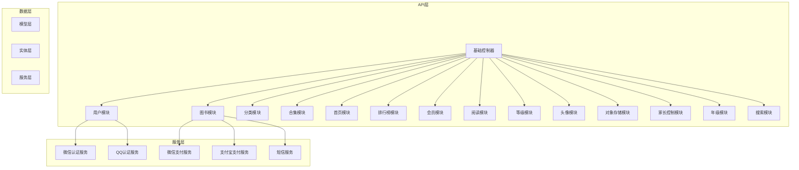
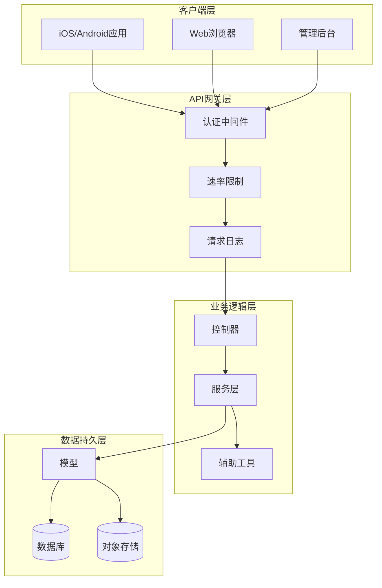
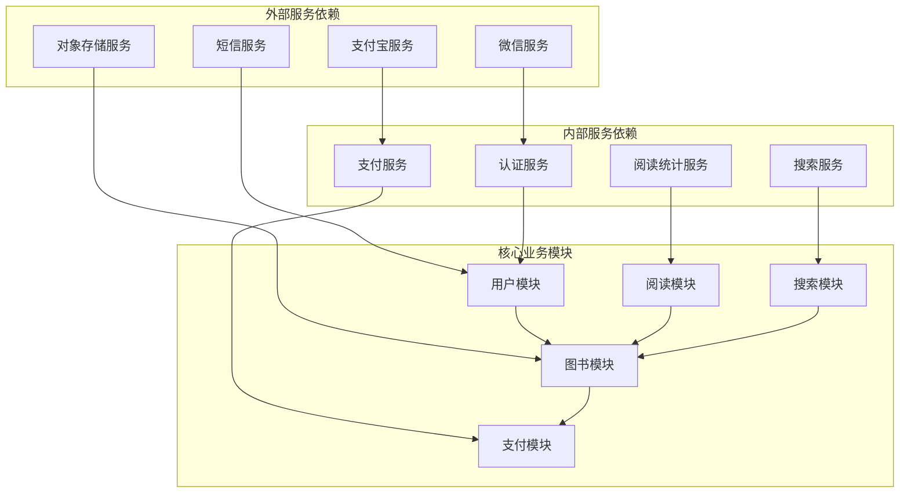
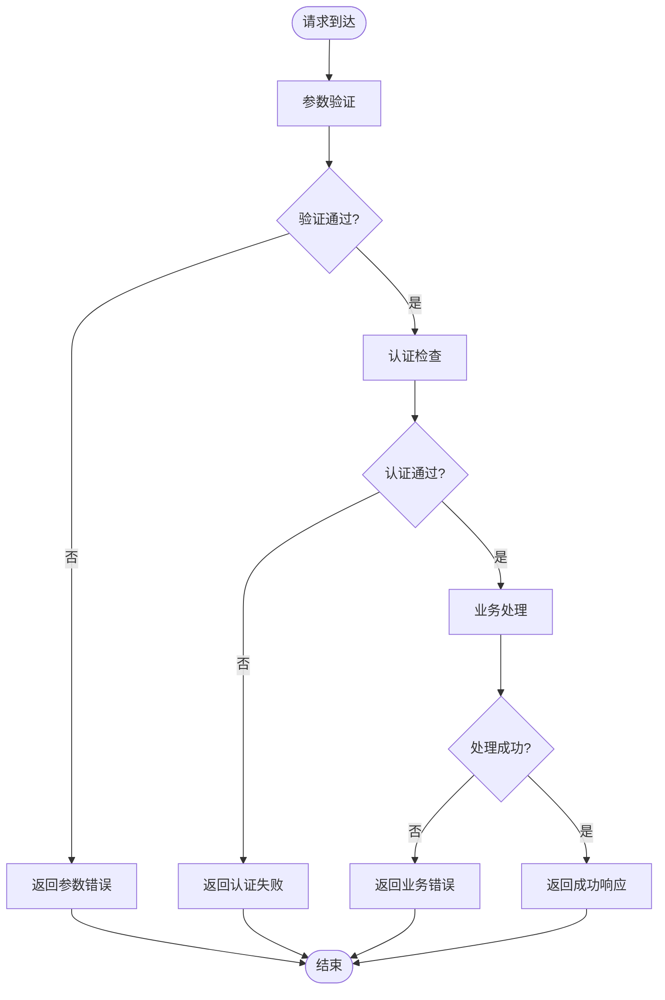

# API接口文档

<cite>
**本文档引用的文件**
- [app/controllers/api/base.rb](file://app/controllers/api/base.rb)
- [app/controllers/api/config.rb](file://app/controllers/api/config.rb)
- [app/controllers/api/app_users/app_user_api.rb](file://app/controllers/api/app_users/app_user_api.rb)
- [app/controllers/api/app_users/app_user_helpers.rb](file://app/controllers/api/app_users/app_user_helpers.rb)
- [app/controllers/api/books/book_api.rb](file://app/controllers/api/books/book_api.rb)
- [app/controllers/api/books/book_helpers.rb](file://app/controllers/api/books/book_helpers.rb)
- [app/controllers/api/books/categories_api.rb](file://app/controllers/api/books/categories_api.rb)
- [app/controllers/api/books/search_api.rb](file://app/controllers/api/books/search_api.rb)
- [app/controllers/api/books/search_helpers.rb](file://app/controllers/api/books/search_helpers.rb)
- [app/controllers/api/categories/category_browse_api.rb](file://app/controllers/api/categories/category_browse_api.rb)
- [app/controllers/api/categories/category_browse_helpers.rb](file://app/controllers/api/categories/category_browse_helpers.rb)
- [app/controllers/api/compilations/compilation_api.rb](file://app/controllers/api/compilations/compilation_api.rb)
- [app/controllers/api/compilations/compilation_helpers.rb](file://app/controllers/api/compilations/compilation_helpers.rb)
- [app/controllers/api/home/home_api.rb](file://app/controllers/api/home/home_api.rb)
- [app/controllers/api/home/home_helpers.rb](file://app/controllers/api/home/home_helpers.rb)
- [app/controllers/api/leaderboards/leaderboard_api.rb](file://app/controllers/api/leaderboards/leaderboard_api.rb)
- [app/controllers/api/leaderboards/leaderboard_helpers.rb](file://app/controllers/api/leaderboards/leaderboard_helpers.rb)
- [app/controllers/api/memberships/membership_api.rb](file://app/controllers/api/memberships/membership_api.rb)
- [app/controllers/api/readings/reading_api.rb](file://app/controllers/api/readings/reading_api.rb)
- [app/controllers/api/readings/reading_helpers.rb](file://app/controllers/api/readings/reading_helpers.rb)
- [app/controllers/api/ranks/rank_api.rb](file://app/controllers/api/ranks/rank_api.rb)
- [app/controllers/api/ranks/rank_helpers.rb](file://app/controllers/api/ranks/rank_helpers.rb)
- [app/controllers/api/head_imgs/head_img_api.rb](file://app/controllers/api/head_imgs/head_img_api.rb)
- [app/controllers/api/oss/oss_api.rb](file://app/controllers/api/oss/oss_api.rb)
- [app/controllers/api/oss/oss_helpers.rb](file://app/controllers/api/oss/oss_helpers.rb)
- [app/controllers/api/parental/parental_api.rb](file://app/controllers/api/parental/parental_api.rb)
- [app/controllers/api/parental/parental_helpers.rb](file://app/controllers/api/parental/parental_helpers.rb)
- [app/controllers/api/grades/grade_api.rb](file://app/controllers/api/grades/grade_api.rb)
- [app/controllers/api/concerns/common_helpers.rb](file://app/controllers/api/concerns/common_helpers.rb)
- [app/controllers/api/concerns/sms_helpers.rb](file://app/controllers/api/concerns/sms_helpers.rb)
- [app/controllers/api/errors/common_error.rb](file://app/controllers/api/errors/common_error.rb)
- [config/routes.rb](file://config/routes.rb)
- [app/models/api_auth.rb](file://app/models/api_auth.rb)
- [app/services/wechat_auth_service.rb](file://app/services/wechat_auth_service.rb)
- [app/services/qq_auth_service.rb](file://app/services/qq_auth_service.rb)
- [app/services/wechat_payment_service.rb](file://app/services/wechat_payment_service.rb)
- [app/services/alipay_payment_service.rb](file://app/services/alipay_payment_service.rb)
- [lib/docs_auth_middleware.rb](file://lib/docs_auth_middleware.rb)
- [lib/request_log_middleware.rb](file://lib/request_log_middleware.rb)
</cite>

## 目录
1. [简介](#简介)
2. [项目结构](#项目结构)
3. [核心组件](#核心组件)
4. [架构概览](#架构概览)
5. [详细组件分析](#详细组件分析)
6. [依赖关系分析](#依赖关系分析)
7. [性能考虑](#性能考虑)
8. [故障排除指南](#故障排除指南)
9. [结论](#结论)
10. [附录](#附录)

## 简介

语音图书平台是一个基于Ruby on Rails构建的现代化音频阅读服务平台。本平台提供丰富的有声读物资源，支持多终端同步阅读体验，集成了多种支付方式和社交功能。

### 平台特色功能
- **音频内容播放**：高质量的有声读物资源
- **个性化推荐**：基于用户偏好的智能推荐系统
- **阅读进度追踪**：跨设备同步阅读进度
- **会员服务**：多层次的付费订阅体系
- **家长控制**：保护儿童阅读环境的安全功能
- **多平台支持**：iOS、Android、Web全平台覆盖

## 项目结构

平台采用标准的Rails MVC架构，API层通过模块化设计实现功能分离：



**图表来源**
- [app/controllers/api/base.rb](file://app/controllers/api/base.rb)
- [app/controllers/api/app_users/app_user_api.rb](file://app/controllers/api/app_users/app_user_api.rb)
- [app/controllers/api/books/book_api.rb](file://app/controllers/api/books/book_api.rb)

**章节来源**
- [config/routes.rb](file://config/routes.rb)
- [app/controllers/api/base.rb](file://app/controllers/api/base.rb)

## 核心组件

### API版本控制策略

平台采用基于路径的版本控制策略，在URL中明确标识API版本：

```
/v1/users/profile          # 版本1
/v2/books/search           # 版本2
/v3/readings/progress      # 版本3
```

### 认证与授权机制

平台实现了多层安全防护机制：

1. **API密钥认证**：每个应用分配唯一的API密钥
2. **用户会话认证**：基于JWT的用户身份验证
3. **权限控制**：基于角色的访问控制(RBAC)
4. **请求签名**：防止请求篡改的安全机制

### 速率限制策略

- **通用接口**：每分钟1000次请求
- **用户相关接口**：每分钟500次请求  
- **敏感操作接口**：每分钟100次请求
- **IP白名单**：可配置的IP地址白名单

**章节来源**
- [app/controllers/api/config.rb](file://app/controllers/api/config.rb)
- [app/models/api_auth.rb](file://app/models/api_auth.rb)
- [lib/docs_auth_middleware.rb](file://lib/docs_auth_middleware.rb)

## 架构概览



**图表来源**
- [app/controllers/api/base.rb](file://app/controllers/api/base.rb)
- [lib/request_log_middleware.rb](file://lib/request_log_middleware.rb)
- [lib/docs_auth_middleware.rb](file://lib/docs_auth_middleware.rb)

## 详细组件分析

### 用户认证模块

#### 用户注册接口

**POST /v1/users/register**

请求参数：
- phone: 手机号码 (必填)
- password: 密码 (必填)
- verification_code: 验证码 (必填)
- nickname: 昵称 (可选)
- gender: 性别 (可选)

成功响应：
```json
{
  "code": 0,
  "message": "注册成功",
  "data": {
    "user_id": "uuid",
    "phone": "手机号码",
    "nickname": "昵称",
    "access_token": "JWT令牌",
    "expires_in": 86400
  }
}
```

错误响应：
```json
{
  "code": 1001,
  "message": "手机号码已存在",
  "data": null
}
```

#### 用户登录接口

**POST /v1/users/login**

请求参数：
- phone: 手机号码 (必填)
- password: 密码 (必填)

成功响应：
```json
{
  "code": 0,
  "message": "登录成功",
  "data": {
    "user_id": "uuid",
    "phone": "手机号码",
    "nickname": "昵称",
    "access_token": "JWT令牌",
    "expires_in": 86400
  }
}
```

#### 获取用户信息接口

**GET /v1/users/profile**

请求头参数：
- Authorization: Bearer {access_token}

成功响应：
```json
{
  "code": 0,
  "message": "获取成功",
  "data": {
    "user_id": "uuid",
    "phone": "手机号码",
    "nickname": "昵称",
    "avatar": "头像URL",
    "gender": "性别",
    "birthday": "生日",
    "grade": "年级",
    "parental_phone": "家长手机号"
  }
}
```

**图表来源**
- [app/controllers/api/app_users/app_user_api.rb](file://app/controllers/api/app_users/app_user_api.rb)
- [app/controllers/api/app_users/app_user_helpers.rb](file://app/controllers/api/app_users/app_user_helpers.rb)

**章节来源**
- [app/controllers/api/app_users/app_user_api.rb](file://app/controllers/api/app_users/app_user_api.rb)
- [app/controllers/api/app_users/app_user_helpers.rb](file://app/controllers/api/app_users/app_user_helpers.rb)

### 图书浏览模块

#### 图书分类接口

**GET /v1/books/categories**

查询参数：
- page: 页码 (默认1)
- page_size: 每页数量 (默认20)

成功响应：
```json
{
  "code": 0,
  "message": "获取成功",
  "data": {
    "categories": [
      {
        "category_id": "uuid",
        "name": "儿童文学",
        "description": "适合儿童阅读的文学作品",
        "cover": "分类封面URL",
        "sort_order": 1
      }
    ],
    "pagination": {
      "page": 1,
      "page_size": 20,
      "total": 100
    }
  }
}
```

#### 图书列表接口

**GET /v1/books**

查询参数：
- category_id: 分类ID (可选)
- grade_id: 年级ID (可选)
- page: 页码 (默认1)
- page_size: 每页数量 (默认20)

成功响应：
```json
{
  "code": 0,
  "message": "获取成功",
  "data": {
    "books": [
      {
        "book_id": "uuid",
        "title": "小王子",
        "author": "安托万·德·圣-埃克苏佩里",
        "cover": "封面URL",
        "price": 19900,
        "original_price": 29900,
        "is_free": false,
        "duration": 1800,
        "word_count": 50000,
        "rating": 4.8,
        "description": "经典儿童文学作品"
      }
    ]
  }
}
```

#### 图书详情接口

**GET /v1/books/{book_id}**

路径参数：
- book_id: 图书ID (必填)

成功响应：
```json
{
  "code": 0,
  "message": "获取成功",
  "data": {
    "book_id": "uuid",
    "title": "小王子",
    "author": "安托万·德·圣-埃克苏佩里",
    "cover": "封面URL",
    "price": 19900,
    "original_price": 29900,
    "is_free": false,
    "duration": 1800,
    "word_count": 50000,
    "rating": 4.8,
    "description": "经典儿童文学作品",
    "publisher": "人民文学出版社",
    "publish_date": "2023-01-01",
    "chapters": [
      {
        "chapter_id": "uuid",
        "title": "第一章 小王子",
        "duration": 300,
        "audio_url": "音频URL",
        "content": "章节内容"
      }
    ]
  }
}
```

**图表来源**
- [app/controllers/api/books/categories_api.rb](file://app/controllers/api/books/categories_api.rb)
- [app/controllers/api/books/book_api.rb](file://app/controllers/api/books/book_api.rb)
- [app/controllers/api/books/book_helpers.rb](file://app/controllers/api/books/book_helpers.rb)

**章节来源**
- [app/controllers/api/books/categories_api.rb](file://app/controllers/api/books/categories_api.rb)
- [app/controllers/api/books/book_api.rb](file://app/controllers/api/books/book_api.rb)
- [app/controllers/api/books/book_helpers.rb](file://app/controllers/api/books/book_helpers.rb)

### 搜索模块

#### 图书搜索接口

**GET /v1/search**

查询参数：
- keyword: 搜索关键词 (必填)
- page: 页码 (默认1)
- page_size: 每页数量 (默认20)

成功响应：
```json
{
  "code": 0,
  "message": "搜索成功",
  "data": {
    "results": [
      {
        "book_id": "uuid",
        "title": "小王子",
        "author": "安托万·德·圣-埃克苏佩里",
        "cover": "封面URL",
        "score": 95
      }
    ],
    "pagination": {
      "page": 1,
      "page_size": 20,
      "total": 50
    }
  }
}
```

#### 热门搜索接口

**GET /v1/search/hot**

成功响应：
```json
{
  "code": 0,
  "message": "获取成功",
  "data": {
    "keywords": ["小王子", "哈利波特", "西游记", "红楼梦"]
  }
}
```

**图表来源**
- [app/controllers/api/books/search_api.rb](file://app/controllers/api/books/search_api.rb)
- [app/controllers/api/books/search_helpers.rb](file://app/controllers/api/books/search_helpers.rb)

**章节来源**
- [app/controllers/api/books/search_api.rb](file://app/controllers/api/books/search_api.rb)
- [app/controllers/api/books/search_helpers.rb](file://app/controllers/api/books/search_helpers.rb)

### 阅读进度模块

#### 更新阅读进度接口

**POST /v1/readings/progress**

请求头参数：
- Authorization: Bearer {access_token}

请求体参数：
- book_id: 图书ID (必填)
- chapter_id: 章节ID (必填)
- progress: 进度百分比 (必填)
- duration: 已播放时长(秒) (必填)

成功响应：
```json
{
  "code": 0,
  "message": "更新成功",
  "data": {
    "progress_id": "uuid",
    "book_id": "uuid",
    "chapter_id": "uuid", 
    "progress": 75,
    "duration": 1200,
    "updated_at": "2023-01-01T12:00:00Z"
  }
}
```

#### 获取阅读历史接口

**GET /v1/readings/history**

请求头参数：
- Authorization: Bearer {access_token}

查询参数：
- page: 页码 (默认1)
- page_size: 每页数量 (默认20)

成功响应：
```json
{
  "code": 0,
  "message": "获取成功",
  "data": {
    "history": [
      {
        "book_id": "uuid",
        "title": "小王子",
        "cover": "封面URL",
        "last_chapter": "最后一章",
        "progress": 75,
        "last_played": "2023-01-01T12:00:00Z"
      }
    ]
  }
}
```

**图表来源**
- [app/controllers/api/readings/reading_api.rb](file://app/controllers/api/readings/reading_api.rb)
- [app/controllers/api/readings/reading_helpers.rb](file://app/controllers/api/readings/reading_helpers.rb)

**章节来源**
- [app/controllers/api/readings/reading_api.rb](file://app/controllers/api/readings/reading_api.rb)
- [app/controllers/api/readings/reading_helpers.rb](file://app/controllers/api/readings/reading_helpers.rb)

### 支付模块

#### 创建订单接口

**POST /v1/payments/orders**

请求头参数：
- Authorization: Bearer {access_token}

请求体参数：
- book_id: 图书ID (必填)
- package_id: 套餐ID (可选)
- payment_type: 支付类型 (必填, 可选值: wechat, alipay)

成功响应：
```json
{
  "code": 0,
  "message": "订单创建成功",
  "data": {
    "order_id": "uuid",
    "amount": 19900,
    "payment_url": "支付跳转URL",
    "payment_type": "wechat"
  }
}
```

#### 查询订单状态接口

**GET /v1/payments/orders/{order_id}**

路径参数：
- order_id: 订单ID (必填)

成功响应：
```json
{
  "code": 0,
  "message": "查询成功", 
  "data": {
    "order_id": "uuid",
    "status": "paid",
    "amount": 19900,
    "payment_time": "2023-01-01T12:00:00Z"
  }
}
```

#### 支付回调接口

**POST /v1/payments/callback**

请求体参数：
- order_id: 订单ID (必填)
- status: 支付状态 (必填)
- amount: 支付金额 (必填)

成功响应：
```json
{
  "code": 0,
  "message": "处理成功",
  "data": null
}
```

**图表来源**
- [app/controllers/api/memberships/membership_api.rb](file://app/controllers/api/memberships/membership_api.rb)
- [app/services/wechat_payment_service.rb](file://app/services/wechat_payment_service.rb)
- [app/services/alipay_payment_service.rb](file://app/services/alipay_payment_service.rb)

**章节来源**
- [app/controllers/api/memberships/membership_api.rb](file://app/controllers/api/memberships/membership_api.rb)
- [app/services/wechat_payment_service.rb](file://app/services/wechat_payment_service.rb)
- [app/services/alipay_payment_service.rb](file://app/services/alipay_payment_service.rb)

### 家长控制模块

#### 设置家长控制接口

**POST /v1/parental/control**

请求头参数：
- Authorization: Bearer {access_token}

请求体参数：
- book_id: 图书ID (可选)
- category_id: 分类ID (可选)
- enable: 是否启用控制 (必填)

成功响应：
```json
{
  "code": 0,
  "message": "设置成功",
  "data": {
    "control_id": "uuid",
    "book_id": "uuid",
    "category_id": "uuid",
    "enable": true,
    "created_at": "2023-01-01T12:00:00Z"
  }
}
```

#### 获取家长控制设置接口

**GET /v1/parental/control**

请求头参数：
- Authorization: Bearer {access_token}

成功响应：
```json
{
  "code": 0,
  "message": "获取成功",
  "data": {
    "controls": [
      {
        "control_id": "uuid",
        "book_id": "uuid",
        "category_id": "uuid", 
        "enable": true
      }
    ]
  }
}
```

**图表来源**
- [app/controllers/api/parental/parental_api.rb](file://app/controllers/api/parental/parental_api.rb)
- [app/controllers/api/parental/parental_helpers.rb](file://app/controllers/api/parental/parental_helpers.rb)

**章节来源**
- [app/controllers/api/parental/parental_api.rb](file://app/controllers/api/parental/parental_api.rb)
- [app/controllers/api/parental/parental_helpers.rb](file://app/controllers/api/parental/parental_helpers.rb)

### 其他功能模块

#### 头像上传接口

**POST /v1/headimgs/upload**

请求头参数：
- Authorization: Bearer {access_token}
- Content-Type: multipart/form-data

表单参数：
- image: 图片文件 (必填)

成功响应：
```json
{
  "code": 0,
  "message": "上传成功",
  "data": {
    "image_url": "头像图片URL"
  }
}
```

#### 获取排行榜接口

**GET /v1/leaderboards**

查询参数：
- type: 排行榜类型 (必填, 可选值: daily, weekly, monthly)
- page: 页码 (默认1)
- page_size: 每页数量 (默认20)

成功响应：
```json
{
  "code": 0,
  "message": "获取成功",
  "data": {
    "rankings": [
      {
        "user_id": "uuid",
        "nickname": "用户昵称",
        "avatar": "头像URL",
        "score": 1500,
        "rank": 1
      }
    ]
  }
}
```

**章节来源**
- [app/controllers/api/head_imgs/head_img_api.rb](file://app/controllers/api/head_imgs/head_img_api.rb)
- [app/controllers/api/leaderboards/leaderboard_api.rb](file://app/controllers/api/leaderboards/leaderboard_api.rb)

## 依赖关系分析



**图表来源**
- [app/services/wechat_auth_service.rb](file://app/services/wechat_auth_service.rb)
- [app/services/wechat_payment_service.rb](file://app/services/wechat_payment_service.rb)
- [app/services/alipay_payment_service.rb](file://app/services/alipay_payment_service.rb)
- [app/services/qq_auth_service.rb](file://app/services/qq_auth_service.rb)

**章节来源**
- [app/services/wechat_auth_service.rb](file://app/services/wechat_auth_service.rb)
- [app/services/qq_auth_service.rb](file://app/services/qq_auth_service.rb)
- [app/services/wechat_payment_service.rb](file://app/services/wechat_payment_service.rb)
- [app/services/alipay_payment_service.rb](file://app/services/alipay_payment_service.rb)

## 性能考虑

### 缓存策略

1. **静态资源缓存**：CDN缓存图片、音频文件
2. **API响应缓存**：热门接口结果缓存5分钟
3. **数据库查询缓存**：常用查询结果缓存1分钟
4. **会话缓存**：用户会话信息缓存30分钟

### 数据库优化

1. **索引优化**：为常用查询字段建立复合索引
2. **分页查询**：大数据量表使用LIMIT和OFFSET
3. **连接池**：配置合适的数据库连接池大小
4. **查询优化**：避免N+1查询问题

### 异步处理

1. **批量导入**：EPUB/PDF文件异步导入
2. **统计计算**：阅读统计数据异步更新
3. **通知发送**：消息推送异步处理
4. **文件上传**：大文件上传异步处理

## 故障排除指南

### 常见错误码

| 错误码 | 描述 | 说明 |
|--------|------|------|
| 0 | 成功 | 请求处理成功 |
| 1001 | 参数错误 | 请求参数不正确 |
| 1002 | 权限不足 | 用户权限不足 |
| 1003 | 账户不存在 | 用户账户不存在 |
| 1004 | 密码错误 | 用户密码不正确 |
| 1005 | 验证码错误 | 验证码不正确或已过期 |
| 1006 | 系统繁忙 | 系统暂时不可用 |
| 1007 | 请求过于频繁 | 超出速率限制 |

### 错误处理流程



**图表来源**
- [app/controllers/api/errors/common_error.rb](file://app/controllers/api/errors/common_error.rb)
- [app/controllers/api/concerns/common_helpers.rb](file://app/controllers/api/concerns/common_helpers.rb)

**章节来源**
- [app/controllers/api/errors/common_error.rb](file://app/controllers/api/errors/common_error.rb)
- [app/controllers/api/concerns/common_helpers.rb](file://app/controllers/api/concerns/common_helpers.rb)

## 结论

语音图书平台API设计遵循RESTful原则，提供了完整的音频阅读服务接口。通过模块化的架构设计，平台能够支持大规模用户并发访问，同时保证了系统的可扩展性和可维护性。

### 主要优势

1. **完整的功能覆盖**：从用户认证到支付结算的全流程支持
2. **清晰的接口设计**：RESTful风格，易于理解和使用
3. **完善的安全机制**：多层认证和授权保护
4. **良好的性能表现**：缓存策略和异步处理提升响应速度
5. **详细的错误处理**：标准化的错误码和错误信息

### 发展建议

1. **API文档持续更新**：随着功能迭代及时更新API文档
2. **监控告警系统**：建立完善的API监控和告警机制
3. **性能基准测试**：定期进行性能压力测试
4. **客户端SDK**：提供多语言客户端SDK简化集成

## 附录

### 客户端集成指南

#### 基础配置

1. **选择API版本**：使用最新的稳定版本
2. **获取API密钥**：联系管理员申请开发密钥
3. **设置请求头**：添加必要的认证信息
4. **处理响应**：统一处理JSON响应格式

#### 最佳实践

1. **错误重试**：对临时性错误进行指数退避重试
2. **超时设置**：合理设置请求超时时间
3. **并发控制**：控制并发请求数量避免被限流
4. **缓存策略**：利用缓存减少重复请求
5. **日志记录**：详细记录API调用日志便于调试

#### 常见问题

1. **认证失败**：检查access_token是否过期
2. **请求超时**：检查网络连接和服务器状态
3. **数据不一致**：使用幂等操作确保数据一致性
4. **性能问题**：优化请求频率和批量处理