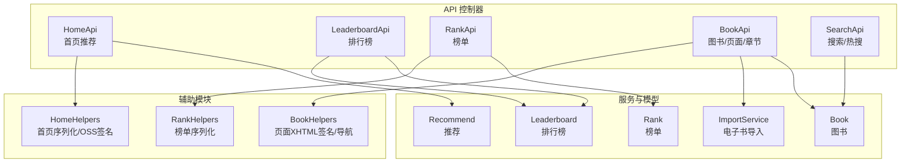
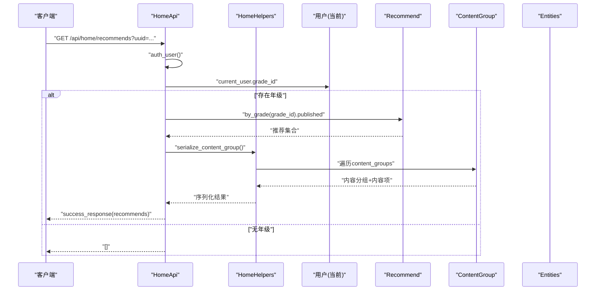
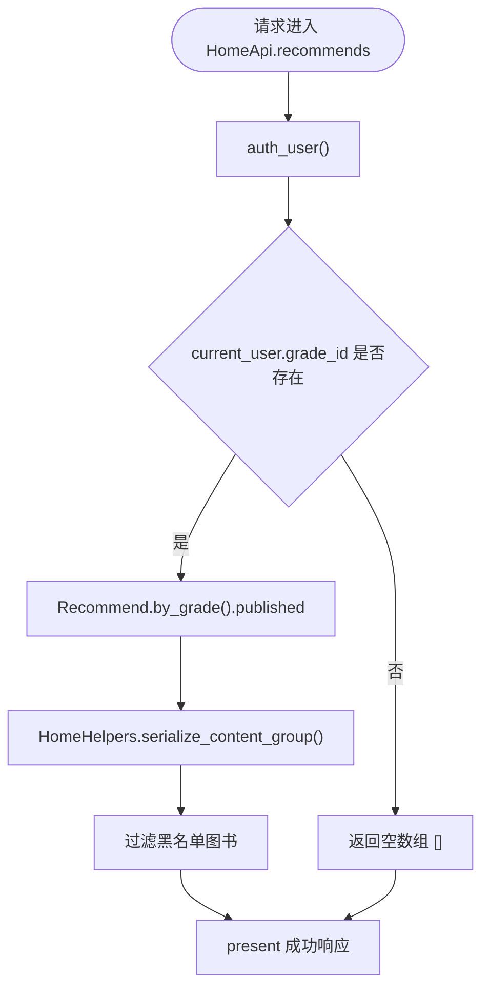
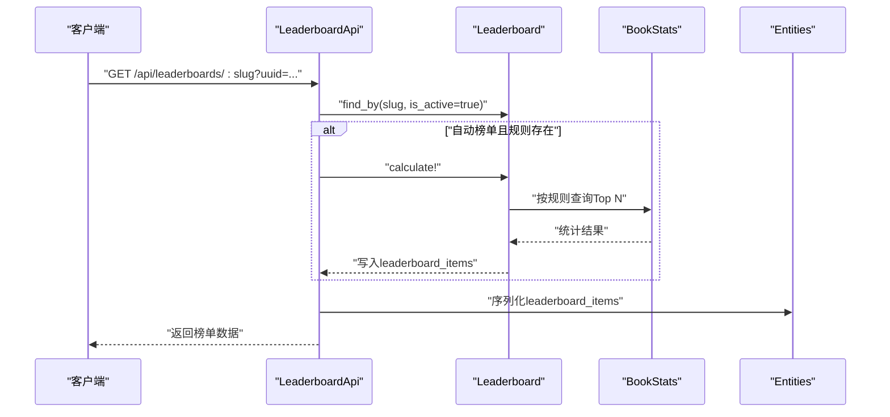
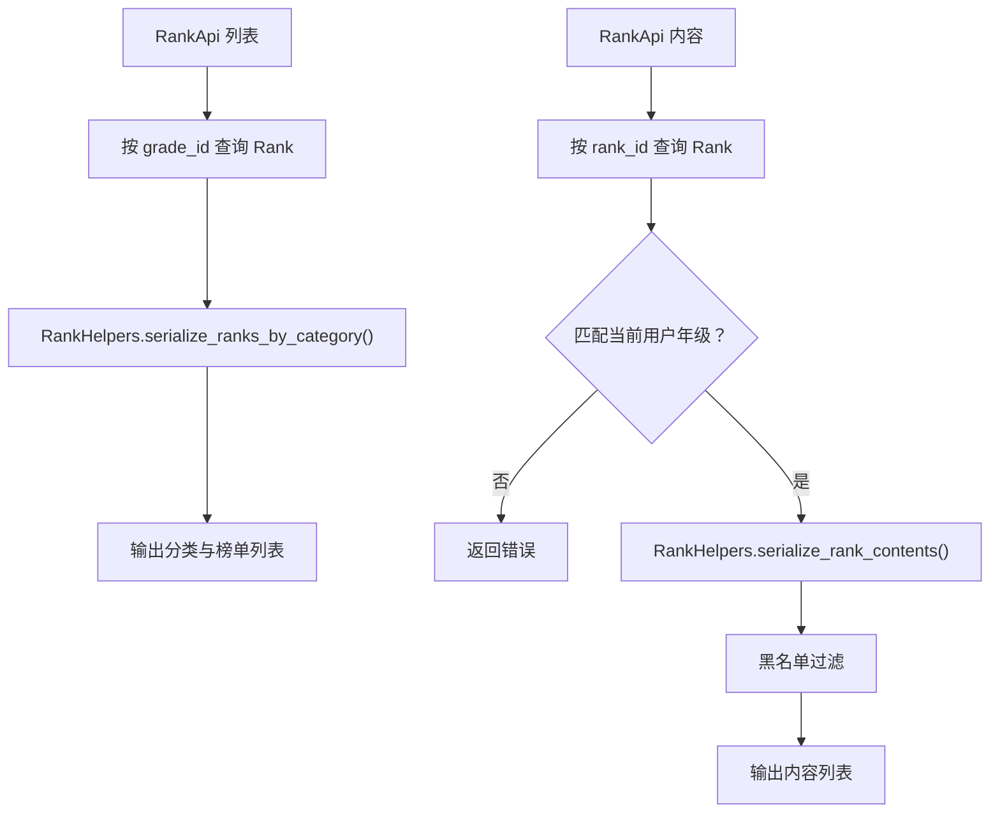
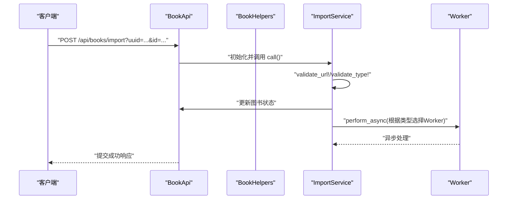
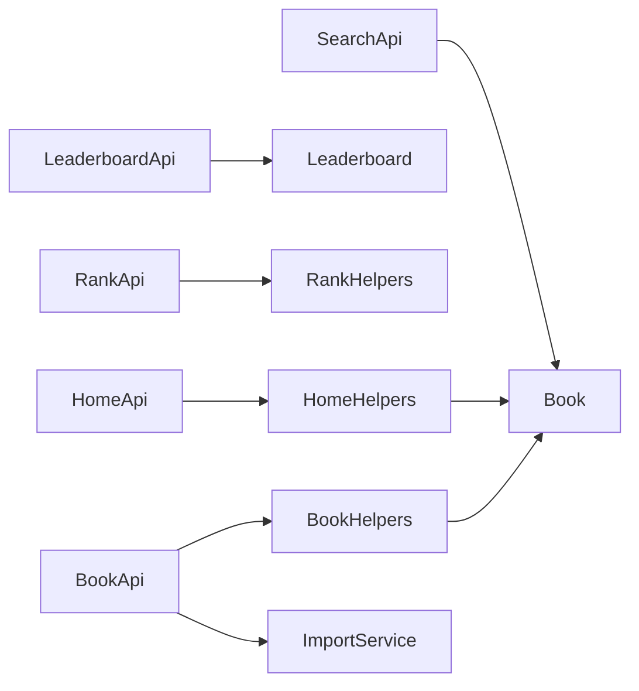

# 内容管理API

<cite>
**本文引用的文件**
- [app/controllers/api/home/home_api.rb](file://app/controllers/api/home/home_api.rb)
- [app/controllers/api/home/home_helpers.rb](file://app/controllers/api/home/home_helpers.rb)
- [app/controllers/api/leaderboards/leaderboard_api.rb](file://app/controllers/api/leaderboards/leaderboard_api.rb)
- [app/controllers/api/ranks/rank_api.rb](file://app/controllers/api/ranks/rank_api.rb)
- [app/controllers/api/ranks/rank_helpers.rb](file://app/controllers/api/ranks/rank_helpers.rb)
- [app/controllers/api/books/book_api.rb](file://app/controllers/api/books/book_api.rb)
- [app/controllers/api/books/book_helpers.rb](file://app/controllers/api/books/book_helpers.rb)
- [app/controllers/api/books/search_api.rb](file://app/controllers/api/books/search_api.rb)
- [app/models/recommend.rb](file://app/models/recommend.rb)
- [app/models/leaderboard.rb](file://app/models/leaderboard.rb)
- [app/models/rank.rb](file://app/models/rank.rb)
- [app/models/book.rb](file://app/models/book.rb)
- [app/services/ebook/import_service.rb](file://app/services/ebook/import_service.rb)
</cite>

## 目录
1. [引言](#引言)
2. [项目结构](#项目结构)
3. [核心组件](#核心组件)
4. [架构总览](#架构总览)
5. [详细组件分析](#详细组件分析)
6. [依赖关系分析](#依赖关系分析)
7. [性能考虑](#性能考虑)
8. [故障排查指南](#故障排查指南)
9. [结论](#结论)
10. [附录](#附录)

## 引言
本文件面向内容管理API，系统性梳理首页内容展示、推荐算法、排行榜与热门榜单等核心能力，明确内容分发策略、个性化推荐机制、内容更新频率与缓存优化方案，并补充内容审核流程、违规处理与内容安全策略，以及内容质量评估指标与用户反馈处理机制。

## 项目结构
- API层采用Grape框架，按功能域划分控制器模块：首页、排行榜、榜单、图书、搜索等。
- 控制器通过helpers封装通用序列化与OSS签名逻辑；服务层负责异步任务调度（如电子书导入）。
- 模型层定义推荐、排行榜、榜单、图书等实体及常用作用域与计算逻辑。
- 数据库迁移文件体现核心表结构与索引设计，支撑内容分发与统计。

**图表来源**
- [app/controllers/api/home/home_api.rb:1-42](file://app/controllers/api/home/home_api.rb#L1-L42)
- [app/controllers/api/leaderboards/leaderboard_api.rb:1-53](file://app/controllers/api/leaderboards/leaderboard_api.rb#L1-L53)
- [app/controllers/api/ranks/rank_api.rb:1-56](file://app/controllers/api/ranks/rank_api.rb#L1-L56)
- [app/controllers/api/books/book_api.rb:1-242](file://app/controllers/api/books/book_api.rb#L1-L242)
- [app/controllers/api/books/search_api.rb:1-128](file://app/controllers/api/books/search_api.rb#L1-L128)
- [app/controllers/api/home/home_helpers.rb:1-114](file://app/controllers/api/home/home_helpers.rb#L1-L114)
- [app/controllers/api/books/book_helpers.rb:1-110](file://app/controllers/api/books/book_helpers.rb#L1-L110)
- [app/controllers/api/ranks/rank_helpers.rb:1-32](file://app/controllers/api/ranks/rank_helpers.rb#L1-L32)
- [app/services/ebook/import_service.rb:1-70](file://app/services/ebook/import_service.rb#L1-L70)
- [app/models/recommend.rb:1-40](file://app/models/recommend.rb#L1-L40)
- [app/models/leaderboard.rb:1-61](file://app/models/leaderboard.rb#L1-L61)
- [app/models/rank.rb:1-38](file://app/models/rank.rb#L1-L38)
- [app/models/book.rb:1-157](file://app/models/book.rb#L1-L157)

**章节来源**
- [app/controllers/api/home/home_api.rb:1-42](file://app/controllers/api/home/home_api.rb#L1-L42)
- [app/controllers/api/leaderboards/leaderboard_api.rb:1-53](file://app/controllers/api/leaderboards/leaderboard_api.rb#L1-L53)
- [app/controllers/api/ranks/rank_api.rb:1-56](file://app/controllers/api/ranks/rank_api.rb#L1-L56)
- [app/controllers/api/books/book_api.rb:1-242](file://app/controllers/api/books/book_api.rb#L1-L242)
- [app/controllers/api/books/search_api.rb:1-128](file://app/controllers/api/books/search_api.rb#L1-L128)

## 核心组件
- 首页推荐（HomeApi）
  - 获取仅推荐层级的推荐列表，按用户年级筛选已发布推荐。
  - 获取指定推荐的详细内容（含内容分组、内容项、图片签名）。
- 排行榜（LeaderboardApi）
  - 获取所有启用的排行榜。
  - 获取指定排行榜的书籍列表，支持自动榜单实时计算。
- 榜单（RankApi）
  - 根据用户年级获取排行榜列表（含分类维度）。
  - 获取指定排行榜的内容（图书或合集）并进行家长控制过滤。
- 图书（BookApi）
  - 合集资源、图书详情、章节URL、目录、电子书导入、页面清单、单页内容、XHTML内容、样式表、批量封面。
- 搜索（SearchApi）
  - 搜索图书、热门关键词、按作者查询、排行榜、热搜榜单。
- 辅助模块（HomeHelpers/BookHelpers/RankHelpers）
  - 统一序列化推荐内容分组、图书、作者、子推荐等。
  - 统一处理OSS签名（含XHTML内CSS与资源链接替换）。
- 服务与模型
  - ImportService：校验URL与类型、更新图书状态、入队异步导入Worker。
  - Recommend/Leaderboard/Rank/Book：定义实体、枚举、作用域与计算逻辑。

**章节来源**
- [app/controllers/api/home/home_api.rb:10-38](file://app/controllers/api/home/home_api.rb#L10-L38)
- [app/controllers/api/leaderboards/leaderboard_api.rb:11-47](file://app/controllers/api/leaderboards/leaderboard_api.rb#L11-L47)
- [app/controllers/api/ranks/rank_api.rb:14-51](file://app/controllers/api/ranks/rank_api.rb#L14-L51)
- [app/controllers/api/books/book_api.rb:13-237](file://app/controllers/api/books/book_api.rb#L13-L237)
- [app/controllers/api/books/search_api.rb:14-123](file://app/controllers/api/books/search_api.rb#L14-L123)
- [app/controllers/api/home/home_helpers.rb:9-110](file://app/controllers/api/home/home_helpers.rb#L9-L110)
- [app/controllers/api/books/book_helpers.rb:32-80](file://app/controllers/api/books/book_helpers.rb#L32-L80)
- [app/controllers/api/ranks/rank_helpers.rb:9-29](file://app/controllers/api/ranks/rank_helpers.rb#L9-L29)
- [app/services/ebook/import_service.rb:14-67](file://app/services/ebook/import_service.rb#L14-L67)
- [app/models/recommend.rb:25-39](file://app/models/recommend.rb#L25-L39)
- [app/models/leaderboard.rb:18-59](file://app/models/leaderboard.rb#L18-L59)
- [app/models/rank.rb:20-37](file://app/models/rank.rb#L20-L37)
- [app/models/book.rb:57-157](file://app/models/book.rb#L57-L157)

## 架构总览
内容管理API围绕“用户鉴权 → 业务控制器 → 序列化助手 → 模型/服务 → 外部存储”的链路组织。首页与榜单均基于用户年级与家长控制进行内容过滤；搜索与排行榜支持多维统计与自动计算；电子书导入采用异步Worker提升吞吐。

**图表来源**
- [app/controllers/api/home/home_api.rb:14-24](file://app/controllers/api/home/home_api.rb#L14-L24)
- [app/controllers/api/home/home_helpers.rb:9-42](file://app/controllers/api/home/home_helpers.rb#L9-L42)
- [app/models/recommend.rb:33-34](file://app/models/recommend.rb#L33-L34)

**章节来源**
- [app/controllers/api/home/home_api.rb:10-38](file://app/controllers/api/home/home_api.rb#L10-L38)
- [app/controllers/api/home/home_helpers.rb:9-42](file://app/controllers/api/home/home_helpers.rb#L9-L42)
- [app/models/recommend.rb:25-39](file://app/models/recommend.rb#L25-L39)

## 详细组件分析

### 首页推荐（HomeApi）
- 功能要点
  - 仅返回当前用户所在年级且已发布的推荐。
  - 支持获取推荐详情（内容分组、内容项、图片签名）。
- 关键流程
  - 用户鉴权后按年级查询推荐，逐条序列化内容分组与内容项。
  - 对内容项按类型映射为合集、图书、作者或子推荐，并对图片URL进行OSS签名。
- 安全与过滤
  - 通过家长控制过滤黑名单图书，避免返回被屏蔽内容。

**图表来源**
- [app/controllers/api/home/home_api.rb:14-24](file://app/controllers/api/home/home_api.rb#L14-L24)
- [app/controllers/api/home/home_helpers.rb:25-42](file://app/controllers/api/home/home_helpers.rb#L25-L42)

**章节来源**
- [app/controllers/api/home/home_api.rb:10-38](file://app/controllers/api/home/home_api.rb#L10-L38)
- [app/controllers/api/home/home_helpers.rb:9-110](file://app/controllers/api/home/home_helpers.rb#L9-L110)

### 排行榜（LeaderboardApi）
- 功能要点
  - 获取所有启用的排行榜。
  - 获取指定排行榜的书籍列表；若为自动榜单且具备规则，则先执行计算。
- 自动榜单计算
  - 基于规则选择统计字段（周/月读者、评分、完成率、最新）并生成榜单项。
  - 使用事务保证计算一致性与原子性。

**图表来源**
- [app/controllers/api/leaderboards/leaderboard_api.rb:31-47](file://app/controllers/api/leaderboards/leaderboard_api.rb#L31-L47)
- [app/models/leaderboard.rb:27-59](file://app/models/leaderboard.rb#L27-L59)

**章节来源**
- [app/controllers/api/leaderboards/leaderboard_api.rb:9-49](file://app/controllers/api/leaderboards/leaderboard_api.rb#L9-L49)
- [app/models/leaderboard.rb:18-59](file://app/models/leaderboard.rb#L18-L59)

### 榜单（RankApi）
- 功能要点
  - 根据用户年级返回该年级下的所有榜单（按分类聚合）。
  - 获取指定榜单的内容（图书或合集），并进行家长控制过滤。
- 序列化与过滤
  - 按分类聚合榜单，输出排序号与名称。
  - 对内容进行黑名单过滤，确保返回安全内容。

**图表来源**
- [app/controllers/api/ranks/rank_api.rb:19-51](file://app/controllers/api/ranks/rank_api.rb#L19-L51)
- [app/controllers/api/ranks/rank_helpers.rb:9-29](file://app/controllers/api/ranks/rank_helpers.rb#L9-L29)
- [app/models/rank.rb:20-37](file://app/models/rank.rb#L20-L37)

**章节来源**
- [app/controllers/api/ranks/rank_api.rb:14-51](file://app/controllers/api/ranks/rank_api.rb#L14-L51)
- [app/controllers/api/ranks/rank_helpers.rb:9-29](file://app/controllers/api/ranks/rank_helpers.rb#L9-L29)
- [app/models/rank.rb:20-37](file://app/models/rank.rb#L20-L37)

### 图书（BookApi）
- 功能要点
  - 合集资源：返回图书与内容项（含签名图片URL）。
  - 图书详情：校验黑名单后返回实体。
  - 章节URL：返回带过期时间的签名URL与时长。
  - 目录、页面清单、单页内容、XHTML预览、样式表。
  - 批量封面：根据book_ids批量返回封面URL。
- XSS与安全
  - 页面XHTML内容中CSS与资源URL统一签名，避免外链失效与跨站风险。
- 电子书导入
  - 校验URL与类型，更新图书状态并入队异步Worker。

**图表来源**
- [app/controllers/api/books/book_api.rb:106-124](file://app/controllers/api/books/book_api.rb#L106-L124)
- [app/services/ebook/import_service.rb:14-67](file://app/services/ebook/import_service.rb#L14-L67)

**章节来源**
- [app/controllers/api/books/book_api.rb:13-237](file://app/controllers/api/books/book_api.rb#L13-L237)
- [app/controllers/api/books/book_helpers.rb:32-80](file://app/controllers/api/books/book_helpers.rb#L32-L80)
- [app/services/ebook/import_service.rb:1-70](file://app/services/ebook/import_service.rb#L1-L70)

### 搜索（SearchApi）
- 功能要点
  - 搜索图书：按书名/作者名检索，记录用户搜索关键词。
  - 热门关键词：按搜索次数降序返回。
  - 按作者查询：按播放量与月度读者排序。
  - 排行榜：支持分类、排行类型与周期过滤。
  - 热搜榜单：支持多种类型与年级过滤。
- 统计与排序
  - 月度读者与播放量联合排序，保障热门与质量兼顾。

**章节来源**
- [app/controllers/api/books/search_api.rb:14-123](file://app/controllers/api/books/search_api.rb#L14-L123)

## 依赖关系分析
- 控制器依赖
  - HomeApi/LeaderboardApi/RankApi/BookApi/SearchApi均依赖CommonHelpers进行鉴权与响应封装。
  - HomeApi/BookApi/RankApi分别依赖对应Helpers进行序列化与OSS签名。
- 模型依赖
  - Recommend/Leaderboard/Rank/Book提供作用域与计算逻辑，被控制器直接调用。
  - Book提供OSS签名工具方法，被BookHelpers与BookApi复用。
- 服务依赖
  - ImportService解耦导入流程，避免阻塞请求线程。

**图表来源**
- [app/controllers/api/home/home_api.rb:1-42](file://app/controllers/api/home/home_api.rb#L1-L42)
- [app/controllers/api/leaderboards/leaderboard_api.rb:1-53](file://app/controllers/api/leaderboards/leaderboard_api.rb#L1-L53)
- [app/controllers/api/ranks/rank_api.rb:1-56](file://app/controllers/api/ranks/rank_api.rb#L1-L56)
- [app/controllers/api/books/book_api.rb:1-242](file://app/controllers/api/books/book_api.rb#L1-L242)
- [app/controllers/api/books/search_api.rb:1-128](file://app/controllers/api/books/search_api.rb#L1-L128)
- [app/controllers/api/home/home_helpers.rb:1-114](file://app/controllers/api/home/home_helpers.rb#L1-L114)
- [app/controllers/api/books/book_helpers.rb:1-110](file://app/controllers/api/books/book_helpers.rb#L1-L110)
- [app/controllers/api/ranks/rank_helpers.rb:1-32](file://app/controllers/api/ranks/rank_helpers.rb#L1-L32)
- [app/services/ebook/import_service.rb:1-70](file://app/services/ebook/import_service.rb#L1-L70)
- [app/models/book.rb:104-141](file://app/models/book.rb#L104-L141)

**章节来源**
- [app/controllers/api/home/home_api.rb:1-42](file://app/controllers/api/home/home_api.rb#L1-L42)
- [app/controllers/api/leaderboards/leaderboard_api.rb:1-53](file://app/controllers/api/leaderboards/leaderboard_api.rb#L1-L53)
- [app/controllers/api/ranks/rank_api.rb:1-56](file://app/controllers/api/ranks/rank_api.rb#L1-L56)
- [app/controllers/api/books/book_api.rb:1-242](file://app/controllers/api/books/book_api.rb#L1-L242)
- [app/controllers/api/books/search_api.rb:1-128](file://app/controllers/api/books/search_api.rb#L1-L128)
- [app/models/book.rb:104-141](file://app/models/book.rb#L104-L141)

## 性能考虑
- 查询优化
  - 控制器中广泛使用includes预加载关联（如content_groups/contents、leaderboard_items/book），减少N+1查询。
  - 作用域与索引（如按年级、状态、排序号）降低数据库扫描成本。
- 缓存与签名
  - OSS资源URL签名带过期时间，避免长期暴露；对XHTML内CSS与资源统一签名，减少二次请求。
- 异步处理
  - 电子书导入通过Worker异步执行，避免请求阻塞。
- 分页与限制
  - 页面清单接口支持分页参数，防止一次性返回过多数据。
- 排序与统计
  - 排行榜与热搜结合播放量、评分、时间等多维指标，兼顾热度与质量。

**章节来源**
- [app/controllers/api/books/book_api.rb:18-41](file://app/controllers/api/books/book_api.rb#L18-L41)
- [app/controllers/api/leaderboards/leaderboard_api.rb:40-47](file://app/controllers/api/leaderboards/leaderboard_api.rb#L40-L47)
- [app/controllers/api/books/book_helpers.rb:54-80](file://app/controllers/api/books/book_helpers.rb#L54-L80)
- [app/services/ebook/import_service.rb:61-67](file://app/services/ebook/import_service.rb#L61-L67)

## 故障排查指南
- 首页推荐为空
  - 检查用户是否设置年级；若无年级返回空数组属预期行为。
  - 确认推荐状态为已发布且按年级正确配置。
- 排行榜不存在或为空
  - 确认slug正确且榜单处于启用状态。
  - 自动榜单需满足规则条件，必要时触发计算。
- 图书/页面访问失败
  - 检查黑名单过滤逻辑，确认家长控制未屏蔽该图书。
  - 确认OSS签名URL有效且未过期。
- 电子书导入报错
  - 检查URL有效性与文件类型（仅支持PDF/EPUB）。
  - 若图书处于处理中或已完成状态，按提示重置状态后重试。

**章节来源**
- [app/controllers/api/home/home_api.rb:17-21](file://app/controllers/api/home/home_api.rb#L17-L21)
- [app/controllers/api/leaderboards/leaderboard_api.rb:34-35](file://app/controllers/api/leaderboards/leaderboard_api.rb#L34-L35)
- [app/controllers/api/books/book_helpers.rb:84-92](file://app/controllers/api/books/book_helpers.rb#L84-L92)
- [app/services/ebook/import_service.rb:45-51](file://app/services/ebook/import_service.rb#L45-L51)

## 结论
本内容管理API以清晰的分层设计实现了首页推荐、排行榜、榜单与图书管理等核心能力。通过家长控制过滤、OSS签名与异步处理，兼顾安全性与性能。建议持续完善自动化计算与缓存策略，进一步提升用户体验与系统稳定性。

## 附录

### 内容分发策略与个性化机制
- 年级维度：推荐、榜单与热搜均按用户年级过滤，确保内容适配。
- 家长控制：黑名单过滤贯穿首页、榜单与图书详情，保障内容安全。
- 排行与热搜：综合播放量、评分、时间等指标，平衡热度与质量。

**章节来源**
- [app/controllers/api/home/home_api.rb:17-21](file://app/controllers/api/home/home_api.rb#L17-L21)
- [app/controllers/api/ranks/rank_api.rb:20-41](file://app/controllers/api/ranks/rank_api.rb#L20-L41)
- [app/controllers/api/books/search_api.rb:86-123](file://app/controllers/api/books/search_api.rb#L86-L123)

### 内容更新频率与缓存优化
- 自动榜单：按规则定期计算并写入榜单项，最后计算时间字段用于追踪。
- OSS签名：章节与页面资源URL带过期时间，减少长期暴露风险。
- 预加载：控制器广泛使用includes，降低查询开销。
- 分页：页面清单接口支持分页，避免大列表一次性传输。

**章节来源**
- [app/models/leaderboard.rb:27-59](file://app/models/leaderboard.rb#L27-L59)
- [app/controllers/api/books/book_api.rb:134-148](file://app/controllers/api/books/book_api.rb#L134-L148)
- [app/controllers/api/books/book_helpers.rb:54-80](file://app/controllers/api/books/book_helpers.rb#L54-L80)

### 内容审核流程、违规处理与内容安全策略
- 审核与状态：图书状态枚举包含草稿、已发布、已下架，便于快速处置。
- 黑名单：通过家长控制与黑名单表实现内容屏蔽。
- 安全：XHTML内CSS与资源URL统一签名，避免外链失效与跨站风险。

**章节来源**
- [app/models/book.rb:81-84](file://app/models/book.rb#L81-L84)
- [app/controllers/api/books/book_helpers.rb:54-80](file://app/controllers/api/books/book_helpers.rb#L54-L80)
- [app/models/book.rb:96-101](file://app/models/book.rb#L96-L101)

### 内容质量评估指标与用户反馈机制
- 评估指标：播放量、评分、月度读者、完成率、最新入库等。
- 用户反馈：搜索关键词记录用于热门词统计与内容偏好分析。

**章节来源**
- [app/controllers/api/books/search_api.rb:24-30](file://app/controllers/api/books/search_api.rb#L24-L30)
- [app/models/leaderboard.rb:33-46](file://app/models/leaderboard.rb#L33-L46)