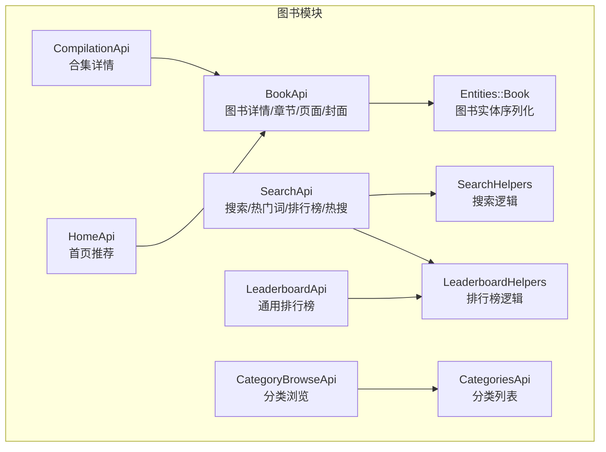
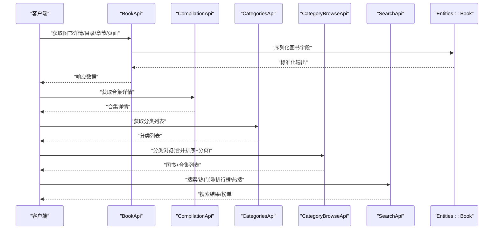
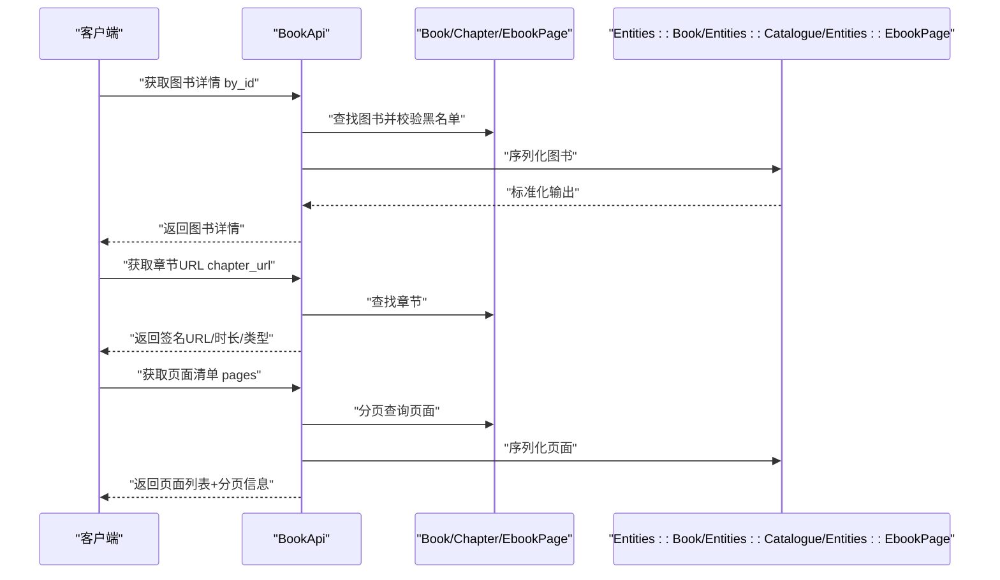
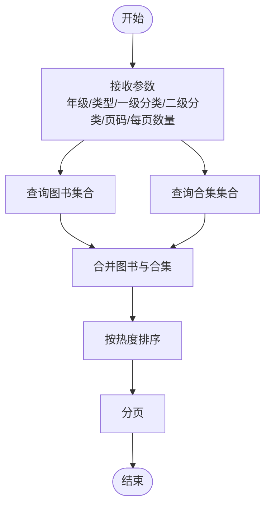
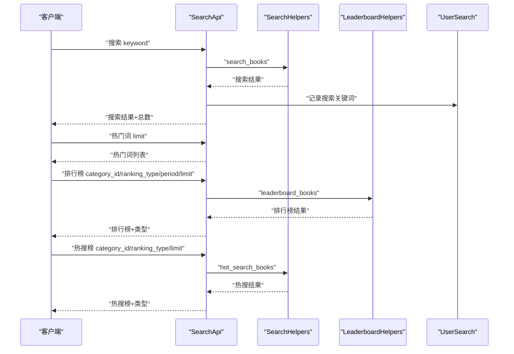
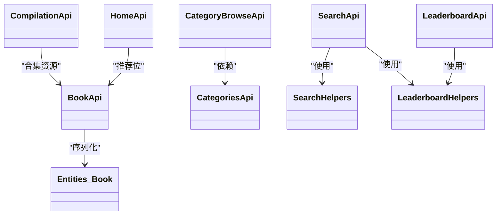

# 图书管理API

<cite>
**本文引用的文件**
- [app/controllers/api/books/book_api.rb](file://app/controllers/api/books/book_api.rb)
- [app/controllers/api/books/categories_api.rb](file://app/controllers/api/books/categories_api.rb)
- [app/controllers/api/books/search_api.rb](file://app/controllers/api/books/search_api.rb)
- [app/controllers/api/books/book_helpers.rb](file://app/controllers/api/books/book_helpers.rb)
- [app/controllers/api/books/search_helpers.rb](file://app/controllers/api/books/search_helpers.rb)
- [app/controllers/api/books/leaderboard_helpers.rb](file://app/controllers/api/books/leaderboard_helpers.rb)
- [app/controllers/api/categories/category_browse_api.rb](file://app/controllers/api/categories/category_browse_api.rb)
- [app/controllers/api/compilations/compilation_api.rb](file://app/controllers/api/compilations/compilation_api.rb)
- [app/controllers/api/leaderboards/leaderboard_api.rb](file://app/controllers/api/leaderboards/leaderboard_api.rb)
- [app/controllers/api/home/home_api.rb](file://app/controllers/api/home/home_api.rb)
- [app/entities/book.rb](file://app/entities/book.rb)
</cite>

## 目录
1. [简介](#简介)
2. [项目结构](#项目结构)
3. [核心组件](#核心组件)
4. [架构总览](#架构总览)
5. [详细组件分析](#详细组件分析)
6. [依赖关系分析](#依赖关系分析)
7. [性能与分页机制](#性能与分页机制)
8. [故障排查指南](#故障排查指南)
9. [结论](#结论)
10. [附录](#附录)

## 简介
本文件为“图书管理API”的全面接口文档，覆盖图书列表查询、分类浏览、图书详情、章节内容访问、搜索、热门推荐、排行榜、合集管理等核心能力。文档同时说明数据结构、内容格式、分页机制与缓存策略，并提供搜索算法、排序规则与过滤条件的使用方法，帮助开发者快速集成与优化。

## 项目结构
图书相关的API主要位于以下控制器与实体中：
- 图书详情与章节内容：app/controllers/api/books/book_api.rb
- 分类列表与分类浏览：app/controllers/api/books/categories_api.rb、app/controllers/api/categories/category_browse_api.rb
- 搜索与热门词、排行榜、热搜榜：app/controllers/api/books/search_api.rb、app/controllers/api/books/search_helpers.rb、app/controllers/api/books/leaderboard_helpers.rb、app/controllers/api/leaderboards/leaderboard_api.rb
- 合集详情：app/controllers/api/compilations/compilation_api.rb
- 首页推荐：app/controllers/api/home/home_api.rb
- 图书实体序列化：app/entities/book.rb

图表来源
- [app/controllers/api/books/book_api.rb:1-242](file://app/controllers/api/books/book_api.rb#L1-L242)
- [app/controllers/api/books/categories_api.rb:1-29](file://app/controllers/api/books/categories_api.rb#L1-L29)
- [app/controllers/api/books/search_api.rb:1-128](file://app/controllers/api/books/search_api.rb#L1-L128)
- [app/controllers/api/books/search_helpers.rb:1-63](file://app/controllers/api/books/search_helpers.rb#L1-L63)
- [app/controllers/api/books/leaderboard_helpers.rb:1-46](file://app/controllers/api/books/leaderboard_helpers.rb#L1-L46)
- [app/controllers/api/categories/category_browse_api.rb:1-67](file://app/controllers/api/categories/category_browse_api.rb#L1-L67)
- [app/controllers/api/compilations/compilation_api.rb:1-27](file://app/controllers/api/compilations/compilation_api.rb#L1-L27)
- [app/controllers/api/leaderboards/leaderboard_api.rb:1-53](file://app/controllers/api/leaderboards/leaderboard_api.rb#L1-L53)
- [app/controllers/api/home/home_api.rb:1-42](file://app/controllers/api/home/home_api.rb#L1-L42)
- [app/entities/book.rb:1-58](file://app/entities/book.rb#L1-L58)

章节来源
- [app/controllers/api/books/book_api.rb:1-242](file://app/controllers/api/books/book_api.rb#L1-L242)
- [app/controllers/api/books/categories_api.rb:1-29](file://app/controllers/api/books/categories_api.rb#L1-L29)
- [app/controllers/api/books/search_api.rb:1-128](file://app/controllers/api/books/search_api.rb#L1-L128)
- [app/controllers/api/books/search_helpers.rb:1-63](file://app/controllers/api/books/search_helpers.rb#L1-L63)
- [app/controllers/api/books/leaderboard_helpers.rb:1-46](file://app/controllers/api/books/leaderboard_helpers.rb#L1-L46)
- [app/controllers/api/categories/category_browse_api.rb:1-67](file://app/controllers/api/categories/category_browse_api.rb#L1-L67)
- [app/controllers/api/compilations/compilation_api.rb:1-27](file://app/controllers/api/compilations/compilation_api.rb#L1-L27)
- [app/controllers/api/leaderboards/leaderboard_api.rb:1-53](file://app/controllers/api/leaderboards/leaderboard_api.rb#L1-L53)
- [app/controllers/api/home/home_api.rb:1-42](file://app/controllers/api/home/home_api.rb#L1-L42)
- [app/entities/book.rb:1-58](file://app/entities/book.rb#L1-L58)

## 核心组件
- 图书详情与章节内容：提供图书详情、目录、章节URL、页面清单、单页内容、XHTML内容、样式表、批量封面等接口。
- 分类与分类浏览：提供分类列表、按年级/类型/一级/二级分类筛选、合并排序与分页。
- 搜索与榜单：提供关键词搜索、热门词、按作者查询、排行榜、热搜榜。
- 合集：提供合集详情及合集内资源列表。
- 首页推荐：提供按年级筛选的推荐位与内容组详情。
- 实体序列化：统一输出图书字段、签名URL、时间格式化等。

章节来源
- [app/controllers/api/books/book_api.rb:11-238](file://app/controllers/api/books/book_api.rb#L11-L238)
- [app/controllers/api/books/categories_api.rb:9-25](file://app/controllers/api/books/categories_api.rb#L9-L25)
- [app/controllers/api/books/search_api.rb:12-124](file://app/controllers/api/books/search_api.rb#L12-L124)
- [app/controllers/api/categories/category_browse_api.rb:14-48](file://app/controllers/api/categories/category_browse_api.rb#L14-L48)
- [app/controllers/api/compilations/compilation_api.rb:9-23](file://app/controllers/api/compilations/compilation_api.rb#L9-L23)
- [app/controllers/api/home/home_api.rb:9-38](file://app/controllers/api/home/home_api.rb#L9-L38)
- [app/entities/book.rb:1-58](file://app/entities/book.rb#L1-L58)

## 架构总览
整体调用链路如下：
- 客户端请求通过各API控制器处理，鉴权后进入业务逻辑。
- 搜索与榜单依赖辅助模块完成SQL构建与排序。
- 实体层负责统一序列化与签名URL生成。
- 合并与分页在分类浏览中完成，确保图书与合集混合排序一致。

图表来源
- [app/controllers/api/books/book_api.rb:44-193](file://app/controllers/api/books/book_api.rb#L44-L193)
- [app/controllers/api/compilations/compilation_api.rb:10-22](file://app/controllers/api/compilations/compilation_api.rb#L10-L22)
- [app/controllers/api/books/categories_api.rb:10-23](file://app/controllers/api/books/categories_api.rb#L10-L23)
- [app/controllers/api/categories/category_browse_api.rb:25-47](file://app/controllers/api/categories/category_browse_api.rb#L25-L47)
- [app/controllers/api/books/search_api.rb:19-122](file://app/controllers/api/books/search_api.rb#L19-L122)
- [app/entities/book.rb:1-58](file://app/entities/book.rb#L1-L58)

## 详细组件分析

### 图书详情与章节内容
- 接口概览
  - 获取合集下的所有资源（需uuid鉴权）
  - 获取图书详情
  - 获取章节内容文件URL（需uuid鉴权）
  - 获取图书目录（需uuid鉴权）
  - 导入电子书文件到图书（需uuid鉴权）
  - 获取图书页面清单
  - 获取图书单页内容
  - 获取图书单页XHTML内容
  - 获取图书样式表
  - 批量获取封面图片URL

- 关键点
  - 所有涉及资源访问的接口均进行用户鉴权与黑名单校验。
  - 章节与页面中的外部资源URL采用签名直链，保障访问安全。
  - 页面XHTML内容会替换CSS与资源链接为签名URL，保证样式正确加载。
  - 电子书导入通过服务层异步处理，接口返回任务提交成功提示。

图表来源
- [app/controllers/api/books/book_api.rb:13-148](file://app/controllers/api/books/book_api.rb#L13-L148)
- [app/entities/book.rb:1-58](file://app/entities/book.rb#L1-L58)

章节来源
- [app/controllers/api/books/book_api.rb:13-238](file://app/controllers/api/books/book_api.rb#L13-L238)

### 分类列表与分类浏览
- 接口概览
  - 获取图书分类列表（支持层级过滤）
  - 分类浏览：按年级、内容类型、一级/二级分类筛选，图书与合集合并排序并分页
  - 获取二级分类列表（用于筛选栏）

- 关键点
  - 分类浏览对图书与合集进行合并与排序，再进行分页，避免重复与错配。
  - 支持内容类型枚举过滤，以及按年级与分类维度组合筛选。
  - 返回分页信息，便于前端滚动加载与分页展示。

图表来源
- [app/controllers/api/categories/category_browse_api.rb:25-47](file://app/controllers/api/categories/category_browse_api.rb#L25-L47)

章节来源
- [app/controllers/api/books/categories_api.rb:9-25](file://app/controllers/api/books/categories_api.rb#L9-L25)
- [app/controllers/api/categories/category_browse_api.rb:14-62](file://app/controllers/api/categories/category_browse_api.rb#L14-L62)

### 搜索、热门词、排行榜与热搜榜
- 接口概览
  - 搜索资源（书名或作者名模糊匹配）
  - 热门搜索关键词（按搜索次数降序）
  - 按作者查询图书（按播放量降序）
  - 图书排行榜（支持分类、排行类型、周期过滤）
  - 热搜榜单（支持分类与排行类型过滤）

- 关键点
  - 搜索基于书名与作者名模糊匹配，并按周阅读量与播放量综合排序。
  - 热门词来自用户搜索记录统计。
  - 排行榜支持热榜（周/月）、评分、新品三类，部分支持按用户年级过滤。
  - 热搜榜支持热榜、评分、新品、特定专题标签等类型。

图表来源
- [app/controllers/api/books/search_api.rb:19-122](file://app/controllers/api/books/search_api.rb#L19-L122)
- [app/controllers/api/books/search_helpers.rb:12-59](file://app/controllers/api/books/search_helpers.rb#L12-L59)
- [app/controllers/api/books/leaderboard_helpers.rb:14-42](file://app/controllers/api/books/leaderboard_helpers.rb#L14-L42)

章节来源
- [app/controllers/api/books/search_api.rb:12-124](file://app/controllers/api/books/search_api.rb#L12-L124)
- [app/controllers/api/books/search_helpers.rb:1-63](file://app/controllers/api/books/search_helpers.rb#L1-L63)
- [app/controllers/api/books/leaderboard_helpers.rb:1-46](file://app/controllers/api/books/leaderboard_helpers.rb#L1-L46)

### 合集详情与资源
- 接口概览
  - 获取合集详情及其关联的图书和资源（需uuid鉴权）

- 关键点
  - 合集详情包含合集基础信息与关联资源列表，资源可能包含图书与内容项。
  - 资源列表会进行黑名单过滤与排序，确保可见性与一致性。

章节来源
- [app/controllers/api/compilations/compilation_api.rb:9-23](file://app/controllers/api/compilations/compilation_api.rb#L9-L23)

### 首页推荐
- 接口概览
  - 获取首页推荐列表（按年级筛选）
  - 获取指定推荐的详细内容（含内容组与内容项）

- 关键点
  - 推荐列表按当前用户年级过滤，未设置年级时为空。
  - 推荐详情包含内容组与内容项的完整结构，便于前端渲染。

章节来源
- [app/controllers/api/home/home_api.rb:9-38](file://app/controllers/api/home/home_api.rb#L9-L38)

## 依赖关系分析
- 控制器依赖
  - BookApi依赖Book、Chapter、EbookPage、Compilation、Entities等模型与实体。
  - SearchApi依赖SearchHelpers与LeaderboardHelpers进行复杂查询与排序。
  - CategoryBrowseApi依赖Category与Compilation进行合并与分页。
  - CompilationApi依赖Compilation模型。
  - LeaderboardApi依赖Leaderboard与LeaderboardItem。
  - HomeApi依赖Recommend与ContentGroup。
- 实体层
  - Entities::Book统一处理封面、样式表、章节等字段的签名URL与格式化输出。

图表来源
- [app/controllers/api/books/book_api.rb:1-242](file://app/controllers/api/books/book_api.rb#L1-L242)
- [app/controllers/api/books/categories_api.rb:1-29](file://app/controllers/api/books/categories_api.rb#L1-L29)
- [app/controllers/api/books/search_api.rb:1-128](file://app/controllers/api/books/search_api.rb#L1-L128)
- [app/controllers/api/books/search_helpers.rb:1-63](file://app/controllers/api/books/search_helpers.rb#L1-L63)
- [app/controllers/api/books/leaderboard_helpers.rb:1-46](file://app/controllers/api/books/leaderboard_helpers.rb#L1-L46)
- [app/controllers/api/categories/category_browse_api.rb:1-67](file://app/controllers/api/categories/category_browse_api.rb#L1-L67)
- [app/controllers/api/compilations/compilation_api.rb:1-27](file://app/controllers/api/compilations/compilation_api.rb#L1-L27)
- [app/controllers/api/leaderboards/leaderboard_api.rb:1-53](file://app/controllers/api/leaderboards/leaderboard_api.rb#L1-L53)
- [app/controllers/api/home/home_api.rb:1-42](file://app/controllers/api/home/home_api.rb#L1-L42)
- [app/entities/book.rb:1-58](file://app/entities/book.rb#L1-L58)

## 性能与分页机制
- 分页
  - 页面清单与分类浏览均支持page与per_page参数，默认值与最大限制在接口中定义，防止过大请求。
  - 分页信息包含总数、当前页、每页数量，便于前端展示与交互。
- 排序
  - 图书列表支持按热度、评分、新增三种排序方式；搜索与榜单根据业务场景采用不同字段排序。
- 缓存策略
  - 章节与页面的外部资源URL采用签名直链，减少跨域与鉴权开销；样式表与XHTML内容中的资源链接统一替换为签名URL，提升加载稳定性。
  - 热搜榜与排行榜接口根据配置可自动计算，避免重复计算带来的性能损耗。
- 过滤与黑名单
  - 所有公开查询均进行黑名单过滤，确保内容合规；排行榜与热搜榜支持按用户年级过滤，缩小结果集。

章节来源
- [app/controllers/api/books/book_api.rb:131-132](file://app/controllers/api/books/book_api.rb#L131-L132)
- [app/controllers/api/books/book_helpers.rb:13-29](file://app/controllers/api/books/book_helpers.rb#L13-L29)
- [app/controllers/api/books/search_api.rb:78-84](file://app/controllers/api/books/search_api.rb#L78-L84)
- [app/controllers/api/books/search_helpers.rb:22-59](file://app/controllers/api/books/search_helpers.rb#L22-L59)
- [app/controllers/api/books/leaderboard_helpers.rb:9-42](file://app/controllers/api/books/leaderboard_helpers.rb#L9-L42)
- [app/controllers/api/categories/category_browse_api.rb:21-31](file://app/controllers/api/categories/category_browse_api.rb#L21-L31)

## 故障排查指南
- 常见错误与处理
  - 资源不存在：当图书、章节、合集等资源不存在时，接口返回明确错误信息，建议前端提示用户刷新或选择其他资源。
  - 黑名单限制：若图书被家长控制加入黑名单，接口会拒绝访问；请检查用户家长控制配置。
  - 文件URL缺失：导入电子书时若无可用文件URL，接口会提示错误；请确认图书文件已上传或配置正确。
  - XHTML未导出：当请求单页XHTML内容但未导出时，接口会提示未导出；请先触发导出流程。
- 日志与监控
  - 实体层对签名URL替换失败进行日志告警，便于定位资源链接问题。
  - 搜索接口记录用户搜索关键词，可用于分析热门词与搜索行为。

章节来源
- [app/controllers/api/books/book_api.rb:52-54](file://app/controllers/api/books/book_api.rb#L52-L54)
- [app/controllers/api/books/book_api.rb:68-69](file://app/controllers/api/books/book_api.rb#L68-L69)
- [app/controllers/api/books/book_api.rb:112-113](file://app/controllers/api/books/book_api.rb#L112-L113)
- [app/controllers/api/books/book_api.rb:190-191](file://app/controllers/api/books/book_api.rb#L190-L191)
- [app/controllers/api/books/book_helpers.rb:84-101](file://app/controllers/api/books/book_helpers.rb#L84-L101)
- [app/controllers/api/books/book_helpers.rb:54-80](file://app/controllers/api/books/book_helpers.rb#L54-L80)

## 结论
本API围绕图书全生命周期管理与内容消费，提供了从分类浏览、搜索、榜单到合集与推荐的完整能力。通过统一的鉴权、黑名单过滤、签名URL与分页机制，既保证了安全性与性能，也提升了用户体验。建议在集成时重点关注排序与过滤参数的组合使用，以及XHTML与样式表资源的签名替换策略。

## 附录
- 数据结构与字段
  - 图书实体包含基础信息、作者/供应商/分类/分级信息、播放量/评分/字数/页数等，并对封面、样式表、章节等字段进行签名URL处理。
- 内容格式
  - 页面内容支持图片与XHTML两种形态；XHTML内容会替换内部资源链接为签名URL，确保样式与图片正确显示。
- 搜索与排序
  - 搜索以书名/作者名模糊匹配，结合周阅读量与播放量排序；排行榜支持热榜（周/月）、评分、新品等类型；热搜榜支持多类型标签。
- 过滤条件
  - 分类浏览支持内容类型、一级/二级分类、年级等多维过滤；排行榜与热搜榜支持按用户年级过滤，缩小适用范围。

章节来源
- [app/entities/book.rb:1-58](file://app/entities/book.rb#L1-L58)
- [app/controllers/api/books/book_helpers.rb:54-80](file://app/controllers/api/books/book_helpers.rb#L54-L80)
- [app/controllers/api/books/search_api.rb:78-108](file://app/controllers/api/books/search_api.rb#L78-L108)
- [app/controllers/api/books/search_helpers.rb:22-59](file://app/controllers/api/books/search_helpers.rb#L22-L59)
- [app/controllers/api/books/leaderboard_helpers.rb:9-42](file://app/controllers/api/books/leaderboard_helpers.rb#L9-L42)