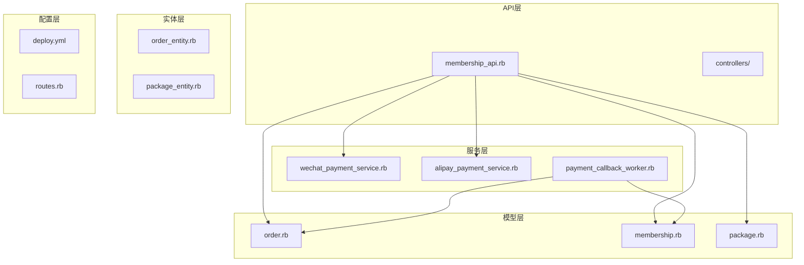
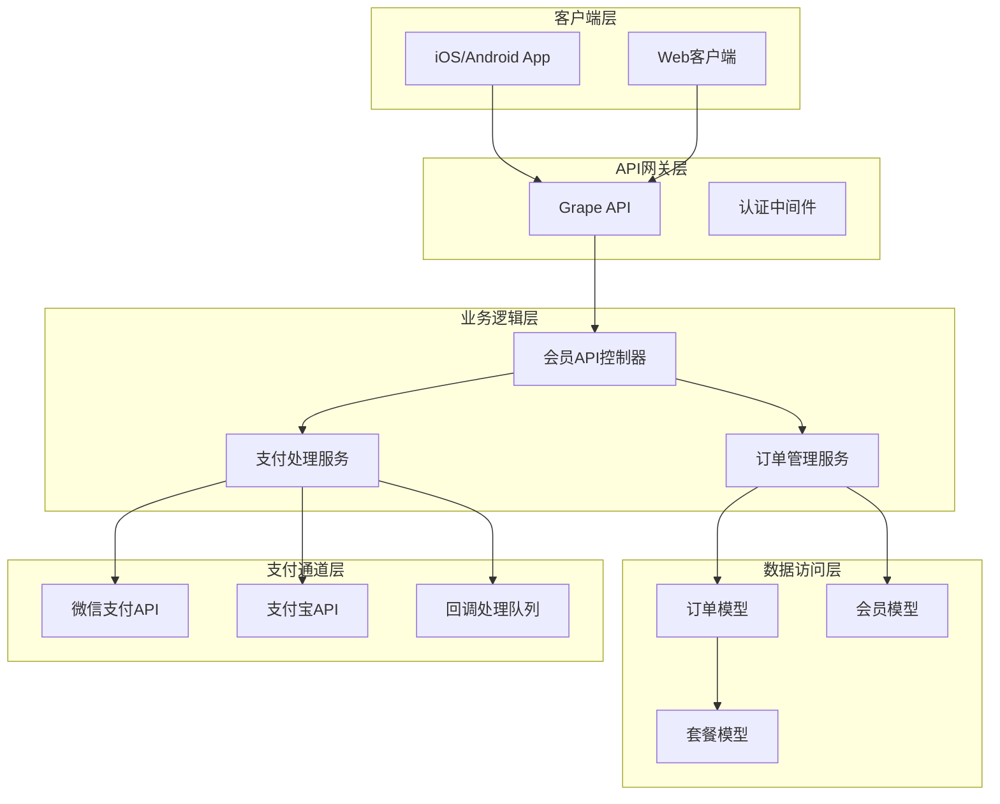
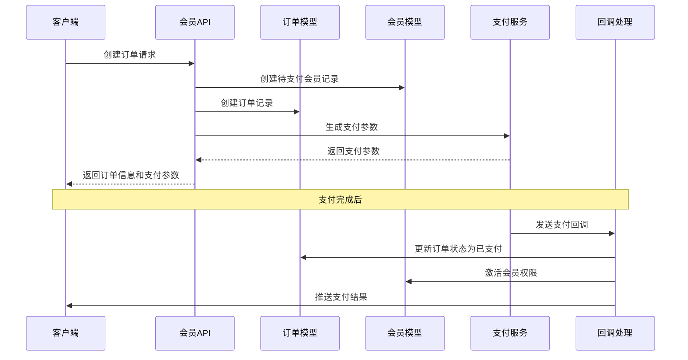
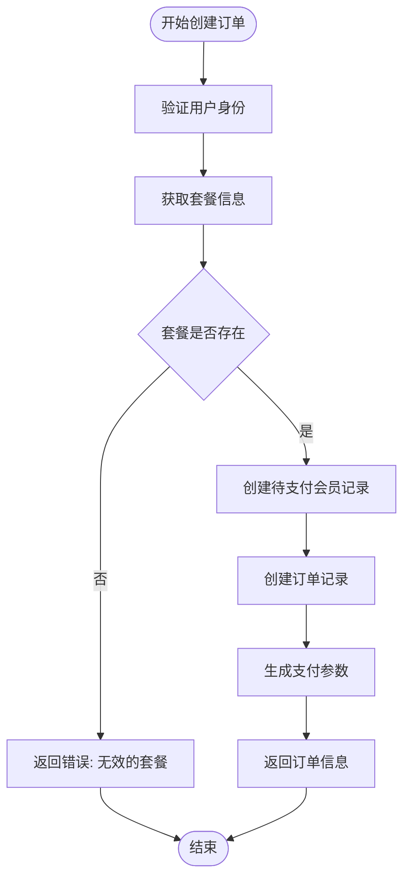
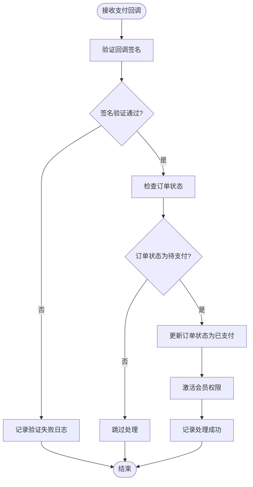
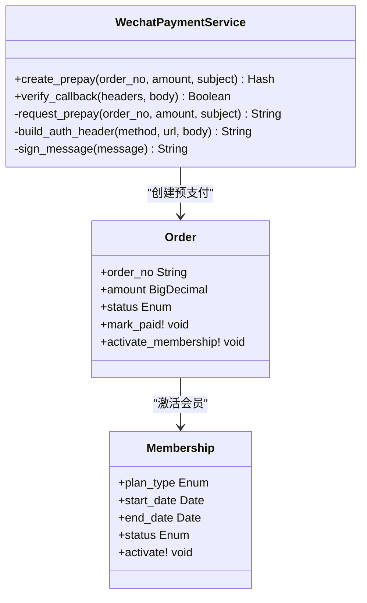
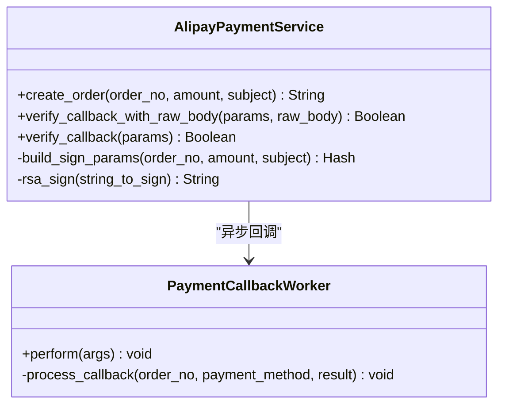
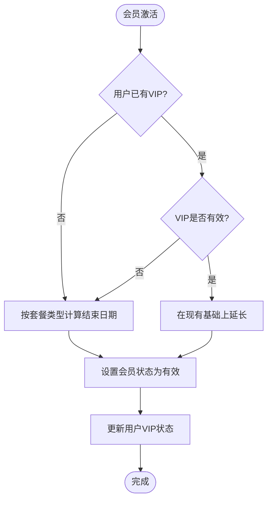
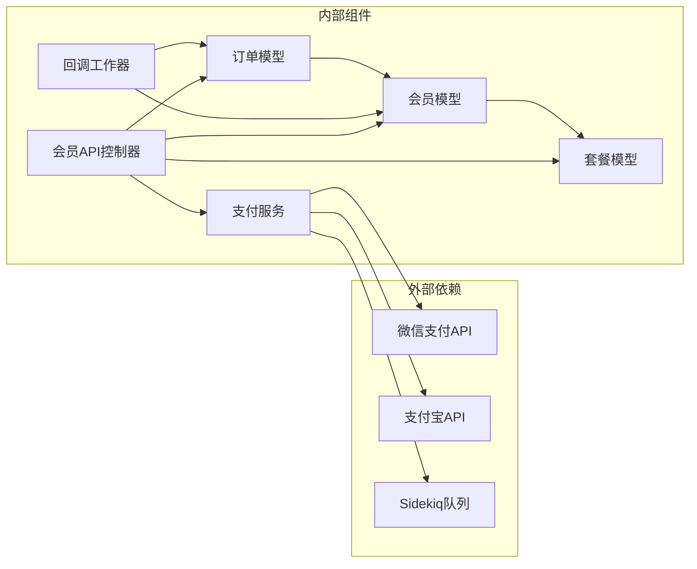

# 支付与会员API

<cite>
**本文档引用的文件**
- [membership_api.rb](file://app/controllers/api/memberships/membership_api.rb)
- [wechat_payment_service.rb](file://app/services/wechat_payment_service.rb)
- [alipay_payment_service.rb](file://app/services/alipay_payment_service.rb)
- [payment_callback_worker.rb](file://app/workers/payment_callback_worker.rb)
- [order.rb](file://app/models/order.rb)
- [membership.rb](file://app/models/membership.rb)
- [package.rb](file://app/models/package.rb)
- [order_entity.rb](file://app/entities/order.rb)
- [package_entity.rb](file://app/entities/package.rb)
- [deploy.yml](file://config/deploy.yml)
- [memberships_spec.rb](file://spec/requests/api/memberships_spec.rb)
- [alipay_payment_service_spec.rb](file://spec/services/alipay_payment_service_spec.rb)
- [wechat_payment_service_spec.rb](file://spec/services/wechat_payment_service_spec.rb)
- [order_spec.rb](file://spec/models/order_spec.rb)
- [membership_spec.rb](file://spec/models/membership_spec.rb)
</cite>

## 目录
1. [简介](#简介)
2. [项目结构](#项目结构)
3. [核心组件](#核心组件)
4. [架构概览](#架构概览)
5. [详细组件分析](#详细组件分析)
6. [依赖关系分析](#依赖关系分析)
7. [性能考虑](#性能考虑)
8. [故障排除指南](#故障排除指南)
9. [结论](#结论)

## 简介

本项目是一个基于Ruby on Rails的语音书应用，提供了完整的支付与会员管理功能。系统集成了微信支付和支付宝两大主流支付渠道，实现了会员套餐购买、订单管理、支付回调处理、会员权益管理等核心业务功能。

系统采用模块化设计，通过Grape框架构建RESTful API，使用Sidekiq进行异步任务处理，确保支付流程的可靠性和系统的高性能。支付回调采用异步处理机制，通过乐观锁避免并发问题，确保订单状态的一致性。

## 项目结构

支付与会员API主要分布在以下目录结构中：

**图表来源**
- [membership_api.rb:1-206](file://app/controllers/api/memberships/membership_api.rb#L1-L206)
- [wechat_payment_service.rb:1-113](file://app/services/wechat_payment_service.rb#L1-L113)
- [alipay_payment_service.rb:1-137](file://app/services/alipay_payment_service.rb#L1-L137)

**章节来源**
- [membership_api.rb:1-206](file://app/controllers/api/memberships/membership_api.rb#L1-L206)
- [wechat_payment_service.rb:1-113](file://app/services/wechat_payment_service.rb#L1-L113)
- [alipay_payment_service.rb:1-137](file://app/services/alipay_payment_service.rb#L1-L137)

## 核心组件

### 支付服务组件

系统提供了两个核心支付服务组件，分别处理微信支付和支付宝支付：

#### 微信支付服务 (WechatPaymentService)
- **功能**: 生成微信预支付订单参数，验证回调签名
- **特点**: 使用微信支付v3 API，支持平台证书验证
- **输出**: 返回APP调起支付所需的参数

#### 支付宝支付服务 (AlipayPaymentService)
- **功能**: 生成支付宝App支付订单参数，验证回调签名
- **特点**: 特殊处理Grape框架对URL编码的处理，确保验签正确
- **输出**: 返回支付宝支付字符串

### 订单管理组件

#### 订单模型 (Order)
- **状态管理**: 待支付、已支付、失败、已退款四种状态
- **支付方式**: 支持支付宝和微信支付
- **订单号生成**: 基于时间戳和随机数的唯一标识符

#### 会员模型 (Membership)
- **套餐类型**: 月度、季度、年度三种会员套餐
- **状态管理**: 待支付、有效、已过期、已取消四种状态
- **有效期计算**: 根据套餐类型自动计算到期时间

### 异步回调处理

#### 支付回调工作器 (PaymentCallbackWorker)
- **队列处理**: 使用Sidekiq异步处理支付回调
- **并发控制**: 通过乐观锁避免重复处理
- **原子操作**: 确保订单状态更新的原子性

**章节来源**
- [wechat_payment_service.rb:1-113](file://app/services/wechat_payment_service.rb#L1-L113)
- [alipay_payment_service.rb:1-137](file://app/services/alipay_payment_service.rb#L1-L137)
- [order.rb:1-104](file://app/models/order.rb#L1-L104)
- [membership.rb:1-73](file://app/models/membership.rb#L1-L73)
- [payment_callback_worker.rb:1-37](file://app/workers/payment_callback_worker.rb#L1-L37)

## 架构概览

系统采用分层架构设计，确保各组件职责清晰、耦合度低：

**图表来源**
- [membership_api.rb:10-202](file://app/controllers/api/memberships/membership_api.rb#L10-L202)
- [payment_callback_worker.rb:5-8](file://app/workers/payment_callback_worker.rb#L5-L8)

## 详细组件分析

### 会员套餐购买流程

会员套餐购买是整个支付系统的核心流程，包含以下步骤：

**图表来源**
- [membership_api.rb:68-122](file://app/controllers/api/memberships/membership_api.rb#L68-L122)
- [order.rb:61-87](file://app/models/order.rb#L61-L87)
- [payment_callback_worker.rb:11-26](file://app/workers/payment_callback_worker.rb#L11-L26)

#### 订单创建流程

订单创建过程包含严格的验证和状态管理：

**图表来源**
- [membership_api.rb:75-122](file://app/controllers/api/memberships/membership_api.rb#L75-L122)

#### 支付回调处理流程

系统采用异步回调处理机制，确保支付安全性：

**图表来源**
- [payment_callback_worker.rb:11-35](file://app/workers/payment_callback_worker.rb#L11-L35)

**章节来源**
- [membership_api.rb:68-122](file://app/controllers/api/memberships/membership_api.rb#L68-L122)
- [payment_callback_worker.rb:11-35](file://app/workers/payment_callback_worker.rb#L11-L35)

### 支付服务实现

#### 微信支付集成

微信支付服务实现了完整的v3 API集成：

**图表来源**
- [wechat_payment_service.rb:19-96](file://app/services/wechat_payment_service.rb#L19-L96)
- [order.rb:57-87](file://app/models/order.rb#L57-L87)
- [membership.rb:65-71](file://app/models/membership.rb#L65-L71)

#### 支付宝支付集成

支付宝支付服务处理了复杂的签名验证逻辑：

**图表来源**
- [alipay_payment_service.rb:16-57](file://app/services/alipay_payment_service.rb#L16-L57)
- [payment_callback_worker.rb:11-15](file://app/workers/payment_callback_worker.rb#L11-L15)

**章节来源**
- [wechat_payment_service.rb:1-113](file://app/services/wechat_payment_service.rb#L1-L113)
- [alipay_payment_service.rb:1-137](file://app/services/alipay_payment_service.rb#L1-L137)

### 会员权益管理

#### 会员状态管理

会员系统实现了灵活的状态管理和权益计算：

| 状态 | 描述 | 权益 |
|------|------|------|
| pending | 待支付 | 无 |
| active | 有效 | 完全访问权限 |
| expired | 已过期 | 限制访问 |
| cancelled | 已取消 | 无 |

#### 有效期计算逻辑

**图表来源**
- [order.rb:63-87](file://app/models/order.rb#L63-L87)

**章节来源**
- [order.rb:61-87](file://app/models/order.rb#L61-L87)
- [membership.rb:47-71](file://app/models/membership.rb#L47-L71)

## 依赖关系分析

系统各组件之间的依赖关系如下：

**图表来源**
- [membership_api.rb:10-202](file://app/controllers/api/memberships/membership_api.rb#L10-L202)
- [payment_callback_worker.rb:5-8](file://app/workers/payment_callback_worker.rb#L5-L8)

**章节来源**
- [membership_api.rb:1-206](file://app/controllers/api/memberships/membership_api.rb#L1-L206)
- [payment_callback_worker.rb:1-37](file://app/workers/payment_callback_worker.rb#L1-L37)

## 性能考虑

### 异步处理优化

系统采用异步回调处理机制，通过Sidekiq队列实现：

- **队列隔离**: 支付回调专用队列，避免阻塞主业务流程
- **重试机制**: 支持最多3次重试，提高成功率
- **并发控制**: 使用乐观锁避免重复处理

### 数据库优化

- **索引设计**: 订单号、状态、用户ID等关键字段建立索引
- **批量操作**: 使用原子更新减少数据库交互次数
- **缓存策略**: 用户VIP状态可考虑添加缓存层

### 支付安全优化

- **签名验证**: 双重签名验证机制
- **参数校验**: 严格的输入参数验证
- **日志审计**: 完整的操作日志记录

## 故障排除指南

### 常见问题及解决方案

#### 支付回调失败

**问题症状**: 支付成功但会员未激活

**排查步骤**:
1. 检查回调签名验证日志
2. 确认订单状态是否已更新
3. 查看Sidekiq队列执行情况

**解决方案**:
- 重启Sidekiq进程
- 检查回调URL配置
- 验证私钥和公钥配置

#### 订单状态异常

**问题症状**: 订单显示已支付但会员状态未更新

**排查步骤**:
1. 检查乐观锁更新是否成功
2. 确认回调处理是否被执行
3. 验证会员激活逻辑

**解决方案**:
- 手动触发会员激活
- 检查数据库连接
- 验证时间同步

#### 支付参数生成失败

**问题症状**: 创建订单时支付参数为空

**排查步骤**:
1. 检查支付密钥配置
2. 确认环境变量设置
3. 验证网络连接

**解决方案**:
- 重新配置支付密钥
- 检查防火墙设置
- 验证API访问权限

**章节来源**
- [payment_callback_worker.rb:29-35](file://app/workers/payment_callback_worker.rb#L29-L35)
- [alipay_payment_service_spec.rb:28-65](file://spec/services/alipay_payment_service_spec.rb#L28-L65)
- [wechat_payment_service_spec.rb:6-27](file://spec/services/wechat_payment_service_spec.rb#L6-L27)

## 结论

本支付与会员API系统实现了完整的会员订阅管理功能，具有以下特点：

### 技术优势
- **双支付渠道**: 同时支持微信支付和支付宝，满足不同用户需求
- **异步处理**: 采用Sidekiq异步回调，提升系统性能和可靠性
- **安全设计**: 多重签名验证和日志审计，确保支付安全
- **状态管理**: 完善的订单和会员状态管理机制

### 功能完整性
- **套餐管理**: 支持月度、季度、年度多种会员套餐
- **权益管理**: 灵活的会员权益计算和延期机制
- **订单追踪**: 完整的订单生命周期管理
- **回调处理**: 自动化的支付结果处理

### 扩展性
- **模块化设计**: 各组件职责清晰，易于扩展和维护
- **配置管理**: 通过环境变量管理支付配置
- **测试覆盖**: 完善的单元测试和集成测试

系统为语音书应用提供了稳定可靠的支付基础设施，能够支持业务的持续发展和用户规模的增长。