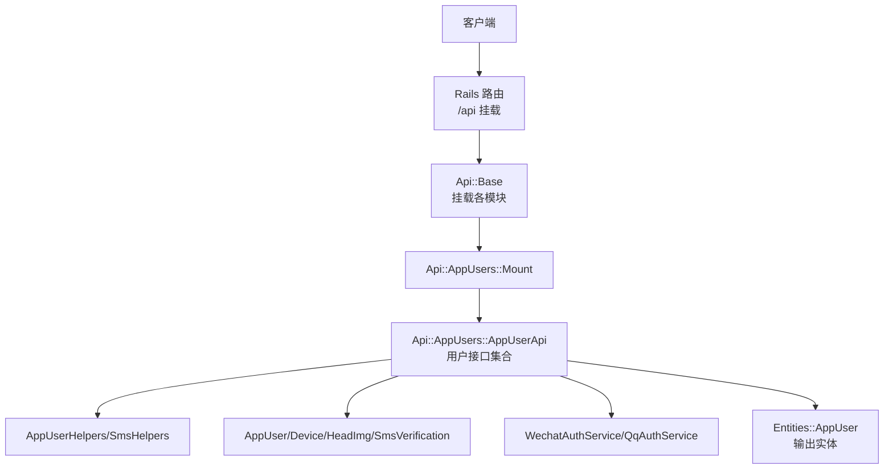
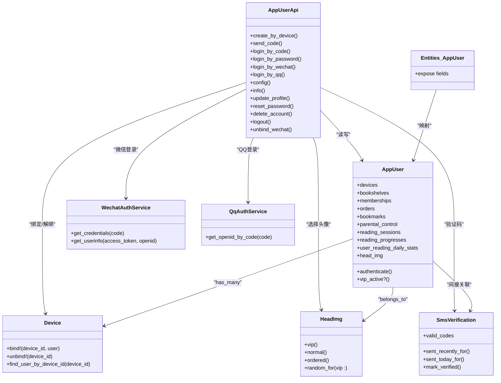
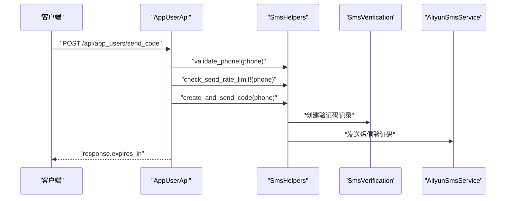
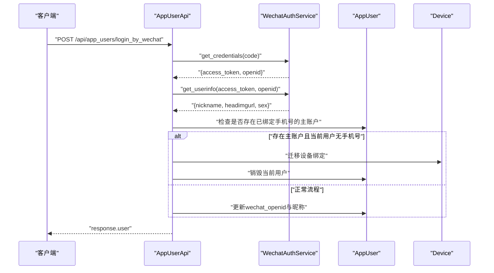
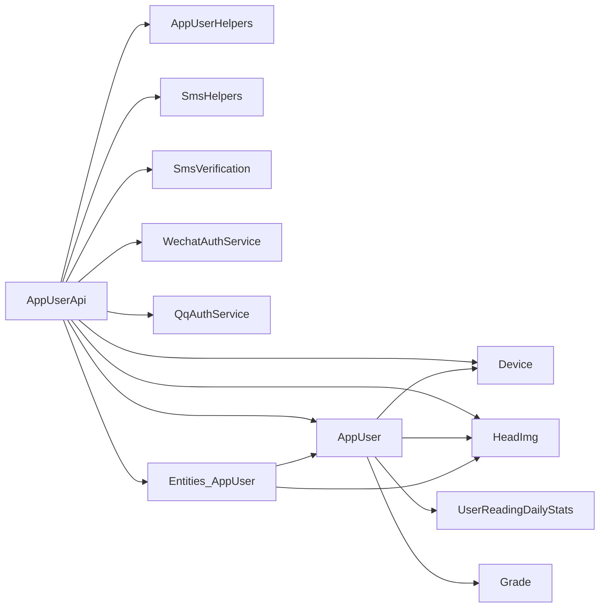

# 用户管理API

<cite>
**本文引用的文件**
- [app/controllers/api/base.rb](file://app/controllers/api/base.rb)
- [config/routes.rb](file://config/routes.rb)
- [app/controllers/api/app_users/mount.rb](file://app/controllers/api/app_users/mount.rb)
- [app/controllers/api/app_users/app_user_api.rb](file://app/controllers/api/app_users/app_user_api.rb)
- [app/controllers/api/app_users/app_user_helpers.rb](file://app/controllers/api/app_users/app_user_helpers.rb)
- [app/controllers/api/concerns/sms_helpers.rb](file://app/controllers/api/concerns/sms_helpers.rb)
- [app/models/app_user.rb](file://app/models/app_user.rb)
- [app/models/device.rb](file://app/models/device.rb)
- [app/models/head_img.rb](file://app/models/head_img.rb)
- [app/models/sms_verification.rb](file://app/models/sms_verification.rb)
- [app/services/wechat_auth_service.rb](file://app/services/wechat_auth_service.rb)
- [app/services/qq_auth_service.rb](file://app/services/qq_auth_service.rb)
- [app/entities/app_user.rb](file://app/entities/app_user.rb)
</cite>

## 目录
1. [简介](#简介)
2. [项目结构](#项目结构)
3. [核心组件](#核心组件)
4. [架构总览](#架构总览)
5. [详细组件分析](#详细组件分析)
6. [依赖分析](#依赖分析)
7. [性能考虑](#性能考虑)
8. [故障排除指南](#故障排除指南)
9. [结论](#结论)
10. [附录](#附录)

## 简介
本文件为“用户管理API”的权威技术文档，覆盖用户注册、登录、个人信息管理、头像上传、设备绑定等核心能力。重点说明用户认证流程、验证码验证机制、以及与微信/QQ第三方登录的集成方式。文档提供接口定义、请求参数、响应格式、错误码说明与使用示例，并对用户数据模型进行字段定义与业务逻辑说明。

## 项目结构
- API入口挂载于 `/api` 路径，用户模块通过 Grape 框架组织，采用命名空间 `/app_users` 提供统一的用户相关接口。
- 用户模块内部包含挂载器、控制器、辅助方法与短信验证码辅助模块；配合模型层完成用户、设备、头像、短信验证码等业务实体的数据持久化与约束。
- 第三方登录通过独立服务类对接微信与QQ开放平台，实现授权码换Token、获取用户信息等流程。

**图表来源**
- [config/routes.rb:9-10](file://config/routes.rb#L9-L10)
- [app/controllers/api/base.rb:24-37](file://app/controllers/api/base.rb#L24-L37)
- [app/controllers/api/app_users/mount.rb:6-8](file://app/controllers/api/app_users/mount.rb#L6-L8)
- [app/controllers/api/app_users/app_user_api.rb:7-12](file://app/controllers/api/app_users/app_user_api.rb#L7-L12)

**章节来源**
- [config/routes.rb:5-10](file://config/routes.rb#L5-L10)
- [app/controllers/api/base.rb:24-37](file://app/controllers/api/base.rb#L24-L37)

## 核心组件
- 用户控制器：集中处理用户注册、登录、资料更新、密码管理、注销与登出等。
- 用户模型：定义用户字段、关联关系、校验规则与缓存失效策略。
- 设备模型：支持多设备绑定与解绑，实现账户在多设备间共享数据。
- 头像模型：提供普通与VIP头像选择，控制非VIP用户不可使用VIP头像。
- 短信验证码模型：管理验证码生成、有效期、使用状态与发送频率限制。
- 短信辅助模块：封装手机号格式校验、验证码生成发送、速率限制与消费验证。
- 第三方登录服务：微信与QQ授权码换Token、获取用户信息与绑定逻辑。
- 实体映射：统一对外输出用户信息，包含头像、年级名称、VIP状态、家长管控等。

**章节来源**
- [app/controllers/api/app_users/app_user_api.rb:7-331](file://app/controllers/api/app_users/app_user_api.rb#L7-L331)
- [app/models/app_user.rb:36-140](file://app/models/app_user.rb#L36-L140)
- [app/models/device.rb:24-52](file://app/models/device.rb#L24-L52)
- [app/models/head_img.rb:13-23](file://app/models/head_img.rb#L13-L23)
- [app/models/sms_verification.rb:22-46](file://app/models/sms_verification.rb#L22-L46)
- [app/controllers/api/concerns/sms_helpers.rb:7-57](file://app/controllers/api/concerns/sms_helpers.rb#L7-L57)
- [app/services/wechat_auth_service.rb:7-85](file://app/services/wechat_auth_service.rb#L7-L85)
- [app/services/qq_auth_service.rb:8-87](file://app/services/qq_auth_service.rb#L8-L87)
- [app/entities/app_user.rb:4-41](file://app/entities/app_user.rb#L4-L41)

## 架构总览
用户模块采用“控制器-模型-实体-服务”分层设计：
- 控制器负责参数校验、业务编排与响应输出；
- 模型负责数据持久化、约束与缓存失效；
- 实体负责对外输出标准化数据；
- 服务负责与第三方平台交互；
- 辅助模块封装通用逻辑（短信、通用帮助）。

**图表来源**
- [app/controllers/api/app_users/app_user_api.rb:7-331](file://app/controllers/api/app_users/app_user_api.rb#L7-L331)
- [app/models/app_user.rb:38-62](file://app/models/app_user.rb#L38-L62)
- [app/models/device.rb:24-52](file://app/models/device.rb#L24-L52)
- [app/models/head_img.rb:13-23](file://app/models/head_img.rb#L13-L23)
- [app/models/sms_verification.rb:22-46](file://app/models/sms_verification.rb#L22-L46)
- [app/services/wechat_auth_service.rb:7-85](file://app/services/wechat_auth_service.rb#L7-L85)
- [app/services/qq_auth_service.rb:8-87](file://app/services/qq_auth_service.rb#L8-L87)
- [app/entities/app_user.rb:4-41](file://app/entities/app_user.rb#L4-L41)

## 详细组件分析

### 用户注册与匿名创建
- 接口：POST /api/app_users/create_by_device
- 功能：根据设备ID创建匿名用户（未绑定手机号），若设备已绑定用户则直接返回该用户。
- 请求参数
  - device_id: 字符串，必填，设备标识
- 响应字段
  - response.user: 用户对象（经实体映射后的标准结构）
- 业务逻辑
  - 若设备存在且已绑定用户，直接返回该用户；
  - 否则创建新用户，设置默认年级、昵称与头像，并将设备绑定到该用户。
- 使用示例
  - POST /api/app_users/create_by_device
  - 请求体：{"device_id": "DEVICE_ID"}
  - 成功响应：{"response": {"user": {...}}}

**章节来源**
- [app/controllers/api/app_users/app_user_api.rb:14-27](file://app/controllers/api/app_users/app_user_api.rb#L14-L27)
- [app/controllers/api/app_users/app_user_helpers.rb:18-31](file://app/controllers/api/app_users/app_user_helpers.rb#L18-L31)

### 发送短信验证码
- 接口：POST /api/app_users/send_code
- 功能：向指定手机号发送4位验证码，支持登录态下更新手机号场景。
- 请求参数
  - uuid: 字符串，可选，用户uuid（登录态）
  - phone: 字符串，必填，手机号
- 响应字段
  - response.expires_in: 数值，验证码有效期（秒）
- 业务逻辑
  - 可选登录态校验；
  - 校验手机号格式；
  - 速率限制：同手机号每60秒内最多发送一次，当日最多8次；
  - 生成4位随机验证码并落库，同时调用短信服务发送。
- 错误码
  - 1001：手机号格式不正确
  - 1002：验证码已发送，请60秒后再试
  - 1003：今日发送次数已达上限，请明日再试
- 使用示例
  - POST /api/app_users/send_code
  - 请求体：{"uuid": "UUID", "phone": "PHONE"}

**章节来源**
- [app/controllers/api/app_users/app_user_api.rb:29-44](file://app/controllers/api/app_users/app_user_api.rb#L29-L44)
- [app/controllers/api/concerns/sms_helpers.rb:14-53](file://app/controllers/api/concerns/sms_helpers.rb#L14-L53)

### 手机号+验证码登录/注册
- 接口：POST /api/app_users/login_by_code
- 功能：手机号+验证码登录或注册（支持多设备共享同一账户）。
- 请求参数
  - uuid: 字符串，必填，用户uuid
  - phone: 字符串，必填，手机号
  - code: 字符串，必填，验证码
- 响应字段
  - response.user: 用户对象
- 业务逻辑
  - 校验验证码有效性与未过期；
  - 若手机号已绑定其他用户，则将当前设备与数据迁移至主账户，销毁当前用户；
  - 否则将手机号绑定到现有用户或新建用户（若uuid对应用户不存在则报错）。
- 错误码
  - 1004：用户未注册，请先调用 create_by_device
  - 1005：验证码无效或已过期
- 使用示例
  - POST /api/app_users/login_by_code
  - 请求体：{"uuid": "UUID", "phone": "PHONE", "code": "CODE"}

**章节来源**
- [app/controllers/api/app_users/app_user_api.rb:46-82](file://app/controllers/api/app_users/app_user_api.rb#L46-L82)
- [app/models/sms_verification.rb:29-44](file://app/models/sms_verification.rb#L29-L44)

### 手机号+密码登录
- 接口：POST /api/app_users/login_by_password
- 功能：手机号+密码登录（支持多设备共享同一账户）。
- 请求参数
  - uuid: 字符串，必填，用户uuid
  - phone: 字符串，必填，手机号
  - password: 字符串，必填，密码
- 响应字段
  - response.user: 用户对象
- 业务逻辑
  - 校验uuid对应的用户是否存在；
  - 校验手机号与密码匹配；
  - 返回用户信息。
- 错误码
  - 1006：用户未注册，请先调用 create_by_device
  - 1007：手机号或密码错误
- 使用示例
  - POST /api/app_users/login_by_password
  - 请求体：{"uuid": "UUID", "phone": "PHONE", "password": "PASSWORD"}

**章节来源**
- [app/controllers/api/app_users/app_user_api.rb:84-99](file://app/controllers/api/app_users/app_user_api.rb#L84-L99)

### 微信登录
- 接口：POST /api/app_users/login_by_wechat
- 功能：微信授权登录（支持多设备共享同一账户）。
- 请求参数
  - uuid: 字符串，必填，用户uuid
  - code: 字符串，必填，微信授权码
- 响应字段
  - response.user: 用户对象
- 业务逻辑
  - 通过授权码换取access_token与openid；
  - 可选获取微信用户信息（昵称、头像、性别），失败时记录告警但不阻断；
  - 若存在已绑定手机号的主账户且当前用户无手机号，直接迁移至主账户；
  - 否则更新当前用户的wechat_openid与微信昵称，若无手机号则提示绑定手机号。
- 错误码
  - 1008：用户未注册，请先调用 create_by_device
  - 1009：授权已过期，请重新授权登录
- 使用示例
  - POST /api/app_users/login_by_wechat
  - 请求体：{"uuid": "UUID", "code": "CODE"}

**章节来源**
- [app/controllers/api/app_users/app_user_api.rb:101-153](file://app/controllers/api/app_users/app_user_api.rb#L101-L153)
- [app/services/wechat_auth_service.rb:16-83](file://app/services/wechat_auth_service.rb#L16-L83)

### QQ登录
- 接口：POST /api/app_users/login_by_qq
- 功能：QQ授权登录（支持多设备共享同一账户）。
- 请求参数
  - uuid: 字符串，必填，用户uuid
  - code: 字符串，必填，QQ授权码
- 响应字段
  - response.user: 用户对象
- 业务逻辑
  - 通过授权码换取QQ openid；
  - 若存在已绑定该openid的用户则直接复用；
  - 否则为当前用户绑定openid（若尚未绑定），并生成默认昵称。
- 错误码
  - 1010：用户未注册，请先调用 create_by_device
- 使用示例
  - POST /api/app_users/login_by_qq
  - 请求体：{"uuid": "UUID", "code": "CODE"}

**章节来源**
- [app/controllers/api/app_users/app_user_api.rb:155-176](file://app/controllers/api/app_users/app_user_api.rb#L155-L176)
- [app/services/qq_auth_service.rb:68-74](file://app/services/qq_auth_service.rb#L68-L74)

### 用户配置（高频接口）
- 接口：GET /api/app_users/config
- 功能：获取用户配置（App启动时调用，高频接口），包含家长管控时长限制等。
- 请求参数
  - uuid: 字符串，必填，用户uuid
- 响应字段
  - response.time_limit_minutes: 数值，家长管控时长限制（分钟）
- 业务逻辑
  - 登录态校验；
  - 使用缓存降低数据库压力，缓存键包含用户更新时间戳以保证一致性。
- 使用示例
  - GET /api/app_users/config?uuid=UUID

**章节来源**
- [app/controllers/api/app_users/app_user_api.rb:178-198](file://app/controllers/api/app_users/app_user_api.rb#L178-L198)

### 获取用户信息
- 接口：GET /api/app_users/info
- 功能：获取当前设备绑定的用户基本信息。
- 请求参数
  - uuid: 字符串，必填，用户uuid
- 响应字段
  - response.user: 用户对象
- 使用示例
  - GET /api/app_users/info?uuid=UUID

**章节来源**
- [app/controllers/api/app_users/app_user_api.rb:200-209](file://app/controllers/api/app_users/app_user_api.rb#L200-L209)

### 更新用户资料
- 接口：PUT /api/app_users/update_profile
- 功能：更新用户资料（昵称、年级、头像）。
- 请求参数
  - uuid: 字符串，必填，用户uuid
  - nickname: 字符串，可选，昵称（最长50字符）
  - grade_id: 整数，可选，年级ID
  - head_img_id: 整数，可选，头像ID
- 响应字段
  - response.user: 用户对象
- 业务逻辑
  - 至少提供一个可更新字段；
  - 非VIP用户不可选择VIP头像；
  - 更新后失效用户缓存。
- 错误码
  - 1011：没有需要更新的字段
  - 1012：VIP头像需要VIP会员才能使用
  - 1013：头像不存在
- 使用示例
  - PUT /api/app_users/update_profile
  - 请求体：{"uuid": "UUID", "nickname": "NICKNAME", "grade_id": 1, "head_img_id": 1}

**章节来源**
- [app/controllers/api/app_users/app_user_api.rb:211-239](file://app/controllers/api/app_users/app_user_api.rb#L211-L239)
- [app/models/head_img.rb:13-23](file://app/models/head_img.rb#L13-L23)

### 设置/重置密码
- 接口：POST /api/app_users/reset_password
- 功能：设置或重置密码（首次设置无需验证码，修改密码需手机号+验证码）。
- 请求参数
  - uuid: 字符串，必填，用户uuid
  - password: 字符串，必填，新密码
  - phone: 字符串，可选，修改已有密码时必须提供手机号
  - code: 字符串，可选，修改已有密码时必须提供验证码
- 响应字段
  - 成功响应（无额外data）
- 业务逻辑
  - 若已有密码，修改时必须提供手机号与验证码并校验；
  - 校验手机号是否已绑定账户；
  - 更新密码。
- 错误码
  - 1014：用户未注册，请先调用 create_by_device
  - 1015：修改密码需要提供手机号和验证码
  - 1016：修改密码需要提供手机号
  - 1017：该手机号未绑定账户
- 使用示例
  - POST /api/app_users/reset_password
  - 请求体：{"uuid": "UUID", "password": "NEW_PASSWORD", "phone": "PHONE", "code": "CODE"}

**章节来源**
- [app/controllers/api/app_users/app_user_api.rb:241-266](file://app/controllers/api/app_users/app_user_api.rb#L241-L266)
- [app/models/sms_verification.rb:29-44](file://app/models/sms_verification.rb#L29-L44)

### 注销账户
- 接口：POST /api/app_users/delete_account
- 功能：注销账户（删除用户及其所有资源，解绑所有设备并创建新匿名账户）。
- 请求参数
  - uuid: 字符串，必填，用户uuid
- 响应字段
  - response.msg: 字符串，提示信息
  - response.user: 新创建的匿名用户（若当前设备存在）
- 业务逻辑
  - 记录当前设备ID；
  - 删除用户；
  - 对用户绑定的每个设备重新创建匿名用户；
  - 返回新用户（若当前设备被迁移）。
- 使用示例
  - POST /api/app_users/delete_account
  - 请求体：{"uuid": "UUID"}

**章节来源**
- [app/controllers/api/app_users/app_user_api.rb:268-292](file://app/controllers/api/app_users/app_user_api.rb#L268-L292)

### 退出登录
- 接口：POST /api/app_users/logout
- 功能：退出登录（解绑当前设备，返回新用户）。
- 请求参数
  - uuid: 字符串，必填，用户uuid
- 响应字段
  - response.user: 新创建的匿名用户
- 业务逻辑
  - 解绑当前设备；
  - 以当前设备ID创建新的匿名用户并返回。
- 使用示例
  - POST /api/app_users/logout
  - 请求体：{"uuid": "UUID"}

**章节来源**
- [app/controllers/api/app_users/app_user_api.rb:294-310](file://app/controllers/api/app_users/app_user_api.rb#L294-L310)

### 解绑微信
- 接口：POST /api/app_users/unbind_wechat
- 功能：解绑微信授权（清除用户的wechat_openid与wechat_nickname）。
- 请求参数
  - uuid: 字符串，必填，用户uuid
- 响应字段
  - response.msg: 字符串，提示信息
- 业务逻辑
  - 校验当前账号是否已绑定微信；
  - 清除微信openID与昵称并失效缓存。
- 错误码
  - 1018：当前账号未绑定微信
- 使用示例
  - POST /api/app_users/unbind_wechat
  - 请求体：{"uuid": "UUID"}

**章节来源**
- [app/controllers/api/app_users/app_user_api.rb:312-326](file://app/controllers/api/app_users/app_user_api.rb#L312-L326)

### 用户认证流程与JWT令牌机制
- 认证方式
  - 用户通过设备ID创建匿名用户后，获得uuid作为后续接口调用的身份标识；
  - 支持手机号+验证码、手机号+密码、微信、QQ等多种登录方式；
  - 登录成功后，客户端应持有uuid并在后续请求中携带。
- JWT令牌
  - 本项目未使用JWT令牌；认证基于uuid与登录态校验（部分接口要求uuid参数）。
- 安全建议
  - 建议在生产环境引入短期有效的JWT令牌与刷新令牌机制，结合HTTPS与CORS策略；
  - 对高频接口增加限流与白名单校验。

**章节来源**
- [app/controllers/api/app_users/app_user_api.rb:12-331](file://app/controllers/api/app_users/app_user_api.rb#L12-L331)

### 手机号验证码验证流程

**图表来源**
- [app/controllers/api/app_users/app_user_api.rb:35-44](file://app/controllers/api/app_users/app_user_api.rb#L35-L44)
- [app/controllers/api/concerns/sms_helpers.rb:14-53](file://app/controllers/api/concerns/sms_helpers.rb#L14-L53)
- [app/models/sms_verification.rb:22-46](file://app/models/sms_verification.rb#L22-L46)

### 微信登录流程

**图表来源**
- [app/controllers/api/app_users/app_user_api.rb:107-153](file://app/controllers/api/app_users/app_user_api.rb#L107-L153)
- [app/services/wechat_auth_service.rb:16-83](file://app/services/wechat_auth_service.rb#L16-L83)

## 依赖分析
- 控制器依赖
  - AppUserApi 依赖 AppUserHelpers、SmsHelpers、AppUser、Device、HeadImg、SmsVerification、WechatAuthService、QqAuthService、Entities::AppUser。
- 模型依赖
  - AppUser 依赖 Device、HeadImg、UserReadingDailyStats、Grade（通过外键与关联）、SmsVerification（间接）。
- 服务依赖
  - WechatAuthService 依赖微信开放平台接口；
  - QqAuthService 依赖QQ开放平台接口。
- 实体依赖
  - Entities::AppUser 依赖 AppUser 与 HeadImg。

**图表来源**
- [app/controllers/api/app_users/app_user_api.rb:7-12](file://app/controllers/api/app_users/app_user_api.rb#L7-L12)
- [app/models/app_user.rb:50-62](file://app/models/app_user.rb#L50-L62)
- [app/entities/app_user.rb:9-11](file://app/entities/app_user.rb#L9-L11)

**章节来源**
- [app/controllers/api/app_users/app_user_api.rb:7-331](file://app/controllers/api/app_users/app_user_api.rb#L7-L331)
- [app/models/app_user.rb:38-62](file://app/models/app_user.rb#L38-L62)
- [app/entities/app_user.rb:4-41](file://app/entities/app_user.rb#L4-L41)

## 性能考虑
- 高频接口缓存
  - 用户配置接口对家长管控时长限制使用Redis缓存，缓存键包含用户更新时间戳，避免重复查询数据库。
- 数据库索引
  - 用户表对phone、uuid、wechat_openid、qq_openid建立唯一索引，确保登录与绑定的唯一性与查询效率。
- 并发绑定
  - 设备绑定操作具备幂等性，支持并发场景下的重复绑定与重新绑定。
- 头像选择
  - 默认头像选择时使用有序查询，减少随机性带来的性能波动。

**章节来源**
- [app/controllers/api/app_users/app_user_api.rb:187-193](file://app/controllers/api/app_users/app_user_api.rb#L187-L193)
- [app/models/app_user.rb:24-32](file://app/models/app_user.rb#L24-L32)
- [app/models/device.rb:34-50](file://app/models/device.rb#L34-L50)
- [app/models/head_img.rb:14-21](file://app/models/head_img.rb#L14-L21)

## 故障排除指南
- 常见错误码与定位
  - 1001：手机号格式不正确 → 检查手机号正则与输入格式
  - 1002：验证码已发送，请60秒后再试 → 检查发送频率限制
  - 1003：今日发送次数已达上限，请明日再试 → 检查当日发送计数
  - 1004：用户未注册，请先调用 create_by_device → 确保先创建匿名用户
  - 1005：验证码无效或已过期 → 检查验证码有效期与使用状态
  - 1006：用户未注册，请先调用 create_by_device → 确认uuid对应用户存在
  - 1007：手机号或密码错误 → 校验手机号与密码
  - 1008：用户未注册，请先调用 create_by_device → 确认uuid对应用户存在
  - 1009：授权已过期，请重新授权登录 → 重新发起第三方授权
  - 1010：用户未注册，请先调用 create_by_device → 确认uuid对应用户存在
  - 1011：没有需要更新的字段 → 至少提供一个可更新字段
  - 1012：VIP头像需要VIP会员才能使用 → 非VIP用户不可选择VIP头像
  - 1013：头像不存在 → 检查head_img_id是否有效
  - 1014：用户未注册，请先调用 create_by_device → 确认uuid对应用户存在
  - 1015：修改密码需要提供手机号和验证码 → 修改密码时必须提供手机号与验证码
  - 1016：修改密码需要提供手机号 → 修改密码时必须提供手机号
  - 1017：该手机号未绑定账户 → 校验手机号是否已绑定
  - 1018：当前账号未绑定微信 → 检查wechat_openid是否为空
- 日志与监控
  - 微信登录获取用户信息失败会记录告警日志，便于排查第三方接口异常。

**章节来源**
- [app/controllers/api/concerns/sms_helpers.rb:14-53](file://app/controllers/api/concerns/sms_helpers.rb#L14-L53)
- [app/controllers/api/app_users/app_user_api.rb:46-82](file://app/controllers/api/app_users/app_user_api.rb#L46-L82)
- [app/controllers/api/app_users/app_user_api.rb:84-99](file://app/controllers/api/app_users/app_user_api.rb#L84-L99)
- [app/controllers/api/app_users/app_user_api.rb:101-153](file://app/controllers/api/app_users/app_user_api.rb#L101-L153)
- [app/controllers/api/app_users/app_user_api.rb:155-176](file://app/controllers/api/app_users/app_user_api.rb#L155-L176)
- [app/controllers/api/app_users/app_user_api.rb:211-239](file://app/controllers/api/app_users/app_user_api.rb#L211-L239)
- [app/controllers/api/app_users/app_user_api.rb:241-266](file://app/controllers/api/app_users/app_user_api.rb#L241-L266)
- [app/controllers/api/app_users/app_user_api.rb:312-326](file://app/controllers/api/app_users/app_user_api.rb#L312-L326)

## 结论
本用户管理API围绕“设备ID匿名创建+多渠道登录+资料管理+设备绑定”的核心路径构建，具备完善的验证码风控、第三方登录集成与高频接口缓存策略。建议在生产环境中补充JWT令牌机制、接口限流与更细粒度的权限控制，以进一步提升安全性与稳定性。

## 附录

### 用户数据模型字段定义
- 字段概览（来自用户表）
  - id: 整数，主键
  - uuid: 字符串，唯一，用户身份标识
  - phone: 字符串，唯一，手机号
  - wechat_openid: 字符串，唯一，微信openid
  - qq_openid: 字符串，唯一，QQ openid
  - nickname: 字符串，最大长度50，昵称
  - password_digest: 字符串，密码加密存储
  - is_vip: 布尔，是否VIP
  - vip_expires_at: 时间，VIP过期时间
  - grade_id: 整数，年级ID（外键）
  - head_img_id: 整数，头像ID（外键）
  - reading_words: 整数，累计阅读字数
  - reading_minutes: 整数，累计阅读分钟数
  - books_read: 整数，累计阅读书籍数量
  - device_id: 字符串，设备ID（兼容旧字段）
  - role: 整数，角色（0-孩子，1-家长，2-管理员）
  - created_at/updated_at: 时间，创建与更新时间
- 关联关系
  - has_many :devices, dependent: :destroy
  - has_many :bookshelves, dependent: :destroy
  - has_many :memberships, dependent: :destroy
  - has_many :orders, dependent: :destroy
  - has_many :bookmarks, dependent: :destroy
  - has_one :parental_control, dependent: :destroy
  - has_many :reading_sessions, dependent: :destroy
  - has_many :reading_progresses, dependent: :destroy
  - has_many :user_reading_daily_stats, class_name: 'UserReadingDailyStats', dependent: :destroy
  - belongs_to :head_img, optional: true

**章节来源**
- [app/models/app_user.rb:1-33](file://app/models/app_user.rb#L1-L33)
- [app/models/app_user.rb:50-62](file://app/models/app_user.rb#L50-L62)

### 头像模型字段定义
- 字段概览（来自头像表）
  - id: 整数，主键
  - img_url: 字符串，头像图片URL
  - is_vip: 布尔，是否VIP头像
  - created_at/updated_at: 时间，创建与更新时间
- 查询范围
  - vip(), normal(), ordered()

**章节来源**
- [app/models/head_img.rb:1-23](file://app/models/head_img.rb#L1-L23)

### 设备模型字段定义
- 字段概览（来自设备表）
  - id: 整数，主键
  - device_id: 字符串，唯一，设备ID
  - app_user_id: 整数，外键，所属用户ID
  - created_at/updated_at: 时间，创建与更新时间
- 关键方法
  - bind!(device_id, user): 绑定设备到用户（幂等）
  - unbind!(device_id): 解绑设备

**章节来源**
- [app/models/device.rb:1-52](file://app/models/device.rb#L1-L52)

### 短信验证码模型字段定义
- 字段概览（来自短信验证码表）
  - id: 整数，主键
  - phone: 字符串，手机号
  - code: 字符串，验证码（4位）
  - expires_at: 时间，过期时间
  - verified: 布尔，是否已验证
  - created_at/updated_at: 时间，创建与更新时间
- 作用域
  - valid_codes, sent_recently_for, sent_today_for, for_phone, by_code

**章节来源**
- [app/models/sms_verification.rb:1-46](file://app/models/sms_verification.rb#L1-L46)

### API定义与使用示例

- 基础信息
  - 基础路径：/api
  - 认证方式：uuid（部分接口要求）
  - 响应格式：统一包装 {"response": {...}}
- 示例：创建匿名用户
  - 方法：POST /api/app_users/create_by_device
  - 请求体：{"device_id": "DEVICE_ID"}
  - 成功响应：{"response": {"user": {...}}}
- 示例：发送验证码
  - 方法：POST /api/app_users/send_code
  - 请求体：{"uuid": "UUID", "phone": "PHONE"}
  - 成功响应：{"response": {"expires_in": 300}}
- 示例：手机号+验证码登录
  - 方法：POST /api/app_users/login_by_code
  - 请求体：{"uuid": "UUID", "phone": "PHONE", "code": "CODE"}
  - 成功响应：{"response": {"user": {...}}}
- 示例：获取用户信息
  - 方法：GET /api/app_users/info?uuid=UUID
  - 成功响应：{"response": {"user": {...}}}
- 示例：更新用户资料
  - 方法：PUT /api/app_users/update_profile
  - 请求体：{"uuid": "UUID", "nickname": "NICKNAME", "grade_id": 1, "head_img_id": 1}
  - 成功响应：{"response": {"user": {...}}}
- 示例：设置/重置密码
  - 方法：POST /api/app_users/reset_password
  - 请求体：{"uuid": "UUID", "password": "NEW_PASSWORD", "phone": "PHONE", "code": "CODE"}
  - 成功响应：{"response": {}}
- 示例：注销账户
  - 方法：POST /api/app_users/delete_account
  - 请求体：{"uuid": "UUID"}
  - 成功响应：{"response": {"msg": "账户已注销", "user": {...}}}
- 示例：退出登录
  - 方法：POST /api/app_users/logout
  - 请求体：{"uuid": "UUID"}
  - 成功响应：{"response": {"user": {...}}}
- 示例：解绑微信
  - 方法：POST /api/app_users/unbind_wechat
  - 请求体：{"uuid": "UUID"}
  - 成功响应：{"response": {"msg": "微信已解绑"}}

**章节来源**
- [app/controllers/api/app_users/app_user_api.rb:12-331](file://app/controllers/api/app_users/app_user_api.rb#L12-L331)