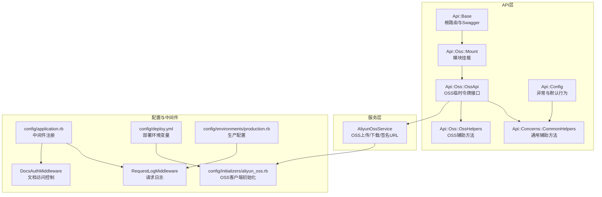
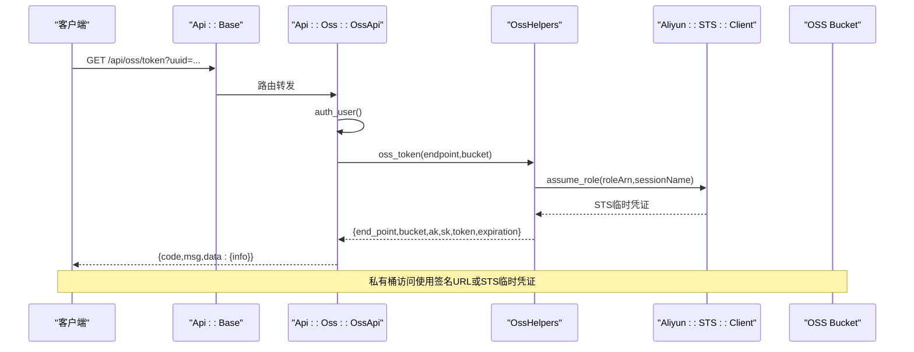
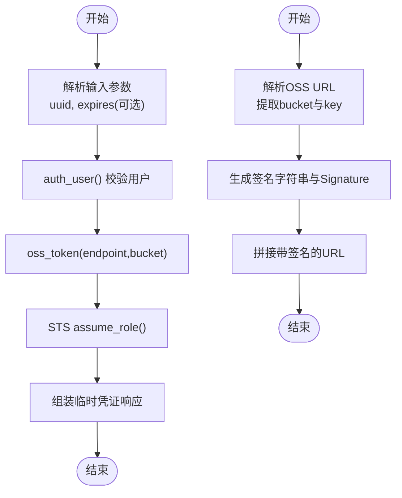
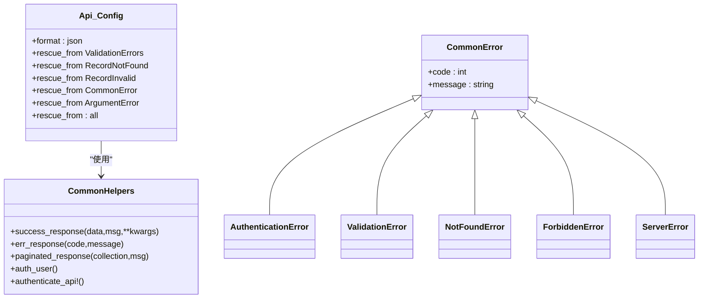
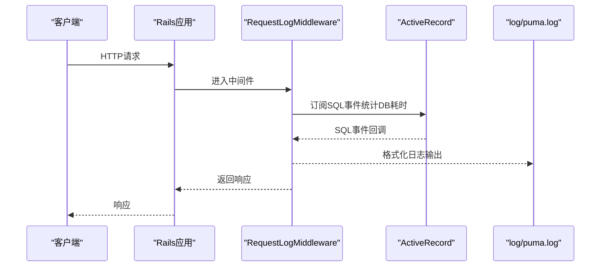
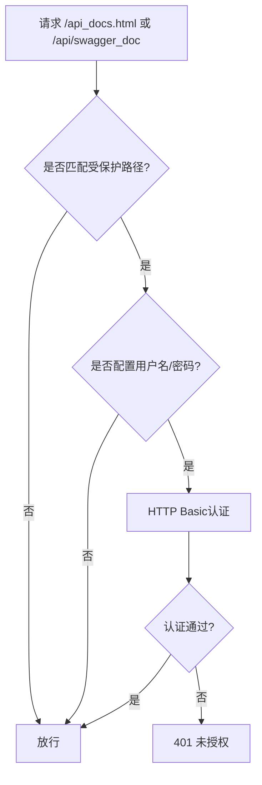
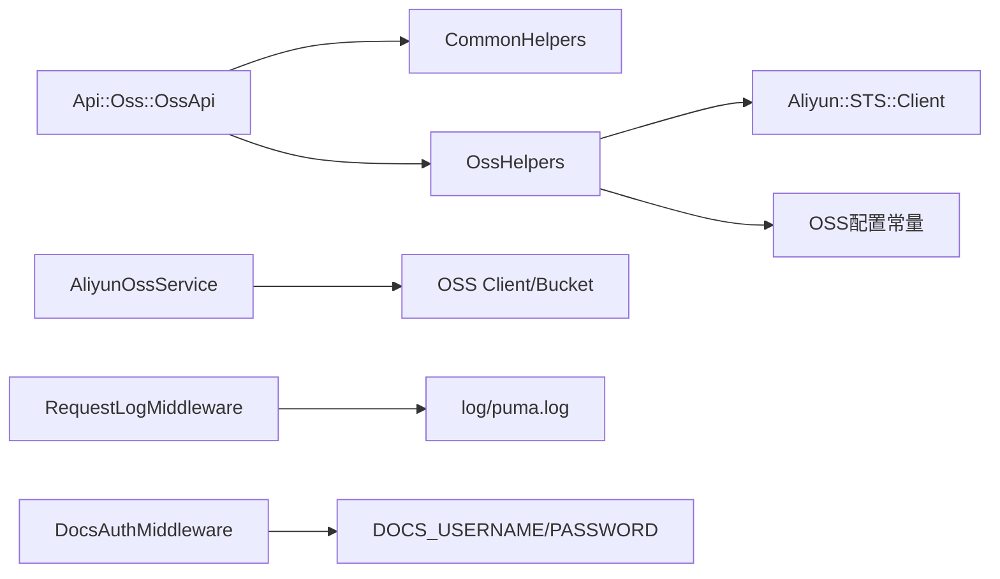

# 系统管理API

<cite>
**本文档引用的文件**
- [app/controllers/api/oss/oss_api.rb](file://app/controllers/api/oss/oss_api.rb)
- [app/controllers/api/oss/oss_helpers.rb](file://app/controllers/api/oss/oss_helpers.rb)
- [app/controllers/api/oss/mount.rb](file://app/controllers/api/oss/mount.rb)
- [lib/aliyun_oss_service.rb](file://lib/aliyun_oss_service.rb)
- [config/initializers/aliyun_oss.rb](file://config/initializers/aliyun_oss.rb)
- [app/controllers/api/base.rb](file://app/controllers/api/base.rb)
- [app/controllers/api/config.rb](file://app/controllers/api/config.rb)
- [app/controllers/api/concerns/common_helpers.rb](file://app/controllers/api/concerns/common_helpers.rb)
- [app/controllers/api/errors/common_error.rb](file://app/controllers/api/errors/common_error.rb)
- [lib/request_log_middleware.rb](file://lib/request_log_middleware.rb)
- [lib/docs_auth_middleware.rb](file://lib/docs_auth_middleware.rb)
- [config/application.rb](file://config/application.rb)
- [config/deploy.yml](file://config/deploy.yml)
- [config/environments/production.rb](file://config/environments/production.rb)
- [spec/requests/api/oss_spec.rb](file://spec/requests/api/oss_spec.rb)
</cite>

## 目录
1. [简介](#简介)
2. [项目结构](#项目结构)
3. [核心组件](#核心组件)
4. [架构总览](#架构总览)
5. [详细组件分析](#详细组件分析)
6. [依赖关系分析](#依赖关系分析)
7. [性能考量](#性能考量)
8. [故障排查指南](#故障排查指南)
9. [结论](#结论)
10. [附录](#附录)

## 简介
本文件为系统管理API的全面接口文档，重点覆盖对象存储服务（OSS）、文件上传下载、错误处理、通用工具函数等功能。文档详细说明OSS配置、文件安全策略、访问权限控制以及CDN加速机制；同时提供系统监控、日志记录、性能优化与故障恢复的技术实现，并给出API版本管理、向后兼容性与迁移指南。

## 项目结构
系统采用Grape + Rails的API架构，OSS相关能力集中在Api::Oss命名空间下，通过Mount进行模块化挂载；全局异常处理、统一响应格式与中间件在Api::Config与应用配置中集中定义；日志与文档访问控制分别通过RequestLogMiddleware与DocsAuthMiddleware实现。

**图表来源**
- [app/controllers/api/base.rb:24-38](file://app/controllers/api/base.rb#L24-L38)
- [app/controllers/api/oss/mount.rb:5-7](file://app/controllers/api/oss/mount.rb#L5-L7)
- [app/controllers/api/oss/oss_api.rb:5-21](file://app/controllers/api/oss/oss_api.rb#L5-L21)
- [app/controllers/api/oss/oss_helpers.rb:8-76](file://app/controllers/api/oss/oss_helpers.rb#L8-L76)
- [lib/aliyun_oss_service.rb:9-14](file://lib/aliyun_oss_service.rb#L9-L14)
- [config/initializers/aliyun_oss.rb:19-31](file://config/initializers/aliyun_oss.rb#L19-L31)
- [app/controllers/api/config.rb:10-52](file://app/controllers/api/config.rb#L10-L52)
- [app/controllers/api/concerns/common_helpers.rb:7-133](file://app/controllers/api/concerns/common_helpers.rb#L7-L133)
- [config/application.rb:58-78](file://config/application.rb#L58-L78)
- [lib/request_log_middleware.rb:8-14](file://lib/request_log_middleware.rb#L8-L14)
- [lib/docs_auth_middleware.rb:5-10](file://lib/docs_auth_middleware.rb#L5-L10)
- [config/deploy.yml:28-56](file://config/deploy.yml#L28-L56)
- [config/environments/production.rb:36-51](file://config/environments/production.rb#L36-L51)

**章节来源**
- [app/controllers/api/base.rb:24-38](file://app/controllers/api/base.rb#L24-L38)
- [app/controllers/api/oss/mount.rb:5-7](file://app/controllers/api/oss/mount.rb#L5-L7)
- [app/controllers/api/oss/oss_api.rb:5-21](file://app/controllers/api/oss/oss_api.rb#L5-L21)
- [app/controllers/api/oss/oss_helpers.rb:8-76](file://app/controllers/api/oss/oss_helpers.rb#L8-L76)
- [lib/aliyun_oss_service.rb:9-14](file://lib/aliyun_oss_service.rb#L9-L14)
- [config/initializers/aliyun_oss.rb:19-31](file://config/initializers/aliyun_oss.rb#L19-L31)
- [app/controllers/api/config.rb:10-52](file://app/controllers/api/config.rb#L10-L52)
- [app/controllers/api/concerns/common_helpers.rb:7-133](file://app/controllers/api/concerns/common_helpers.rb#L7-L133)
- [config/application.rb:58-78](file://config/application.rb#L58-L78)
- [lib/request_log_middleware.rb:8-14](file://lib/request_log_middleware.rb#L8-L14)
- [lib/docs_auth_middleware.rb:5-10](file://lib/docs_auth_middleware.rb#L5-L10)
- [config/deploy.yml:28-56](file://config/deploy.yml#L28-L56)
- [config/environments/production.rb:36-51](file://config/environments/production.rb#L36-L51)

## 核心组件
- Api::Oss::OssApi：提供获取OSS临时授权凭证（STSToken）的接口，集成用户认证与响应格式化。
- Api::Oss::OssHelpers：提供OSS签名URL生成与STS临时凭证获取的辅助方法。
- AliyunOssService：封装OSS上传、下载、签名URL生成等核心能力，支持本地文件与二进制数据上传。
- Api::Config：统一异常处理、默认响应格式与Grape配置。
- Api::Concerns::CommonHelpers：统一成功/错误响应、分页、用户认证与API签名验证。
- RequestLogMiddleware：统一请求日志记录，格式化输出并写入独立日志文件。
- DocsAuthMiddleware：对API文档页面进行HTTP Basic认证保护。

**章节来源**
- [app/controllers/api/oss/oss_api.rb:5-21](file://app/controllers/api/oss/oss_api.rb#L5-L21)
- [app/controllers/api/oss/oss_helpers.rb:8-76](file://app/controllers/api/oss/oss_helpers.rb#L8-L76)
- [lib/aliyun_oss_service.rb:9-109](file://lib/aliyun_oss_service.rb#L9-L109)
- [app/controllers/api/config.rb:10-52](file://app/controllers/api/config.rb#L10-L52)
- [app/controllers/api/concerns/common_helpers.rb:7-133](file://app/controllers/api/concerns/common_helpers.rb#L7-L133)
- [lib/request_log_middleware.rb:8-164](file://lib/request_log_middleware.rb#L8-L164)
- [lib/docs_auth_middleware.rb:5-51](file://lib/docs_auth_middleware.rb#L5-L51)

## 架构总览
系统管理API围绕“鉴权—服务—响应”三层设计，OSS模块通过STS实现最小权限访问，结合签名URL实现私有桶安全访问；全局中间件负责日志与文档保护；部署配置集中管理环境变量与CDN代理。

**图表来源**
- [app/controllers/api/base.rb:24-38](file://app/controllers/api/base.rb#L24-L38)
- [app/controllers/api/oss/oss_api.rb:14-20](file://app/controllers/api/oss/oss_api.rb#L14-L20)
- [app/controllers/api/oss/oss_helpers.rb:59-75](file://app/controllers/api/oss/oss_helpers.rb#L59-L75)
- [config/initializers/aliyun_oss.rb:19-31](file://config/initializers/aliyun_oss.rb#L19-L31)

## 详细组件分析

### OSS接口与安全策略
- 接口：GET /api/oss/token
  - 功能：为指定用户发放OSS临时授权凭证（STSToken），用于直传或临时访问。
  - 鉴权：依赖Api::Concerns::CommonHelpers中的auth_user，校验uuid有效性。
  - 实现：调用Api::Oss::OssHelpers.oss_token，基于阿里云STS服务签发短期凭据。
  - 响应：success_response包装统一响应结构，返回{end_point, bucket, access_key_id, access_key_secret, security_token, expiration, session_name}。
- 签名URL生成
  - Api::Oss::OssHelpers.signed_oss_url：将公网OSS URL转换为带签名的临时访问链接，支持非ASCII字符URL解析与错误兜底。
  - lib/aliyun_oss_service.generate_signed_url：手动实现OSS签名算法，避免SDK历史缺陷，支持自定义过期时间。
- 文件上传下载
  - lib/aliyun_oss_service.upload_file/upload_data：支持本地文件与二进制数据上传，自动推断Content-Type，返回公网URL。
  - lib/aliyun_oss_service.download_file：从OSS下载到本地，自动创建目录。
- 安全策略
  - 最小权限：通过STS角色扮演发放短期凭据，降低长期密钥泄露风险。
  - 私有桶访问：使用签名URL或STS临时凭证，避免公开暴露资源。
  - CDN加速：OSS公网域名配合CDN可实现全球加速，具体接入由CDN服务商配置。

**图表来源**
- [app/controllers/api/oss/oss_api.rb:14-20](file://app/controllers/api/oss/oss_api.rb#L14-L20)
- [app/controllers/api/oss/oss_helpers.rb:59-75](file://app/controllers/api/oss/oss_helpers.rb#L59-L75)
- [lib/aliyun_oss_service.rb:77-92](file://lib/aliyun_oss_service.rb#L77-L92)

**章节来源**
- [app/controllers/api/oss/oss_api.rb:9-21](file://app/controllers/api/oss/oss_api.rb#L9-L21)
- [app/controllers/api/oss/oss_helpers.rb:11-75](file://app/controllers/api/oss/oss_helpers.rb#L11-L75)
- [lib/aliyun_oss_service.rb:16-92](file://lib/aliyun_oss_service.rb#L16-L92)
- [spec/requests/api/oss_spec.rb:8-46](file://spec/requests/api/oss_spec.rb#L8-L46)

### 错误处理与统一响应
- Api::Config统一捕获Grape参数验证、AR记录未找到/无效、自定义业务异常与未知异常，返回统一响应结构{code,msg,data}。
- Api::Concerns::CommonHelpers提供success_response与err_response，支持分页响应与API签名验证。
- Api::Errors模块定义通用业务异常基类及认证、参数、记录不存在、权限不足、服务器内部错误等细分类型。

**图表来源**
- [app/controllers/api/config.rb:10-52](file://app/controllers/api/config.rb#L10-L52)
- [app/controllers/api/concerns/common_helpers.rb:12-133](file://app/controllers/api/concerns/common_helpers.rb#L12-L133)
- [app/controllers/api/errors/common_error.rb:7-53](file://app/controllers/api/errors/common_error.rb#L7-L53)

**章节来源**
- [app/controllers/api/config.rb:10-52](file://app/controllers/api/config.rb#L10-L52)
- [app/controllers/api/concerns/common_helpers.rb:12-133](file://app/controllers/api/concerns/common_helpers.rb#L12-L133)
- [app/controllers/api/errors/common_error.rb:7-53](file://app/controllers/api/errors/common_error.rb#L7-L53)

### 日志记录与监控
- RequestLogMiddleware：记录请求耗时、数据库耗时、视图耗时与参数摘要，输出到独立log/puma.log文件；忽略健康检查与静态资源等无意义请求。
- 生产环境日志级别与健康检查静默路径在config/environments/production.rb中配置。
- 应用层日志在config/application.rb中注册中间件。

**图表来源**
- [lib/request_log_middleware.rb:26-74](file://lib/request_log_middleware.rb#L26-L74)
- [config/application.rb:76-78](file://config/application.rb#L76-L78)
- [config/environments/production.rb:36-42](file://config/environments/production.rb#L36-L42)

**章节来源**
- [lib/request_log_middleware.rb:16-164](file://lib/request_log_middleware.rb#L16-L164)
- [config/application.rb:76-78](file://config/application.rb#L76-L78)
- [config/environments/production.rb:36-42](file://config/environments/production.rb#L36-L42)

### 文档访问控制
- DocsAuthMiddleware：对/api_docs.html与/api/swagger_doc路径启用HTTP Basic认证，仅在非开发环境生效。
- 认证凭据通过环境变量DOCS_USERNAME与DOCS_PASSWORD配置。

**图表来源**
- [lib/docs_auth_middleware.rb:12-24](file://lib/docs_auth_middleware.rb#L12-L24)
- [config/application.rb:69-74](file://config/application.rb#L69-L74)

**章节来源**
- [lib/docs_auth_middleware.rb:5-51](file://lib/docs_auth_middleware.rb#L5-L51)
- [config/application.rb:69-74](file://config/application.rb#L69-L74)

### API版本管理与向后兼容
- 当前OSS模块位于Api::Oss命名空间，接口路径为/api/oss/token。
- 项目建议遵循Grape helpers模式：将复杂逻辑优先放入对应模块的*_helpers.rb文件，通过helpers Api::Xxx::XxxHelpers引入，保持API类简洁。
- 对于跨模块复用或需要独立生命周期的逻辑，再迁移到app/services/下的独立Service类。

**章节来源**
- [.claude/memory/feedback_prefer_helpers_for_api_logic.md:1-17](file://.claude/memory/feedback_prefer_helpers_for_api_logic.md#L1-L17)
- [.claude/memory/feedback_helper_pattern.md:1-22](file://.claude/memory/feedback_helper_pattern.md#L1-L22)
- [.claude/memory/feedback_voicebook_helper_pattern.md:1-12](file://.claude/memory/feedback_voicebook_helper_pattern.md#L1-L12)

## 依赖关系分析
- Api::Oss::OssApi依赖Api::Concerns::CommonHelpers进行用户认证与响应格式化，依赖Api::Oss::OssHelpers进行OSS操作。
- Api::Oss::OssHelpers依赖阿里云STS SDK与OSS配置常量。
- lib/aliyun_oss_service依赖OSS客户端与Bucket实例，提供上传/下载/签名URL生成。
- 中间件与部署配置贯穿全局，影响日志、文档访问与环境变量注入。

**图表来源**
- [app/controllers/api/oss/oss_api.rb:5-21](file://app/controllers/api/oss/oss_api.rb#L5-L21)
- [app/controllers/api/oss/oss_helpers.rb:8-76](file://app/controllers/api/oss/oss_helpers.rb#L8-L76)
- [lib/aliyun_oss_service.rb:9-14](file://lib/aliyun_oss_service.rb#L9-L14)
- [lib/request_log_middleware.rb:8-14](file://lib/request_log_middleware.rb#L8-L14)
- [lib/docs_auth_middleware.rb:5-10](file://lib/docs_auth_middleware.rb#L5-L10)

**章节来源**
- [app/controllers/api/oss/oss_api.rb:5-21](file://app/controllers/api/oss/oss_api.rb#L5-L21)
- [app/controllers/api/oss/oss_helpers.rb:8-76](file://app/controllers/api/oss/oss_helpers.rb#L8-L76)
- [lib/aliyun_oss_service.rb:9-14](file://lib/aliyun_oss_service.rb#L9-L14)
- [lib/request_log_middleware.rb:8-14](file://lib/request_log_middleware.rb#L8-L14)
- [lib/docs_auth_middleware.rb:5-10](file://lib/docs_auth_middleware.rb#L5-L10)

## 性能考量
- 缓存与连接池
  - 生产环境使用Redis作为缓存存储，提升用户查询与热点数据命中率。
  - 数据库连接池在生产环境大幅扩容，满足高并发场景。
- 日志与监控
  - RequestLogMiddleware分离DB耗时与视图耗时，便于定位性能瓶颈。
  - 生产环境静默健康检查与静态资源日志，减少噪音。
- CDN与OSS
  - 使用OSS公网域名配合CDN实现全球加速，降低延迟与带宽成本。
- 部署与弹性
  - Kamal部署配置支持优雅下线与容器保留，便于快速回滚与故障恢复。

**章节来源**
- [config/environments/production.rb:47-51](file://config/environments/production.rb#L47-L51)
- [lib/request_log_middleware.rb:60-74](file://lib/request_log_middleware.rb#L60-L74)
- [config/deploy.yml:89-95](file://config/deploy.yml#L89-L95)

## 故障排查指南
- 常见问题定位
  - 未授权访问：确认uuid有效与auth_user流程正常，检查Api::Concerns::CommonHelpers中的认证逻辑。
  - STS签名失败：核对OSS_ACCESS_KEY_ID/SECRET与OSS_STS_ROLE_ARN配置，确保角色具备相应权限。
  - 签名URL异常：检查OSS URL格式与编码，确认signed_oss_url的错误兜底逻辑。
  - 上传/下载失败：查看AliyunOssService的异常包装UploadError，结合日志定位具体错误。
- 日志分析
  - 关注log/puma.log中的请求耗时与参数摘要，结合数据库耗时判断慢查询。
  - 生产环境日志级别为info，避免过度打印敏感信息。
- 文档访问
  - 如无法访问/api_docs.html或/api/swagger_doc，请检查DOCS_USERNAME与DOCS_PASSWORD环境变量。

**章节来源**
- [app/controllers/api/concerns/common_helpers.rb:92-113](file://app/controllers/api/concerns/common_helpers.rb#L92-L113)
- [app/controllers/api/oss/oss_helpers.rb:59-75](file://app/controllers/api/oss/oss_helpers.rb#L59-L75)
- [lib/aliyun_oss_service.rb:34-36](file://lib/aliyun_oss_service.rb#L34-L36)
- [lib/request_log_middleware.rb:66-74](file://lib/request_log_middleware.rb#L66-L74)
- [lib/docs_auth_middleware.rb:28-38](file://lib/docs_auth_middleware.rb#L28-L38)

## 结论
本系统管理API通过STS与签名URL实现OSS的安全访问，结合统一异常处理、日志中间件与文档保护，形成完整的安全与可观测性体系。生产环境配置强调缓存、连接池与CDN加速，部署层面支持优雅下线与快速回滚。建议在后续迭代中持续遵循helpers优先的Grape模式，保持API层简洁与可维护性。

## 附录
- API文档与标签
  - Swagger文档在Api::Base中注册，标签包含home、app_users、books、search、memberships、oss、parental、reading、leaderboards、ranks、categories等。
- OSS配置清单
  - OSS_BUCKET_NAME、OSS_ENDPOINT、ALIYUN_ACCESS_KEY_ID、ALIYUN_ACCESS_KEY_SECRET、OSS_STS_ROLE_ARN、REDIS_URL、REDIS_PASSWORD、DOCS_USERNAME、DOCS_PASSWORD等。
- 健康检查
  - /api/up用于负载均衡与容器健康检查，返回状态与时间戳。

**章节来源**
- [app/controllers/api/base.rb:40-62](file://app/controllers/api/base.rb#L40-L62)
- [config/deploy.yml:28-70](file://config/deploy.yml#L28-L70)
- [app/controllers/api/base.rb:12-22](file://app/controllers/api/base.rb#L12-L22)