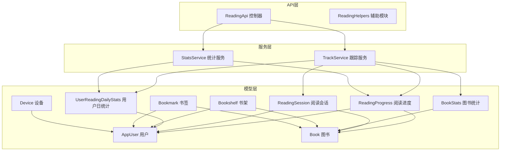
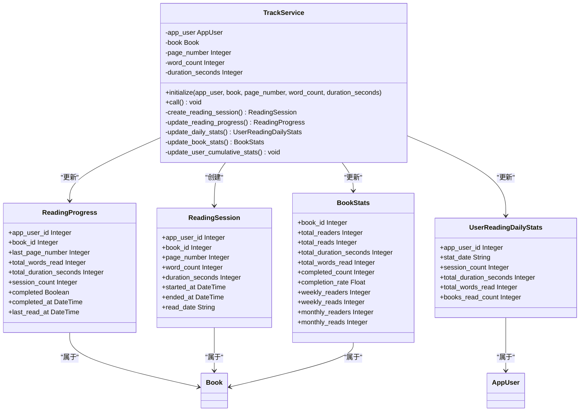
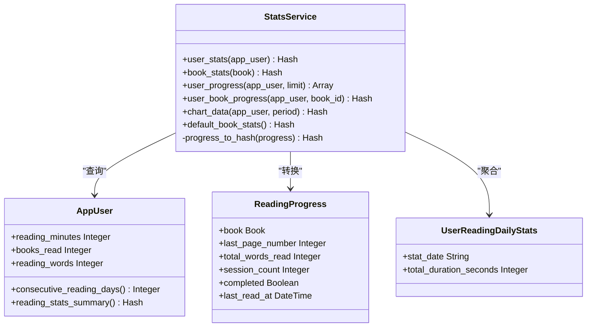
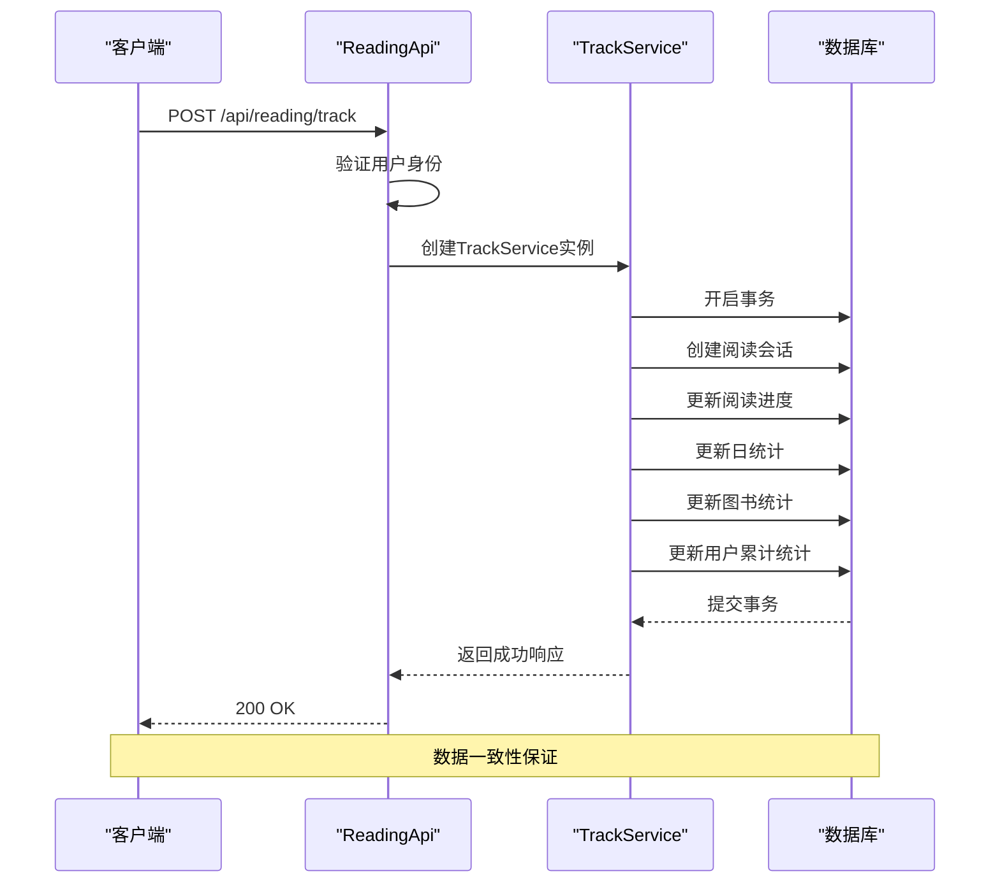
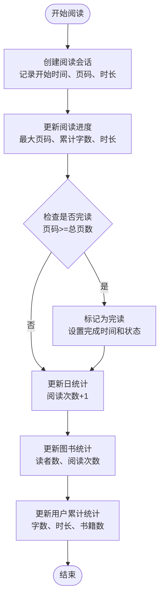
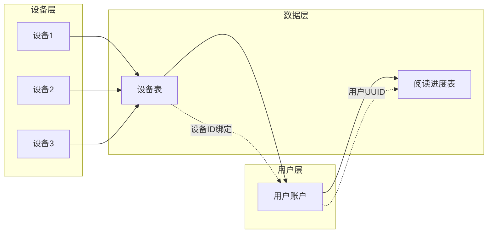
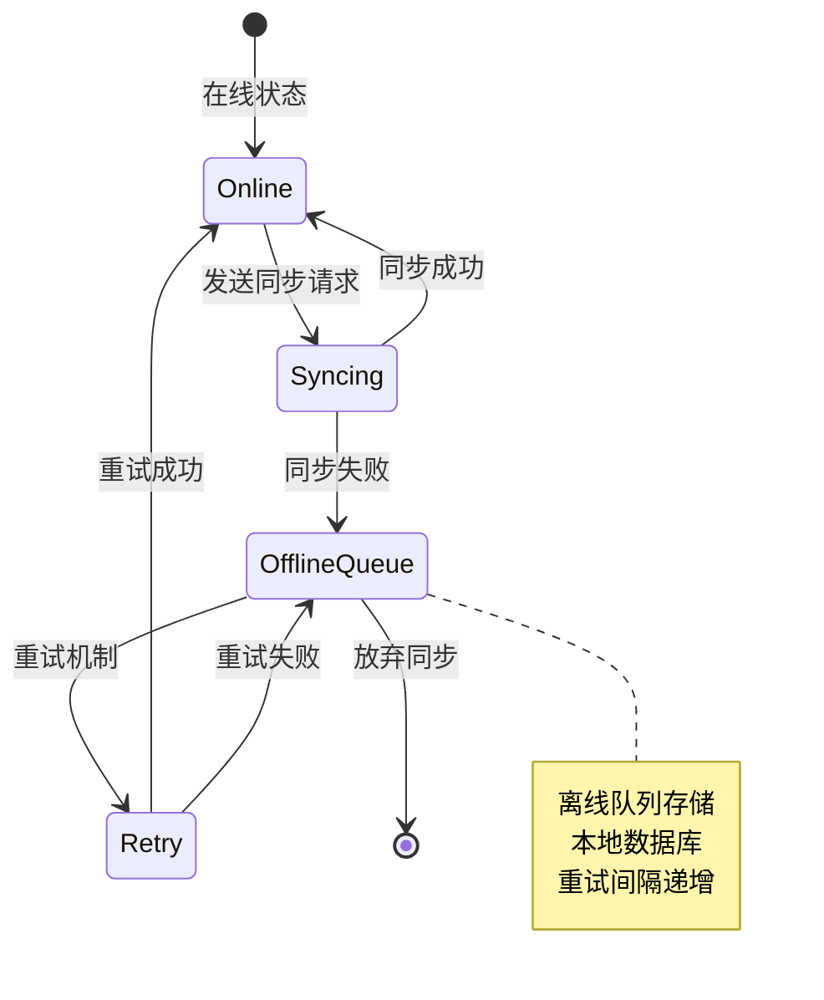
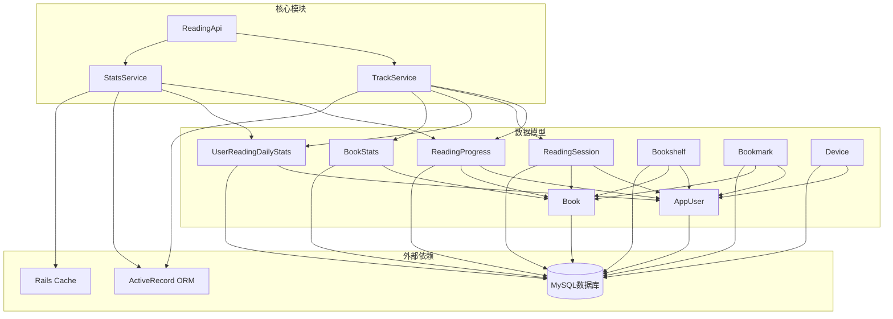

# 阅读进度API

<cite>
**本文档引用的文件**
- [reading_api.rb](file://app/controllers/api/readings/reading_api.rb)
- [reading_helpers.rb](file://app/controllers/api/readings/reading_helpers.rb)
- [stats_service.rb](file://app/services/reading/stats_service.rb)
- [track_service.rb](file://app/services/reading/track_service.rb)
- [reading_progress.rb](file://app/models/reading_progress.rb)
- [reading_session.rb](file://app/models/reading_session.rb)
- [user_reading_daily_stats.rb](file://app/models/user_reading_daily_stats.rb)
- [book_stats.rb](file://app/models/book_stats.rb)
- [app_user.rb](file://app/models/app_user.rb)
- [book.rb](file://app/models/book.rb)
- [bookshelf.rb](file://app/models/bookshelf.rb)
- [bookmark.rb](file://app/models/bookmark.rb)
- [device.rb](file://app/models/device.rb)
</cite>

## 目录
1. [简介](#简介)
2. [项目结构](#项目结构)
3. [核心组件](#核心组件)
4. [架构概览](#架构概览)
5. [详细组件分析](#详细组件分析)
6. [依赖关系分析](#依赖关系分析)
7. [性能考虑](#性能考虑)
8. [故障排除指南](#故障排除指南)
9. [结论](#结论)

## 简介

阅读进度API是VoiceBook阅读平台的核心功能模块，负责管理用户的阅读行为跟踪、进度统计和数据同步。该API提供了完整的阅读进度管理解决方案，包括阅读时长统计、章节完成度计算、书架管理、收藏夹功能和历史记录追踪。

系统采用分层架构设计，通过服务层封装业务逻辑，控制器层处理HTTP请求，模型层管理数据持久化。所有操作都在数据库事务中执行，确保数据一致性和完整性。

## 项目结构

阅读进度API位于应用的API控制器层次结构中，采用模块化组织方式：

**图表来源**
- [reading_api.rb:1-93](file://app/controllers/api/readings/reading_api.rb#L1-L93)
- [track_service.rb:1-126](file://app/services/reading/track_service.rb#L1-L126)
- [stats_service.rb:1-140](file://app/services/reading/stats_service.rb#L1-L140)

**章节来源**
- [reading_api.rb:1-93](file://app/controllers/api/readings/reading_api.rb#L1-L93)
- [reading_helpers.rb:1-10](file://app/controllers/api/readings/reading_helpers.rb#L1-L10)

## 核心组件

### 阅读跟踪服务 (TrackService)

TrackService是阅读进度API的核心业务逻辑组件，负责处理用户阅读行为的完整生命周期：

**图表来源**
- [track_service.rb:1-126](file://app/services/reading/track_service.rb#L1-L126)
- [reading_progress.rb:1-27](file://app/models/reading_progress.rb#L1-L27)
- [reading_session.rb:1-25](file://app/models/reading_session.rb#L1-L25)
- [user_reading_daily_stats.rb:1-21](file://app/models/user_reading_daily_stats.rb#L1-L21)
- [book_stats.rb:1-31](file://app/models/book_stats.rb#L1-L31)

### 阅读统计服务 (StatsService)

StatsService提供多种维度的阅读数据分析功能：

**图表来源**
- [stats_service.rb:1-140](file://app/services/reading/stats_service.rb#L1-L140)
- [app_user.rb:1-140](file://app/models/app_user.rb#L1-L140)
- [reading_progress.rb:1-27](file://app/models/reading_progress.rb#L1-L27)
- [user_reading_daily_stats.rb:1-21](file://app/models/user_reading_daily_stats.rb#L1-L21)

**章节来源**
- [track_service.rb:1-126](file://app/services/reading/track_service.rb#L1-L126)
- [stats_service.rb:1-140](file://app/services/reading/stats_service.rb#L1-L140)

## 架构概览

阅读进度API采用经典的三层架构模式，通过清晰的职责分离实现了高内聚低耦合的设计：

**图表来源**
- [reading_api.rb:19-34](file://app/controllers/api/readings/reading_api.rb#L19-L34)
- [track_service.rb:16-26](file://app/services/reading/track_service.rb#L16-L26)

系统的核心特性包括：

1. **事务性操作**：所有阅读数据更新都在单个数据库事务中执行，确保数据一致性
2. **实时统计**：即时更新用户和图书的阅读统计数据
3. **并发安全**：通过数据库约束和事务避免并发竞争条件
4. **缓存优化**：用户统计结果使用Redis缓存，提高查询性能

## 详细组件分析

### 阅读会话管理

阅读会话是用户每次实际阅读活动的最小单位，系统通过ReadingSession模型记录每次阅读的详细信息：

**图表来源**
- [track_service.rb:30-123](file://app/services/reading/track_service.rb#L30-L123)
- [reading_session.rb:16-25](file://app/models/reading_session.rb#L16-L25)
- [reading_progress.rb:17-27](file://app/models/reading_progress.rb#L17-L27)

### 进度同步机制

系统支持多设备间的阅读进度同步，通过设备绑定和用户标识实现数据共享：

**图表来源**
- [device.rb:24-51](file://app/models/device.rb#L24-L51)
- [app_user.rb:38-140](file://app/models/app_user.rb#L38-L140)
- [reading_progress.rb:17-27](file://app/models/reading_progress.rb#L17-L27)

### 阅读统计数据计算

系统提供多层次的阅读统计分析，支持用户个人统计和全站图书统计：

#### 用户统计指标
- **总阅读时长**：所有阅读进度的总时长（分钟）
- **总阅读字数**：累计阅读的总字数
- **平均阅读时长**：总时长除以阅读次数
- **完成率**：已读完的书籍数量占总数的比例
- **连续阅读天数**：基于日统计的连续阅读天数计算

#### 图书统计指标
- **总阅读人数**：阅读过该书的不同用户数
- **总阅读次数**：该书被阅读的总次数
- **完读人数**：完成阅读的用户数
- **完读率**：完读人数占总阅读人数的比例
- **周/月活跃读者**：近7天/30天的独立读者数

**章节来源**
- [stats_service.rb:6-28](file://app/services/reading/stats_service.rb#L6-L28)
- [stats_service.rb:30-44](file://app/services/reading/stats_service.rb#L30-L44)
- [app_user.rb:94-114](file://app/models/app_user.rb#L94-L114)

### 离线数据处理

系统具备完善的离线数据处理能力，确保在网络不稳定情况下的数据完整性：

**图表来源**
- [track_service.rb:16-26](file://app/services/reading/track_service.rb#L16-L26)

## 依赖关系分析

阅读进度API的依赖关系体现了清晰的分层架构和模块化设计：

**图表来源**
- [reading_api.rb:1-93](file://app/controllers/api/readings/reading_api.rb#L1-L93)
- [track_service.rb:1-126](file://app/services/reading/track_service.rb#L1-L126)
- [stats_service.rb:1-140](file://app/services/reading/stats_service.rb#L1-L140)

**章节来源**
- [reading_api.rb:1-93](file://app/controllers/api/readings/reading_api.rb#L1-L93)
- [track_service.rb:1-126](file://app/services/reading/track_service.rb#L1-L126)
- [stats_service.rb:1-140](file://app/services/reading/stats_service.rb#L1-L140)

## 性能考虑

### 缓存策略
系统采用多级缓存机制优化性能：
- **用户统计缓存**：用户阅读统计结果缓存30秒
- **应用用户缓存**：用户信息缓存，更新时自动失效
- **查询结果缓存**：常用查询结果使用Redis缓存

### 数据库优化
- **索引优化**：关键查询字段建立适当索引
- **批量查询**：使用includes预加载关联数据
- **分页处理**：进度列表默认限制20条记录

### 并发控制
- **数据库事务**：所有更新操作在事务中执行
- **乐观锁**：使用版本号避免并发更新冲突
- **重试机制**：网络异常时自动重试

## 故障排除指南

### 常见问题及解决方案

#### 阅读进度不同步
**症状**：多设备间阅读进度不一致
**原因**：设备绑定问题或缓存未刷新
**解决**：
1. 检查设备是否正确绑定到用户账户
2. 清除用户统计缓存
3. 验证数据库连接状态

#### 统计数据异常
**症状**：阅读时长或字数统计不准确
**原因**：并发更新导致的数据竞争
**解决**：
1. 检查事务是否正确提交
2. 验证数据库约束是否生效
3. 确认缓存是否及时更新

#### API响应超时
**症状**：接口响应时间过长
**原因**：数据库查询性能问题
**解决**：
1. 分析慢查询日志
2. 添加必要的数据库索引
3. 优化复杂查询语句

**章节来源**
- [track_service.rb:16-26](file://app/services/reading/track_service.rb#L16-L26)
- [app_user.rb:72-72](file://app/models/app_user.rb#L72-L72)

## 结论

阅读进度API通过精心设计的架构和完善的业务逻辑，为VoiceBook平台提供了可靠的阅读行为跟踪和数据统计能力。系统具备以下优势：

1. **数据一致性**：通过数据库事务确保所有操作的原子性
2. **扩展性强**：模块化设计便于功能扩展和维护
3. **性能优异**：多级缓存和数据库优化提升系统性能
4. **用户体验好**：实时统计和多设备同步提供流畅体验

未来可以在以下方面进一步优化：
- 增加更细粒度的权限控制
- 扩展更多类型的阅读行为统计
- 实现更智能的个性化推荐算法
- 增强离线数据同步的可靠性