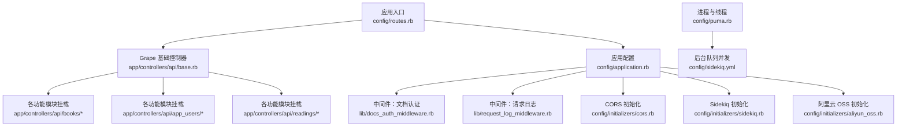
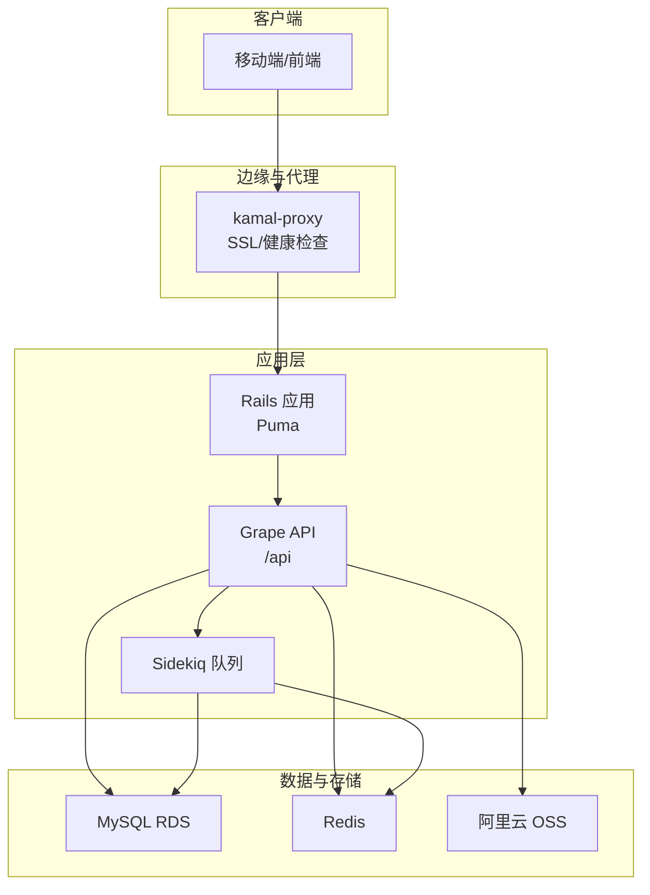
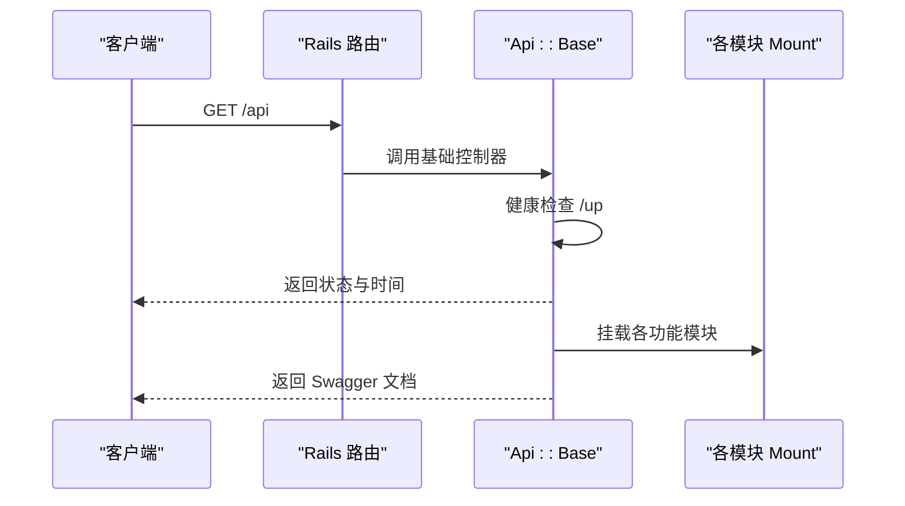
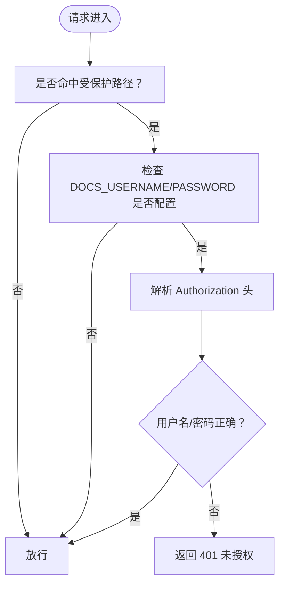
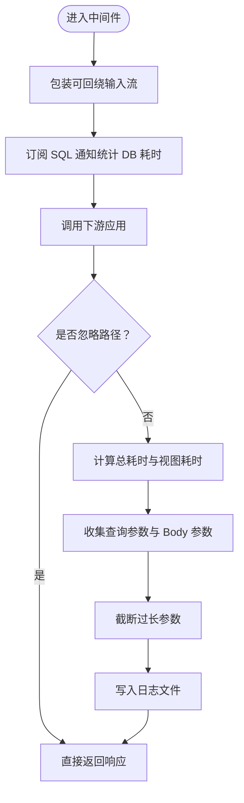
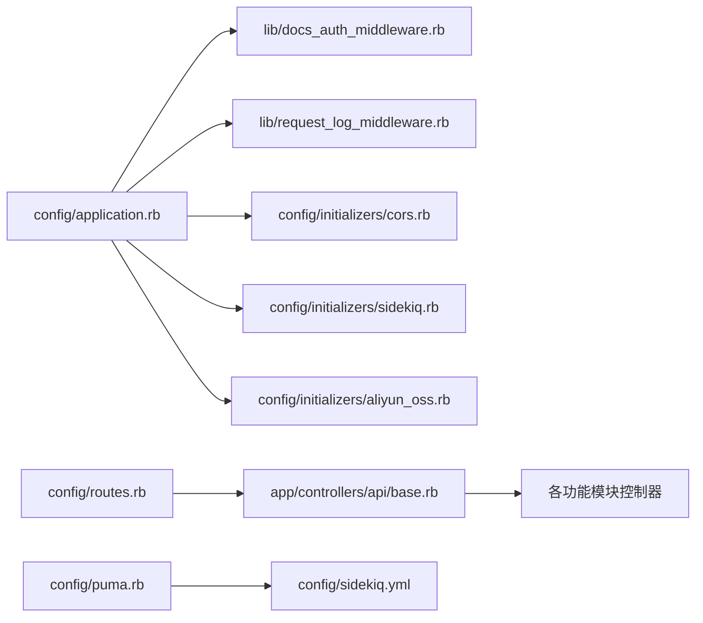

# 开发指南

<cite>
**本文引用的文件**
- [README.md](file://README.md)
- [Gemfile](file://Gemfile)
- [config/application.rb](file://config/application.rb)
- [config/routes.rb](file://config/routes.rb)
- [app/controllers/application_controller.rb](file://app/controllers/application_controller.rb)
- [app/controllers/api/base.rb](file://app/controllers/api/base.rb)
- [lib/docs_auth_middleware.rb](file://lib/docs_auth_middleware.rb)
- [lib/request_log_middleware.rb](file://lib/request_log_middleware.rb)
- [.rubocop.yml](file://.rubocop.yml)
- [config/initializers/cors.rb](file://config/initializers/cors.rb)
- [config/initializers/sidekiq.rb](file://config/initializers/sidekiq.rb)
- [config/initializers/aliyun_oss.rb](file://config/initializers/aliyun_oss.rb)
- [config/puma.rb](file://config/puma.rb)
- [config/sidekiq.yml](file://config/sidekiq.yml)
- [DEPLOYMENT.md](file://DEPLOYMENT.md)
- [KAMAL_DEPLOYMENT.md](file://KAMAL_DEPLOYMENT.md)
</cite>

## 目录
1. [引言](#引言)
2. [项目结构](#项目结构)
3. [核心组件](#核心组件)
4. [架构总览](#架构总览)
5. [详细组件分析](#详细组件分析)
6. [依赖关系分析](#依赖关系分析)
7. [性能考虑](#性能考虑)
8. [故障排查指南](#故障排查指南)
9. [结论](#结论)
10. [附录](#附录)

## 引言
本开发指南面向语音图书平台（VoiceBook）的后端团队，覆盖代码规范、命名约定、目录结构组织、中间件系统、日志记录、文档认证、基础设施组件使用方法、代码审查流程、性能优化建议、安全编码实践、开发工具配置、调试技巧以及扩展与维护策略。目标是帮助新成员快速上手，统一开发标准，提升交付质量与稳定性。

## 项目结构
- 采用 Rails 8 + Grape API + Sidekiq 的架构，API-only 模式，根路由挂载 Grape API 至 /api。
- lib 目录存放自定义中间件与服务封装；config/initializers 放置第三方集成初始化；app/controllers/api 下按领域划分模块化 API。
- 测试框架为 RSpec，配合 FactoryBot、WebMock、SimpleCov 等工具。

图表来源
- [config/routes.rb:1-30](file://config/routes.rb#L1-L30)
- [app/controllers/api/base.rb:1-65](file://app/controllers/api/base.rb#L1-L65)
- [config/application.rb:1-81](file://config/application.rb#L1-L81)
- [lib/docs_auth_middleware.rb:1-51](file://lib/docs_auth_middleware.rb#L1-L51)
- [lib/request_log_middleware.rb:1-164](file://lib/request_log_middleware.rb#L1-L164)
- [config/initializers/cors.rb:1-17](file://config/initializers/cors.rb#L1-L17)
- [config/initializers/sidekiq.rb:1-22](file://config/initializers/sidekiq.rb#L1-L22)
- [config/initializers/aliyun_oss.rb:1-31](file://config/initializers/aliyun_oss.rb#L1-L31)
- [config/puma.rb:1-46](file://config/puma.rb#L1-L46)
- [config/sidekiq.yml:1-8](file://config/sidekiq.yml#L1-L8)

章节来源
- [config/routes.rb:1-30](file://config/routes.rb#L1-L30)
- [app/controllers/api/base.rb:1-65](file://app/controllers/api/base.rb#L1-L65)
- [config/application.rb:1-81](file://config/application.rb#L1-L81)

## 核心组件
- API 基础入口：负责健康检查、首页欢迎接口、Swagger 文档注册与模块挂载。
- 中间件体系：文档认证中间件与请求日志中间件，分别保护文档接口与统一记录请求耗时与参数。
- 初始化器：CORS、Sidekiq、阿里云 OSS。
- 进程与队列：Puma 线程/进程配置与 Sidekiq 并发/队列配置。
- 部署与运维：Kamal 部署、Docker 构建、健康检查、零停机切换。

章节来源
- [app/controllers/api/base.rb:1-65](file://app/controllers/api/base.rb#L1-L65)
- [lib/docs_auth_middleware.rb:1-51](file://lib/docs_auth_middleware.rb#L1-L51)
- [lib/request_log_middleware.rb:1-164](file://lib/request_log_middleware.rb#L1-L164)
- [config/initializers/cors.rb:1-17](file://config/initializers/cors.rb#L1-L17)
- [config/initializers/sidekiq.rb:1-22](file://config/initializers/sidekiq.rb#L1-L22)
- [config/initializers/aliyun_oss.rb:1-31](file://config/initializers/aliyun_oss.rb#L1-L31)
- [config/puma.rb:1-46](file://config/puma.rb#L1-L46)
- [config/sidekiq.yml:1-8](file://config/sidekiq.yml#L1-L8)

## 架构总览
系统以 Grape 作为 API 层，Rails 负责路由与中间件，Sidekiq 负责异步任务，Puma 作为应用服务器，阿里云 OSS 提供对象存储，Redis 作为缓存与队列后端。部署通过 Kamal 与 Docker 实现零停机发布。

图表来源
- [config/routes.rb:1-30](file://config/routes.rb#L1-L30)
- [app/controllers/api/base.rb:1-65](file://app/controllers/api/base.rb#L1-L65)
- [config/initializers/sidekiq.rb:1-22](file://config/initializers/sidekiq.rb#L1-L22)
- [config/initializers/aliyun_oss.rb:1-31](file://config/initializers/aliyun_oss.rb#L1-L31)
- [config/puma.rb:1-46](file://config/puma.rb#L1-L46)
- [KAMAL_DEPLOYMENT.md:197-213](file://KAMAL_DEPLOYMENT.md#L197-L213)

## 详细组件分析

### API 基础入口与模块挂载
- 健康检查与首页接口：提供 /api/up 与 /api/ 用于健康检查与欢迎信息。
- Swagger 文档：集中注册标签与基础路径，便于统一文档管理。
- 模块挂载：按领域挂载 AppUsers、Books、Readings、Leaderboards、Ranks、Categories、HeadImgs 等模块。

图表来源
- [config/routes.rb:1-30](file://config/routes.rb#L1-L30)
- [app/controllers/api/base.rb:1-65](file://app/controllers/api/base.rb#L1-L65)

章节来源
- [app/controllers/api/base.rb:1-65](file://app/controllers/api/base.rb#L1-L65)
- [config/routes.rb:1-30](file://config/routes.rb#L1-L30)

### 文档认证中间件
- 作用范围：保护 /api_docs.html、/api/swagger_doc 及其子路径。
- 触发条件：当 DOCS_USERNAME 与 DOCS_PASSWORD 环境变量均存在时启用 Basic Auth。
- 未通过认证返回 401 并提示需要文档访问密码。

图表来源
- [lib/docs_auth_middleware.rb:1-51](file://lib/docs_auth_middleware.rb#L1-L51)

章节来源
- [lib/docs_auth_middleware.rb:1-51](file://lib/docs_auth_middleware.rb#L1-L51)

### 请求日志中间件（Unicorn 风格）
- 记录格式：包含时间、状态码、DB 耗时、总耗时、视图耗时、方法、路径与参数。
- 忽略路径：健康检查、favicon、根路径、robots.txt 等。
- 参数收集：优先解析 JSON，其次 form-urlencoded，最后尝试 multipart。
- 日志文件：独立写入 log/puma.log，支持每日轮转。

图表来源
- [lib/request_log_middleware.rb:1-164](file://lib/request_log_middleware.rb#L1-L164)

章节来源
- [lib/request_log_middleware.rb:1-164](file://lib/request_log_middleware.rb#L1-L164)

### CORS 配置
- 默认允许跨域：允许任意来源与方法，暴露分页相关头部。
- 可选禁用示例：提供注释化的自定义配置模板，便于按需调整。

章节来源
- [config/initializers/cors.rb:1-17](file://config/initializers/cors.rb#L1-L17)

### Sidekiq 初始化与队列配置
- Redis URL 构建：统一从环境变量构建，支持开发/测试默认值。
- 日志：持久化到 log/sidekiq.log，按日轮转，同时输出到 stdout。
- 并发与队列：在 sidekiq.yml 中定义并发数、队列与超时。

章节来源
- [config/initializers/sidekiq.rb:1-22](file://config/initializers/sidekiq.rb#L1-L22)
- [config/sidekiq.yml:1-8](file://config/sidekiq.yml#L1-L8)

### 阿里云 OSS 初始化
- 开发环境加载 .env；生产环境从环境变量读取密钥与端点。
- 初始化 OSS 客户端与 Bucket，封装上传/下载能力。

章节来源
- [config/initializers/aliyun_oss.rb:1-31](file://config/initializers/aliyun_oss.rb#L1-L31)

### Puma 进程与线程配置
- 线程：默认 3，可通过 RAILS_MAX_THREADS 调整。
- Worker：生产环境可配置，支持预加载应用。
- 端口：默认 80，与 kamal-proxy app_port 保持一致。

章节来源
- [config/puma.rb:1-46](file://config/puma.rb#L1-L46)

### 代码规范与命名约定
- RuboCop 插件：启用 rubocop-rails 与 rubocop-rspec。
- 行宽：最大 220。
- 方法长度：最大 150。
- 复杂度：圈复杂度与感知复杂度上限均为 20。
- 字符串：强制单引号。
- Rails/RSpec 规则：部分规则禁用，以适配项目现状。

章节来源
- [.rubocop.yml:1-179](file://.rubocop.yml#L1-L179)

### 部署与运维
- Kamal 部署：本地构建镜像 → 推送 Registry → 远端拉取 → 启动容器 → kamal-proxy 健康检查 → 切换流量。
- Dockerfile：阿里云镜像源、RubyGems 镜像、jemalloc、多阶段构建。
- 健康检查：/up 与 /api/up。
- 零停机：kamal-proxy 保障无缝切换。

章节来源
- [KAMAL_DEPLOYMENT.md:197-213](file://KAMAL_DEPLOYMENT.md#L197-L213)
- [DEPLOYMENT.md:369-377](file://DEPLOYMENT.md#L369-L377)

## 依赖关系分析
- 应用启动链路：config/application.rb 注入中间件与初始化器，config/routes.rb 挂载 Grape API，app/controllers/api/base.rb 组织模块。
- 第三方依赖：Grape、Sidekiq、Redis、MySQL、阿里云 OSS、Puma。
- 测试与质量：RSpec、FactoryBot、WebMock、SimpleCov、RuboCop。

图表来源
- [config/application.rb:1-81](file://config/application.rb#L1-L81)
- [config/routes.rb:1-30](file://config/routes.rb#L1-L30)
- [app/controllers/api/base.rb:1-65](file://app/controllers/api/base.rb#L1-L65)
- [config/puma.rb:1-46](file://config/puma.rb#L1-L46)
- [config/sidekiq.yml:1-8](file://config/sidekiq.yml#L1-L8)

章节来源
- [config/application.rb:1-81](file://config/application.rb#L1-L81)
- [config/routes.rb:1-30](file://config/routes.rb#L1-L30)
- [app/controllers/api/base.rb:1-65](file://app/controllers/api/base.rb#L1-L65)

## 性能考虑
- 线程与 Worker：根据 IO 密集特性，合理设置 RAILS_MAX_THREADS 与 WEB_CONCURRENCY，避免过度竞争 GVL。
- Sidekiq 并发：结合 CPU/IO 与队列负载，调整 concurrency 与队列优先级。
- Redis：建议 maxmemory-policy 设为 noeviction，避免淘汰导致缓存抖动。
- 日志：请求日志中间件对 SQL 订阅统计 DB 耗时，有助于定位慢查询。
- 阿里云 OSS：批量上传/下载时注意分片与并发，避免带宽瓶颈。

## 故障排查指南
- 文档访问 401：确认 DOCS_USERNAME 与 DOCS_PASSWORD 环境变量已正确设置。
- 请求日志异常：检查 log/puma.log 是否存在与权限，确认中间件插入顺序（需在静态文件中间件之前）。
- CORS 问题：核对允许来源与暴露头，必要时参考注释化配置模板。
- Sidekiq 任务失败：检查 log/sidekiq.log 与队列配置，确认 Redis 连接与超时设置。
- 部署健康检查失败：确认 Puma 端口与 kamal-proxy app_port 一致，/up 能正常返回。
- 零停机切换失败：检查 kamal-proxy 健康检查路径与超时配置。

章节来源
- [lib/docs_auth_middleware.rb:1-51](file://lib/docs_auth_middleware.rb#L1-L51)
- [lib/request_log_middleware.rb:1-164](file://lib/request_log_middleware.rb#L1-L164)
- [config/initializers/cors.rb:1-17](file://config/initializers/cors.rb#L1-L17)
- [config/initializers/sidekiq.rb:1-22](file://config/initializers/sidekiq.rb#L1-L22)
- [KAMAL_DEPLOYMENT.md:263-269](file://KAMAL_DEPLOYMENT.md#L263-L269)

## 结论
本指南提供了从架构理解、组件使用、代码规范到部署运维的完整开发标准。建议在日常开发中严格遵循中间件与初始化器的配置边界，持续优化线程/队列与 Redis 策略，并通过文档认证与日志中间件强化可观测性与安全性。

## 附录

### 开发工具与配置
- RuboCop：统一代码风格与质量基线。
- RSpec：单元/集成测试与覆盖率。
- Docker 与 Kamal：本地验证与生产零停机部署。
- Puma：线程与 Worker 配置，确保端口与代理一致。

章节来源
- [.rubocop.yml:1-179](file://.rubocop.yml#L1-L179)
- [DEPLOYMENT.md:66-78](file://DEPLOYMENT.md#L66-L78)
- [KAMAL_DEPLOYMENT.md:180-186](file://KAMAL_DEPLOYMENT.md#L180-L186)

### 代码审查流程（建议）
- 提交前运行 RuboCop 与 RSpec，确保通过。
- 关注复杂度与方法长度阈值，必要时拆分逻辑。
- 新增/修改中间件或初始化器需评估对全局的影响。
- 部署前在本地 Docker 容器中验证健康检查与核心接口。

章节来源
- [.rubocop.yml:1-179](file://.rubocop.yml#L1-L179)
- [DEPLOYMENT.md:443-506](file://DEPLOYMENT.md#L443-L506)

### 安全编码实践
- 文档认证：仅在生产环境启用 Basic Auth，避免泄露。
- 参数收集：对敏感参数进行截断与脱敏记录。
- CORS：最小化允许来源与方法，暴露必要头部。
- 队列参数：遵循 Sidekiq 7 的 JSON 原生类型限制。

章节来源
- [lib/docs_auth_middleware.rb:1-51](file://lib/docs_auth_middleware.rb#L1-L51)
- [lib/request_log_middleware.rb:1-164](file://lib/request_log_middleware.rb#L1-L164)
- [config/initializers/cors.rb:1-17](file://config/initializers/cors.rb#L1-L17)
- [README.md:189-195](file://README.md#L189-L195)

### 扩展新功能与维护
- 功能模块：在 app/controllers/api 下新增领域模块，遵循现有挂载与 Helpers 约定。
- 中间件：仅在 config/application.rb 中插入，确保顺序与环境判断正确。
- 初始化器：集中于 config/initializers，避免分散配置。
- 队列：按业务场景选择队列，控制并发与超时，关注日志与重试策略。

章节来源
- [app/controllers/api/base.rb:1-65](file://app/controllers/api/base.rb#L1-L65)
- [config/application.rb:1-81](file://config/application.rb#L1-L81)
- [config/initializers/sidekiq.rb:1-22](file://config/initializers/sidekiq.rb#L1-L22)