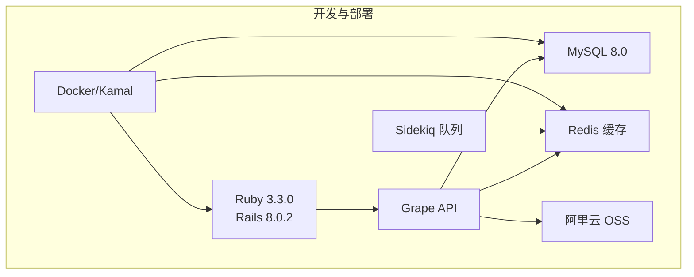
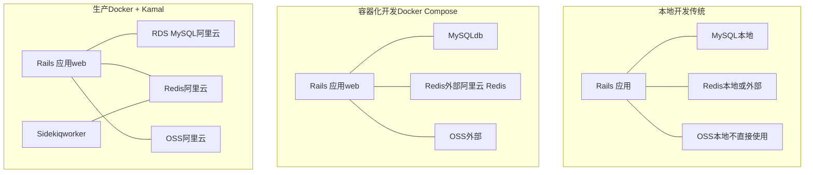
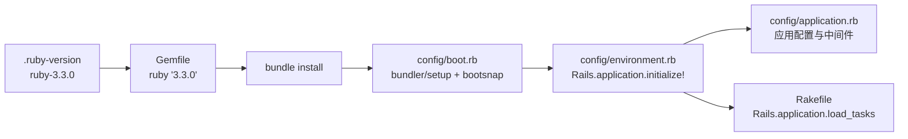

# 快速开始

<cite>
**本文引用的文件**
- [README.md](file://README.md)
- [DEPLOYMENT.md](file://DEPLOYMENT.md)
- [Gemfile](file://Gemfile)
- [.ruby-version](file://.ruby-version)
- [config/database.yml](file://config/database.yml)
- [Dockerfile](file://Dockerfile)
- [docker-compose.yml](file://docker-compose.yml)
- [config/application.rb](file://config/application.rb)
- [db/seeds.rb](file://db/seeds.rb)
- [config/deploy.yml](file://config/deploy.yml)
- [config/boot.rb](file://config/boot.rb)
- [config/environment.rb](file://config/environment.rb)
- [Rakefile](file://Rakefile)
</cite>

## 目录
1. [简介](#简介)
2. [项目结构](#项目结构)
3. [核心组件](#核心组件)
4. [架构总览](#架构总览)
5. [详细组件分析](#详细组件分析)
6. [依赖关系分析](#依赖关系分析)
7. [性能考虑](#性能考虑)
8. [故障排除指南](#故障排除指南)
9. [结论](#结论)
10. [附录](#附录)

## 简介
本指南旨在帮助新开发者在约 30 分钟内完成语音图书平台（VoiceBook）的本地运行。内容覆盖环境准备、Ruby 版本要求、依赖安装、数据库配置、环境变量设置、Docker 容器化部署以及传统本地开发环境配置；并包含数据库初始化、种子数据导入、服务启动等关键步骤。同时提供常见问题解决方案与故障排除建议。

## 项目结构
- 采用 Rails 8.0.2 + Grape API + Sidekiq 的后端架构，提供移动端 API 接口。
- 支持多种内容类型：电子书（PDF/EPUB）、有声书、视频、绘本。
- 使用 MySQL 8.0（utf8mb4）作为主数据库，Redis + Sidekiq 作为缓存与异步队列。
- 部署采用 Docker + Kamal，结合阿里云 OSS 与 RDS。

**章节来源**
- [README.md:106-118](file://README.md#L106-L118)
- [Gemfile:3](file://Gemfile#L3)
- [config/application.rb:16-81](file://config/application.rb#L16-L81)

## 核心组件
- Ruby 与 Rails：Ruby 3.3.0，Rails 8.0.2，Grape 提供 API，Sidekiq 作为后台任务队列。
- 数据库：MySQL 8.0（utf8mb4），开发/测试使用本地 MySQL，生产使用阿里云 RDS。
- 缓存与队列：Redis + Sidekiq 7.3。
- 存储：阿里云 OSS。
- 渲染：poppler-utils（pdftocairo）用于 PDF 页面处理。
- 测试：RSpec + FactoryBot + Webmock。

**章节来源**
- [README.md:9-21](file://README.md#L9-L21)
- [Gemfile:1-45](file://Gemfile#L1-L45)
- [config/application.rb:35-37](file://config/application.rb#L35-L37)

## 架构总览
下图展示了开发与生产两种运行模式的关键组件交互：

**图表来源**
- [docker-compose.yml:5-53](file://docker-compose.yml#L5-L53)
- [config/deploy.yml:10-17](file://config/deploy.yml#L10-L17)
- [config/application.rb:42-56](file://config/application.rb#L42-L56)

**章节来源**
- [docker-compose.yml:1-53](file://docker-compose.yml#L1-L53)
- [config/deploy.yml:1-104](file://config/deploy.yml#L1-L104)

## 详细组件分析

### 环境与依赖准备
- Ruby 版本：严格使用 3.3.0，与 .ruby-version 保持一致。
- 依赖安装：使用 bundle 安装项目所需 gem。
- 本地系统依赖：macOS 需要安装 mysql 与 poppler；Ubuntu/Debian 需要 default-mysql-client 与 poppler-utils。
- 阿里云镜像：Gemfile 指定阿里云镜像源以加速安装。

**章节来源**
- [.ruby-version:1-2](file://.ruby-version#L1-L2)
- [Gemfile:1-45](file://Gemfile#L1-L45)
- [README.md:106-118](file://README.md#L106-L118)

### 数据库配置
- 开发/测试：使用本地 MySQL，默认 socket 连接，数据库分别为 voicebook_development 与 voicebook_test。
- 生产：通过环境变量连接阿里云 RDS，支持 DATABASE_PRD_* 系列变量。
- 字符集：utf8mb4，排序规则 utf8mb4_unicode_ci。
- 连接池：开发/测试使用 RAILS_MAX_THREADS，生产使用 DATABASE_POOL_SIZE。

**章节来源**
- [config/database.yml:14-20](file://config/database.yml#L14-L20)
- [config/database.yml:22-39](file://config/database.yml#L22-L39)

### 环境变量设置
- 开发/测试：可通过 .env 文件或直接导出环境变量。
- 生产：通过 Kamal 的 secret 注入，包含 DATABASE_PRD_*、ALIYUN_ACCESS_KEY_*、REDIS_URL/REDIS_PASSWORD、SECRET_KEY_BASE 等。
- 容器化：docker-compose 示例中设置了 RAILS_ENV、DATABASE_*、REDIS_URL、RAILS_MASTER_KEY、SECRET_KEY_BASE、OSS_* 等。

**章节来源**
- [config/deploy.yml:27-70](file://config/deploy.yml#L27-L70)
- [docker-compose.yml:33-46](file://docker-compose.yml#L33-L46)
- [README.md:97-105](file://README.md#L97-L105)

### Docker 容器化部署
- 生产镜像：基于 reg.ylb.im/voicebook/ruby:3.3.0-slim-prod，使用多阶段构建，预编译 Bootsnap，最终以非 root 用户运行。
- 入口脚本：ENTRYPOINT 调用 /rails/bin/docker-entrypoint（仓库未包含该脚本文件，但 Dockerfile 指定）。
- 端口暴露：容器对外暴露 80 端口，由 Puma 监听。
- Compose 服务：包含 web（Rails）与 db（MySQL），web 依赖 db 健康检查；Redis 使用外部阿里云 Redis；OSS 为外部服务。

**章节来源**
- [Dockerfile:1-63](file://Dockerfile#L1-L63)
- [docker-compose.yml:5-53](file://docker-compose.yml#L5-L53)

### 传统本地开发环境
- 启动 Rails 服务器：bin/rails server，默认监听 3000 端口。
- 访问 API：/api 查看 API 状态，/up 进行健康检查。
- 测试：bundle exec rspec 运行全部测试，或针对特定文件运行。

**章节来源**
- [DEPLOYMENT.md:58-78](file://DEPLOYMENT.md#L58-L78)
- [README.md:120-126](file://README.md#L120-L126)

### 数据库初始化与种子数据
- 初始化：创建数据库、执行迁移、加载种子数据。
- 种子数据：包含年级、分类、阅读分级、排行榜、热门搜索、API 认证等基础数据。

**章节来源**
- [README.md:115-118](file://README.md#L115-L118)
- [db/seeds.rb:1-81](file://db/seeds.rb#L1-L81)

### 服务启动流程
- 本地：bundle exec rails server 启动 Puma，访问 /api 与 /up。
- Docker Compose：docker-compose up -d 启动 web 与 db，查看日志 docker-compose logs -f web。
- Kamal：首次部署 k setup，后续 k deploy；支持回滚与日志查看。

**章节来源**
- [DEPLOYMENT.md:58-78](file://DEPLOYMENT.md#L58-L78)
- [DEPLOYMENT.md:101-114](file://DEPLOYMENT.md#L101-L114)
- [DEPLOYMENT.md:211-228](file://DEPLOYMENT.md#L211-L228)

## 依赖关系分析
- Ruby 版本与 Gemfile：Gemfile 指定 Ruby 3.3.0，使用阿里云镜像源加速安装。
- Rails 引导：config/boot.rb 设置 BUNDLE_GEMFILE 并加载 bundler 与 bootsnap。
- 应用初始化：config/environment.rb 初始化 Rails 应用。
- Rake 任务：Rakefile 加载 Rails 应用任务。

**图表来源**
- [.ruby-version:1-2](file://.ruby-version#L1-L2)
- [Gemfile:1-45](file://Gemfile#L1-L45)
- [config/boot.rb:1-5](file://config/boot.rb#L1-L5)
- [config/environment.rb:1-6](file://config/environment.rb#L1-L6)
- [Rakefile:1-7](file://Rakefile#L1-L7)

**章节来源**
- [.ruby-version:1-2](file://.ruby-version#L1-L2)
- [Gemfile:1-45](file://Gemfile#L1-L45)
- [config/boot.rb:1-5](file://config/boot.rb#L1-L5)
- [config/environment.rb:1-6](file://config/environment.rb#L1-L6)
- [Rakefile:1-7](file://Rakefile#L1-L7)

## 性能考虑
- 连接池：开发/测试使用 RAILS_MAX_THREADS，生产使用 DATABASE_POOL_SIZE。
- Redis URL 构建：根据环境动态生成，开发/测试默认 localhost，生产从 REDIS_URL/REDIS_PASSWORD 组合。
- Puma：容器内 CMD 使用 config/puma.rb 启动（仓库未包含该文件，但 Dockerfile 指定）。
- Bootsnap：Dockerfile 与 config/boot.rb 中均启用以加速启动。

**章节来源**
- [config/database.yml:24-29](file://config/database.yml#L24-L29)
- [config/application.rb:42-56](file://config/application.rb#L42-L56)
- [Dockerfile:30-35](file://Dockerfile#L30-L35)
- [config/boot.rb:1-5](file://config/boot.rb#L1-L5)

## 故障排除指南
- Docker 构建失败（gem 安装错误）：确认镜像已安装 default-libmysqlclient-dev。
- 连接数据库失败：检查 RDS 安全组是否允许服务器内网 IP。
- Puma 启动失败：检查 config/puma.rb 端口配置与 config/master.key 是否存在。
- 生成 master.key：使用 EDITOR=vi bin/rails credentials:edit。
- Docker Compose 健康检查：curl http://localhost:3000/up。
- Kamal 部署：首次 k setup，后续 k deploy；查看日志 k app logs -f。

**章节来源**
- [DEPLOYMENT.md:391-406](file://DEPLOYMENT.md#L391-L406)
- [DEPLOYMENT.md:134-142](file://DEPLOYMENT.md#L134-L142)
- [DEPLOYMENT.md:211-228](file://DEPLOYMENT.md#L211-L228)

## 结论
按照本指南，您可以在 30 分钟内完成从环境准备到本地运行的全流程。优先选择 Docker Compose 快速体验，随后再切换到传统本地开发或生产级 Kamal 部署。遇到问题时，可参考“故障排除指南”中的常见场景与解决步骤。

## 附录

### 快速操作清单（30 分钟）
- 安装 Ruby 3.3.0 与系统依赖（macOS/Ubuntu）。
- bundle install 安装 Ruby 依赖。
- 启动本地 MySQL（或使用 docker-compose）。
- 创建数据库并执行迁移。
- 导入种子数据。
- 启动 Rails 服务器或 Docker Compose。
- 访问 /api 与 /up 验证服务状态。

**章节来源**
- [README.md:106-118](file://README.md#L106-L118)
- [DEPLOYMENT.md:35-78](file://DEPLOYMENT.md#L35-L78)
- [docker-compose.yml:101-114](file://docker-compose.yml#L101-L114)