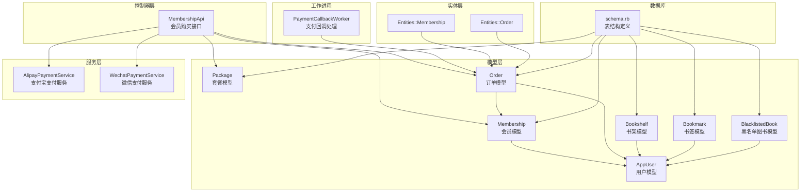
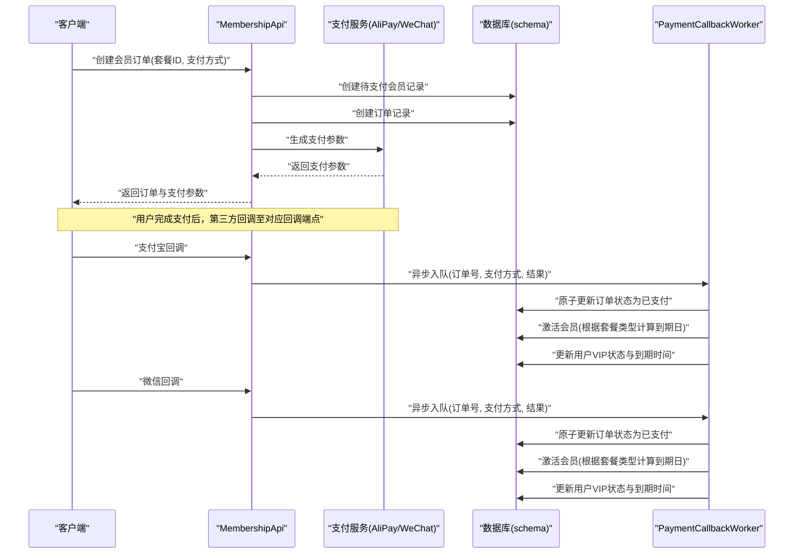
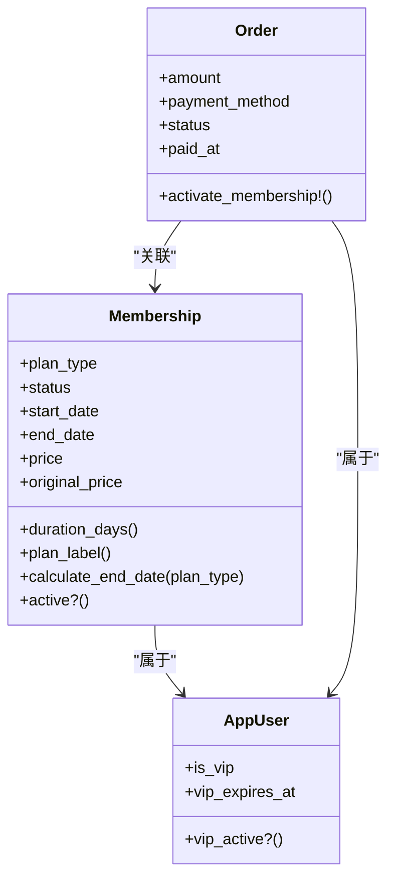
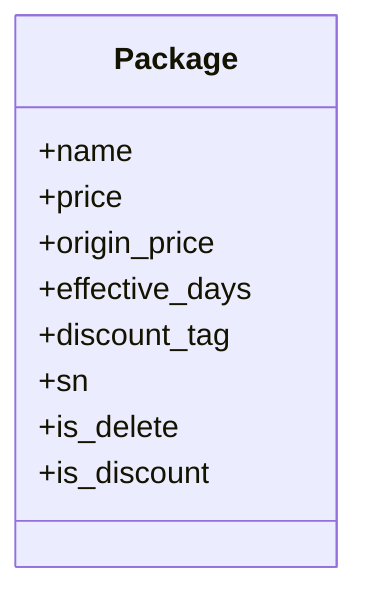
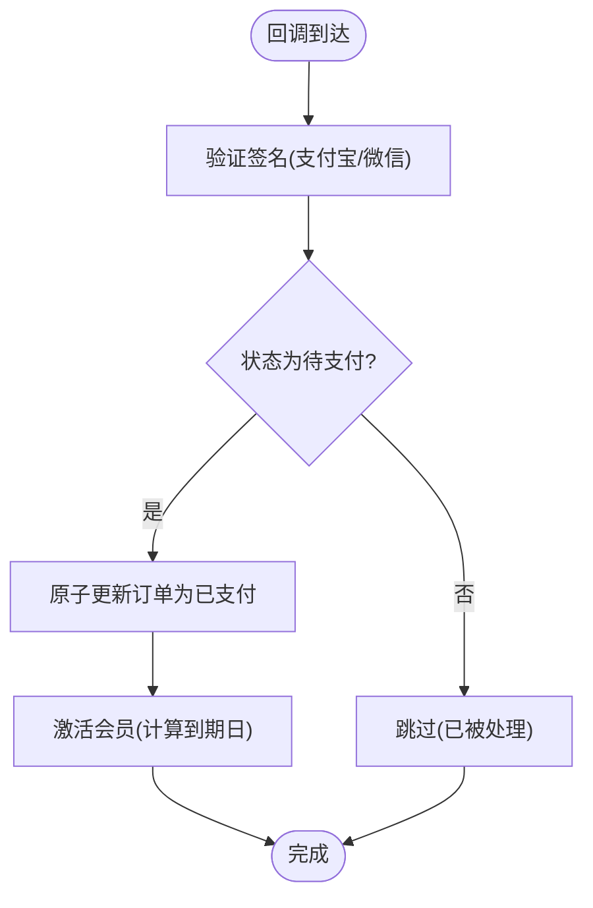
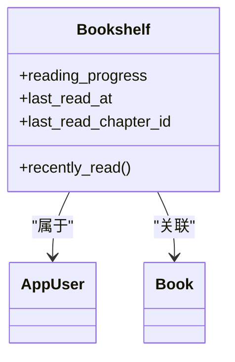
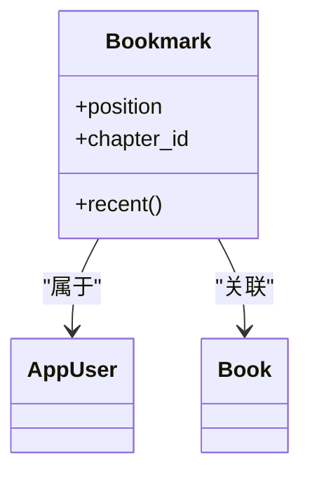
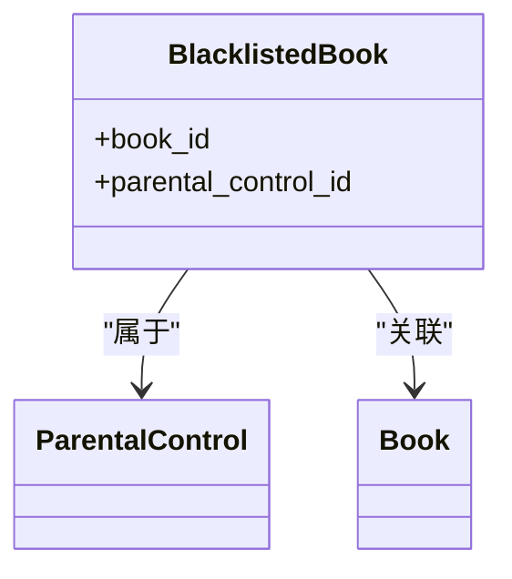
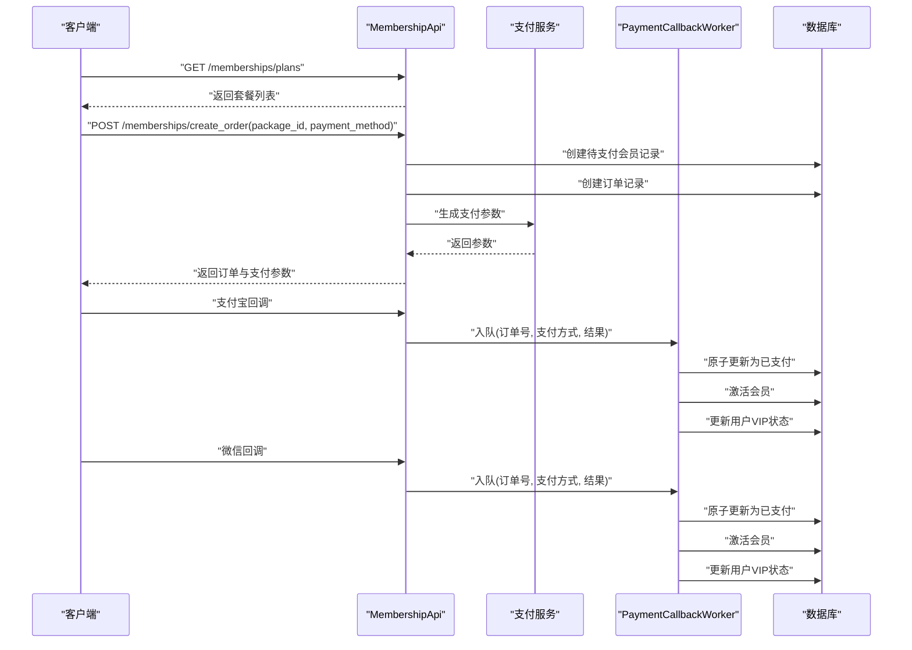
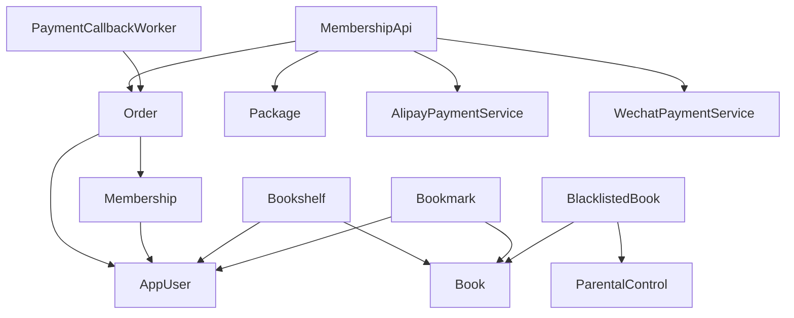

# 会员与订单模型

<cite>
**本文档引用的文件**
- [membership.rb](file://app/models/membership.rb)
- [package.rb](file://app/models/package.rb)
- [order.rb](file://app/models/order.rb)
- [bookshelf.rb](file://app/models/bookshelf.rb)
- [bookmark.rb](file://app/models/bookmark.rb)
- [blacklisted_book.rb](file://app/models/blacklisted_book.rb)
- [membership_api.rb](file://app/controllers/api/memberships/membership_api.rb)
- [alipay_payment_service.rb](file://app/services/alipay_payment_service.rb)
- [wechat_payment_service.rb](file://app/services/wechat_payment_service.rb)
- [payment_callback_worker.rb](file://app/workers/payment_callback_worker.rb)
- [app_user.rb](file://app/models/app_user.rb)
- [membership实体](file://app/entities/membership.rb)
- [order实体](file://app/entities/order.rb)
- [schema.rb](file://db/schema.rb)
- [会员模型规格](file://spec/models/membership_spec.rb)
- [订单模型规格](file://spec/models/order_spec.rb)
- [书架模型规格](file://spec/models/bookshelf_spec.rb)
- [书签模型规格](file://spec/models/bookmark_spec.rb)
</cite>

## 目录
1. [引言](#引言)
2. [项目结构](#项目结构)
3. [核心组件](#核心组件)
4. [架构概览](#架构概览)
5. [详细组件分析](#详细组件分析)
6. [依赖分析](#依赖分析)
7. [性能考虑](#性能考虑)
8. [故障排除指南](#故障排除指南)
9. [结论](#结论)

## 引言
本文件聚焦于语音阅读应用中的会员服务与订单管理相关数据模型，系统性阐述以下主题：
- 会员模型的等级、权限与有效期管理
- 套餐模型的价格、内容包与服务范围
- 订单模型的支付状态、交易记录与回调处理
- 书架模型的收藏管理与同步机制
- 书签模型的位置标记与跨设备同步
- 黑名单图书的限制与访问控制
- 会员升级、续费、退款等业务流程的数据支持
- 订单状态流转与支付安全的技术实现细节

## 项目结构
围绕会员与订单的核心文件组织如下：
- 模型层：会员、套餐、订单、书架、书签、黑名单图书
- 控制器层：会员购买接口，包含套餐列表、订单创建、支付回调
- 服务层：支付宝与微信支付服务，负责参数生成与签名验证
- 工作进程：支付回调异步处理，确保幂等与一致性
- 实体层：API 输出序列化，控制对外暴露字段
- 数据库：schema 定义各表结构与索引

**图表来源**
- [membership_api.rb:1-206](file://app/controllers/api/memberships/membership_api.rb#L1-L206)
- [membership.rb:1-73](file://app/models/membership.rb#L1-L73)
- [package.rb:1-29](file://app/models/package.rb#L1-L29)
- [order.rb:1-104](file://app/models/order.rb#L1-L104)
- [bookshelf.rb:1-36](file://app/models/bookshelf.rb#L1-L36)
- [bookmark.rb:1-33](file://app/models/bookmark.rb#L1-L33)
- [blacklisted_book.rb:1-29](file://app/models/blacklisted_book.rb#L1-L29)
- [alipay_payment_service.rb:1-137](file://app/services/alipay_payment_service.rb#L1-L137)
- [wechat_payment_service.rb:1-113](file://app/services/wechat_payment_service.rb#L1-L113)
- [payment_callback_worker.rb:1-37](file://app/workers/payment_callback_worker.rb#L1-L37)
- [membership实体:1-15](file://app/entities/membership.rb#L1-L15)
- [order实体:1-22](file://app/entities/order.rb#L1-L22)
- [schema.rb:385-428](file://db/schema.rb#L385-L428)

**章节来源**
- [membership_api.rb:1-206](file://app/controllers/api/memberships/membership_api.rb#L1-L206)
- [schema.rb:385-428](file://db/schema.rb#L385-L428)

## 核心组件
本节概述各核心模型的职责与关键特性。

- 会员模型（Membership）
  - 管理用户的 VIP 订阅（月度、季度、年度）
  - 维护开始/结束日期、价格、状态与套餐类型
  - 提供有效性判断与套餐时长计算
  - 与用户与订单存在关联关系

- 套餐模型（Package）
  - 定义可购买的会员套餐，包含名称、价格、原价、生效天数等
  - 提供默认作用域与排序规则，支持折扣标记

- 订单模型（Order）
  - 记录购买行为，支持支付宝与微信支付
  - 维护订单号、金额、支付方式、状态与支付时间
  - 提供订单号生成、标记支付、激活会员等方法
  - 与用户及会员存在关联关系

- 书架模型（Bookshelf）
  - 管理用户个人书架，记录阅读进度与最后阅读时间
  - 保证用户与图书组合的唯一性

- 书签模型（Bookmark）
  - 记录用户在阅读中添加的位置标记（百分比）
  - 支持按创建时间排序

- 黑名单图书模型（BlacklistedBook）
  - 管理家长设置的内容黑名单，屏蔽特定图书
  - 保证家长管控与图书组合的唯一性

**章节来源**
- [membership.rb:26-73](file://app/models/membership.rb#L26-L73)
- [package.rb:19-29](file://app/models/package.rb#L19-L29)
- [order.rb:27-104](file://app/models/order.rb#L27-L104)
- [bookshelf.rb:24-36](file://app/models/bookshelf.rb#L24-L36)
- [bookmark.rb:22-33](file://app/models/bookmark.rb#L22-L33)
- [blacklisted_book.rb:21-29](file://app/models/blacklisted_book.rb#L21-L29)

## 架构概览
会员与订单相关模块的交互流程如下：

**图表来源**
- [membership_api.rb:68-122](file://app/controllers/api/memberships/membership_api.rb#L68-L122)
- [alipay_payment_service.rb:16-26](file://app/services/alipay_payment_service.rb#L16-L26)
- [wechat_payment_service.rb:19-37](file://app/services/wechat_payment_service.rb#L19-L37)
- [payment_callback_worker.rb:11-35](file://app/workers/payment_callback_worker.rb#L11-L35)
- [order.rb:56-87](file://app/models/order.rb#L56-L87)
- [schema.rb:400-414](file://db/schema.rb#L400-L414)

## 详细组件分析

### 会员模型（Membership）
- 等级与权限
  - 套餐类型：月度、季度、年度
  - 状态：待支付、有效、已过期、已取消
  - 通过有效性判断与到期日控制权限范围

- 有效期管理
  - 开始/结束日期用于确定有效区间
  - 提供套餐时长计算方法
  - 提供计算结束日期的类方法，依据套餐类型推算

- 与用户/订单的关系
  - 属于用户，可关联多笔订单
  - 与订单存在一对一关联，用于记录购买的会员记录

**图表来源**
- [membership.rb:26-73](file://app/models/membership.rb#L26-L73)
- [order.rb:63-87](file://app/models/order.rb#L63-L87)
- [app_user.rb:78-80](file://app/models/app_user.rb#L78-L80)

**章节来源**
- [membership.rb:26-73](file://app/models/membership.rb#L26-L73)
- [membership_spec.rb:26-112](file://spec/models/membership_spec.rb#L26-L112)

### 套餐模型（Package）
- 价格与内容包
  - 名称、价格、原价、生效天数
  - 支持折扣标记与排序字段

- 服务范围
  - 默认作用域过滤删除状态
  - 提供多种排序与筛选作用域

**图表来源**
- [package.rb:19-29](file://app/models/package.rb#L19-L29)

**章节来源**
- [package.rb:19-29](file://app/models/package.rb#L19-L29)
- [schema.rb:416-428](file://db/schema.rb#L416-L428)

### 订单模型（Order）
- 支付状态与交易记录
  - 状态：待支付、已支付、失败、已退款
  - 支付方式：支付宝、微信
  - 订单号唯一性与自动生成规则

- 回调处理与幂等
  - 异步回调处理，使用乐观锁确保仅一次状态变更
  - 成功回调后激活会员，支持续费与升级场景

**图表来源**
- [payment_callback_worker.rb:17-26](file://app/workers/payment_callback_worker.rb#L17-L26)
- [order.rb:56-87](file://app/models/order.rb#L56-L87)
- [alipay_payment_service.rb:28-57](file://app/services/alipay_payment_service.rb#L28-L57)
- [wechat_payment_service.rb:39-64](file://app/services/wechat_payment_service.rb#L39-L64)

**章节来源**
- [order.rb:27-104](file://app/models/order.rb#L27-L104)
- [order_spec.rb:27-160](file://spec/models/order_spec.rb#L27-L160)
- [payment_callback_worker.rb:1-37](file://app/workers/payment_callback_worker.rb#L1-L37)

### 书架模型（Bookshelf）
- 收藏管理
  - 用户与图书组合唯一，防止重复添加
  - 记录阅读进度与最后阅读时间

- 同步机制
  - 通过用户维度聚合，按最后阅读时间排序
  - 可扩展为跨设备同步策略（如基于用户ID的合并）

**图表来源**
- [bookshelf.rb:24-36](file://app/models/bookshelf.rb#L24-L36)

**章节来源**
- [bookshelf.rb:24-36](file://app/models/bookshelf.rb#L24-L36)
- [bookshelf_spec.rb:24-63](file://spec/models/bookshelf_spec.rb#L24-L63)

### 书签模型（Bookmark）
- 位置标记
  - 百分比位置与章节ID
  - 支持按创建时间倒序查看

- 跨设备同步
  - 基于用户与图书维度的唯一性，便于跨设备合并
  - 可结合书架模型的用户维度进行统一同步

**图表来源**
- [bookmark.rb:22-33](file://app/models/bookmark.rb#L22-L33)

**章节来源**
- [bookmark.rb:22-33](file://app/models/bookmark.rb#L22-L33)
- [bookmark_spec.rb:22-48](file://spec/models/bookmark_spec.rb#L22-L48)

### 黑名单图书模型（BlacklistedBook）
- 限制与访问控制
  - 家长管控与图书的唯一组合
  - 屏蔽黑名单中的图书，保障儿童内容安全

**图表来源**
- [blacklisted_book.rb:21-29](file://app/models/blacklisted_book.rb#L21-L29)

**章节来源**
- [blacklisted_book.rb:21-29](file://app/models/blacklisted_book.rb#L21-L29)

### 会员购买与支付流程（API）
- 套餐列表与订单创建
  - 获取套餐列表并按价格排序
  - 创建待支付会员记录与订单
  - 生成支付参数（支付宝或微信）

- 支付回调与异步处理
  - 支付宝回调：读取原始 body，验证签名后异步入队
  - 微信回调：读取请求头与 body，验证签名后异步入队
  - 工作进程原子更新订单状态并激活会员

**图表来源**
- [membership_api.rb:55-122](file://app/controllers/api/memberships/membership_api.rb#L55-L122)
- [alipay_payment_service.rb:28-57](file://app/services/alipay_payment_service.rb#L28-L57)
- [wechat_payment_service.rb:39-64](file://app/services/wechat_payment_service.rb#L39-L64)
- [payment_callback_worker.rb:11-35](file://app/workers/payment_callback_worker.rb#L11-L35)

**章节来源**
- [membership_api.rb:1-206](file://app/controllers/api/memberships/membership_api.rb#L1-L206)

## 依赖分析
- 模型间依赖
  - Order 依赖 Membership 与 AppUser
  - Membership 依赖 AppUser
  - Bookshelf、Bookmark、BlacklistedBook 依赖 AppUser 与 Book
- 控制器依赖
  - MembershipApi 依赖 Package、Membership、Order 以及支付服务
- 服务与工作进程
  - 支付回调由 PaymentCallbackWorker 统一处理，确保幂等与一致性

**图表来源**
- [order.rb:34-36](file://app/models/order.rb#L34-L36)
- [membership.rb:34-35](file://app/models/membership.rb#L34-L35)
- [membership_api.rb:78-98](file://app/controllers/api/memberships/membership_api.rb#L78-L98)
- [payment_callback_worker.rb:11-26](file://app/workers/payment_callback_worker.rb#L11-L26)

**章节来源**
- [order.rb:27-104](file://app/models/order.rb#L27-L104)
- [membership.rb:26-73](file://app/models/membership.rb#L26-L73)
- [membership_api.rb:1-206](file://app/controllers/api/memberships/membership_api.rb#L1-L206)

## 性能考虑
- 索引优化
  - 会员表按状态与到期日建立索引，加速有效会员查询
  - 订单表按状态、订单号与会员ID建立索引，提升支付状态与关联查询效率
  - 书架与书签表按用户ID与图书ID建立索引，优化收藏与书签查询
- 幂等与并发
  - 支付回调采用乐观锁原子更新，避免重复处理
  - 异步队列处理回调，降低主流程阻塞风险
- 序列化与输出
  - 使用实体层控制对外输出字段，减少不必要的数据传输

## 故障排除指南
- 支付回调签名验证失败
  - 支付宝：确认回调前读取原始 body，使用原始 URL-encoded 字符串进行验签
  - 微信：确认回调头包含必要字段并使用平台证书验证
- 订单状态异常
  - 检查回调是否已入队并执行
  - 核对订单状态是否为待支付，避免重复更新
- 会员未激活
  - 确认回调结果中的交易状态为成功
  - 检查套餐类型与到期日计算逻辑

**章节来源**
- [alipay_payment_service.rb:28-57](file://app/services/alipay_payment_service.rb#L28-L57)
- [wechat_payment_service.rb:39-64](file://app/services/wechat_payment_service.rb#L39-L64)
- [payment_callback_worker.rb:17-35](file://app/workers/payment_callback_worker.rb#L17-L35)

## 结论
本文档系统梳理了会员与订单管理相关的核心数据模型及其交互关系，明确了会员等级与有效期管理、套餐价格与服务范围、订单状态流转与支付安全、书架与书签的收藏与同步机制，以及黑名单图书的访问控制策略。通过支付宝与微信支付服务的集成、异步回调处理与幂等更新，系统实现了稳定可靠的会员购买与续费流程，并为后续扩展（如退款、升级等）提供了清晰的数据基础与架构支撑。