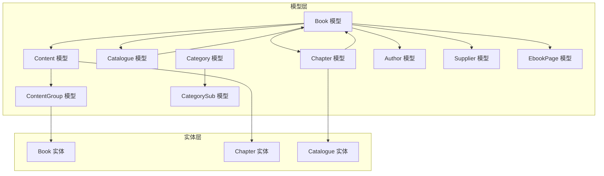
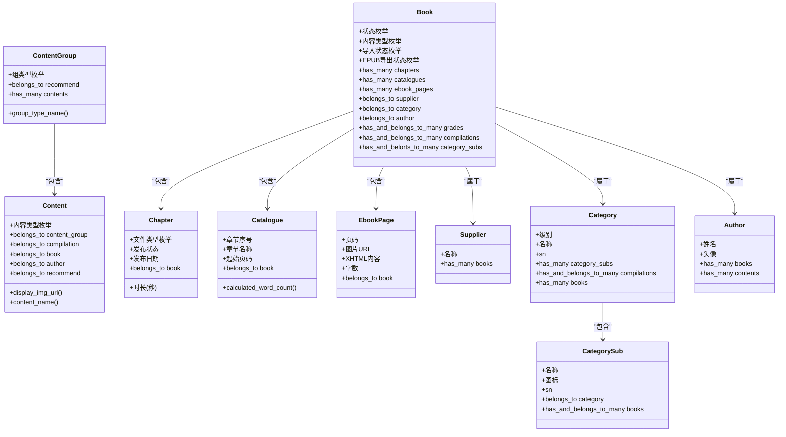
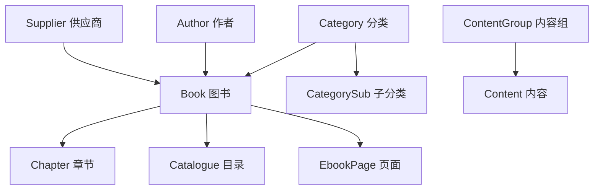

# 图书内容模型

<cite>
**本文档引用的文件**
- [app/models/book.rb](file://app/models/book.rb)
- [app/models/chapter.rb](file://app/models/chapter.rb)
- [app/models/catalogue.rb](file://app/models/catalogue.rb)
- [app/models/content.rb](file://app/models/content.rb)
- [app/models/content_group.rb](file://app/models/content_group.rb)
- [app/models/category.rb](file://app/models/category.rb)
- [app/models/category_sub.rb](file://app/models/category_sub.rb)
- [app/models/author.rb](file://app/models/author.rb)
- [app/models/supplier.rb](file://app/models/supplier.rb)
- [app/models/ebook_page.rb](file://app/models/ebook_page.rb)
- [app/entities/book.rb](file://app/entities/book.rb)
- [app/entities/chapter.rb](file://app/entities/chapter.rb)
- [app/entities/catalogue.rb](file://app/entities/catalogue.rb)
</cite>

## 目录
1. [引言](#引言)
2. [项目结构](#项目结构)
3. [核心组件](#核心组件)
4. [架构概览](#架构概览)
5. [详细组件分析](#详细组件分析)
6. [依赖分析](#依赖分析)
7. [性能考虑](#性能考虑)
8. [故障排除指南](#故障排除指南)
9. [结论](#结论)

## 引言

本文件系统性地阐述语音图书应用中的图书内容相关数据模型，涵盖Book图书模型、Chapter章节模型、Catalogue目录模型、Content内容模型、ContentGroup内容组模型、Category分类模型、CategorySub子分类模型、Author作者模型以及Supplier供应商模型。文档重点说明各模型的字段定义、内容属性与元数据管理方式，并解释它们之间的关联关系。同时，结合现有代码实现，提供导入、导出、搜索和推荐算法的数据支持说明。

## 项目结构

该语音图书应用采用标准的Rails项目结构，图书相关内容主要分布在以下位置：
- 模型层：位于 app/models，定义了核心业务实体及其关系
- 实体层：位于 app/entities，用于API响应的数据封装与序列化
- 数据库迁移：位于 db/migrate，包含各模型对应的表结构定义

**图表来源**
- [app/models/book.rb:57-156](file://app/models/book.rb#L57-L156)
- [app/models/chapter.rb:26-102](file://app/models/chapter.rb#L26-L102)
- [app/models/catalogue.rb:24-41](file://app/models/catalogue.rb#L24-L41)
- [app/models/content.rb:25-78](file://app/models/content.rb#L25-L78)
- [app/models/content_group.rb:23-60](file://app/models/content_group.rb#L23-L60)
- [app/models/category.rb:17-39](file://app/models/category.rb#L17-L39)
- [app/models/category_sub.rb:23-33](file://app/models/category_sub.rb#L23-L33)
- [app/models/author.rb:11-18](file://app/models/author.rb#L11-L18)
- [app/models/supplier.rb:14-16](file://app/models/supplier.rb#L14-L16)
- [app/models/ebook_page.rb:25-33](file://app/models/ebook_page.rb#L25-L33)
- [app/entities/book.rb:4-56](file://app/entities/book.rb#L4-L56)
- [app/entities/chapter.rb:4-21](file://app/entities/chapter.rb#L4-L21)
- [app/entities/catalogue.rb:4-13](file://app/entities/catalogue.rb#L4-L13)

**章节来源**
- [app/models/book.rb:1-157](file://app/models/book.rb#L1-L157)
- [app/models/chapter.rb:1-103](file://app/models/chapter.rb#L1-L103)
- [app/models/catalogue.rb:1-42](file://app/models/catalogue.rb#L1-L42)
- [app/models/content.rb:1-79](file://app/models/content.rb#L1-L79)
- [app/models/content_group.rb:1-61](file://app/models/content_group.rb#L1-L61)
- [app/models/category.rb:1-40](file://app/models/category.rb#L1-L40)
- [app/models/category_sub.rb:1-34](file://app/models/category_sub.rb#L1-L34)
- [app/models/author.rb:1-19](file://app/models/author.rb#L1-L19)
- [app/models/supplier.rb:1-17](file://app/models/supplier.rb#L1-L17)
- [app/models/ebook_page.rb:1-34](file://app/models/ebook_page.rb#L1-L34)
- [app/entities/book.rb:1-58](file://app/entities/book.rb#L1-L58)
- [app/entities/chapter.rb:1-23](file://app/entities/chapter.rb#L1-L23)
- [app/entities/catalogue.rb:1-15](file://app/entities/catalogue.rb#L1-L15)

## 核心组件

本节概述图书内容相关的核心数据模型，包括字段定义、枚举状态、验证规则与常用作用域。

- Book 图书模型
  - 关键字段：名称、封面图、简介、内容类型（电子书/有声/视频/绘本）、导入状态、导出状态、播放次数、评分、字数、页数、主题标签等
  - 枚举状态：状态（草稿/已发布/已下架）、内容类型（电子书/有声/视频/绘本）、导入状态（未导入/处理中/就绪/失败）、EPUB导出状态（未导出/导出中/已完成/失败）
  - 关系：属于供应商、分类、作者；多对多：年级、合辑、子分类；一对多：章节、目录、电子书页面、收藏、书架、阅读进度、会话、统计
  - 作用域：按状态、类型、作者、分类、年级筛选，以及热门、高分、最新等排序

- Chapter 章节模型
  - 关键字段：章节名称、封面图、内容文件URL、文件类型、时长（秒）、发布状态、发布日期、排序
  - 枚举与校验：文件类型限定在预定义集合内，名称长度限制
  - 功能：发布/下线切换、免费/付费切换

- Catalogue 目录模型
  - 关键字段：图书ID、章节序号、章节名称、起始页码、免费标记
  - 功能：按章节序号排序；计算章节字数（基于相邻目录间页面字数求和）

- Content 内容模型
  - 关键字段：内容类型（合辑/单本/作者展示/推荐/排行榜）、图片URL、排序、关联实体（图书/合辑/作者/推荐）
  - 枚举：内容类型枚举及中文名称映射
  - 功能：根据内容类型选择合适的展示图片与标题

- ContentGroup 内容组模型
  - 关键字段：组类型（多图/Banner/一行三列/一行展示/双排三列/一排双列/单列/作者展示/二级推荐）、名称、排序、关联推荐
  - 枚举：组类型枚举及中文名称映射
  - 功能：按排序与ID降序默认排列

- Category 分类模型
  - 关键字段：名称、级别、排序、激活状态
  - 关系：与图书、合辑的多对多关系，与子分类的一对多关系

- CategorySub 子分类模型
  - 关键字段：名称、图标、排序、父分类ID
  - 关系：属于某个分类，与图书多对多

- Author 作者模型
  - 关键字段：姓名、头像
  - 关系：与图书、内容的一对多

- Supplier 供应商模型
  - 关键字段：名称
  - 验证：唯一性与长度限制

- EbookPage 电子书页面模型
  - 关键字段：页码、页面图片URL、XHTML内容、字数
  - 关系：属于某本图书，页码在图书范围内唯一

**章节来源**
- [app/models/book.rb:57-156](file://app/models/book.rb#L57-L156)
- [app/models/chapter.rb:26-102](file://app/models/chapter.rb#L26-L102)
- [app/models/catalogue.rb:24-41](file://app/models/catalogue.rb#L24-L41)
- [app/models/content.rb:25-78](file://app/models/content.rb#L25-L78)
- [app/models/content_group.rb:23-60](file://app/models/content_group.rb#L23-L60)
- [app/models/category.rb:17-39](file://app/models/category.rb#L17-L39)
- [app/models/category_sub.rb:23-33](file://app/models/category_sub.rb#L23-L33)
- [app/models/author.rb:11-18](file://app/models/author.rb#L11-L18)
- [app/models/supplier.rb:14-16](file://app/models/supplier.rb#L14-L16)
- [app/models/ebook_page.rb:25-33](file://app/models/ebook_page.rb#L25-L33)

## 架构概览

下图展示了图书内容相关模型之间的整体关系与数据流向：

**图表来源**
- [app/models/book.rb:57-156](file://app/models/book.rb#L57-L156)
- [app/models/chapter.rb:26-102](file://app/models/chapter.rb#L26-L102)
- [app/models/catalogue.rb:24-41](file://app/models/catalogue.rb#L24-L41)
- [app/models/content.rb:25-78](file://app/models/content.rb#L25-L78)
- [app/models/content_group.rb:23-60](file://app/models/content_group.rb#L23-L60)
- [app/models/category.rb:17-39](file://app/models/category.rb#L17-L39)
- [app/models/category_sub.rb:23-33](file://app/models/category_sub.rb#L23-L33)
- [app/models/author.rb:11-18](file://app/models/author.rb#L11-L18)
- [app/models/supplier.rb:14-16](file://app/models/supplier.rb#L14-L16)
- [app/models/ebook_page.rb:25-33](file://app/models/ebook_page.rb#L25-L33)

## 详细组件分析

### Book 图书模型

- 字段定义与含义
  - 基础信息：名称、封面图、简介、评分、播放次数
  - 内容属性：内容类型（电子书/有声/视频/绘本）、内容文件URL、文件类型、字数、页数
  - 导入导出：导入状态、导入错误信息、导入完成时间、EPUB导出状态、EPUB导出错误、EPUB OSS路径与URL、样式CSS OSS URL、导航文件OSS URL
  - 元数据：主题标签（JSON格式）、状态（草稿/已发布/已下架）、是否免费、是否VIP、ISBN、创建/更新时间
  - 关联ID：作者、供应商、分类、年级、合辑、子分类

- 关系与作用域
  - 属关系：供应商、分类、作者
  - 多对多：年级、合辑、子分类
  - 一对多：章节、目录、电子书页面、收藏、书架、阅读进度、会话、统计
  - 作用域：按状态、类型、作者、分类、年级筛选，以及热门、高分、最新排序

- 元数据与OSS签名
  - 提供统一的OSS URL签名方法，支持中文路径解析与签名生成，便于安全访问云端资源

- 搜索与过滤
  - 支持黑名单过滤（按用户家长控制），避免在推荐或浏览中出现黑名单图书

**章节来源**
- [app/models/book.rb:57-156](file://app/models/book.rb#L57-L156)

### Chapter 章节模型

- 字段定义与含义
  - 基础信息：章节名称、封面图、内容文件URL、文件类型
  - 时间与发布：时长（秒）、发布状态、发布日期、排序
  - 关联：属于某本图书

- 文件类型与展示
  - 定义文件类型枚举与中文名称、图标、颜色映射，便于前端展示与分类标识

- 发布与定价
  - 提供发布/下线切换与免费/付费切换功能，返回操作结果提示

**章节来源**
- [app/models/chapter.rb:26-102](file://app/models/chapter.rb#L26-L102)

### Catalogue 目录模型

- 字段定义与含义
  - 基础信息：图书ID、章节序号、章节名称、起始页码、免费标记
  - 关联：属于某本图书

- 章节字数计算
  - 通过当前目录起始页与下一目录起始页之间的电子书页面字数求和，计算该章节覆盖的字数范围

**章节来源**
- [app/models/catalogue.rb:24-41](file://app/models/catalogue.rb#L24-L41)
- [app/models/ebook_page.rb:25-33](file://app/models/ebook_page.rb#L25-L33)

### Content 内容模型

- 字段定义与含义
  - 基础信息：内容类型、图片URL、排序
  - 关联：内容组、合辑、图书、作者、推荐

- 内容类型与展示
  - 内容类型枚举：合辑、单本、作者展示、推荐、排行榜
  - 展示逻辑：根据内容组类型与内容类型动态选择展示图片与标题

**章节来源**
- [app/models/content.rb:25-78](file://app/models/content.rb#L25-L78)

### ContentGroup 内容组模型

- 字段定义与含义
  - 基础信息：组类型、名称、排序、关联推荐
  - 组类型枚举：多图/Banner/一行三列/一行展示/双排三列/一排双列/单列/作者展示/二级推荐

- 排序与展示
  - 默认按排序与ID降序排列，便于首页或推荐位的稳定展示

**章节来源**
- [app/models/content_group.rb:23-60](file://app/models/content_group.rb#L23-L60)

### Category 分类模型与 CategorySub 子分类模型

- Category 分类模型
  - 字段：名称、级别、排序、激活状态
  - 关系：与图书、合辑多对多，与子分类一对多

- CategorySub 子分类模型
  - 字段：名称、图标、排序、父分类ID
  - 关系：属于某个分类，与图书多对多

- 层级结构
  - 通过父子关系形成分类层级，支持多级分类浏览与筛选

**章节来源**
- [app/models/category.rb:17-39](file://app/models/category.rb#L17-L39)
- [app/models/category_sub.rb:23-33](file://app/models/category_sub.rb#L23-L33)

### Author 作者模型与 Supplier 供应商模型

- Author 作者模型
  - 字段：姓名、头像
  - 关系：与图书、内容一对多

- Supplier 供应商模型
  - 字段：名称
  - 验证：名称唯一且长度限制

- 关联关系
  - Book 属于 Author 与 Supplier，用于内容来源与版权管理

**章节来源**
- [app/models/author.rb:11-18](file://app/models/author.rb#L11-L18)
- [app/models/supplier.rb:14-16](file://app/models/supplier.rb#L14-L16)
- [app/models/book.rb:57-63](file://app/models/book.rb#L57-L63)

### EbookPage 电子书页面模型

- 字段定义与含义
  - 基础信息：页码、页面图片URL、XHTML内容、字数
  - 关联：属于某本图书
  - 约束：页码在图书范围内唯一

- 与目录的关系
  - 目录通过起始页码与页面字数计算章节字数，支撑阅读统计与章节计量

**章节来源**
- [app/models/ebook_page.rb:25-33](file://app/models/ebook_page.rb#L25-L33)
- [app/models/catalogue.rb:30-40](file://app/models/catalogue.rb#L30-L40)

### 实体层（API 序列化）

- Book 实体
  - 暴露关键字段：ID、名称、封面图、主题、分类ID、供应商ID、作者ID、作者名、文件类型、简介、供应商名、子分类列表、免费/VIP标记、年级ID、播放次数、字数、评分、状态、页数、EPUB/样式URL签名、创建/更新时间、章节列表
  - 使用统一OSS签名方法确保资源可访问

- Chapter 实体
  - 暴露：ID、名称、封面图、文件类型、文件类型名称、免费/VIP标记、发布状态、发布日期、时长、排序

- Catalogue 实体
  - 暴露：ID、章节序号、章节名称、起始页码、字数（根据内容类型选择计算方式）、免费标记

**章节来源**
- [app/entities/book.rb:4-56](file://app/entities/book.rb#L4-L56)
- [app/entities/chapter.rb:4-21](file://app/entities/chapter.rb#L4-L21)
- [app/entities/catalogue.rb:4-13](file://app/entities/catalogue.rb#L4-L13)

## 依赖分析

图书内容模型之间的依赖关系如下：

**图表来源**
- [app/models/book.rb:57-63](file://app/models/book.rb#L57-L63)
- [app/models/chapter.rb:27-27](file://app/models/chapter.rb#L27-L27)
- [app/models/catalogue.rb:25-25](file://app/models/catalogue.rb#L25-L25)
- [app/models/content.rb:26-30](file://app/models/content.rb#L26-L30)
- [app/models/content_group.rb:24-25](file://app/models/content_group.rb#L24-L25)
- [app/models/category.rb:18-20](file://app/models/category.rb#L18-L20)
- [app/models/category_sub.rb:24-25](file://app/models/category_sub.rb#L24-L25)
- [app/models/author.rb:12-13](file://app/models/author.rb#L12-L13)
- [app/models/supplier.rb:14-14](file://app/models/supplier.rb#L14-L14)

**章节来源**
- [app/models/book.rb:57-75](file://app/models/book.rb#L57-L75)
- [app/models/chapter.rb:26-27](file://app/models/chapter.rb#L26-L27)
- [app/models/catalogue.rb:24-25](file://app/models/catalogue.rb#L24-L25)
- [app/models/content.rb:25-30](file://app/models/content.rb#L25-L30)
- [app/models/content_group.rb:23-25](file://app/models/content_group.rb#L23-L25)
- [app/models/category.rb:17-20](file://app/models/category.rb#L17-L20)
- [app/models/category_sub.rb:23-25](file://app/models/category_sub.rb#L23-L25)
- [app/models/author.rb:11-13](file://app/models/author.rb#L11-L13)
- [app/models/supplier.rb:14-14](file://app/models/supplier.rb#L14-L14)

## 性能考虑

- 索引与查询优化
  - Book 表在状态、导入状态、名称、分类、供应商等字段建立索引，支持高频查询与筛选
  - Catalogue 与 EbookPage 在图书ID上建立索引，加速章节与页面查询
  - EbookPage 在 (book_id, page_number) 上建立唯一索引，保证页码唯一性

- 排序与分页
  - 多处提供 ordered/sorted 作用域，便于前端分页与排序展示
  - 目录按章节序号排序，页面按页码排序

- 缓存与签名
  - OSS URL 签名方法统一处理，减少重复签名计算
  - 目录字数计算通过数据库聚合查询实现，避免逐页遍历

**章节来源**
- [app/models/book.rb:45-51](file://app/models/book.rb#L45-L51)
- [app/models/catalogue.rb:27-28](file://app/models/catalogue.rb#L27-L28)
- [app/models/ebook_page.rb:16-19](file://app/models/ebook_page.rb#L16-L19)
- [app/models/ebook_page.rb:30-32](file://app/models/ebook_page.rb#L30-L32)

## 故障排除指南

- OSS URL 签名失败
  - 现象：资源无法访问或签名无效
  - 排查：确认URL包含阿里云域名、对象Key正确解析、密钥配置有效
  - 参考：Book 模型提供的签名方法与异常处理

- 导入/导出状态异常
  - 现象：导入状态长时间停留在“处理中”或导出失败
  - 排查：检查导入错误信息与导出错误信息字段，核对文件类型与文件路径
  - 参考：Book 模型的导入状态与EPUB导出状态枚举

- 章节发布状态不生效
  - 现象：发布/下线切换后状态未更新
  - 排查：确认调用发布/下线方法，检查 is_published 字段更新
  - 参考：Chapter 模型的发布/下线方法

- 目录字数计算不准确
  - 现象：章节字数与实际不符
  - 排查：确认目录起始页码与下一目录起始页码关系、页面字数字段是否正确
  - 参考：Catalogue 模型的字数计算逻辑

**章节来源**
- [app/models/book.rb:104-141](file://app/models/book.rb#L104-L141)
- [app/models/chapter.rb:79-101](file://app/models/chapter.rb#L79-L101)
- [app/models/catalogue.rb:31-40](file://app/models/catalogue.rb#L31-L40)

## 结论

本文档系统梳理了语音图书应用中图书内容相关的核心数据模型，明确了各模型的字段定义、内容属性与元数据管理方式，并深入分析了模型间的关联关系与常见使用场景。通过统一的OSS签名、完善的枚举与作用域、以及清晰的目录与页面字数计算逻辑，为图书内容的导入、导出、搜索与推荐提供了坚实的数据基础。建议在后续开发中持续关注索引优化、缓存策略与错误日志记录，以进一步提升系统性能与稳定性。