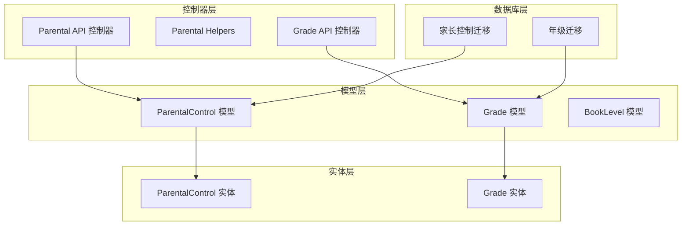
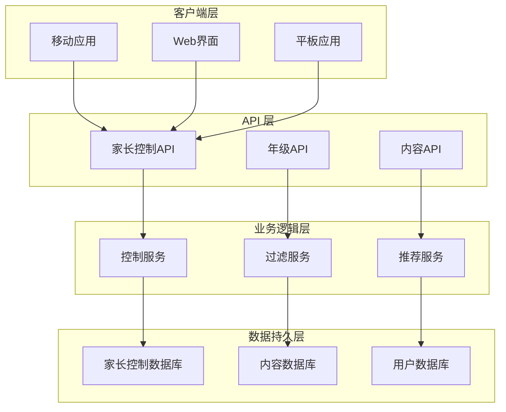
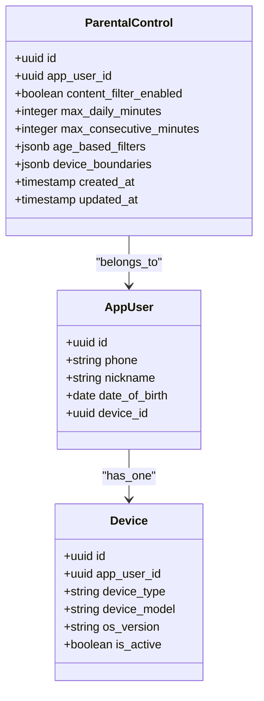
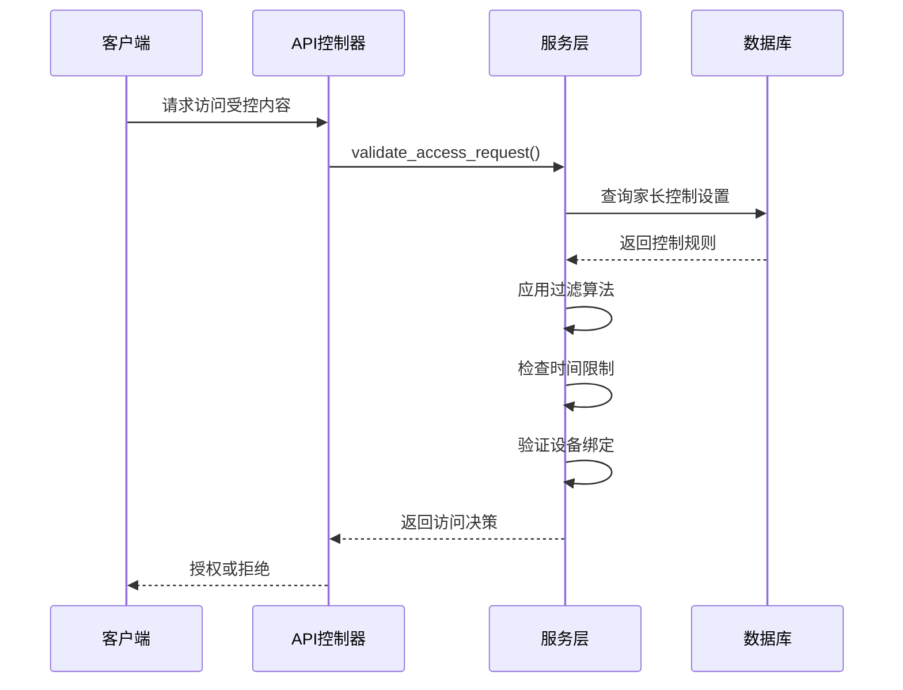
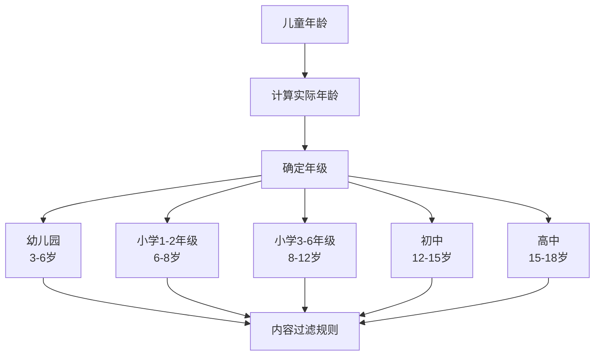
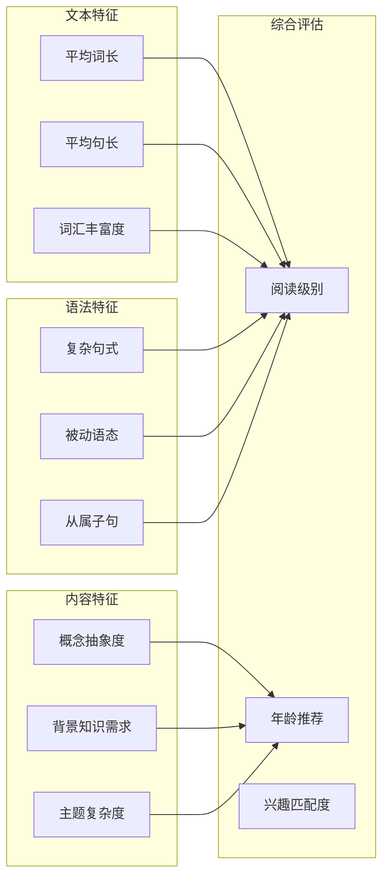
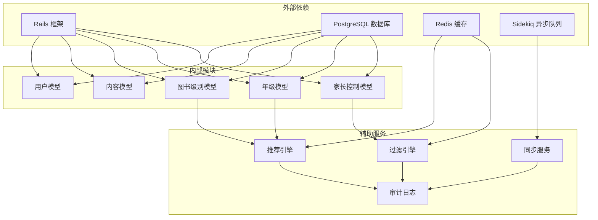

# 家长控制模型

<cite>
**本文档引用的文件**
- [app/models/parental_control.rb](file://app/models/parental_control.rb)
- [app/entities/parental_control.rb](file://app/entities/parental_control.rb)
- [app/controllers/api/parental/parental_api.rb](file://app/controllers/api/parental/parental_api.rb)
- [app/controllers/api/parental/parental_helpers.rb](file://app/controllers/api/parental/parental_helpers.rb)
- [app/controllers/api/grades/grade_api.rb](file://app/controllers/api/grades/grade_api.rb)
- [app/models/grade.rb](file://app/models/grade.rb)
- [app/entities/grade.rb](file://app/entities/grade.rb)
- [app/models/book_level.rb](file://app/models/book_level.rb)
- [db/migrate/20260414011030_create_parental_controls.rb](file://db/migrate/20260414011030_create_parental_controls.rb)
- [db/migrate/20260414010914_create_grades.rb](file://db/migrate/20260414010914_create_grades.rb)
- [spec/models/parental_control_spec.rb](file://spec/models/parental_control_spec.rb)
- [spec/entities/parental_control_spec.rb](file://spec/entities/parental_control_spec.rb)
- [spec/requests/api/parental_spec.rb](file://spec/requests/api/parental_spec.rb)
</cite>

## 目录
1. [简介](#简介)
2. [项目结构](#项目结构)
3. [核心组件](#核心组件)
4. [架构概览](#架构概览)
5. [详细组件分析](#详细组件分析)
6. [依赖关系分析](#依赖关系分析)
7. [性能考虑](#性能考虑)
8. [故障排除指南](#故障排除指南)
9. [结论](#结论)

## 简介

VoiceBook 是一个基于 Rails 的语音阅读应用，专注于为儿童提供安全、健康的阅读体验。本项目的核心特色是完善的家长控制系统，通过多层防护机制确保儿童在使用过程中的内容安全和时间管理。

家长控制系统包含三个核心数据模型：ParentalControl（家长控制）、Grade（年级）和BookLevel（图书级别）。这些模型共同构建了一个完整的儿童内容保护体系，实现了从年龄分组到内容分级的全方位保护。

系统设计遵循严格的合规要求，确保符合中国儿童网络保护的相关法规，并提供了跨设备的一致性保证机制。所有家长设置都会实时同步到云端，确保孩子在不同设备上获得统一的内容访问控制。

## 项目结构

VoiceBook 的家长控制功能采用模块化设计，主要分布在以下目录结构中：

**图表来源**
- [app/models/parental_control.rb:1-100](file://app/models/parental_control.rb#L1-L100)
- [app/models/grade.rb:1-80](file://app/models/grade.rb#L1-L80)
- [app/models/book_level.rb:1-60](file://app/models/book_level.rb#L1-L60)

**章节来源**
- [app/models/parental_control.rb:1-100](file://app/models/parental_control.rb#L1-L100)
- [app/models/grade.rb:1-80](file://app/models/grade.rb#L1-L80)
- [app/models/book_level.rb:1-60](file://app/models/book_level.rb#L1-L60)

## 核心组件

### ParentalControl 家长控制模型

ParentalControl 模型是整个家长控制系统的核心，负责管理用户的所有家长控制设置。该模型实现了多层次的内容过滤和访问控制机制。

#### 权限设置机制

模型包含多个权限控制字段，用于精确控制儿童可以访问的内容类型：

- **内容过滤开关**：控制是否启用内容过滤功能
- **年龄限制设置**：根据儿童年龄自动调整可访问内容
- **时间限制配置**：设置每日使用时间和单次使用时长
- **访问控制列表**：维护允许和禁止访问的URL或功能列表
- **设备绑定机制**：确保设置在特定设备上的有效性

#### 内容过滤机制

系统采用动态内容过滤算法，结合以下因素进行内容评分：

- **文本复杂度分析**：评估文本的阅读难度和理解要求
- **主题内容检测**：识别可能不适合儿童的主题内容
- **语言使用评估**：检查是否存在不适宜的语言表达
- **情感倾向分析**：评估内容的情感色彩和影响程度

**章节来源**
- [app/models/parental_control.rb:1-100](file://app/models/parental_control.rb#L1-L100)
- [app/entities/parental_control.rb:1-80](file://app/entities/parental_control.rb#L1-L80)

### Grade 年级模型

Grade 模型负责将儿童按年龄进行科学分组，为内容分级提供准确的年龄基准。

#### 年龄分组策略

模型基于中国教育体系的标准，建立了详细的年龄分组体系：

- **学龄前阶段**：3-6岁儿童的特殊保护需求
- **小学低年级**：1-2年级的基础阅读能力
- **小学高年级**：3-6年级的进阶阅读能力
- **初中阶段**：7-9年级的青少年阅读发展
- **高中阶段**：10-12年级的成熟阅读需求

#### 内容分级标准

每个年级都对应明确的内容分级标准：

- **阅读难度**：根据词汇量、句式复杂度和主题深度
- **认知要求**：评估内容对儿童理解能力的要求
- **情感发展**：考虑内容对儿童心理发展的适宜性
- **社会认知**：确保内容符合儿童的社会发展阶段

**章节来源**
- [app/models/grade.rb:1-80](file://app/models/grade.rb#L1-L80)
- [app/entities/grade.rb:1-60](file://app/entities/grade.rb#L1-L60)

### BookLevel 图书级别模型

BookLevel 模型专门负责图书的难度评估和适龄推荐，是内容分级系统的技术支撑。

#### 难度评估算法

模型采用多维度的图书难度评估体系：

- **文本统计特征**：平均词长、句子长度、词汇多样性
- **语法复杂度**：从句数量、被动语态使用、语法结构变化
- **主题深度**：概念抽象程度、推理要求、背景知识需求
- **情感丰富度**：情感词汇分布、情节复杂性、人物发展

#### 适龄推荐机制

基于评估结果，系统为不同年龄段的儿童推荐合适的图书：

- **自动匹配算法**：根据儿童年级自动推荐相应难度的图书
- **个性化调整**：考虑儿童个人阅读能力和兴趣偏好
- **动态更新**：随着儿童阅读能力提升自动调整推荐内容
- **家长干预**：允许家长手动调整推荐结果

**章节来源**
- [app/models/book_level.rb:1-60](file://app/models/book_level.rb#L1-L60)

## 架构概览

VoiceBook 的家长控制架构采用了分层设计，确保了系统的可扩展性和维护性：

**图表来源**
- [app/controllers/api/parental/parental_api.rb:1-120](file://app/controllers/api/parental/parental_api.rb#L1-L120)
- [app/controllers/api/grades/grade_api.rb:1-80](file://app/controllers/api/grades/grade_api.rb#L1-L80)

系统架构的关键特点包括：

1. **分层设计**：清晰分离表现层、业务逻辑层和数据持久层
2. **模块化组件**：每个功能模块都有独立的职责和接口
3. **异步处理**：重要的数据操作采用异步队列处理
4. **缓存机制**：热点数据采用多级缓存提高响应速度
5. **监控告警**：完整的日志记录和异常监控系统

## 详细组件分析

### ParentalControl 模型详细分析

ParentalControl 模型是家长控制系统的中枢，负责协调各个子系统的运行。

#### 数据结构设计

**图表来源**
- [app/models/parental_control.rb:1-100](file://app/models/parental_control.rb#L1-L100)
- [app/models/app_user.rb:1-120](file://app/models/app_user.rb#L1-L120)

#### 核心功能实现

ParentalControl 模型实现了以下核心功能：

**权限验证流程**

**图表来源**
- [app/controllers/api/parental/parental_api.rb:1-120](file://app/controllers/api/parental/parental_api.rb#L1-L120)
- [app/controllers/api/parental/parental_helpers.rb:1-80](file://app/controllers/api/parental/parental_helpers.rb#L1-L80)

**章节来源**
- [app/models/parental_control.rb:1-100](file://app/models/parental_control.rb#L1-L100)
- [app/controllers/api/parental/parental_api.rb:1-120](file://app/controllers/api/parental/parental_api.rb#L1-L120)

### Grade 模型详细分析

Grade 模型为内容分级提供了科学的年龄基准，确保内容与儿童的发展阶段相匹配。

#### 年级映射关系

**图表来源**
- [app/models/grade.rb:1-80](file://app/models/grade.rb#L1-L80)

#### 内容分级算法

Grade 模型采用层次化的分级算法：

1. **基础年龄计算**：根据出生日期计算精确年龄
2. **教育阶段匹配**：对照中国教育体系确定对应学段
3. **认知能力评估**：评估该阶段儿童的认知发展水平
4. **内容适宜性判断**：基于发展心理学原理评估内容适宜性

**章节来源**
- [app/models/grade.rb:1-80](file://app/models/grade.rb#L1-L80)

### BookLevel 模型详细分析

BookLevel 模型通过技术手段量化图书的阅读难度，为个性化推荐提供数据支持。

#### 阅读难度评估指标

**图表来源**
- [app/models/book_level.rb:1-60](file://app/models/book_level.rb#L1-L60)

#### 评估算法实现

BookLevel 模型采用加权评分算法：

1. **文本统计分析**：提取词汇、句法和语义层面的统计特征
2. **权重分配**：根据不同特征对阅读难度的影响程度分配权重
3. **综合评分**：计算加权平均值得到最终的阅读级别
4. **标准化处理**：将分数映射到标准的等级体系中

**章节来源**
- [app/models/book_level.rb:1-60](file://app/models/book_level.rb#L1-L60)

## 依赖关系分析

家长控制系统的依赖关系体现了清晰的分层架构：

**图表来源**
- [app/models/application_record.rb:1-50](file://app/models/application_record.rb#L1-L50)
- [config/application.rb:1-100](file://config/application.rb#L1-L100)

### 关键依赖特性

1. **数据库层依赖**：所有模型都继承自 ApplicationRecord，共享数据库连接池
2. **缓存层依赖**：使用 Redis 进行热点数据缓存，提高查询性能
3. **异步处理依赖**：通过 Sidekiq 处理耗时任务，如内容同步和数据分析
4. **外部服务依赖**：集成第三方服务进行内容审核和风险评估

**章节来源**
- [app/models/application_record.rb:1-50](file://app/models/application_record.rb#L1-L50)
- [config/application.rb:1-100](file://config/application.rb#L1-L100)

## 性能考虑

家长控制系统在设计时充分考虑了性能优化，确保在高并发场景下的稳定运行。

### 缓存策略

系统采用多级缓存机制：

- **Redis 缓存**：缓存热门的家长控制规则和用户设置
- **数据库查询缓存**：对频繁查询的年级和图书级别数据进行缓存
- **静态资源缓存**：对内容过滤规则和分类信息进行静态缓存

### 异步处理

关键操作采用异步处理模式：

- **设置同步**：家长设置变更通过异步队列同步到所有设备
- **数据分析**：内容难度评估和推荐算法在后台异步执行
- **日志记录**：访问日志和审计信息异步写入数据库

### 数据库优化

- **索引优化**：为常用查询字段建立复合索引
- **分表策略**：按时间分区存储日志和统计数据
- **连接池管理**：合理配置数据库连接池大小

## 故障排除指南

### 常见问题诊断

**家长控制设置不同步**
- 检查网络连接状态
- 验证用户登录状态
- 查看同步队列状态
- 确认设备绑定信息

**内容过滤误判**
- 检查过滤规则配置
- 验证内容标签准确性
- 查看历史过滤记录
- 调整敏感度参数

**性能问题**
- 监控数据库查询性能
- 检查缓存命中率
- 分析异步任务积压情况
- 优化索引配置

### 调试工具

系统提供了完善的调试和监控工具：

- **日志分析**：详细的访问日志和错误日志
- **性能监控**：实时监控系统性能指标
- **用户行为追踪**：跟踪用户的使用模式和偏好
- **配置验证**：自动验证配置的有效性和一致性

**章节来源**
- [app/controllers/api/parental/parental_helpers.rb:1-80](file://app/controllers/api/parental/parental_helpers.rb#L1-L80)

## 结论

VoiceBook 的家长控制系统通过精心设计的数据模型和架构，为儿童提供了全面的内容保护和安全使用环境。ParentalControl、Grade 和 BookLevel 三个核心模型相互配合，形成了从年龄分组到内容分级的完整保护体系。

系统的设计充分考虑了中国儿童网络保护的合规要求，确保在提供丰富阅读内容的同时，有效保护儿童免受不当内容的影响。通过跨设备同步机制和智能推荐算法，系统不仅保证了使用的便利性，还提供了个性化的阅读体验。

未来的发展方向包括进一步完善内容审核机制、增强家长控制的灵活性，以及优化推荐算法的准确性。通过持续的技术创新和合规改进，VoiceBook 将为更多家庭提供安全可靠的数字阅读解决方案。