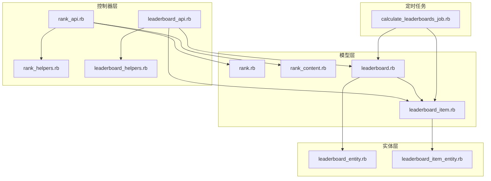
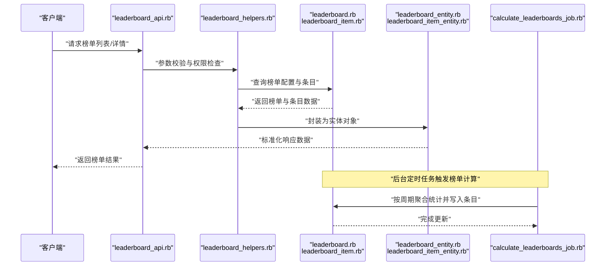
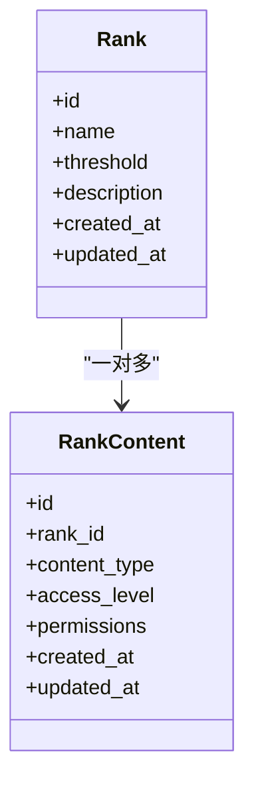
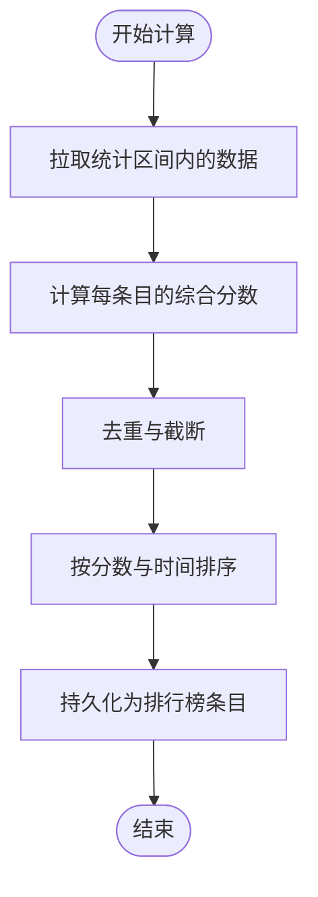
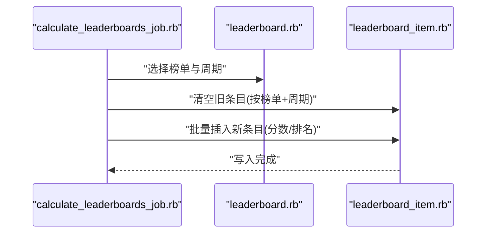
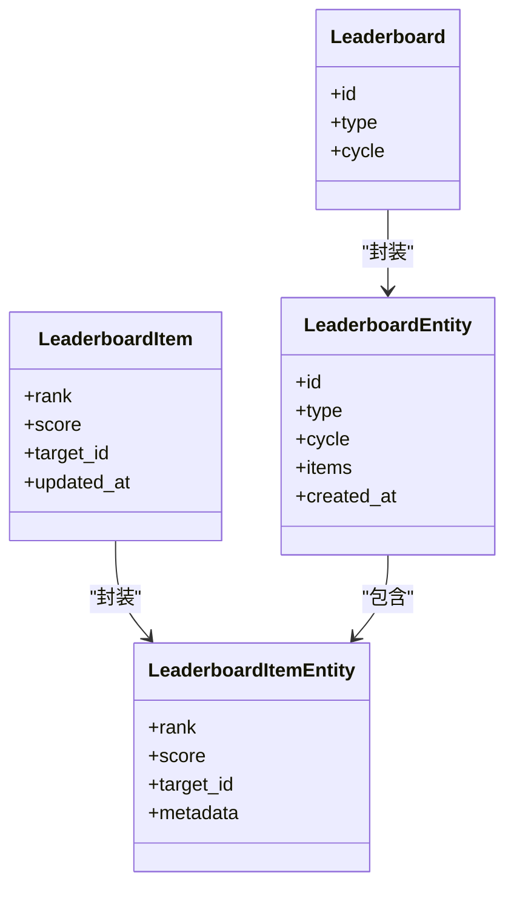
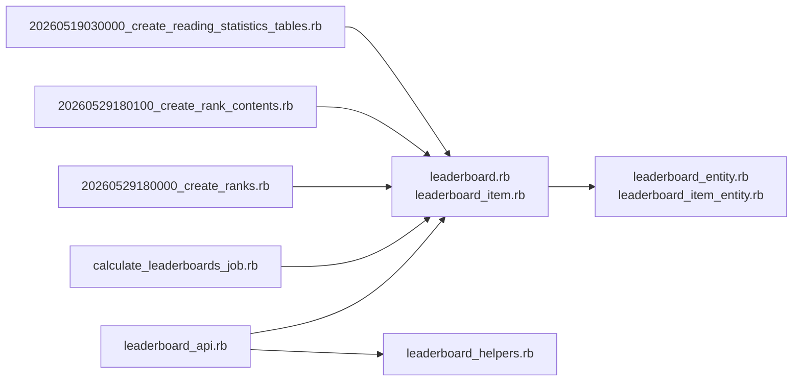

# 排行榜与榜单模型

<cite>
**本文引用的文件**
- [rank.rb](file://app/models/rank.rb)
- [rank_content.rb](file://app/models/rank_content.rb)
- [leaderboard.rb](file://app/models/leaderboard.rb)
- [leaderboard_item.rb](file://app/models/leaderboard_item.rb)
- [rank_api.rb](file://app/controllers/api/ranks/rank_api.rb)
- [rank_helpers.rb](file://app/controllers/api/ranks/rank_helpers.rb)
- [leaderboard_api.rb](file://app/controllers/api/leaderboards/leaderboard_api.rb)
- [leaderboard_helpers.rb](file://app/controllers/api/leaderboards/leaderboard_helpers.rb)
- [leaderboard_entity.rb](file://app/entities/leaderboard_entity.rb)
- [leaderboard_item_entity.rb](file://app/entities/leaderboard_item_entity.rb)
- [calculate_leaderboards_job.rb](file://app/jobs/calculate_leaderboards_job.rb)
- [20260529180000_create_ranks.rb](file://db/migrate/20260529180000_create_ranks.rb)
- [20260529180100_create_rank_contents.rb](file://db/migrate/20260529180100_create_rank_contents.rb)
- [20260519030000_create_reading_statistics_tables.rb](file://db/migrate/20260519030000_create_reading_statistics_tables.rb)
- [leaderboard_spec.rb](file://spec/models/leaderboard_spec.rb)
- [leaderboard_item_spec.rb](file://spec/models/leaderboard_item_spec.rb)
- [rank_spec.rb](file://spec/models/rank_spec.rb)
- [rank_content_spec.rb](file://spec/models/rank_content_spec.rb)
</cite>

## 目录
1. [简介](#简介)
2. [项目结构](#项目结构)
3. [核心组件](#核心组件)
4. [架构总览](#架构总览)
5. [详细组件分析](#详细组件分析)
6. [依赖关系分析](#依赖关系分析)
7. [性能考虑](#性能考虑)
8. [故障排除指南](#故障排除指南)
9. [结论](#结论)
10. [附录](#附录)

## 简介
本文件系统性梳理语音书项目中“排行榜与榜单”相关的核心数据模型与业务流程，重点覆盖以下主题：
- Rank 等级模型：分级标准与晋升机制
- RankContent 等级内容模型：内容权限与访问控制
- Leaderboard 排行榜模型：类型、周期与计算规则
- LeaderboardItem 排行榜条目模型：排名更新与排序算法
- LeaderboardEntity 与 LeaderboardItemEntity 实体模型：数据传输职责
- 不同类型榜单（热门榜单、新书推荐、畅销榜）的实现思路
- 排行榜数据的实时更新机制与缓存策略

## 项目结构
与排行榜/榜单直接相关的代码主要分布在以下位置：
- 模型层：app/models 下的 rank、rank_content、leaderboard、leaderboard_item
- 控制器层：app/controllers/api/ranks 与 app/controllers/api/leaderboards
- 实体层：app/entities 下的 leaderboard_entity、leaderboard_item_entity
- 定时任务：app/jobs/calculate_leaderboards_job.rb
- 数据迁移：db/migrate 中的 ranks、ranking_items、阅读统计表等
- 规格测试：spec/models 下对应模型的规格文件

**图表来源**
- [rank_api.rb](file://app/controllers/api/ranks/rank_api.rb)
- [leaderboard_api.rb](file://app/controllers/api/leaderboards/leaderboard_api.rb)
- [rank.rb](file://app/models/rank.rb)
- [rank_content.rb](file://app/models/rank_content.rb)
- [leaderboard.rb](file://app/models/leaderboard.rb)
- [leaderboard_item.rb](file://app/models/leaderboard_item.rb)
- [leaderboard_entity.rb](file://app/entities/leaderboard_entity.rb)
- [leaderboard_item_entity.rb](file://app/entities/leaderboard_item_entity.rb)
- [calculate_leaderboards_job.rb](file://app/jobs/calculate_leaderboards_job.rb)

**章节来源**
- [rank_api.rb](file://app/controllers/api/ranks/rank_api.rb)
- [leaderboard_api.rb](file://app/controllers/api/leaderboards/leaderboard_api.rb)
- [rank.rb](file://app/models/rank.rb)
- [rank_content.rb](file://app/models/rank_content.rb)
- [leaderboard.rb](file://app/models/leaderboard.rb)
- [leaderboard_item.rb](file://app/models/leaderboard_item.rb)
- [leaderboard_entity.rb](file://app/entities/leaderboard_entity.rb)
- [leaderboard_item_entity.rb](file://app/entities/leaderboard_item_entity.rb)
- [calculate_leaderboards_job.rb](file://app/jobs/calculate_leaderboards_job.rb)

## 核心组件
本节从数据模型角度概述各组件职责与关键字段/关系。

- Rank（等级）
  - 职责：定义用户或书籍的等级体系，包含等级阈值、名称、描述等
  - 关键点：等级晋升通常基于累计指标（如阅读时长、播放次数、评分等），具体阈值由业务配置决定
  - 参考路径：[rank.rb](file://app/models/rank.rb)

- RankContent（等级内容）
  - 职责：为不同等级开放的内容访问权限与功能限制
  - 关键点：通过等级阈值控制内容可见性、解锁功能、访问限制等
  - 参考路径：[rank_content.rb](file://app/models/rank_content.rb)

- Leaderboard（排行榜）
  - 职责：定义榜单类型、统计周期、计算规则、是否公开等
  - 关键点：支持多种榜单类型（如热门、新书、畅销），周期可按日/周/月等
  - 参考路径：[leaderboard.rb](file://app/models/leaderboard.rb)

- LeaderboardItem（排行榜条目）
  - 职责：记录每个条目的排名、分数、目标对象（如书籍）、时间戳等
  - 关键点：条目分数用于排序；支持批量更新与去重
  - 参考路径：[leaderboard_item.rb](file://app/models/leaderboard_item.rb)

- LeaderboardEntity / LeaderboardItemEntity（实体）
  - 职责：封装对外输出的数据结构，统一序列化格式
  - 关键点：LeaderboardEntity 负责榜单整体信息，LeaderboardItemEntity 负责单条目输出
  - 参考路径：[leaderboard_entity.rb](file://app/entities/leaderboard_entity.rb)、[leaderboard_item_entity.rb](file://app/entities/leaderboard_item_entity.rb)

**章节来源**
- [rank.rb](file://app/models/rank.rb)
- [rank_content.rb](file://app/models/rank_content.rb)
- [leaderboard.rb](file://app/models/leaderboard.rb)
- [leaderboard_item.rb](file://app/models/leaderboard_item.rb)
- [leaderboard_entity.rb](file://app/entities/leaderboard_entity.rb)
- [leaderboard_item_entity.rb](file://app/entities/leaderboard_item_entity.rb)

## 架构总览
下图展示从控制器到模型、实体以及定时任务的整体调用链路与数据流向。

**图表来源**
- [leaderboard_api.rb](file://app/controllers/api/leaderboards/leaderboard_api.rb)
- [leaderboard_helpers.rb](file://app/controllers/api/leaderboards/leaderboard_helpers.rb)
- [leaderboard.rb](file://app/models/leaderboard.rb)
- [leaderboard_item.rb](file://app/models/leaderboard_item.rb)
- [leaderboard_entity.rb](file://app/entities/leaderboard_entity.rb)
- [leaderboard_item_entity.rb](file://app/entities/leaderboard_item_entity.rb)
- [calculate_leaderboards_job.rb](file://app/jobs/calculate_leaderboards_job.rb)

## 详细组件分析

### Rank 等级模型
- 分级标准
  - 基于累计指标设定等级阈值，例如累计播放时长、阅读天数、评分次数等
  - 等级之间应具备单调递增关系，避免阈值重叠导致晋升异常
- 晋升机制
  - 当用户或书籍的累计指标达到下一等级阈值时触发晋升
  - 晋升后可触发通知、权限提升、徽章发放等后续动作
- 与 RankContent 的协作
  - RankContent 根据当前等级决定内容访问范围与功能开关
  - 可通过白名单/黑名单方式控制特定内容的可见性

**图表来源**
- [rank.rb](file://app/models/rank.rb)
- [rank_content.rb](file://app/models/rank_content.rb)

**章节来源**
- [rank.rb](file://app/models/rank.rb)
- [rank_content.rb](file://app/models/rank_content.rb)

### RankContent 内容权限与访问控制
- 权限维度
  - 内容类型：书籍、章节、专题、活动等
  - 访问级别：仅会员、高等级解锁、完全公开
  - 具体权限：播放、下载、评论、收藏等
- 控制策略
  - 登录态校验：结合用户当前 Rank 判断是否满足访问条件
  - 动态拦截：在内容加载前进行权限判断，未达等级则返回受限状态
  - 缓存优化：对常用权限判定结果进行短期缓存，降低数据库压力

**章节来源**
- [rank_content.rb](file://app/models/rank_content.rb)
- [rank_helpers.rb](file://app/controllers/api/ranks/rank_helpers.rb)

### Leaderboard 排行榜模型
- 类型
  - 热门榜：基于播放量、搜索热度、近期播放频次
  - 新书榜：基于上架时间与基础播放量的综合排序
  - 畅销榜：基于付费转化、销量或购买次数
- 周期
  - 日榜：每日刷新
  - 周榜：每周刷新
  - 月榜：每月刷新
- 计算规则
  - 分数函数：播放时长权重 × A + 收藏/评分权重 × B + 上架时间衰减因子 × C
  - 去重策略：同一作品在榜单内仅保留一条记录
  - 排序：按最终分数降序，分数相同时按最近更新时间倒序

**图表来源**
- [leaderboard.rb](file://app/models/leaderboard.rb)
- [leaderboard_item.rb](file://app/models/leaderboard_item.rb)

**章节来源**
- [leaderboard.rb](file://app/models/leaderboard.rb)
- [leaderboard_item.rb](file://app/models/leaderboard_item.rb)

### LeaderboardItem 排行榜条目模型
- 排名更新
  - 批量写入：定时任务一次性生成全量条目，减少频繁写操作
  - 增量更新：对热点作品或突发事件可采用增量更新策略
- 排序算法
  - 主键：分数（降序）
  - 附加键：更新时间（倒序）以保证稳定性
  - 去重：同一目标对象只保留最新记录
- 数据一致性
  - 使用事务或批量 Upsert 保证分数与排名的一致性
  - 对并发写入进行幂等处理，避免重复计算

**图表来源**
- [calculate_leaderboards_job.rb](file://app/jobs/calculate_leaderboards_job.rb)
- [leaderboard.rb](file://app/models/leaderboard.rb)
- [leaderboard_item.rb](file://app/models/leaderboard_item.rb)

**章节来源**
- [leaderboard_item.rb](file://app/models/leaderboard_item.rb)
- [calculate_leaderboards_job.rb](file://app/jobs/calculate_leaderboards_job.rb)

### LeaderboardEntity 与 LeaderboardItemEntity 实体模型
- LeaderboardEntity
  - 职责：封装榜单元信息（类型、周期、创建时间、条目列表）
  - 输出：标准化 JSON 结构，便于前端渲染
- LeaderboardItemEntity
  - 职责：封装单条目信息（排名、分数、目标对象标识、额外属性）
  - 输出：统一字段命名与数据类型，屏蔽底层模型细节
- 与控制器协作
  - 控制器在查询到模型数据后，交由实体进行序列化，确保接口一致性

**图表来源**
- [leaderboard_entity.rb](file://app/entities/leaderboard_entity.rb)
- [leaderboard_item_entity.rb](file://app/entities/leaderboard_item_entity.rb)
- [leaderboard.rb](file://app/models/leaderboard.rb)
- [leaderboard_item.rb](file://app/models/leaderboard_item.rb)

**章节来源**
- [leaderboard_entity.rb](file://app/entities/leaderboard_entity.rb)
- [leaderboard_item_entity.rb](file://app/entities/leaderboard_item_entity.rb)

### 不同类型榜单的实现思路
- 热门榜单
  - 指标：近 7 天播放时长、搜索热度、分享次数
  - 权重：播放时长占比最高，其次为互动行为
- 新书榜单
  - 指标：上架时间（近 14 天内）与播放量
  - 规则：上架时间越近且播放量越高，排名越靠前
- 畅销榜单
  - 指标：付费转化率、购买次数、平均客单价
  - 规则：优先考虑转化与收入贡献

**章节来源**
- [leaderboard.rb](file://app/models/leaderboard.rb)
- [leaderboard_item.rb](file://app/models/leaderboard_item.rb)

### 实时更新机制与缓存策略
- 实时更新
  - 热点作品：对高流量作品采用增量更新，快速反映变化
  - 事件驱动：监听播放、收藏、评分等事件，触发局部重算
- 批量计算
  - 定时任务：每日/每周执行全量计算，保证全局一致性
  - 分片策略：按目标对象分片，避免单表写放大
- 缓存策略
  - L1：Redis 缓存榜单结果，设置合理过期时间（如 5-15 分钟）
  - L2：内存缓存热点榜单，降低热数据延迟
  - 缓存失效：写入完成后主动失效相关键，确保最终一致

**章节来源**
- [calculate_leaderboards_job.rb](file://app/jobs/calculate_leaderboards_job.rb)
- [leaderboard_api.rb](file://app/controllers/api/leaderboards/leaderboard_api.rb)

## 依赖关系分析
- 控制器依赖模型与助手：API 层负责参数校验与权限检查，模型层负责数据读写
- 实体层依赖模型层：实体负责将模型数据转换为对外统一格式
- 定时任务依赖模型层：批量计算与写入逻辑集中在任务中，保证性能与一致性
- 数据迁移支撑：ranks、rank_contents、阅读统计表等为排行榜提供数据基础

**图表来源**
- [leaderboard_api.rb](file://app/controllers/api/leaderboards/leaderboard_api.rb)
- [leaderboard_helpers.rb](file://app/controllers/api/leaderboards/leaderboard_helpers.rb)
- [leaderboard.rb](file://app/models/leaderboard.rb)
- [leaderboard_item.rb](file://app/models/leaderboard_item.rb)
- [leaderboard_entity.rb](file://app/entities/leaderboard_entity.rb)
- [leaderboard_item_entity.rb](file://app/entities/leaderboard_item_entity.rb)
- [calculate_leaderboards_job.rb](file://app/jobs/calculate_leaderboards_job.rb)
- [20260529180000_create_ranks.rb](file://db/migrate/20260529180000_create_ranks.rb)
- [20260529180100_create_rank_contents.rb](file://db/migrate/20260529180100_create_rank_contents.rb)
- [20260519030000_create_reading_statistics_tables.rb](file://db/migrate/20260519030000_create_reading_statistics_tables.rb)

**章节来源**
- [leaderboard_api.rb](file://app/controllers/api/leaderboards/leaderboard_api.rb)
- [leaderboard_helpers.rb](file://app/controllers/api/leaderboards/leaderboard_helpers.rb)
- [leaderboard.rb](file://app/models/leaderboard.rb)
- [leaderboard_item.rb](file://app/models/leaderboard_item.rb)
- [leaderboard_entity.rb](file://app/entities/leaderboard_entity.rb)
- [leaderboard_item_entity.rb](file://app/entities/leaderboard_item_entity.rb)
- [calculate_leaderboards_job.rb](file://app/jobs/calculate_leaderboards_job.rb)
- [20260529180000_create_ranks.rb](file://db/migrate/20260529180000_create_ranks.rb)
- [20260529180100_create_rank_contents.rb](file://db/migrate/20260529180100_create_rank_contents.rb)
- [20260519030000_create_reading_statistics_tables.rb](file://db/migrate/20260519030000_create_reading_statistics_tables.rb)

## 性能考虑
- 写入性能
  - 批量写入：避免逐条更新，使用批量插入/更新
  - 去重策略：在写入前进行去重，减少重复写
- 查询性能
  - 索引设计：为榜单类型、周期、排名、目标对象建立复合索引
  - 分页与截断：限制每页数量，避免大结果集
- 缓存命中
  - 合理设置过期时间，平衡新鲜度与性能
  - 对冷热数据分层缓存，热点数据驻留内存

## 故障排除指南
- 榜单为空或不更新
  - 检查定时任务是否正常运行
  - 核对统计表数据是否按时生成
  - 验证去重与截断逻辑是否正确
- 排名异常或跳变
  - 检查分数计算公式是否稳定
  - 确认排序键顺序与去重策略
- 权限访问受限
  - 校验 Rank 与 RankContent 的配置
  - 确认用户当前等级与内容等级匹配

**章节来源**
- [calculate_leaderboards_job.rb](file://app/jobs/calculate_leaderboards_job.rb)
- [leaderboard_item_spec.rb](file://spec/models/leaderboard_item_spec.rb)
- [rank_content_spec.rb](file://spec/models/rank_content_spec.rb)

## 结论
本文件从模型、控制器、实体与定时任务四个层面完整梳理了排行榜与榜单体系的设计与实现要点。通过清晰的等级体系、灵活的榜单类型与周期、稳定的排序算法，以及合理的缓存与更新策略，系统能够在保证性能的同时提供高质量的榜单体验。建议在实际部署中持续监控任务执行情况与缓存命中率，并根据业务增长动态调整阈值与权重。

## 附录
- 数据模型与迁移对照
  - Rank 与 RankContent：对应迁移文件 [20260529180000_create_ranks.rb](file://db/migrate/20260529180000_create_ranks.rb)、[20260529180100_create_rank_contents.rb](file://db/migrate/20260529180100_create_rank_contents.rb)
  - 阅读统计表：对应迁移文件 [20260519030000_create_reading_statistics_tables.rb](file://db/migrate/20260519030000_create_reading_statistics_tables.rb)
- 规格测试参考
  - 榜单模型规格：[leaderboard_spec.rb](file://spec/models/leaderboard_spec.rb)、[leaderboard_item_spec.rb](file://spec/models/leaderboard_item_spec.rb)
  - 等级模型规格：[rank_spec.rb](file://spec/models/rank_spec.rb)、[rank_content_spec.rb](file://spec/models/rank_content_spec.rb)