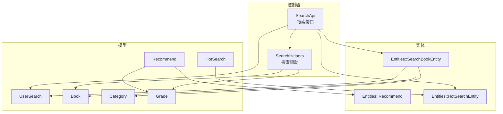
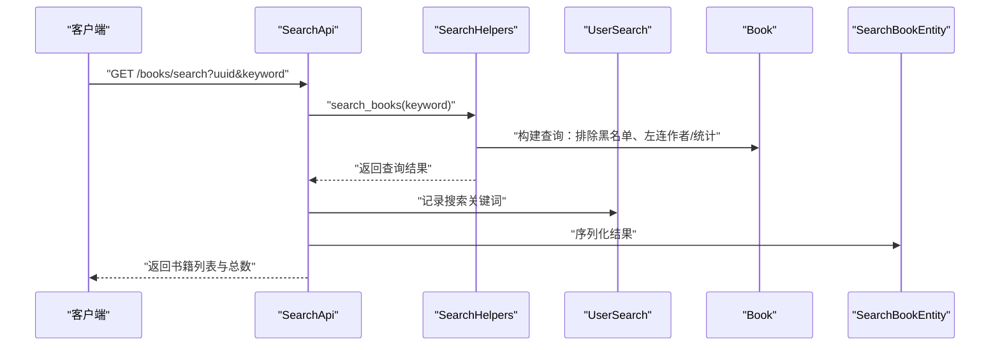
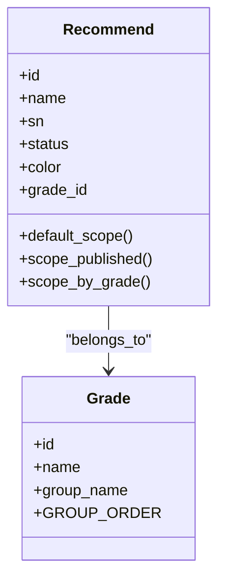
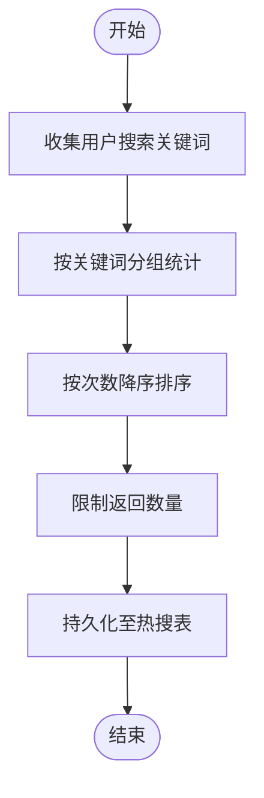
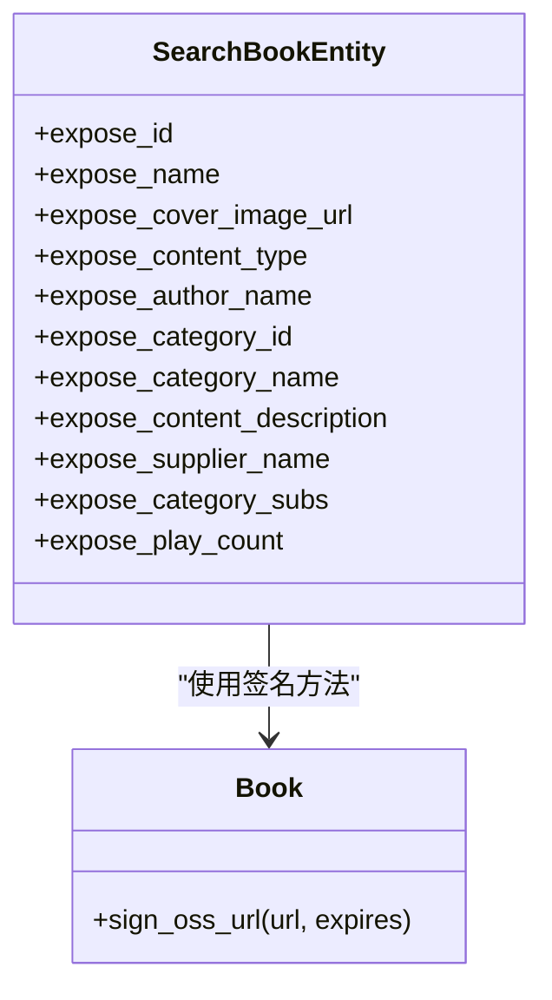
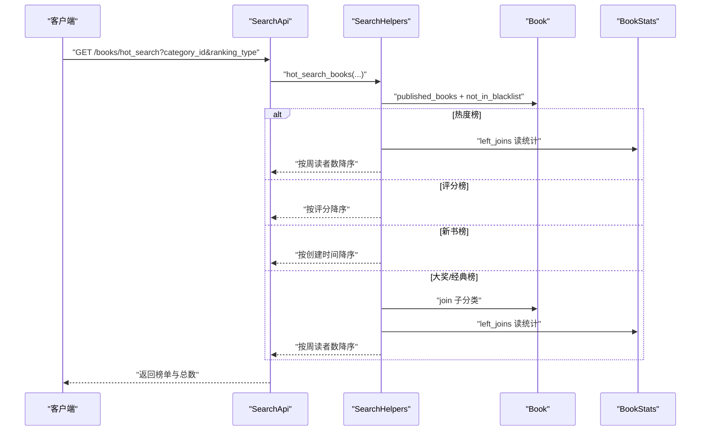
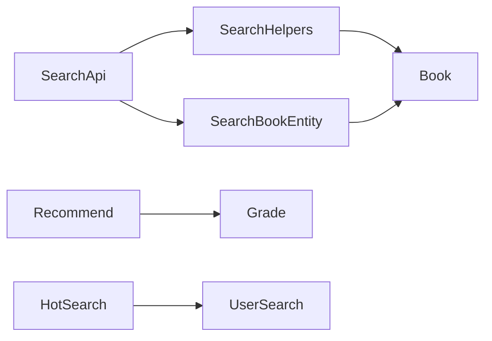

# 推荐与搜索模型

<cite>
**本文引用的文件**
- [app/models/recommend.rb](file://app/models/recommend.rb)
- [app/entities/recommend.rb](file://app/entities/recommend.rb)
- [app/models/hot_search.rb](file://app/models/hot_search.rb)
- [app/entities/hot_search_entity.rb](file://app/entities/hot_search_entity.rb)
- [app/models/user_search.rb](file://app/models/user_search.rb)
- [app/entities/search_book_entity.rb](file://app/entities/search_book_entity.rb)
- [app/models/book.rb](file://app/models/book.rb)
- [app/models/category.rb](file://app/models/category.rb)
- [app/models/grade.rb](file://app/models/grade.rb)
- [app/controllers/api/books/search_api.rb](file://app/controllers/api/books/search_api.rb)
- [app/controllers/api/books/search_helpers.rb](file://app/controllers/api/books/search_helpers.rb)
- [db/migrate/20260430200000_rename_users_to_app_users.rb](file://db/migrate/20260430200000_rename_users_to_app_users.rb)
- [db/migrate/20260509020747_add_uuid_to_app_users.rb](file://db/migrate/20260509020747_add_uuid_to_app_users.rb)
- [db/migrate/20260529063842_add_color_to_recommends.rb](file://db/migrate/20260529063842_add_color_to_recommends.rb)
</cite>

## 目录
1. [简介](#简介)
2. [项目结构](#项目结构)
3. [核心组件](#核心组件)
4. [架构概览](#架构概览)
5. [详细组件分析](#详细组件分析)
6. [依赖分析](#依赖分析)
7. [性能考虑](#性能考虑)
8. [故障排查指南](#故障排查指南)
9. [结论](#结论)
10. [附录](#附录)

## 简介
本文件聚焦于语音书籍平台的推荐系统与搜索功能相关数据模型，系统化梳理以下主题：
- Recommend 推荐模型的字段、索引、作用域与内容策略
- 搜索结果实体 SearchBookEntity 的数据结构与序列化逻辑
- 热搜词 HotSearch 与用户搜索记录 UserSearch 的统计与更新机制
- 搜索 API 的调用流程与排序权重
- 个性化推荐、协同过滤、内容相似度等算法的数据支撑点
- 搜索性能优化与缓存策略建议

## 项目结构
围绕“推荐与搜索”主题的关键文件组织如下：
- 模型层：recommend、hot_search、user_search、book、category、grade
- 实体层：recommend、hot_search_entity、search_book_entity
- 控制器与辅助：search_api、search_helpers
- 数据迁移：用户表重命名与 UUID 字段、推荐位颜色字段

图表来源
- [app/controllers/api/books/search_api.rb:1-128](file://app/controllers/api/books/search_api.rb#L1-L128)
- [app/controllers/api/books/search_helpers.rb:1-63](file://app/controllers/api/books/search_helpers.rb#L1-L63)
- [app/entities/search_book_entity.rb:1-28](file://app/entities/search_book_entity.rb#L1-L28)
- [app/entities/hot_search_entity.rb:1-9](file://app/entities/hot_search_entity.rb#L1-L9)
- [app/entities/recommend.rb:1-12](file://app/entities/recommend.rb#L1-L12)
- [app/models/recommend.rb:1-40](file://app/models/recommend.rb#L1-L40)
- [app/models/hot_search.rb:1-9](file://app/models/hot_search.rb#L1-L9)
- [app/models/user_search.rb:1-14](file://app/models/user_search.rb#L1-L14)
- [app/models/book.rb:1-157](file://app/models/book.rb#L1-L157)
- [app/models/category.rb:1-40](file://app/models/category.rb#L1-L40)
- [app/models/grade.rb:1-24](file://app/models/grade.rb#L1-L24)

章节来源
- [app/controllers/api/books/search_api.rb:1-128](file://app/controllers/api/books/search_api.rb#L1-L128)
- [app/controllers/api/books/search_helpers.rb:1-63](file://app/controllers/api/books/search_helpers.rb#L1-L63)
- [app/models/book.rb:1-157](file://app/models/book.rb#L1-L157)

## 核心组件
- Recommend 推荐位模型：承载推荐内容名称、排序、状态、颜色以及与年级的关联；提供默认排序、发布态筛选、按年级筛选等作用域。
- HotSearch 热搜词模型：维护关键词唯一性、激活态与排序字段，提供激活与排序作用域。
- UserSearch 用户搜索记录：记录用户搜索关键词，提供全局热词统计作用域（按关键词分组计数并降序）。
- SearchBookEntity 搜索结果实体：对 Book 及其关联对象进行序列化输出，包含封面签名、作者/分类/子分类/供应商信息、播放量等。
- SearchApi 与 SearchHelpers：提供搜索、热搜榜单、作者检索、排行榜等接口与辅助逻辑。

章节来源
- [app/models/recommend.rb:1-40](file://app/models/recommend.rb#L1-L40)
- [app/entities/recommend.rb:1-12](file://app/entities/recommend.rb#L1-L12)
- [app/models/hot_search.rb:1-9](file://app/models/hot_search.rb#L1-L9)
- [app/entities/hot_search_entity.rb:1-9](file://app/entities/hot_search_entity.rb#L1-L9)
- [app/models/user_search.rb:1-14](file://app/models/user_search.rb#L1-L14)
- [app/entities/search_book_entity.rb:1-28](file://app/entities/search_book_entity.rb#L1-L28)
- [app/controllers/api/books/search_api.rb:1-128](file://app/controllers/api/books/search_api.rb#L1-L128)
- [app/controllers/api/books/search_helpers.rb:1-63](file://app/controllers/api/books/search_helpers.rb#L1-L63)

## 架构概览
搜索与推荐的端到端流程如下：

图表来源
- [app/controllers/api/books/search_api.rb:19-31](file://app/controllers/api/books/search_api.rb#L19-L31)
- [app/controllers/api/books/search_helpers.rb:12-20](file://app/controllers/api/books/search_helpers.rb#L12-L20)
- [app/models/user_search.rb:7-12](file://app/models/user_search.rb#L7-L12)
- [app/entities/search_book_entity.rb:1-28](file://app/entities/search_book_entity.rb#L1-L28)

## 详细组件分析

### Recommend 推荐模型与内容策略
- 字段与索引
  - 关键字段：名称、排序、状态、颜色、年级关联
  - 索引：年级索引与复合索引（年级+排序），用于快速定位与排序
- 作用域与策略
  - 默认排序：按排序升序、ID 降序，保证稳定顺序
  - 发布态筛选：仅返回状态为“已发布”的推荐位
  - 年级筛选：按年级 ID 过滤推荐位
- 内容策略
  - 建议：推荐位内容应与用户年级匹配；颜色可作为视觉提示，便于运营配置
  - 关联：推荐位与年级多对多通过中间表管理；内容组可承载具体条目集合

图表来源
- [app/models/recommend.rb:25-38](file://app/models/recommend.rb#L25-L38)
- [app/models/grade.rb:12-22](file://app/models/grade.rb#L12-L22)

章节来源
- [app/models/recommend.rb:1-40](file://app/models/recommend.rb#L1-L40)
- [app/models/grade.rb:1-24](file://app/models/grade.rb#L1-L24)
- [db/migrate/20260529063842_add_color_to_recommends.rb:1-6](file://db/migrate/20260529063842_add_color_to_recommends.rb#L1-L6)

### RecommendationItem 推荐条目与权重计算
- 当前仓库未发现 RecommendationItem 模型与实体文件
- 建议设计思路（概念性，非现有实现）
  - 条目模型：关联推荐位、目标资源（如 Book）、权重、排序
  - 权重计算：结合内容热度（播放/阅读）、相似度分数、用户偏好、时间衰减因子
  - 排序：按权重降序，必要时引入随机扰动避免完全确定性
- 与现有模型的衔接
  - 可复用 Book 的播放量、评分、分类、年级等属性
  - 可复用 UserSearch 的热词统计作为内容热度信号之一

[本节为概念性说明，不直接分析具体文件，故无章节来源]

### HotSearch 热搜词统计与更新机制
- 数据模型
  - 关键字段：关键词唯一、激活态、排序字段
  - 作用域：激活态筛选、按排序升序
- 统计与更新
  - 全局热词：通过 UserSearch.top_keywords 聚合统计，按关键词分组计数并降序
  - 更新策略：可定期任务聚合日志或基于高频写入的缓存刷新
- 实时性
  - 若需实时热搜，建议引入 Redis 等缓存层，热点词写入后即时更新

图表来源
- [app/models/user_search.rb:7-12](file://app/models/user_search.rb#L7-L12)
- [app/models/hot_search.rb:1-9](file://app/models/hot_search.rb#L1-L9)

章节来源
- [app/models/hot_search.rb:1-9](file://app/models/hot_search.rb#L1-L9)
- [app/models/user_search.rb:1-14](file://app/models/user_search.rb#L1-L14)

### UserSearch 用户搜索记录与隐私保护
- 功能
  - 记录用户搜索关键词，支持全局热词统计
- 隐私保护
  - 建议：仅保留关键词与时间维度，不存储可识别个人身份的信息；对历史数据设定生命周期清理
  - 合规：遵循最小化原则，避免跨用户关联分析
- 数据分析
  - 可用于生成热门搜索词、内容热度信号；注意去标识化后再用于训练或报表

章节来源
- [app/models/user_search.rb:1-14](file://app/models/user_search.rb#L1-L14)

### SearchBookEntity 搜索结果实体与查询优化
- 数据结构
  - 输出字段：书籍 ID、名称、封面 URL（经 OSS 签名）、内容类型、作者名、分类信息、供应商名、子分类、播放量等
  - 关联处理：作者、分类、子分类、供应商等关联对象的懒加载与预加载
- 查询优化要点
  - 预加载：在搜索与榜单接口中使用 includes 预加载常用关联，减少 N+1 查询
  - 去重：搜索与榜单使用 DISTINCT 避免重复
  - 排序：优先使用数据库索引列排序；对复杂表达式（如 COALESCE）配合索引或物化视图
  - 分页：对大结果集启用 limit/offset 或基于游标的分页
- OSS 签名
  - 封面 URL 通过统一签名方法生成带过期时间的访问链接，保障资源安全

图表来源
- [app/entities/search_book_entity.rb:4-26](file://app/entities/search_book_entity.rb#L4-L26)
- [app/models/book.rb:104-141](file://app/models/book.rb#L104-L141)

章节来源
- [app/entities/search_book_entity.rb:1-28](file://app/entities/search_book_entity.rb#L1-L28)
- [app/models/book.rb:1-157](file://app/models/book.rb#L1-L157)

### HotSearchEntity 热搜实体与实时统计
- 数据结构
  - 输出字段：热搜项 ID、关键词
- 实时统计
  - 建议：结合缓存（如 Redis）实现增量更新；定时任务批量落库，降低写放大
  - 排序：按排序字段或计数字段动态调整

章节来源
- [app/entities/hot_search_entity.rb:1-9](file://app/entities/hot_search_entity.rb#L1-L9)
- [app/models/hot_search.rb:1-9](file://app/models/hot_search.rb#L1-L9)

### 搜索 API 工作流与排序权重
- 搜索接口
  - 关键词搜索：排除黑名单、左连作者与统计表、按周读者数与播放量排序
  - 热搜榜单：支持按热度、评分、新书、特定子标签（如“大奖版/名著榜”）排序
  - 作者检索：按月读者数与播放量排序
- 权重与排序
  - 热度：优先使用周读者数；若无统计则回退播放量
  - 评分：仅对有评分的书籍生效
  - 新书：按创建时间倒序
  - 子标签：通过子分类过滤特定榜单

图表来源
- [app/controllers/api/books/search_api.rb:102-123](file://app/controllers/api/books/search_api.rb#L102-L123)
- [app/controllers/api/books/search_helpers.rb:22-59](file://app/controllers/api/books/search_helpers.rb#L22-L59)

章节来源
- [app/controllers/api/books/search_api.rb:1-128](file://app/controllers/api/books/search_api.rb#L1-L128)
- [app/controllers/api/books/search_helpers.rb:1-63](file://app/controllers/api/books/search_helpers.rb#L1-L63)

### 个性化推荐、协同过滤、内容相似度的算法数据支持
- 个性化推荐
  - 用户画像：年级、设备、阅读偏好（可通过 UserSearch 热词与 BookStats 统计推断）
  - 内容特征：分类、子分类、主题、作者、评分、播放量
- 协同过滤
  - 基于用户行为（播放、收藏、评分）的相似用户/物品矩阵
  - 建议：以 BookStats 与用户阅读会话为输入，离线计算相似度
- 内容相似度
  - 基于分类、子分类、主题、作者的布尔特征与 TF-IDF 特征
  - 建议：以 Book 与 Category/Sub 为特征空间，结合播放量与评分构造相似度

[本节为概念性说明，不直接分析具体文件，故无章节来源]

## 依赖分析
- 模块耦合
  - SearchApi 依赖 SearchHelpers 提供查询封装
  - SearchBookEntity 依赖 Book 的签名能力与关联对象
  - Recommend 依赖 Grade 与内容组（中间表）
  - UserSearch 为热搜统计提供数据来源
- 外部依赖
  - OSS 签名服务用于资源访问控制
  - Redis（建议）用于热搜与热门词的缓存

图表来源
- [app/controllers/api/books/search_api.rb:1-128](file://app/controllers/api/books/search_api.rb#L1-L128)
- [app/controllers/api/books/search_helpers.rb:1-63](file://app/controllers/api/books/search_helpers.rb#L1-L63)
- [app/entities/search_book_entity.rb:1-28](file://app/entities/search_book_entity.rb#L1-L28)
- [app/models/recommend.rb:25-27](file://app/models/recommend.rb#L25-L27)
- [app/models/grade.rb:12-16](file://app/models/grade.rb#L12-L16)
- [app/models/hot_search.rb:1-9](file://app/models/hot_search.rb#L1-L9)
- [app/models/user_search.rb:1-14](file://app/models/user_search.rb#L1-L14)

章节来源
- [app/controllers/api/books/search_api.rb:1-128](file://app/controllers/api/books/search_api.rb#L1-L128)
- [app/controllers/api/books/search_helpers.rb:1-63](file://app/controllers/api/books/search_helpers.rb#L1-L63)
- [app/entities/search_book_entity.rb:1-28](file://app/entities/search_book_entity.rb#L1-L28)
- [app/models/recommend.rb:1-40](file://app/models/recommend.rb#L1-L40)
- [app/models/grade.rb:1-24](file://app/models/grade.rb#L1-L24)
- [app/models/hot_search.rb:1-9](file://app/models/hot_search.rb#L1-L9)
- [app/models/user_search.rb:1-14](file://app/models/user_search.rb#L1-L14)

## 性能考虑
- 查询层面
  - 预加载：在搜索与榜单接口中 includes 常用关联，避免 N+1
  - 去重：使用 DISTINCT 避免重复
  - 索引：确保排序与过滤字段具备索引（如分类、状态、创建时间、播放量）
- 缓存策略
  - 热搜词：Redis 缓存高频词，写入时同步更新；定期批量落库
  - 榜单：对固定榜单设置短 TTL 缓存，热点榜单可双写缓存
  - 结果序列化：Entity 层尽量延迟计算，避免重复序列化
- 分页与限流
  - 对大结果集启用分页；对外部接口增加速率限制，防止滥用
- 资源访问
  - OSS 签名统一入口，避免泄露密钥；合理设置过期时间

[本节提供通用建议，不直接分析具体文件，故无章节来源]

## 故障排查指南
- 搜索结果为空
  - 检查黑名单过滤逻辑与用户年级匹配
  - 确认关键词是否命中作者或书名模糊匹配
- 排序异常
  - 核对 COALESCE 表达式与排序字段是否存在
  - 确认 left_joins 的统计表是否正确
- 热搜词不更新
  - 检查 UserSearch.top_keywords 是否正常执行
  - 若使用缓存，确认写入与过期策略
- OSS 资源无法访问
  - 校验签名参数与过期时间
  - 确认对象键解析逻辑与 Bucket/Endpoint 正确

章节来源
- [app/controllers/api/books/search_helpers.rb:12-59](file://app/controllers/api/books/search_helpers.rb#L12-L59)
- [app/models/book.rb:104-141](file://app/models/book.rb#L104-L141)
- [app/models/user_search.rb:7-12](file://app/models/user_search.rb#L7-L12)

## 结论
本项目在模型与接口层面已具备推荐与搜索的基础能力：推荐位与年级绑定、搜索与榜单的排序权重、热搜词的统计入口、搜索结果的实体序列化与资源签名。为进一步提升个性化与实时性，建议引入缓存与离线计算，完善推荐条目与权重体系，并强化用户隐私保护与数据生命周期管理。

## 附录
- 用户表迁移与 UUID 字段
  - 用户表重命名为 app_users，并建立唯一 UUID 索引，便于后续用户画像与推荐链路使用
- 推荐位颜色字段
  - 新增颜色字段，便于运营侧进行视觉区分与内容标注

章节来源
- [db/migrate/20260430200000_rename_users_to_app_users.rb:1-28](file://db/migrate/20260430200000_rename_users_to_app_users.rb#L1-L28)
- [db/migrate/20260509020747_add_uuid_to_app_users.rb:1-28](file://db/migrate/20260509020747_add_uuid_to_app_users.rb#L1-L28)
- [db/migrate/20260529063842_add_color_to_recommends.rb:1-6](file://db/migrate/20260529063842_add_color_to_recommends.rb#L1-L6)