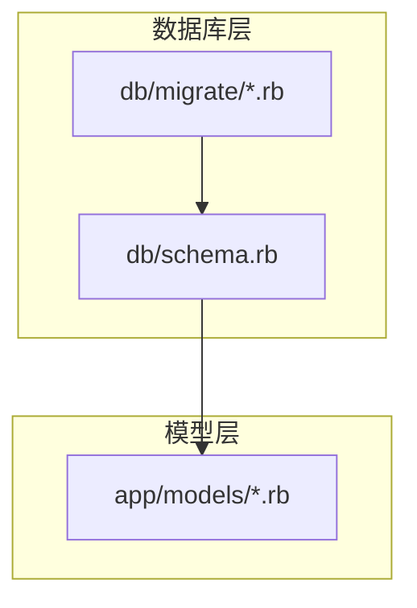
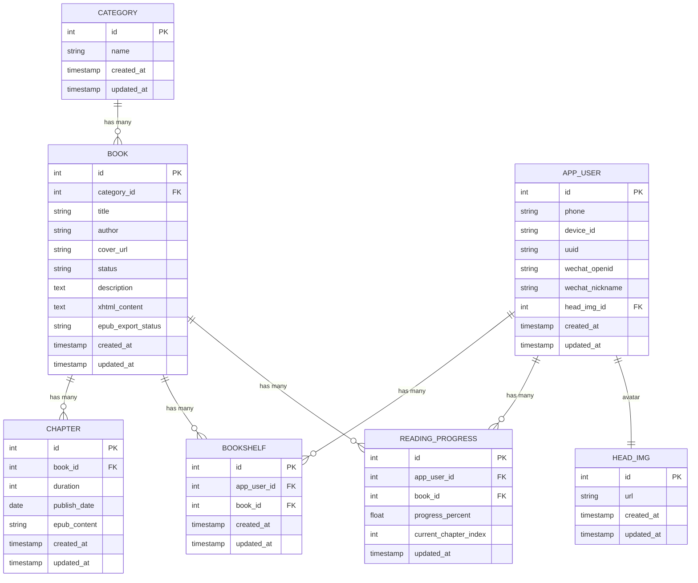
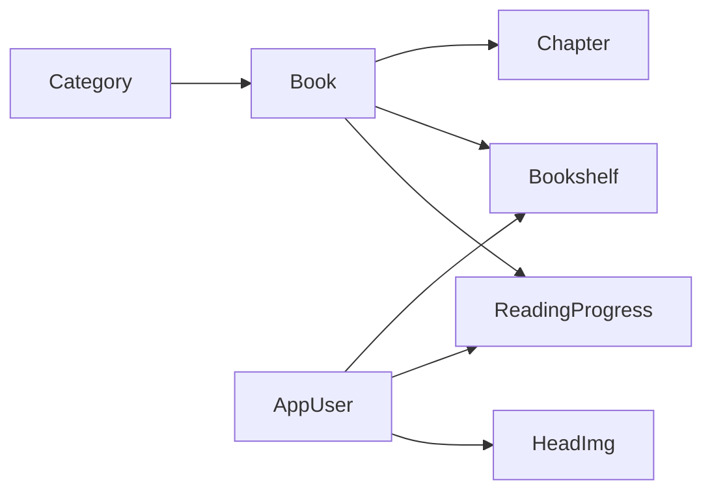

# 数据模型

<cite>
**本文引用的文件**
- [db/schema.rb](file://db/schema.rb)
- [app/models/book.rb](file://app/models/book.rb)
- [app/models/app_user.rb](file://app/models/app_user.rb)
- [app/models/chapter.rb](file://app/models/chapter.rb)
- [app/models/category.rb](file://app/models/category.rb)
- [app/models/bookshelf.rb](file://app/models/bookshelf.rb)
- [app/models/reading_progress.rb](file://app/models/reading_progress.rb)
- [db/migrate/20260430200000_rename_users_to_app_users.rb](file://db/migrate/20260430200000_rename_users_to_app_users.rb)
- [db/migrate/20260521070000_create_chapters.rb](file://db/migrate/20260521070000_create_chapters.rb)
- [db/migrate/20260525080000_add_duration_to_chapters.rb](file://db/migrate/20260525080000_add_duration_to_chapters.rb)
- [db/migrate/20260525090000_add_publish_date_to_chapters.rb](file://db/migrate/20260525090000_add_publish_date_to_chapters.rb)
- [db/migrate/20260516000000_create_book_chapters.rb](file://db/migrate/20260516000000_create_book_chapters.rb)
- [db/migrate/20260522080000_rename_book_chapters_to_catalogues.rb](file://db/migrate/20260522080000_rename_book_chapters_to_catalogues.rb)
- [db/migrate/20260528100000_create_packages.rb](file://db/migrate/20260528100000_create_packages.rb)
- [db/migrate/20260529021514_add_discount_tag_to_packages.rb](file://db/migrate/20260529021514_add_discount_tag_to_packages.rb)
- [db/migrate/20260529063842_add_color_to_recommends.rb](file://db/migrate/20260529063842_add_color_to_recommends.rb)
- [db/migrate/20260529180000_create_ranks.rb](file://db/migrate/20260529180000_create_ranks.rb)
- [db/migrate/20260529180100_create_rank_contents.rb](file://db/migrate/20260529180100_create_rank_contents.rb)
- [db/migrate/20260519030000_create_reading_statistics_tables.rb](file://db/migrate/20260519030000_create_reading_statistics_tables.rb)
- [db/migrate/20260519084829_create_head_imgs.rb](file://db/migrate/20260519084829_create_head_imgs.rb)
- [db/migrate/20260519085000_add_head_img_id_to_app_users.rb](file://db/migrate/20260519085000_add_head_img_id_to_app_users.rb)
- [db/migrate/20260519090000_remove_avatar_from_app_users.rb](file://db/migrate/20260519090000_remove_avatar_from_app_users.rb)
- [db/migrate/20260509020747_add_uuid_to_app_users.rb](file://db/migrate/20260509020747_add_uuid_to_app_users.rb)
- [db/migrate/20260509013133_change_device_id_limit_in_app_users.rb](file://db/migrate/20260509013133_change_device_id_limit_in_app_users.rb)
- [db/migrate/20260508000000_add_social_auth_to_app_users.rb](file://db/migrate/20260508000000_add_social_auth_to_app_users.rb)
- [db/migrate/20260507120000_make_phone_nullable_in_app_users.rb](file://db/migrate/20260507120000_make_phone_nullable_in_app_users.rb)
- [db/migrate/20260507041637_rename_uuid_to_device_id_in_app_users.rb](file://db/migrate/20260507041637_rename_uuid_to_device_id_in_app_users.rb)
- [db/migrate/20260430100000_add_xhtml_and_export_assets_to_books_and_pages.rb](file://db/migrate/20260430100000_add_xhtml_and_export_assets_to_books_and_pages.rb)
- [db/migrate/20260429082709_add_uuid_to_users.rb](file://db/migrate/20260429082709_add_uuid_to_users.rb)
- [db/migrate/20260421090100_create_ebook_pages.rb](file://db/migrate/20260421090100_create_ebook_pages.rb)
- [db/migrate/20260421090000_add_ebook_fields_to_books.rb](file://db/migrate/20260421090000_add_ebook_fields_to_books.rb)
- [db/migrate/20260414010936_create_books.rb](file://db/migrate/20260414010936_create_books.rb)
- [db/migrate/20260414010916_create_categories.rb](file://db/migrate/20260414010916_create_categories.rb)
- [db/migrate/20260414010919_create_users.rb](file://db/migrate/20260414010919_create_users.rb)
- [db/migrate/20260414010923_create_api_auths.rb](file://db/migrate/20260414010923_create_api_auths.rb)
- [db/migrate/20260414010921_create_sms_verifications.rb](file://db/migrate/20260414010921_create_sms_verifications.rb)
- [db/migrate/20260414010914_create_grades.rb](file://db/migrate/20260414010914_create_grades.rb)
- [db/migrate/20260414010941_create_audio_albums.rb](file://db/migrate/20260414010941_create_audio_albums.rb)
- [db/migrate/20260414010943_create_audio_episodes.rb](file://db/migrate/20260414010943_create_audio_episodes.rb)
- [db/migrate/20260414010945_create_collections.rb](file://db/migrate/20260414010945_create_collections.rb)
- [db/migrate/20260414010956_create_collection_items.rb](file://db/migrate/20260414010956_create_collection_items.rb)
- [db/migrate/20260414010959_create_bookshelves.rb](file://db/migrate/20260414010959_create_bookshelves.rb)
- [db/migrate/20260414011001_create_reading_records.rb](file://db/migrate/20260414011001_create_reading_records.rb)
- [db/migrate/20260414011004_create_memberships.rb](file://db/migrate/20260414011004_create_memberships.rb)
- [db/migrate/20260414011006_create_orders.rb](file://db/migrate/20260414011006_create_orders.rb)
- [db/migrate/20260414011021_create_banners.rb](file://db/migrate/20260414011021_create_banners.rb)
- [db/migrate/20260414011023_create_hot_searches.rb](file://db/migrate/20260414011023_create_hot_searches.rb)
- [db/migrate/20260414011025_create_rankings.rb](file://db/migrate/20260414011025_create_rankings.rb)
- [db/migrate/20260414011028_create_ranking_items.rb](file://db/migrate/20260414011028_create_ranking_items.rb)
- [db/migrate/20260414011030_create_parental_controls.rb](file://db/migrate/20260414011030_create_parental_controls.rb)
- [db/migrate/20260414011032_create_blacklisted_books.rb](file://db/migrate/20260414011032_create_blacklisted_books.rb)
- [db/migrate/20260414011035_create_bookmarks.rb](file://db/migrate/20260414011035_create_bookmarks.rb)
- [db/migrate/20260414011037_create_reading_levels.rb](file://db/migrate/20260414011037_create_reading_levels.rb)
- [db/migrate/20260414011039_create_recommendations.rb](file://db/migrate/20260414011039_create_recommendations.rb)
- [db/migrate/20260414011041_create_recommendation_items.rb](file://db/migrate/20260414011041_create_recommendation_items.rb)
- [db/migrate/20260511000000_create_devices.rb](file://db/migrate/20260511000000_create_devices.rb)
- [db/migrate/20260512000000_add_chapter_id_to_ebook_pages.rb](file://db/migrate/20260512000000_add_chapter_id_to_ebook_pages.rb)
- [db/migrate/20260512000001_add_epub_fields_to_chapters.rb](file://db/migrate/20260512000001_add_epub_fields_to_chapters.rb)
- [db/migrate/20260514031303_change_xhtml_content_to_text.rb](file://db/migrate/20260514031303_change_xhtml_content_to_text.rb)
- [db/migrate/20260515000000_remove_chapters_and_restructure_ebook_pages.rb](file://db/migrate/20260515000000_remove_chapters_and_restructure_ebook_pages.rb)
- [db/migrate/20260518073644_add_content_description_to_books.rb](file://db/migrate/20260518073644_add_content_description_to_books.rb)
- [db/migrate/20260519024109_add_word_count_to_book_chapters.rb](file://db/migrate/20260519024109_add_word_count_to_book_chapters.rb)
- [db/migrate/20260519024806_remove_page_dimensions_from_ebook_pages.rb](file://db/migrate/20260519024806_remove_page_dimensions_from_ebook_pages.rb)
- [db/migrate/20260519080000_create_head_imgs.rb](file://db/migrate/20260519080000_create_head_imgs.rb)
- [db/migrate/20260519085000_add_head_img_id_to_app_users.rb](file://db/migrate/20260519085000_add_head_img_id_to_app_users.rb)
- [db/migrate/20260519090000_remove_avatar_from_app_users.rb](file://db/migrate/20260519090000_remove_avatar_from_app_users.rb)
- [db/migrate/20260601112131_create_user_searches.rb](file://db/migrate/20260601112131_create_user_searches.rb)
- [db/migrate/20260603120000_add_wechat_nickname_to_app_users.rb](file://db/migrate/20260603120000_add_wechat_nickname_to_app_users.rb)
- [db/migrate/20260604074802_change_xhtml_content_to_mediumtext.rb](file://db/migrate/20260604074802_change_xhtml_content_to_mediumtext.rb)
</cite>

## 目录
1. [简介](#简介)
2. [项目结构](#项目结构)
3. [核心组件](#核心组件)
4. [架构总览](#架构总览)
5. [详细组件分析](#详细组件分析)
6. [依赖分析](#依赖分析)
7. [性能考虑](#性能考虑)
8. [故障排查指南](#故障排查指南)
9. [结论](#结论)
10. [附录](#附录)

## 简介
本文件系统性梳理语音图书平台的数据模型，聚焦核心实体：Book（图书）、AppUser（用户）、Chapter（章节）、Category（分类）以及与阅读、收藏、设备、头像等相关的模型。文档从数据库表结构、字段定义、约束与索引、实体关系、数据验证与业务约束、完整性保障机制，到数据迁移历史与版本演进进行完整说明，并通过ER图直观展示实体间的关联规则。

## 项目结构
围绕数据模型的核心文件主要分布在以下位置：
- db/schema.rb：数据库当前模式快照，包含所有表、列、索引与外键约束
- app/models/*：ActiveRecord 模型定义，承载业务逻辑与关系声明
- db/migrate/*：按时间顺序排列的迁移脚本，记录数据库结构演进

图表来源
- [db/schema.rb](file://db/schema.rb)
- [db/migrate/20260414010936_create_books.rb](file://db/migrate/20260414010936_create_books.rb)

章节来源
- [db/schema.rb](file://db/schema.rb)
- [db/migrate/20260414010936_create_books.rb](file://db/migrate/20260414010936_create_books.rb)

## 核心组件
本节对关键实体进行字段级说明，涵盖数据类型、约束与索引策略，并结合迁移脚本追溯字段引入时间点。

- Book（图书）
  - 关键字段与约束
    - 主键：自增整数
    - 外键：category_id 引用 Category.id
    - 唯一索引：无显式唯一索引（需结合业务语义确认）
    - 其他：包含标题、作者、简介、封面、状态、EPUB/XHTML导出相关字段等
  - 字段演进
    - 初始创建于 [db/migrate/20260414010936_create_books.rb](file://db/migrate/20260414010936_create_books.rb)
    - 后续多次扩展：新增电子书字段、XHTML内容、EPUB导出资产等
      - [db/migrate/20260421090000_add_ebook_fields_to_books.rb](file://db/migrate/20260421090000_add_ebook_fields_to_books.rb)
      - [db/migrate/20260430100000_add_xhtml_and_export_assets_to_books_and_pages.rb](file://db/migrate/20260430100000_add_xhtml_and_export_assets_to_books_and_pages.rb)
      - [db/migrate/20260429100000_add_epub_export_fields_to_books.rb](file://db/migrate/20260429100000_add_epub_export_fields_to_books.rb)
      - [db/migrate/20260518073644_add_content_description_to_books.rb](file://db/migrate/20260518073644_add_content_description_to_books.rb)
  - 验证与约束
    - 标题、作者等字段通常存在非空校验
    - 状态枚举值在业务层进行约束
  - 索引
    - category_id 建有索引以支持查询与连接
    - XHTML内容字段类型变更至 mediumtext，便于全文检索或大文本处理

- AppUser（用户）
  - 关键字段与约束
    - 主键：自增整数
    - 唯一索引：phone（可为空时仍需业务层唯一性控制）
    - 社会化登录：微信/QQ等第三方授权字段
    - 设备绑定：device_id（原uuid字段重命名为device_id）
    - 头像：head_img_id 外键关联 head_imgs 表
  - 字段演进
    - 初始创建于 [db/migrate/20260414010919_create_users.rb](file://db/migrate/20260414010919_create_users.rb)
    - 用户表重命名为 AppUser：[db/migrate/20260430200000_rename_users_to_app_users.rb](file://db/migrate/20260430200000_rename_users_to_app_users.rb)
    - 设备ID字段重命名与长度调整：[db/migrate/20260507041637_rename_uuid_to_device_id_in_app_users.rb](file://db/migrate/20260507041637_rename_uuid_to_device_id_in_app_users.rb)、[db/migrate/20260509013133_change_device_id_limit_in_app_users.rb](file://db/migrate/20260509013133_change_device_id_limit_in_app_users.rb)
    - 手机号可空化：[db/migrate/20260507120000_make_phone_nullable_in_app_users.rb](file://db/migrate/20260507120000_make_phone_nullable_in_app_users.rb)
    - 社会化登录字段：[db/migrate/20260508000000_add_social_auth_to_app_users.rb](file://db/migrate/20260508000000_add_social_auth_to_app_users.rb)
    - UUID字段引入：[db/migrate/20260509020747_add_uuid_to_app_users.rb](file://db/migrate/20260509020747_add_uuid_to_app_users.rb)
    - 头像字段迁移：[db/migrate/20260519084829_create_head_imgs.rb](file://db/migrate/20260519084829_create_head_imgs.rb)、[db/migrate/20260519085000_add_head_img_id_to_app_users.rb](file://db/migrate/20260519085000_add_head_img_id_to_app_users.rb)、[db/migrate/20260519090000_remove_avatar_from_app_users.rb](file://db/migrate/20260519090000_remove_avatar_from_app_users.rb)
    - 微信昵称：[db/migrate/20260603120000_add_wechat_nickname_to_app_users.rb](file://db/migrate/20260603120000_add_wechat_nickname_to_app_users.rb)
  - 验证与约束
    - phone 在业务层可能要求唯一性与格式校验
    - 第三方授权字段用于登录流程校验
  - 索引
    - phone、device_id、head_img_id 等建立索引以提升查询效率

- Chapter（章节）
  - 关键字段与约束
    - 主键：自增整数
    - 外键：book_id 引用 Book.id
    - 新增字段：duration（时长）、publish_date（发布日期）、epub-related 字段
  - 字段演进
    - 初次创建章节表：[db/migrate/20260521070000_create_chapters.rb](file://db/migrate/20260521070000_create_chapters.rb)
    - 增加时长与发布日期：[db/migrate/20260525080000_add_duration_to_chapters.rb](file://db/migrate/20260525080000_add_duration_to_chapters.rb)、[db/migrate/20260525090000_add_publish_date_to_chapters.rb](file://db/migrate/20260525090000_add_publish_date_to_chapters.rb)
    - EPUB相关字段：[db/migrate/20260512000001_add_epub_fields_to_chapters.rb](file://db/migrate/20260512000001_add_epub_fields_to_chapters.rb)
    - 章节与页面重构：章节表被移除并由 book_chapters/ebook_pages 重构替代，详见后续章节
  - 验证与约束
    - duration 为数值型，publish_date 为日期型
    - 与 Book 的一对多关系在业务层约束
  - 索引
    - book_id 建有索引以支持按书查询章节

- Category（分类）
  - 关键字段与约束
    - 主键：自增整数
    - 无明显外键依赖，作为图书分类维度
  - 字段演进
    - 初始创建：[db/migrate/20260414010916_create_categories.rb](file://db/migrate/20260414010916_create_categories.rb)
  - 验证与约束
    - 名称唯一性在业务层控制
  - 索引
    - 默认主键索引

- Bookshelf（书架）
  - 关键字段与约束
    - 主键：自增整数
    - 外键：app_user_id 引用 AppUser.id，book_id 引用 Book.id
    - 唯一性：app_user_id + book_id 组合唯一，防止重复加入同一本书
  - 字段演进
    - 初始创建：[db/migrate/20260414010959_create_bookshelves.rb](file://db/migrate/20260414010959_create_bookshelves.rb)
  - 验证与约束
    - 组合唯一性确保用户不会重复添加同一本书
  - 索引
    - app_user_id、book_id 各自建索引，组合唯一索引覆盖查询与去重

- ReadingProgress（阅读进度）
  - 关键字段与约束
    - 主键：自增整数
    - 外键：app_user_id 引用 AppUser.id，book_id 引用 Book.id
    - 唯一性：app_user_id + book_id 组合唯一，确保每用户每书仅一条进度
  - 字段演进
    - 创建统计表：[db/migrate/20260519030000_create_reading_statistics_tables.rb](file://db/migrate/20260519030000_create_reading_statistics_tables.rb)
  - 验证与约束
    - 进度百分比、章节序号等字段在业务层校验范围
  - 索引
    - app_user_id、book_id 建索引，组合唯一索引保障唯一性

章节来源
- [app/models/book.rb](file://app/models/book.rb)
- [app/models/app_user.rb](file://app/models/app_user.rb)
- [app/models/chapter.rb](file://app/models/chapter.rb)
- [app/models/category.rb](file://app/models/category.rb)
- [app/models/bookshelf.rb](file://app/models/bookshelf.rb)
- [app/models/reading_progress.rb](file://app/models/reading_progress.rb)
- [db/migrate/20260414010936_create_books.rb](file://db/migrate/20260414010936_create_books.rb)
- [db/migrate/20260430200000_rename_users_to_app_users.rb](file://db/migrate/20260430200000_rename_users_to_app_users.rb)
- [db/migrate/20260521070000_create_chapters.rb](file://db/migrate/20260521070000_create_chapters.rb)
- [db/migrate/20260525080000_add_duration_to_chapters.rb](file://db/migrate/20260525080000_add_duration_to_chapters.rb)
- [db/migrate/20260525090000_add_publish_date_to_chapters.rb](file://db/migrate/20260525090000_add_publish_date_to_chapters.rb)
- [db/migrate/20260519030000_create_reading_statistics_tables.rb](file://db/migrate/20260519030000_create_reading_statistics_tables.rb)

## 架构总览
下图展示核心实体之间的关系与关联规则，基于 schema 与迁移脚本映射：

图表来源
- [db/schema.rb](file://db/schema.rb)
- [db/migrate/20260414010916_create_categories.rb](file://db/migrate/20260414010916_create_categories.rb)
- [db/migrate/20260414010936_create_books.rb](file://db/migrate/20260414010936_create_books.rb)
- [db/migrate/20260430200000_rename_users_to_app_users.rb](file://db/migrate/20260430200000_rename_users_to_app_users.rb)
- [db/migrate/20260521070000_create_chapters.rb](file://db/migrate/20260521070000_create_chapters.rb)
- [db/migrate/20260519030000_create_reading_statistics_tables.rb](file://db/migrate/20260519030000_create_reading_statistics_tables.rb)
- [db/migrate/20260519084829_create_head_imgs.rb](file://db/migrate/20260519084829_create_head_imgs.rb)

## 详细组件分析

### 图书实体 Book
- 字段与类型
  - 主键：整数
  - 分类外键：整数
  - 标题/作者/封面/状态：字符串
  - 描述：文本
  - XHTML内容：文本（后升级为 mediumtext）
  - EPUB导出状态：字符串
- 约束与索引
  - category_id 建有索引
  - 无显式唯一索引
- 业务逻辑
  - 与 Category 为多对一
  - 与 Chapter 为一对多
  - 与 Bookshelf、ReadingProgress 存在多对多间接关系（通过中间表）
- 数据验证
  - 标题/作者必填
  - 状态枚举值在业务层校验
- 性能建议
  - 对 category_id、status、title 等常用过滤字段建立复合索引
  - XHTML 内容大文本字段避免在高频查询中参与排序或分组

章节来源
- [app/models/book.rb](file://app/models/book.rb)
- [db/migrate/20260414010936_create_books.rb](file://db/migrate/20260414010936_create_books.rb)
- [db/migrate/20260514031303_change_xhtml_content_to_text.rb](file://db/migrate/20260514031303_change_xhtml_content_to_text.rb)
- [db/migrate/20260604074802_change_xhtml_content_to_mediumtext.rb](file://db/migrate/20260604074802_change_xhtml_content_to_mediumtext.rb)

### 用户实体 AppUser
- 字段与类型
  - 主键：整数
  - phone：字符串（可空）
  - device_id：字符串（可空）
  - uuid：字符串（唯一）
  - wechat_openid/wechat_nickname：字符串
  - head_img_id：整数（可空）
- 约束与索引
  - phone 可空，但业务上常需唯一性控制
  - device_id、uuid 建有索引
  - head_img_id 建有索引
- 业务逻辑
  - 支持手机号与第三方社交账号登录
  - 与 HeadImg 一对一
  - 与 Bookshelf、ReadingProgress 一对多
- 数据验证
  - phone 格式与唯一性校验
  - openid 唯一性校验
- 性能建议
  - 对 phone、wechat_openid 建立唯一索引
  - device_id 用于设备绑定场景，建议建立索引

章节来源
- [app/models/app_user.rb](file://app/models/app_user.rb)
- [db/migrate/20260414010919_create_users.rb](file://db/migrate/20260414010919_create_users.rb)
- [db/migrate/20260430200000_rename_users_to_app_users.rb](file://db/migrate/20260430200000_rename_users_to_app_users.rb)
- [db/migrate/20260507041637_rename_uuid_to_device_id_in_app_users.rb](file://db/migrate/20260507041637_rename_uuid_to_device_id_in_app_users.rb)
- [db/migrate/20260509013133_change_device_id_limit_in_app_users.rb](file://db/migrate/20260509013133_change_device_id_limit_in_app_users.rb)
- [db/migrate/20260507120000_make_phone_nullable_in_app_users.rb](file://db/migrate/20260507120000_make_phone_nullable_in_app_users.rb)
- [db/migrate/20260508000000_add_social_auth_to_app_users.rb](file://db/migrate/20260508000000_add_social_auth_to_app_users.rb)
- [db/migrate/20260509020747_add_uuid_to_app_users.rb](file://db/migrate/20260509020747_add_uuid_to_app_users.rb)
- [db/migrate/20260519084829_create_head_imgs.rb](file://db/migrate/20260519084829_create_head_imgs.rb)
- [db/migrate/20260519085000_add_head_img_id_to_app_users.rb](file://db/migrate/20260519085000_add_head_img_id_to_app_users.rb)
- [db/migrate/20260519090000_remove_avatar_from_app_users.rb](file://db/migrate/20260519090000_remove_avatar_from_app_users.rb)
- [db/migrate/20260603120000_add_wechat_nickname_to_app_users.rb](file://db/migrate/20260603120000_add_wechat_nickname_to_app_users.rb)

### 章节实体 Chapter
- 字段与类型
  - 主键：整数
  - book_id：整数（外键）
  - duration：整数（秒）
  - publish_date：日期
  - epub_content：字符串
- 约束与索引
  - book_id 建有索引
- 业务逻辑
  - 与 Book 为一对多
  - 后续被 book_chapters/ebook_pages 替代，章节表被移除
- 数据验证
  - duration 非负
  - publish_date 合法日期
- 性能建议
  - 对 book_id 建索引，支持按书查询章节

章节来源
- [app/models/chapter.rb](file://app/models/chapter.rb)
- [db/migrate/20260521070000_create_chapters.rb](file://db/migrate/20260521070000_create_chapters.rb)
- [db/migrate/20260525080000_add_duration_to_chapters.rb](file://db/migrate/20260525080000_add_duration_to_chapters.rb)
- [db/migrate/20260525090000_add_publish_date_to_chapters.rb](file://db/migrate/20260525090000_add_publish_date_to_chapters.rb)
- [db/migrate/20260512000001_add_epub_fields_to_chapters.rb](file://db/migrate/20260512000001_add_epub_fields_to_chapters.rb)
- [db/migrate/20260515000000_remove_chapters_and_restructure_ebook_pages.rb](file://db/migrate/20260515000000_remove_chapters_and_restructure_ebook_pages.rb)

### 分类实体 Category
- 字段与类型
  - 主键：整数
  - name：字符串
- 约束与索引
  - 默认主键索引
- 业务逻辑
  - 与 Book 为多对一
- 数据验证
  - name 唯一性在业务层控制
- 性能建议
  - 对 name 建唯一索引

章节来源
- [app/models/category.rb](file://app/models/category.rb)
- [db/migrate/20260414010916_create_categories.rb](file://db/migrate/20260414010916_create_categories.rb)

### 书架实体 Bookshelf
- 字段与类型
  - 主键：整数
  - app_user_id：整数（外键）
  - book_id：整数（外键）
- 约束与索引
  - app_user_id + book_id 组合唯一
  - app_user_id、book_id 各自建索引
- 业务逻辑
  - 用户收藏图书的中间表
- 数据验证
  - 组合唯一性确保不重复收藏
- 性能建议
  - 查询某用户的所有收藏时利用 app_user_id 索引

章节来源
- [app/models/bookshelf.rb](file://app/models/bookshelf.rb)
- [db/migrate/20260414010959_create_bookshelves.rb](file://db/migrate/20260414010959_create_bookshelves.rb)

### 阅读进度实体 ReadingProgress
- 字段与类型
  - 主键：整数
  - app_user_id：整数（外键）
  - book_id：整数（外键）
  - progress_percent：浮点数
  - current_chapter_index：整数
- 约束与索引
  - app_user_id + book_id 组合唯一
  - app_user_id、book_id 各自建索引
- 业务逻辑
  - 记录用户的阅读进度
- 数据验证
  - progress_percent 范围校验（如 0~100）
  - current_chapter_index 合法性校验
- 性能建议
  - 按用户查询进度时利用 app_user_id 索引

章节来源
- [app/models/reading_progress.rb](file://app/models/reading_progress.rb)
- [db/migrate/20260519030000_create_reading_statistics_tables.rb](file://db/migrate/20260519030000_create_reading_statistics_tables.rb)

### 头像实体 HeadImg
- 字段与类型
  - 主键：整数
  - url：字符串
- 约束与索引
  - 默认主键索引
- 业务逻辑
  - 与 AppUser 一对一关联
- 数据验证
  - url 格式校验
- 性能建议
  - 头像URL缓存与CDN加速

章节来源
- [db/migrate/20260519084829_create_head_imgs.rb](file://db/migrate/20260519084829_create_head_imgs.rb)
- [db/migrate/20260519085000_add_head_img_id_to_app_users.rb](file://db/migrate/20260519085000_add_head_img_id_to_app_users.rb)
- [db/migrate/20260519090000_remove_avatar_from_app_users.rb](file://db/migrate/20260519090000_remove_avatar_from_app_users.rb)

## 依赖分析
- 外键依赖
  - Book.category_id → Category.id
  - Chapter.book_id → Book.id
  - Bookshelf.app_user_id → AppUser.id
  - Bookshelf.book_id → Book.id
  - ReadingProgress.app_user_id → AppUser.id
  - ReadingProgress.book_id → Book.id
  - AppUser.head_img_id → HeadImg.id
- 关系强度
  - 一对多：Category→Book；Book→Chapter；AppUser→Bookshelf/ReadingProgress
  - 多对多：AppUser—Book（通过 Bookshelf 间接实现）
- 索引策略
  - 外键字段均建有索引，保障连接与过滤性能
  - 组合唯一索引用于去重（Bookshelf、ReadingProgress）

图表来源
- [db/schema.rb](file://db/schema.rb)

章节来源
- [db/schema.rb](file://db/schema.rb)

## 性能考虑
- 索引优化
  - 为外键字段建立单列索引，减少连接成本
  - 对高选择性字段（如 phone、wechat_openid、uuid）建立唯一索引
  - 对组合唯一性字段（bookshelf、reading_progress）建立复合唯一索引
- 查询模式
  - 按用户查询收藏与进度：优先使用 app_user_id 索引
  - 按分类查询图书：优先使用 category_id 索引
- 文本字段
  - XHTML 大文本字段避免参与排序与分组，必要时拆分或建立独立索引
- 写入优化
  - 批量导入图书与章节时，关闭自动提交与事务合并
  - 控制并发写入，避免热点主键争用

## 故障排查指南
- 常见问题
  - 外键约束失败：检查关联实体是否存在且状态合法
  - 唯一性冲突：检查组合唯一索引是否被违反（如重复收藏、重复进度）
  - 字段类型不匹配：核对迁移脚本中的字段类型变更（如 XHTML 从 text 升级为 mediumtext）
- 排查步骤
  - 使用 EXPLAIN 分析慢查询，确认索引是否命中
  - 校验业务层参数范围与格式（progress_percent、duration、publish_date）
  - 检查第三方登录字段（wechat_openid）是否重复
- 修复建议
  - 重建缺失索引或唯一索引
  - 回滚并重新执行相关迁移脚本修正字段类型
  - 清理脏数据，恢复唯一性约束

## 结论
本数据模型围绕图书、用户、章节、分类等核心实体构建，通过外键与索引保障数据一致性与查询性能。随着业务发展，模型经历了多次演进（如章节表重构、电子书字段扩展、头像系统迁移），迁移脚本清晰记录了版本变化。建议在现有基础上进一步完善唯一性约束、索引覆盖与大文本字段的查询策略，持续优化读写性能与数据完整性。

## 附录
- 数据迁移历史与版本演进
  - 20260414：基础表创建（grades、categories、users、sms_verifications、api_auths、books、audio_albums、audio_episodes、collections、collection_items、bookshelves、reading_records、memberships、orders、banners、hot_searches、rankings、ranking_items、parental_controls、blacklisted_books、bookmarks、reading_levels、recommendations、recommendation_items）
  - 20260421：电子书字段扩展（books、ebook_pages）
  - 20260429：用户UUID字段、EPUB导出字段
  - 20260430：XHTML与导出资源字段、用户重命名与ID字段调整
  - 20260507：设备ID重命名与长度调整、手机号可空化
  - 20260508：社交登录字段
  - 20260509：用户UUID、头像系统迁移
  - 20260511：devices 表创建
  - 20260512：章节ID到页面字段、章节EPUB字段
  - 20260514：XHTML内容类型变更
  - 20260515：移除章节表，重构为 book_chapters/ebook_pages
  - 20260516：book_chapters 表创建
  - 20260518：书籍描述字段
  - 20260519：章节字数、页面尺寸移除、阅读统计表、头像表、用户头像字段、搜索表
  - 20260521：chapters 表创建
  - 20260522：book_chapters 重命名为 catalogues
  - 20260525：章节时长与发布日期、章节EPUB字段
  - 20260528：packages 表创建
  - 20260529：折扣标签、推荐颜色、排行榜表
  - 20260601：用户搜索表
  - 20260603：用户微信昵称
  - 20260604：XHTML内容类型再次调整为 mediumtext

章节来源
- [db/migrate/20260414010914_create_grades.rb](file://db/migrate/20260414010914_create_grades.rb)
- [db/migrate/20260414010916_create_categories.rb](file://db/migrate/20260414010916_create_categories.rb)
- [db/migrate/20260414010919_create_users.rb](file://db/migrate/20260414010919_create_users.rb)
- [db/migrate/20260414010921_create_sms_verifications.rb](file://db/migrate/20260414010921_create_sms_verifications.rb)
- [db/migrate/20260414010923_create_api_auths.rb](file://db/migrate/20260414010923_create_api_auths.rb)
- [db/migrate/20260414010936_create_books.rb](file://db/migrate/20260414010936_create_books.rb)
- [db/migrate/20260414010941_create_audio_albums.rb](file://db/migrate/20260414010941_create_audio_albums.rb)
- [db/migrate/20260414010943_create_audio_episodes.rb](file://db/migrate/20260414010943_create_audio_episodes.rb)
- [db/migrate/20260414010945_create_collections.rb](file://db/migrate/20260414010945_create_collections.rb)
- [db/migrate/20260414010956_create_collection_items.rb](file://db/migrate/20260414010956_create_collection_items.rb)
- [db/migrate/20260414010959_create_bookshelves.rb](file://db/migrate/20260414010959_create_bookshelves.rb)
- [db/migrate/20260414011001_create_reading_records.rb](file://db/migrate/20260414011001_create_reading_records.rb)
- [db/migrate/20260414011004_create_memberships.rb](file://db/migrate/20260414011004_create_memberships.rb)
- [db/migrate/20260414011006_create_orders.rb](file://db/migrate/20260414011006_create_orders.rb)
- [db/migrate/20260414011021_create_banners.rb](file://db/migrate/20260414011021_create_banners.rb)
- [db/migrate/20260414011023_create_hot_searches.rb](file://db/migrate/20260414011023_create_hot_searches.rb)
- [db/migrate/20260414011025_create_rankings.rb](file://db/migrate/20260414011025_create_rankings.rb)
- [db/migrate/20260414011028_create_ranking_items.rb](file://db/migrate/20260414011028_create_ranking_items.rb)
- [db/migrate/20260414011030_create_parental_controls.rb](file://db/migrate/20260414011030_create_parental_controls.rb)
- [db/migrate/20260414011032_create_blacklisted_books.rb](file://db/migrate/20260414011032_create_blacklisted_books.rb)
- [db/migrate/20260414011035_create_bookmarks.rb](file://db/migrate/20260414011035_create_bookmarks.rb)
- [db/migrate/20260414011037_create_reading_levels.rb](file://db/migrate/20260414011037_create_reading_levels.rb)
- [db/migrate/20260414011039_create_recommendations.rb](file://db/migrate/20260414011039_create_recommendations.rb)
- [db/migrate/20260414011041_create_recommendation_items.rb](file://db/migrate/20260414011041_create_recommendation_items.rb)
- [db/migrate/20260421090000_add_ebook_fields_to_books.rb](file://db/migrate/20260421090000_add_ebook_fields_to_books.rb)
- [db/migrate/20260421090100_create_ebook_pages.rb](file://db/migrate/20260421090100_create_ebook_pages.rb)
- [db/migrate/20260429082709_add_uuid_to_users.rb](file://db/migrate/20260429082709_add_uuid_to_users.rb)
- [db/migrate/20260429100000_add_epub_export_fields_to_books.rb](file://db/migrate/20260429100000_add_epub_export_fields_to_books.rb)
- [db/migrate/20260430100000_add_xhtml_and_export_assets_to_books_and_pages.rb](file://db/migrate/20260430100000_add_xhtml_and_export_assets_to_books_and_pages.rb)
- [db/migrate/20260430200000_rename_users_to_app_users.rb](file://db/migrate/20260430200000_rename_users_to_app_users.rb)
- [db/migrate/20260430200002_rename_user_id_to_app_user_id.rb](file://db/migrate/20260430200002_rename_user_id_to_app_user_id.rb)
- [db/migrate/20260507041637_rename_uuid_to_device_id_in_app_users.rb](file://db/migrate/20260507041637_rename_uuid_to_device_id_in_app_users.rb)
- [db/migrate/20260507120000_make_phone_nullable_in_app_users.rb](file://db/migrate/20260507120000_make_phone_nullable_in_app_users.rb)
- [db/migrate/20260508000000_add_social_auth_to_app_users.rb](file://db/migrate/20260508000000_add_social_auth_to_app_users.rb)
- [db/migrate/20260509013133_change_device_id_limit_in_app_users.rb](file://db/migrate/20260509013133_change_device_id_limit_in_app_users.rb)
- [db/migrate/20260509020747_add_uuid_to_app_users.rb](file://db/migrate/20260509020747_add_uuid_to_app_users.rb)
- [db/migrate/20260509120000_drop_deprecated_models.rb](file://db/migrate/20260509120000_drop_deprecated_models.rb)
- [db/migrate/20260509120100_sync_zheli_read_models.rb](file://db/migrate/20260509120100_sync_zheli_read_models.rb)
- [db/migrate/20260509120101_add_voicebook_fields_to_books_and_recreate_ebook_pages.rb](file://db/migrate/20260509120101_add_voicebook_fields_to_books_and_recreate_ebook_pages.rb)
- [db/migrate/20260511000000_create_devices.rb](file://db/migrate/20260511000000_create_devices.rb)
- [db/migrate/20260512000000_add_chapter_id_to_ebook_pages.rb](file://db/migrate/20260512000000_add_chapter_id_to_ebook_pages.rb)
- [db/migrate/20260512000001_add_epub_fields_to_chapters.rb](file://db/migrate/20260512000001_add_epub_fields_to_chapters.rb)
- [db/migrate/20260514031303_change_xhtml_content_to_text.rb](file://db/migrate/20260514031303_change_xhtml_content_to_text.rb)
- [db/migrate/20260515000000_remove_chapters_and_restructure_ebook_pages.rb](file://db/migrate/20260515000000_remove_chapters_and_restructure_ebook_pages.rb)
- [db/migrate/20260516000000_create_book_chapters.rb](file://db/migrate/20260516000000_create_book_chapters.rb)
- [db/migrate/20260518073644_add_content_description_to_books.rb](file://db/migrate/20260518073644_add_content_description_to_books.rb)
- [db/migrate/20260519024109_add_word_count_to_book_chapters.rb](file://db/migrate/20260519024109_add_word_count_to_book_chapters.rb)
- [db/migrate/20260519024806_remove_page_dimensions_from_ebook_pages.rb](file://db/migrate/20260519024806_remove_page_dimensions_from_ebook_pages.rb)
- [db/migrate/20260519030000_create_reading_statistics_tables.rb](file://db/migrate/20260519030000_create_reading_statistics_tables.rb)
- [db/migrate/20260519084829_create_head_imgs.rb](file://db/migrate/20260519084829_create_head_imgs.rb)
- [db/migrate/20260519085000_add_head_img_id_to_app_users.rb](file://db/migrate/20260519085000_add_head_img_id_to_app_users.rb)
- [db/migrate/20260519090000_remove_avatar_from_app_users.rb](file://db/migrate/20260519090000_remove_avatar_from_app_users.rb)
- [db/migrate/20260521070000_create_chapters.rb](file://db/migrate/20260521070000_create_chapters.rb)
- [db/migrate/20260522080000_rename_book_chapters_to_catalogues.rb](file://db/migrate/20260522080000_rename_book_chapters_to_catalogues.rb)
- [db/migrate/20260525080000_add_duration_to_chapters.rb](file://db/migrate/20260525080000_add_duration_to_chapters.rb)
- [db/migrate/20260525090000_add_publish_date_to_chapters.rb](file://db/migrate/20260525090000_add_publish_date_to_chapters.rb)
- [db/migrate/20260528100000_create_packages.rb](file://db/migrate/20260528100000_create_packages.rb)
- [db/migrate/20260529021514_add_discount_tag_to_packages.rb](file://db/migrate/20260529021514_add_discount_tag_to_packages.rb)
- [db/migrate/20260529063842_add_color_to_recommends.rb](file://db/migrate/20260529063842_add_color_to_recommends.rb)
- [db/migrate/20260529180000_create_ranks.rb](file://db/migrate/20260529180000_create_ranks.rb)
- [db/migrate/20260529180100_create_rank_contents.rb](file://db/migrate/20260529180100_create_rank_contents.rb)
- [db/migrate/20260601112131_create_user_searches.rb](file://db/migrate/20260601112131_create_user_searches.rb)
- [db/migrate/20260603120000_add_wechat_nickname_to_app_users.rb](file://db/migrate/20260603120000_add_wechat_nickname_to_app_users.rb)
- [db/migrate/20260604074802_change_xhtml_content_to_mediumtext.rb](file://db/migrate/20260604074802_change_xhtml_content_to_mediumtext.rb)