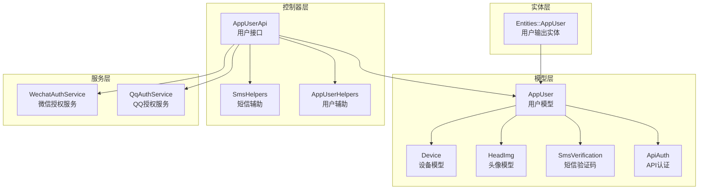
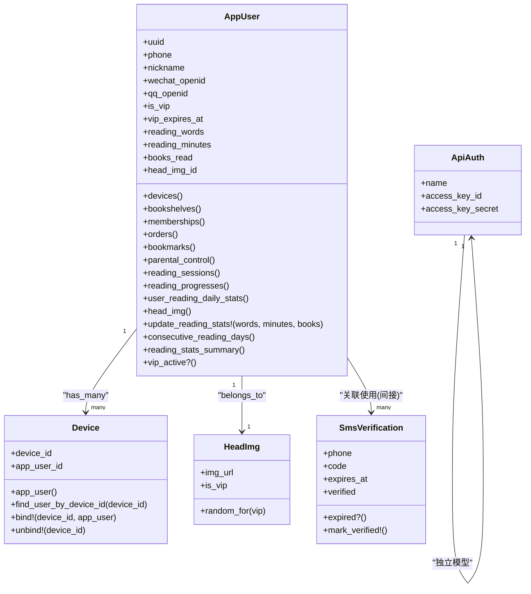
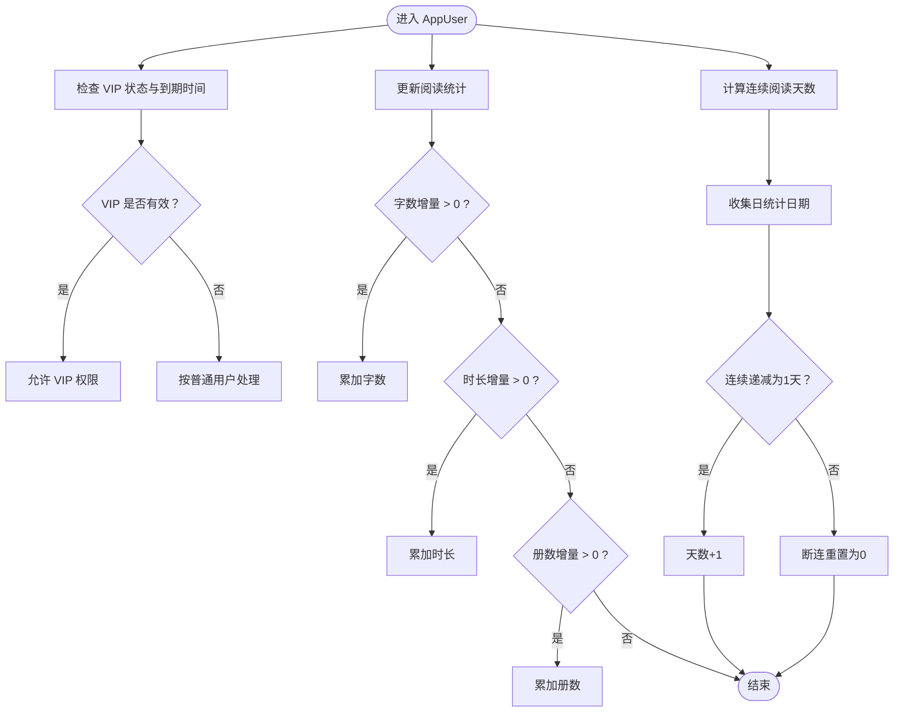
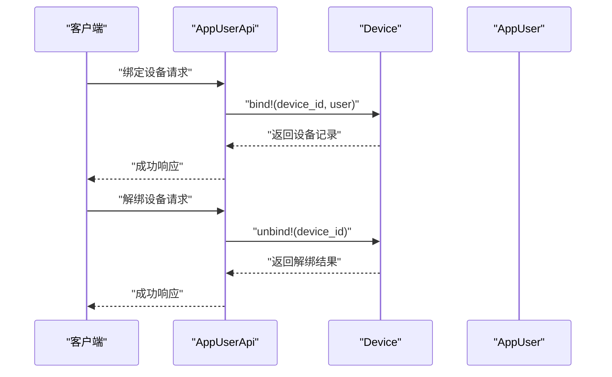
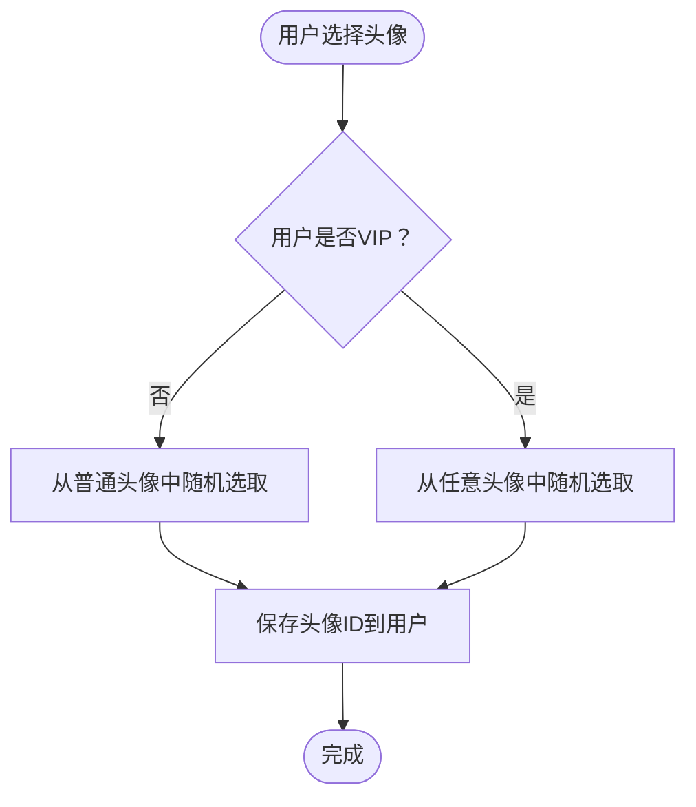
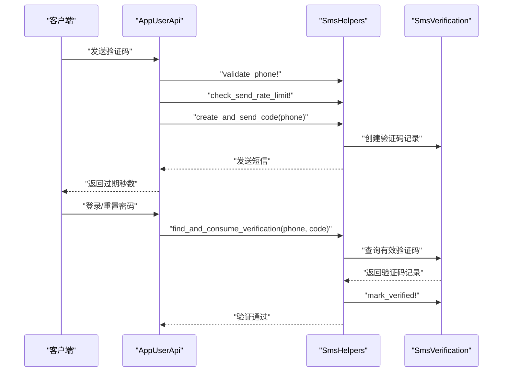
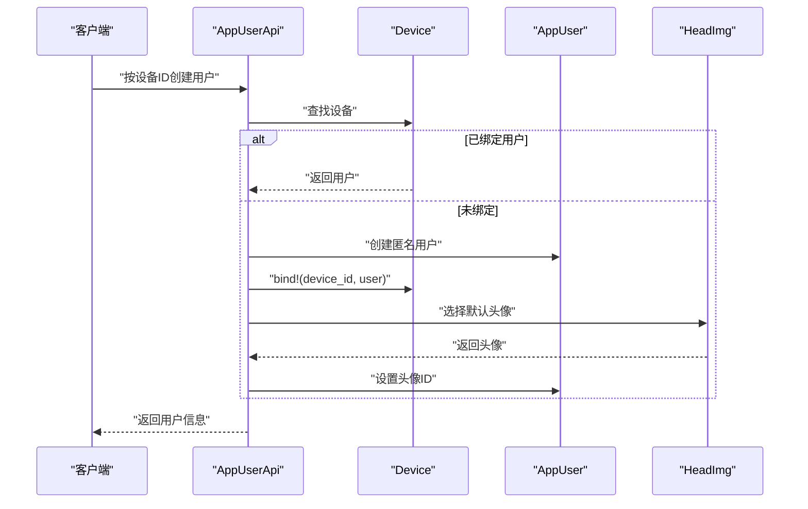
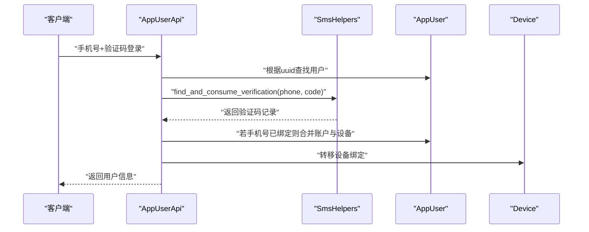
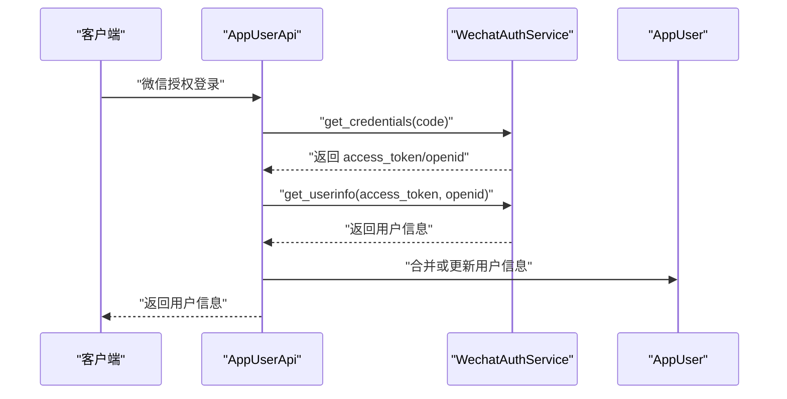
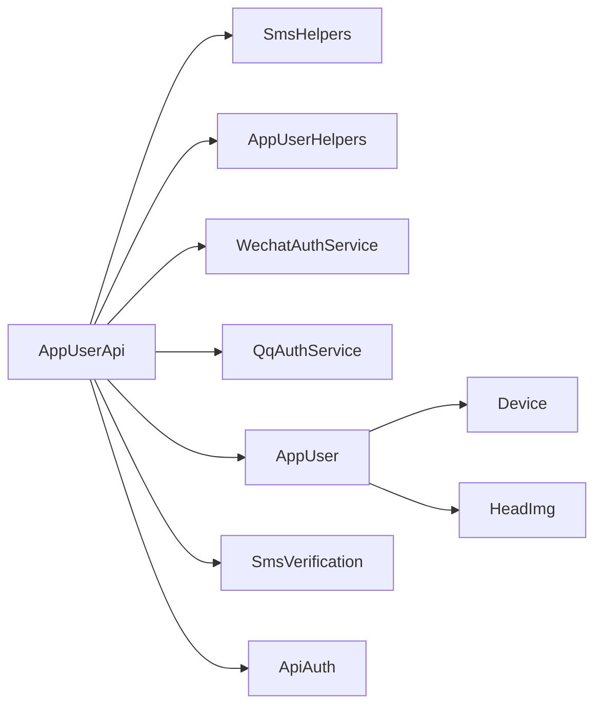

# 用户模型

<cite>
**本文引用的文件**
- [app/models/app_user.rb](file://app/models/app_user.rb)
- [app/models/device.rb](file://app/models/device.rb)
- [app/models/head_img.rb](file://app/models/head_img.rb)
- [app/models/sms_verification.rb](file://app/models/sms_verification.rb)
- [app/models/api_auth.rb](file://app/models/api_auth.rb)
- [app/controllers/api/app_users/app_user_api.rb](file://app/controllers/api/app_users/app_user_api.rb)
- [app/controllers/api/concerns/sms_helpers.rb](file://app/controllers/api/concerns/sms_helpers.rb)
- [app/controllers/api/app_users/app_user_helpers.rb](file://app/controllers/api/app_users/app_user_helpers.rb)
- [app/entities/app_user.rb](file://app/entities/app_user.rb)
- [app/services/wechat_auth_service.rb](file://app/services/wechat_auth_service.rb)
- [app/services/qq_auth_service.rb](file://app/services/qq_auth_service.rb)
- [db/migrate/20260430200000_rename_users_to_app_users.rb](file://db/migrate/20260430200000_rename_users_to_app_users.rb)
- [db/migrate/20260511000000_create_devices.rb](file://db/migrate/20260511000000_create_devices.rb)
- [db/migrate/20260519085000_add_head_img_id_to_app_users.rb](file://db/migrate/20260519085000_add_head_img_id_to_app_users.rb)
</cite>

## 目录
1. [简介](#简介)
2. [项目结构](#项目结构)
3. [核心组件](#核心组件)
4. [架构总览](#架构总览)
5. [详细组件分析](#详细组件分析)
6. [依赖分析](#依赖分析)
7. [性能考虑](#性能考虑)
8. [故障排查指南](#故障排查指南)
9. [结论](#结论)
10. [附录](#附录)

## 简介
本文件系统化梳理语音书应用中的用户相关数据模型与业务流程，重点覆盖以下方面：
- AppUser 用户模型：字段定义、数据类型、验证规则、业务逻辑与角色体系
- 设备(Device)模型：多设备绑定与解绑、设备ID生成与幂等绑定策略
- 头像(HeadImg)模型：头像存储与关联、VIP头像访问控制
- 短信验证(SmsVerification)模型：验证码生成、有效期与消费机制
- API认证(ApiAuth)模型：客户端密钥生成与权限控制
- 核心业务场景：用户注册、登录、设备绑定、头像更换、密码重置、注销与退出登录
- 数据安全与隐私保护：缓存失效、敏感字段处理、第三方授权安全

## 项目结构
围绕用户模型的相关代码主要分布在以下位置：
- 模型层：app/models 下的用户、设备、头像、短信验证码、API认证模型
- 控制器层：app/controllers/api/app_users 下的用户接口与辅助模块
- 实体层：app/entities 下的用户输出实体
- 服务层：app/services 下的微信、QQ授权服务
- 迁移层：db/migrate 下的历史迁移与字段演进

**图表来源**
- [app/models/app_user.rb:38-139](file://app/models/app_user.rb#L38-L139)
- [app/models/device.rb:24-51](file://app/models/device.rb#L24-L51)
- [app/models/head_img.rb:13-22](file://app/models/head_img.rb#L13-L22)
- [app/models/sms_verification.rb:22-45](file://app/models/sms_verification.rb#L22-L45)
- [app/models/api_auth.rb:20-36](file://app/models/api_auth.rb#L20-L36)
- [app/controllers/api/app_users/app_user_api.rb:7-331](file://app/controllers/api/app_users/app_user_api.rb#L7-L331)
- [app/controllers/api/concerns/sms_helpers.rb:7-56](file://app/controllers/api/concerns/sms_helpers.rb#L7-L56)
- [app/controllers/api/app_users/app_user_helpers.rb:6-34](file://app/controllers/api/app_users/app_user_helpers.rb#L6-L34)
- [app/entities/app_user.rb:4-40](file://app/entities/app_user.rb#L4-L40)
- [app/services/wechat_auth_service.rb:7-84](file://app/services/wechat_auth_service.rb#L7-L84)
- [app/services/qq_auth_service.rb:8-86](file://app/services/qq_auth_service.rb#L8-L86)

**章节来源**
- [app/models/app_user.rb:1-140](file://app/models/app_user.rb#L1-L140)
- [app/models/device.rb:1-52](file://app/models/device.rb#L1-L52)
- [app/models/head_img.rb:1-23](file://app/models/head_img.rb#L1-L23)
- [app/models/sms_verification.rb:1-46](file://app/models/sms_verification.rb#L1-L46)
- [app/models/api_auth.rb:1-37](file://app/models/api_auth.rb#L1-L37)
- [app/controllers/api/app_users/app_user_api.rb:1-331](file://app/controllers/api/app_users/app_user_api.rb#L1-L331)
- [app/controllers/api/concerns/sms_helpers.rb:1-57](file://app/controllers/api/concerns/sms_helpers.rb#L1-L57)
- [app/controllers/api/app_users/app_user_helpers.rb:1-35](file://app/controllers/api/app_users/app_user_helpers.rb#L1-L35)
- [app/entities/app_user.rb:1-41](file://app/entities/app_user.rb#L1-L41)
- [app/services/wechat_auth_service.rb:1-85](file://app/services/wechat_auth_service.rb#L1-L85)
- [app/services/qq_auth_service.rb:1-87](file://app/services/qq_auth_service.rb#L1-L87)

## 核心组件
本节对关键模型进行字段、验证与业务逻辑的深入解析。

- AppUser 用户模型
  - 字段与类型：包含手机号、昵称、UUID、角色、VIP状态与到期时间、微信/QQ开放ID、阅读统计、头像关联等
  - 唯一性约束：手机号、微信/QQ开放ID、UUID、设备ID
  - 角色枚举：child（儿童）、parent（家长）、admin（管理员），默认 child
  - 关联关系：多设备绑定、书架、订单、会员、书签、家长管控、阅读会话与进度、日统计、头像
  - 核心业务：
    - 自动生成设备ID与UUID（创建时）
    - 更新阅读统计（字数、时长、册数）
    - 计算连续阅读天数
    - VIP有效性判断
    - 缓存失效（更新时）
  - 参考路径：[app/models/app_user.rb:38-139](file://app/models/app_user.rb#L38-L139)

- Device 设备模型
  - 字段与类型：设备ID（唯一）、所属用户
  - 关联关系：属于 AppUser（可为空，支持匿名用户）
  - 核心能力：
    - 幂等绑定：bind! 支持重复绑定与并发保护
    - 解绑：unbind! 清空用户绑定
    - 查询：按设备ID查找绑定用户
  - 参考路径：[app/models/device.rb:24-51](file://app/models/device.rb#L24-L51)

- HeadImg 头像模型
  - 字段与类型：头像URL、是否VIP头像
  - 关联关系：AppUser 一对一关联
  - 核心能力：
    - VIP/普通头像范围
    - 随机选取（支持VIP/非VIP）
  - 参考路径：[app/models/head_img.rb:13-22](file://app/models/head_img.rb#L13-L22)

- SmsVerification 短信验证码模型
  - 字段与类型：手机号、验证码（4位）、过期时间、是否已验证
  - 核心能力：
    - 验证码有效期与过期判断
    - 消费型验证：一次性使用
    - 作用域：有效未验证、近期发送、当日发送量统计
  - 参考路径：[app/models/sms_verification.rb:22-45](file://app/models/sms_verification.rb#L22-L45)

- ApiAuth API认证模型
  - 字段与类型：客户端名称、访问密钥ID、访问密钥密文
  - 核心能力：
    - 创建前自动生成密钥对
    - 唯一性约束：客户端名称、密钥ID
  - 参考路径：[app/models/api_auth.rb:20-36](file://app/models/api_auth.rb#L20-L36)

**章节来源**
- [app/models/app_user.rb:38-139](file://app/models/app_user.rb#L38-L139)
- [app/models/device.rb:24-51](file://app/models/device.rb#L24-L51)
- [app/models/head_img.rb:13-22](file://app/models/head_img.rb#L13-L22)
- [app/models/sms_verification.rb:22-45](file://app/models/sms_verification.rb#L22-L45)
- [app/models/api_auth.rb:20-36](file://app/models/api_auth.rb#L20-L36)

## 架构总览
下图展示用户相关模型之间的关系与典型调用链：

**图表来源**
- [app/models/app_user.rb:50-61](file://app/models/app_user.rb#L50-L61)
- [app/models/device.rb:24-32](file://app/models/device.rb#L24-L32)
- [app/models/head_img.rb:13-22](file://app/models/head_img.rb#L13-L22)
- [app/models/sms_verification.rb:22-45](file://app/models/sms_verification.rb#L22-L45)
- [app/models/api_auth.rb:20-36](file://app/models/api_auth.rb#L20-L36)

## 详细组件分析

### AppUser 用户模型
- 字段与验证
  - 手机号：唯一、正则校验、可空（支持匿名用户）
  - 微信/QQ开放ID：唯一、可空
  - 昵称：最大长度50、可空
  - UUID：唯一、创建时自动生成
  - 设备ID：唯一索引、创建时自动生成
  - 角色：枚举 child/parent/admin，默认 child
  - VIP：布尔值与到期时间组合判断有效性
- 关联与业务
  - 多设备绑定：支持多设备共享同一账户
  - 阅读统计：原子性累加字数、时长、册数
  - 连续阅读天数：基于日统计表计算
  - 缓存失效：更新时主动清理缓存键
- 参考路径
  - [app/models/app_user.rb:63-124](file://app/models/app_user.rb#L63-L124)

**图表来源**
- [app/models/app_user.rb:77-124](file://app/models/app_user.rb#L77-L124)

**章节来源**
- [app/models/app_user.rb:38-139](file://app/models/app_user.rb#L38-L139)

### 设备(Device)模型
- 设计要点
  - 设备ID唯一且固定长度限制，支持幂等绑定
  - bind! 在并发场景下保证唯一性与一致性
  - unbind! 支持退出登录后解绑
  - find_user_by_device_id 快速定位用户
- 参考路径
  - [app/models/device.rb:24-51](file://app/models/device.rb#L24-L51)

**图表来源**
- [app/models/device.rb:34-50](file://app/models/device.rb#L34-L50)
- [app/controllers/api/app_users/app_user_api.rb:299-310](file://app/controllers/api/app_users/app_user_api.rb#L299-L310)

**章节来源**
- [app/models/device.rb:24-51](file://app/models/device.rb#L24-L51)

### 头像(HeadImg)模型
- 存储与关联
  - 头像URL与是否VIP头像标志
  - AppUser 通过 head_img_id 关联 HeadImg
- 访问控制
  - 非VIP用户不可选择VIP头像
  - 随机选取普通或VIP头像
- 参考路径
  - [app/models/head_img.rb:13-22](file://app/models/head_img.rb#L13-L22)
  - [app/controllers/api/app_users/app_user_api.rb:228-234](file://app/controllers/api/app_users/app_user_api.rb#L228-L234)

**图表来源**
- [app/models/head_img.rb:18-21](file://app/models/head_img.rb#L18-L21)
- [app/controllers/api/app_users/app_user_api.rb:228-234](file://app/controllers/api/app_users/app_user_api.rb#L228-L234)

**章节来源**
- [app/models/head_img.rb:13-22](file://app/models/head_img.rb#L13-L22)
- [app/controllers/api/app_users/app_user_api.rb:228-234](file://app/controllers/api/app_users/app_user_api.rb#L228-L234)

### 短信验证(SmsVerification)模型
- 安全验证流程
  - 生成4位验证码并设置过期时间
  - 发送频率限制：同手机号冷却时间与当日上限
  - 消费型验证：一次性使用，使用后标记为已验证
- 参考路径
  - [app/models/sms_verification.rb:22-45](file://app/models/sms_verification.rb#L22-L45)
  - [app/controllers/api/concerns/sms_helpers.rb:14-56](file://app/controllers/api/concerns/sms_helpers.rb#L14-L56)

**图表来源**
- [app/controllers/api/concerns/sms_helpers.rb:14-56](file://app/controllers/api/concerns/sms_helpers.rb#L14-L56)
- [app/models/sms_verification.rb:36-44](file://app/models/sms_verification.rb#L36-L44)

**章节来源**
- [app/models/sms_verification.rb:22-45](file://app/models/sms_verification.rb#L22-L45)
- [app/controllers/api/concerns/sms_helpers.rb:14-56](file://app/controllers/api/concerns/sms_helpers.rb#L14-L56)

### API认证(ApiAuth)模型
- 权限控制机制
  - 自动生成访问密钥ID与密钥密文
  - 唯一性约束保障客户端身份唯一
  - 作为外部API客户端的身份凭证
- 参考路径
  - [app/models/api_auth.rb:20-36](file://app/models/api_auth.rb#L20-L36)

**章节来源**
- [app/models/api_auth.rb:20-36](file://app/models/api_auth.rb#L20-L36)

### 核心业务场景数据流

#### 场景一：按设备ID匿名创建用户
- 流程概览
  - 根据设备ID查找设备记录
  - 若设备已绑定用户则复用，否则创建匿名用户
  - 自动绑定设备并设置默认头像
- 参考路径
  - [app/controllers/api/app_users/app_user_api.rb:13-27](file://app/controllers/api/app_users/app_user_api.rb#L13-L27)
  - [app/controllers/api/app_users/app_user_helpers.rb:20-31](file://app/controllers/api/app_users/app_user_helpers.rb#L20-L31)

**图表来源**
- [app/controllers/api/app_users/app_user_api.rb:13-27](file://app/controllers/api/app_users/app_user_api.rb#L13-L27)
- [app/controllers/api/app_users/app_user_helpers.rb:20-31](file://app/controllers/api/app_users/app_user_helpers.rb#L20-L31)
- [app/models/device.rb:34-43](file://app/models/device.rb#L34-L43)

**章节来源**
- [app/controllers/api/app_users/app_user_api.rb:13-27](file://app/controllers/api/app_users/app_user_api.rb#L13-L27)
- [app/controllers/api/app_users/app_user_helpers.rb:20-31](file://app/controllers/api/app_users/app_user_helpers.rb#L20-L31)

#### 场景二：手机号+验证码登录/注册
- 流程概览
  - 校验验证码并消费
  - 若手机号已绑定其他用户，合并账户与设备
  - 更新用户信息并返回
- 参考路径
  - [app/controllers/api/app_users/app_user_api.rb:46-82](file://app/controllers/api/app_users/app_user_api.rb#L46-L82)
  - [app/controllers/api/concerns/sms_helpers.rb:42-53](file://app/controllers/api/concerns/sms_helpers.rb#L42-L53)

**图表来源**
- [app/controllers/api/app_users/app_user_api.rb:53-81](file://app/controllers/api/app_users/app_user_api.rb#L53-L81)
- [app/controllers/api/concerns/sms_helpers.rb:42-53](file://app/controllers/api/concerns/sms_helpers.rb#L42-L53)

**章节来源**
- [app/controllers/api/app_users/app_user_api.rb:46-82](file://app/controllers/api/app_users/app_user_api.rb#L46-L82)
- [app/controllers/api/concerns/sms_helpers.rb:42-53](file://app/controllers/api/concerns/sms_helpers.rb#L42-L53)

#### 场景三：微信登录
- 流程概览
  - 通过授权码换取微信凭证与用户信息
  - 若存在已绑定手机号的主账户，合并当前用户
  - 否则更新当前用户的微信开放ID与昵称
- 参考路径
  - [app/controllers/api/app_users/app_user_api.rb:101-153](file://app/controllers/api/app_users/app_user_api.rb#L101-L153)
  - [app/services/wechat_auth_service.rb:19-83](file://app/services/wechat_auth_service.rb#L19-L83)

**图表来源**
- [app/controllers/api/app_users/app_user_api.rb:107-147](file://app/controllers/api/app_users/app_user_api.rb#L107-L147)
- [app/services/wechat_auth_service.rb:19-83](file://app/services/wechat_auth_service.rb#L19-L83)

**章节来源**
- [app/controllers/api/app_users/app_user_api.rb:101-153](file://app/controllers/api/app_users/app_user_api.rb#L101-L153)
- [app/services/wechat_auth_service.rb:19-83](file://app/services/wechat_auth_service.rb#L19-L83)

#### 场景四：头像更换与权限控制
- 流程概览
  - 校验目标头像是否存在
  - 非VIP用户不可选择VIP头像
  - 更新用户头像ID并失效缓存
- 参考路径
  - [app/controllers/api/app_users/app_user_api.rb:211-239](file://app/controllers/api/app_users/app_user_api.rb#L211-L239)
  - [app/models/head_img.rb:13-22](file://app/models/head_img.rb#L13-L22)

**章节来源**
- [app/controllers/api/app_users/app_user_api.rb:211-239](file://app/controllers/api/app_users/app_user_api.rb#L211-L239)
- [app/models/head_img.rb:13-22](file://app/models/head_img.rb#L13-L22)

#### 场景五：密码重置
- 流程概览
  - 首次设置密码无需验证码；修改已有密码需手机号+验证码
  - 校验目标手机号是否已绑定账户
  - 更新密码并返回成功
- 参考路径
  - [app/controllers/api/app_users/app_user_api.rb:241-266](file://app/controllers/api/app_users/app_user_api.rb#L241-L266)

**章节来源**
- [app/controllers/api/app_users/app_user_api.rb:241-266](file://app/controllers/api/app_users/app_user_api.rb#L241-L266)

#### 场景六：注销账户与退出登录
- 流程概览
  - 注销：删除用户及其资源，解绑设备并为每个设备创建新匿名用户
  - 退出登录：解绑当前设备，返回新匿名用户
- 参考路径
  - [app/controllers/api/app_users/app_user_api.rb:268-310](file://app/controllers/api/app_users/app_user_api.rb#L268-L310)

**章节来源**
- [app/controllers/api/app_users/app_user_api.rb:268-310](file://app/controllers/api/app_users/app_user_api.rb#L268-L310)

## 依赖分析
- 模型间耦合
  - AppUser 与 Device：一对多，设备ID唯一，支持多设备共享
  - AppUser 与 HeadImg：一对一，头像ID外键
  - AppUser 与 SmsVerification：间接关联（通过登录/注册流程使用）
  - ApiAuth：独立模型，用于外部客户端鉴权
- 控制器与模型交互
  - AppUserApi 依赖 SmsHelpers 进行验证码校验与发送
  - AppUserApi 依赖 AppUserHelpers 进行用户创建与默认配置
  - AppUserApi 依赖 WechatAuthService/ QqAuthService 进行第三方授权
- 参考路径
  - [app/controllers/api/app_users/app_user_api.rb:7-331](file://app/controllers/api/app_users/app_user_api.rb#L7-L331)
  - [app/controllers/api/concerns/sms_helpers.rb:7-56](file://app/controllers/api/concerns/sms_helpers.rb#L7-L56)
  - [app/controllers/api/app_users/app_user_helpers.rb:6-34](file://app/controllers/api/app_users/app_user_helpers.rb#L6-L34)
  - [app/services/wechat_auth_service.rb:7-84](file://app/services/wechat_auth_service.rb#L7-L84)
  - [app/services/qq_auth_service.rb:8-86](file://app/services/qq_auth_service.rb#L8-L86)

**图表来源**
- [app/controllers/api/app_users/app_user_api.rb:7-331](file://app/controllers/api/app_users/app_user_api.rb#L7-L331)
- [app/controllers/api/concerns/sms_helpers.rb:7-56](file://app/controllers/api/concerns/sms_helpers.rb#L7-L56)
- [app/controllers/api/app_users/app_user_helpers.rb:6-34](file://app/controllers/api/app_users/app_user_helpers.rb#L6-L34)
- [app/services/wechat_auth_service.rb:7-84](file://app/services/wechat_auth_service.rb#L7-L84)
- [app/services/qq_auth_service.rb:8-86](file://app/services/qq_auth_service.rb#L8-L86)
- [app/models/app_user.rb:50-61](file://app/models/app_user.rb#L50-L61)

**章节来源**
- [app/controllers/api/app_users/app_user_api.rb:7-331](file://app/controllers/api/app_users/app_user_api.rb#L7-L331)
- [app/controllers/api/concerns/sms_helpers.rb:7-56](file://app/controllers/api/concerns/sms_helpers.rb#L7-L56)
- [app/controllers/api/app_users/app_user_helpers.rb:6-34](file://app/controllers/api/app_users/app_user_helpers.rb#L6-L34)
- [app/services/wechat_auth_service.rb:7-84](file://app/services/wechat_auth_service.rb#L7-L84)
- [app/services/qq_auth_service.rb:8-86](file://app/services/qq_auth_service.rb#L8-L86)
- [app/models/app_user.rb:50-61](file://app/models/app_user.rb#L50-L61)

## 性能考虑
- 缓存策略
  - AppUser 更新时主动失效缓存键，避免脏读
  - 用户配置接口高频调用时使用Redis缓存家长管控时限
- 数据库索引
  - 用户表在手机号、微信/QQ开放ID、UUID、设备ID上建立唯一索引，提升查询与去重效率
- 并发控制
  - 设备绑定采用幂等策略与异常捕获，避免并发写入冲突
- 参考路径
  - [app/models/app_user.rb:72-72](file://app/models/app_user.rb#L72-L72)
  - [app/controllers/api/app_users/app_user_api.rb:187-197](file://app/controllers/api/app_users/app_user_api.rb#L187-L197)
  - [app/models/device.rb:34-50](file://app/models/device.rb#L34-L50)

## 故障排查指南
- 验证码相关
  - 验证码无效或已过期：检查 SmsVerification 的有效期与消费状态
  - 发送频率超限：确认冷却时间与当日发送次数限制
  - 参考路径
    - [app/controllers/api/concerns/sms_helpers.rb:31-40](file://app/controllers/api/concerns/sms_helpers.rb#L31-L40)
    - [app/models/sms_verification.rb:36-44](file://app/models/sms_verification.rb#L36-L44)
- 第三方登录
  - 微信授权码异常：检查授权码是否被使用或过期
  - QQ授权失败：检查回调格式与错误信息
  - 参考路径
    - [app/controllers/api/app_users/app_user_api.rb:150-153](file://app/controllers/api/app_users/app_user_api.rb#L150-L153)
    - [app/services/wechat_auth_service.rb:35-43](file://app/services/wechat_auth_service.rb#L35-L43)
    - [app/services/qq_auth_service.rb:54-65](file://app/services/qq_auth_service.rb#L54-L65)
- 设备绑定
  - 绑定失败或并发冲突：确认设备ID唯一性与幂等绑定逻辑
  - 参考路径
    - [app/models/device.rb:34-50](file://app/models/device.rb#L34-L50)

**章节来源**
- [app/controllers/api/concerns/sms_helpers.rb:31-40](file://app/controllers/api/concerns/sms_helpers.rb#L31-L40)
- [app/models/sms_verification.rb:36-44](file://app/models/sms_verification.rb#L36-L44)
- [app/controllers/api/app_users/app_user_api.rb:150-153](file://app/controllers/api/app_users/app_user_api.rb#L150-L153)
- [app/services/wechat_auth_service.rb:35-43](file://app/services/wechat_auth_service.rb#L35-L43)
- [app/services/qq_auth_service.rb:54-65](file://app/services/qq_auth_service.rb#L54-L65)
- [app/models/device.rb:34-50](file://app/models/device.rb#L34-L50)

## 结论
本文件系统化梳理了语音书应用的用户相关数据模型与业务流程，明确了各模型的字段定义、验证规则与核心业务逻辑，并通过序列图与流程图展示了关键场景的数据流转。同时，结合缓存策略、数据库索引与并发控制等手段，确保系统的高性能与高可用。对于第三方登录与短信验证等安全敏感环节，提供了清晰的故障排查路径与最佳实践建议。

## 附录
- 字段演进与迁移
  - 用户表重命名与索引迁移
  - 设备表创建与历史数据回填
  - 用户头像字段迁移
  - 参考路径
    - [db/migrate/20260430200000_rename_users_to_app_users.rb:5-26](file://db/migrate/20260430200000_rename_users_to_app_users.rb#L5-L26)
    - [db/migrate/20260511000000_create_devices.rb:1-22](file://db/migrate/20260511000000_create_devices.rb#L1-L22)
    - [db/migrate/20260519085000_add_head_img_id_to_app_users.rb:1-6](file://db/migrate/20260519085000_add_head_img_id_to_app_users.rb#L1-L6)
- 输出实体
  - 用户输出实体包含头像嵌套、设备ID、阅读统计与VIP状态等关键字段
  - 参考路径
    - [app/entities/app_user.rb:4-40](file://app/entities/app_user.rb#L4-L40)