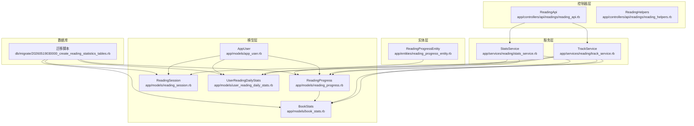
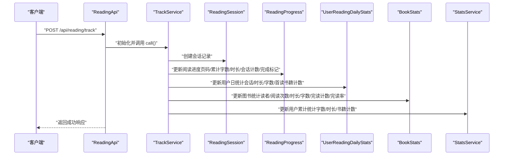
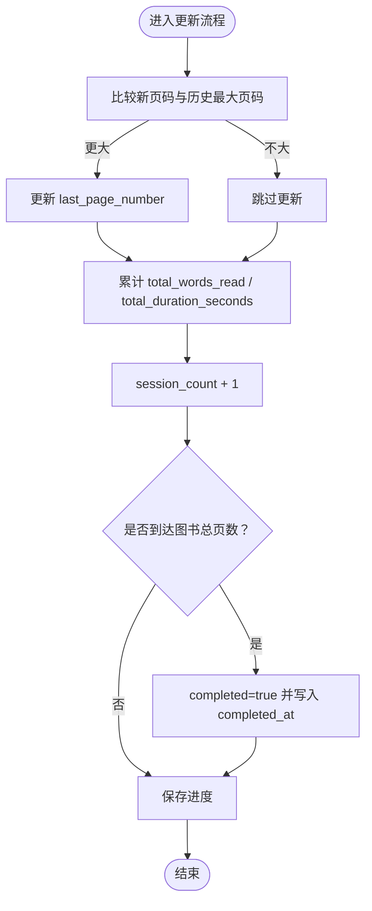
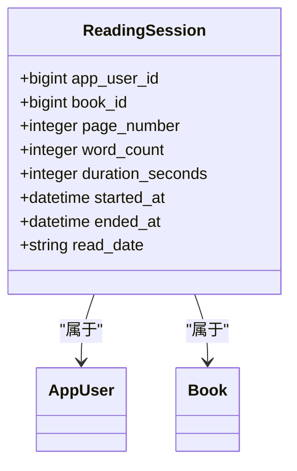
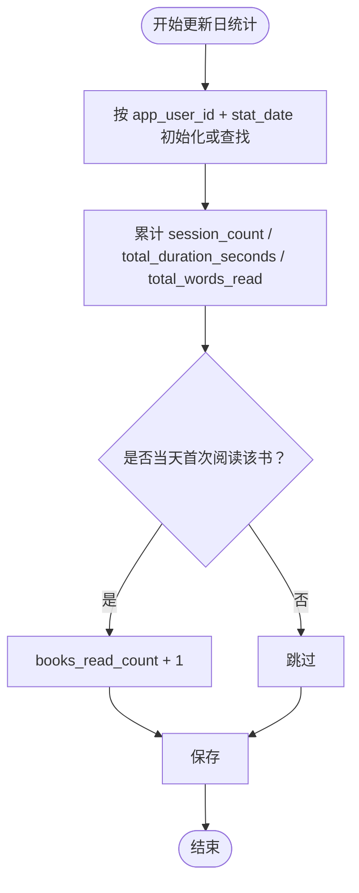
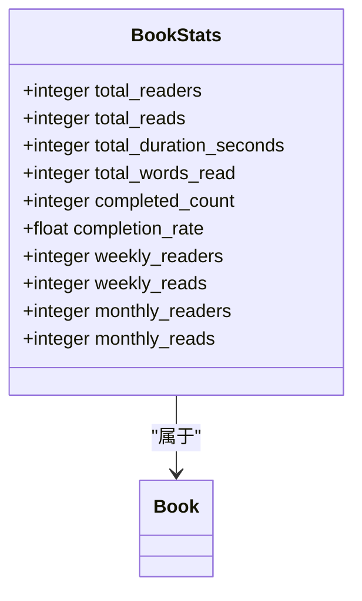
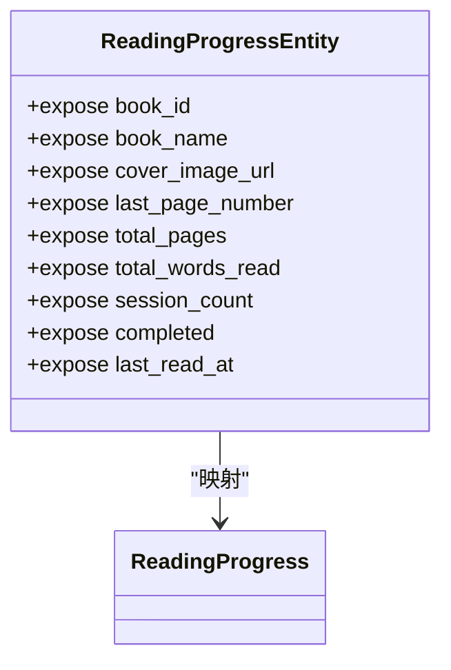
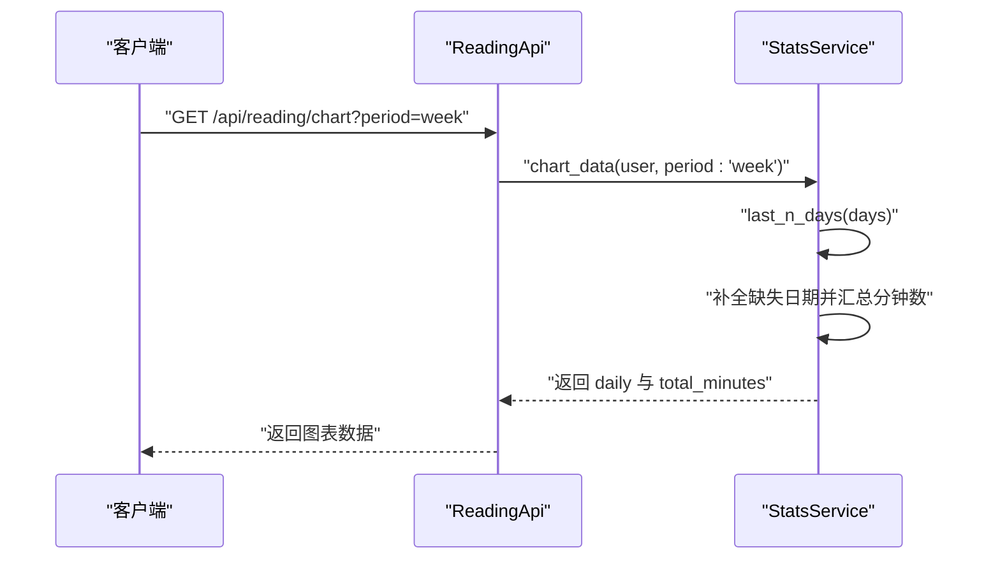
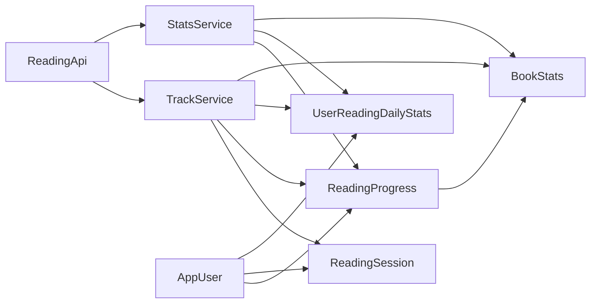

# 阅读统计模型

<cite>
**本文引用的文件**
- [reading_progress.rb](file://app/models/reading_progress.rb)
- [reading_session.rb](file://app/models/reading_session.rb)
- [user_reading_daily_stats.rb](file://app/models/user_reading_daily_stats.rb)
- [book_stats.rb](file://app/models/book_stats.rb)
- [reading_progress_entity.rb](file://app/entities/reading_progress_entity.rb)
- [stats_service.rb](file://app/services/reading/stats_service.rb)
- [track_service.rb](file://app/services/reading/track_service.rb)
- [reading_api.rb](file://app/controllers/api/readings/reading_api.rb)
- [reading_helpers.rb](file://app/controllers/api/readings/reading_helpers.rb)
- [app_user.rb](file://app/models/app_user.rb)
- [20260519030000_create_reading_statistics_tables.rb](file://db/migrate/20260519030000_create_reading_statistics_tables.rb)
- [reading_progress_spec.rb](file://spec/models/reading_progress_spec.rb)
- [reading_session_spec.rb](file://spec/models/reading_session_spec.rb)
- [stats_service_spec.rb](file://spec/services/reading/stats_service_spec.rb)
- [track_service_spec.rb](file://spec/services/reading/track_service_spec.rb)
- [reading_spec.rb](file://spec/requests/api/reading_spec.rb)
</cite>

## 目录
1. [简介](#简介)
2. [项目结构](#项目结构)
3. [核心组件](#核心组件)
4. [架构概览](#架构概览)
5. [详细组件分析](#详细组件分析)
6. [依赖分析](#依赖分析)
7. [性能考虑](#性能考虑)
8. [故障排查指南](#故障排查指南)
9. [结论](#结论)
10. [附录](#附录)

## 简介
本文件系统性梳理阅读统计相关数据模型与服务层实现，覆盖以下主题：
- ReadingProgress 阅读进度模型：如何跟踪用户的阅读状态与位置，以及完成标记逻辑
- ReadingSession 阅读会话模型：时间记录与行为分析的基础
- UserReadingDailyStats 用户每日阅读统计数据：聚合机制与索引设计
- BookStats 图书统计模型：阅读量、评分与流行度计算
- ReadingProgressEntity 实体模型：API 层的数据传输格式
- 阅读行为追踪、学习分析与个性化推荐的数据基础
- 实时更新机制与性能优化策略

## 项目结构
围绕阅读统计的关键文件分布如下：
- 模型层：reading_progress.rb、reading_session.rb、user_reading_daily_stats.rb、book_stats.rb、app_user.rb
- 服务层：stats_service.rb、track_service.rb
- 控制器层：reading_api.rb、reading_helpers.rb
- 数据迁移：20260519030000_create_reading_statistics_tables.rb
- 实体层：reading_progress_entity.rb
- 测试：各模型与服务的规格测试文件

**图示来源**
- [reading_api.rb:1-93](file://app/controllers/api/readings/reading_api.rb#L1-L93)
- [track_service.rb:1-126](file://app/services/reading/track_service.rb#L1-L126)
- [stats_service.rb:1-140](file://app/services/reading/stats_service.rb#L1-L140)
- [reading_progress.rb:1-27](file://app/models/reading_progress.rb#L1-L27)
- [reading_session.rb:1-25](file://app/models/reading_session.rb#L1-L25)
- [user_reading_daily_stats.rb:1-21](file://app/models/user_reading_daily_stats.rb#L1-L21)
- [book_stats.rb:1-31](file://app/models/book_stats.rb#L1-L31)
- [app_user.rb:1-140](file://app/models/app_user.rb#L1-L140)
- [reading_progress_entity.rb:1-24](file://app/entities/reading_progress_entity.rb#L1-L24)
- [20260519030000_create_reading_statistics_tables.rb:1-90](file://db/migrate/20260519030000_create_reading_statistics_tables.rb#L1-L90)

**章节来源**
- [reading_api.rb:1-93](file://app/controllers/api/readings/reading_api.rb#L1-L93)
- [track_service.rb:1-126](file://app/services/reading/track_service.rb#L1-L126)
- [stats_service.rb:1-140](file://app/services/reading/stats_service.rb#L1-L140)
- [reading_progress.rb:1-27](file://app/models/reading_progress.rb#L1-L27)
- [reading_session.rb:1-25](file://app/models/reading_session.rb#L1-L25)
- [user_reading_daily_stats.rb:1-21](file://app/models/user_reading_daily_stats.rb#L1-L21)
- [book_stats.rb:1-31](file://app/models/book_stats.rb#L1-L31)
- [app_user.rb:1-140](file://app/models/app_user.rb#L1-L140)
- [reading_progress_entity.rb:1-24](file://app/entities/reading_progress_entity.rb#L1-L24)
- [20260519030000_create_reading_statistics_tables.rb:1-90](file://db/migrate/20260519030000_create_reading_statistics_tables.rb#L1-L90)

## 核心组件
- ReadingProgress：单用户对单图书的阅读进度快照，记录最新页码、累计字数与时长、会话次数、完成标记与最近阅读时间等
- ReadingSession：单次阅读会话记录，包含页码、字数、时长、起止时间与阅读日期
- UserReadingDailyStats：按用户与日期聚合的日统计，包含当日会话次数、总时长、总字数与阅读书籍数
- BookStats：按图书聚合的统计，包含总读者数、总阅读次数、总时长、总字数、完读人数、完读率及近7/30天读者与阅读次数
- ReadingProgressEntity：API 层输出实体，将阅读进度映射为对外传输的结构化数据
- StatsService：统计查询与聚合服务，负责用户统计摘要、图书统计、进度列表与图表数据生成
- TrackService：阅读行为追踪服务，事务内创建会话、更新进度、日统计、图书统计与用户累计统计

**章节来源**
- [reading_progress.rb:1-27](file://app/models/reading_progress.rb#L1-L27)
- [reading_session.rb:1-25](file://app/models/reading_session.rb#L1-L25)
- [user_reading_daily_stats.rb:1-21](file://app/models/user_reading_daily_stats.rb#L1-L21)
- [book_stats.rb:1-31](file://app/models/book_stats.rb#L1-L31)
- [reading_progress_entity.rb:1-24](file://app/entities/reading_progress_entity.rb#L1-L24)
- [stats_service.rb:1-140](file://app/services/reading/stats_service.rb#L1-L140)
- [track_service.rb:1-126](file://app/services/reading/track_service.rb#L1-L126)

## 架构概览
阅读统计的端到端流程由控制器触发，服务层协调多张统计表进行原子更新，并通过实体层输出标准化数据。

**图示来源**
- [reading_api.rb:19-34](file://app/controllers/api/readings/reading_api.rb#L19-L34)
- [track_service.rb:16-26](file://app/services/reading/track_service.rb#L16-L26)
- [reading_session.rb:30-40](file://app/models/reading_session.rb#L30-L40)
- [reading_progress.rb:42-66](file://app/models/reading_progress.rb#L42-L66)
- [user_reading_daily_stats.rb:68-86](file://app/models/user_reading_daily_stats.rb#L68-L86)
- [book_stats.rb:88-115](file://app/models/book_stats.rb#L88-L115)
- [app_user.rb:87-92](file://app/models/app_user.rb#L87-L92)

## 详细组件分析

### ReadingProgress 阅读进度模型
- 字段与含义
  - last_page_number：最新阅读到的页码
  - total_words_read：本书累计阅读字数
  - total_duration_seconds：本书累计阅读时长（秒）
  - session_count：阅读次数
  - completed/completed_at：是否已读完及完读时间
  - last_read_at：最近阅读时间
- 关系与约束
  - belongs_to :app_user、belongs_to :book
  - 唯一索引：[app_user_id, book_id]
- 关键逻辑
  - 当新页码超过历史最大值时更新
  - 累计字数与时长累加
  - 会话次数递增
  - 若达到图书总页数则标记完成并记录完成时间
  - 提供 recently_read、completed、in_progress、recently_completed 等常用作用域

**图示来源**
- [track_service.rb:42-66](file://app/services/reading/track_service.rb#L42-L66)
- [reading_progress.rb:17-26](file://app/models/reading_progress.rb#L17-L26)

**章节来源**
- [reading_progress.rb:1-27](file://app/models/reading_progress.rb#L1-L27)
- [track_service.rb:42-66](file://app/services/reading/track_service.rb#L42-L66)
- [reading_progress_spec.rb:30-48](file://spec/models/reading_progress_spec.rb#L30-L48)

### ReadingSession 阅读会话模型
- 字段与含义
  - page_number、word_count、duration_seconds：本次会话的页码、字数与时长
  - started_at/ended_at：开始与结束时间
  - read_date：阅读日期（YYYY-MM-DD）
- 关系与约束
  - belongs_to :app_user、belongs_to :book
  - 索引：[app_user_id, book_id]、[app_user_id, read_date]、[book_id]
- 关键逻辑
  - 会话创建时写入 read_date 与 started_at
  - 提供按日期、最近、最近 N 天、按图书与日期筛选的作用域

**图示来源**
- [reading_session.rb:1-25](file://app/models/reading_session.rb#L1-L25)
- [20260519030000_create_reading_statistics_tables.rb:3-16](file://db/migrate/20260519030000_create_reading_statistics_tables.rb#L3-L16)

**章节来源**
- [reading_session.rb:1-25](file://app/models/reading_session.rb#L1-L25)
- [reading_session_spec.rb:18-56](file://spec/models/reading_session_spec.rb#L18-L56)
- [20260519030000_create_reading_statistics_tables.rb:3-16](file://db/migrate/20260519030000_create_reading_statistics_tables.rb#L3-L16)

### UserReadingDailyStats 用户每日阅读统计数据
- 字段与含义
  - session_count、total_duration_seconds、total_words_read、books_read_count
- 关系与约束
  - belongs_to :app_user
  - 唯一索引：[app_user_id, stat_date]
  - 提供 last_n_days、up_to_date 作用域
- 关键逻辑
  - 按日聚合用户会话次数、总时长、总字数
  - 通过“当天首次阅读某书”的竞态避免重复计数
  - 用于生成周/月图表数据

**图示来源**
- [track_service.rb:68-86](file://app/services/reading/track_service.rb#L68-L86)
- [user_reading_daily_stats.rb:14-21](file://app/models/user_reading_daily_stats.rb#L14-L21)

**章节来源**
- [user_reading_daily_stats.rb:1-21](file://app/models/user_reading_daily_stats.rb#L1-L21)
- [track_service.rb:68-86](file://app/services/reading/track_service.rb#L68-L86)
- [stats_service.rb:66-110](file://app/services/reading/stats_service.rb#L66-L110)

### BookStats 图书统计模型
- 字段与含义
  - total_readers、total_reads、total_duration_seconds、total_words_read
  - completed_count、completion_rate
  - weekly_readers、weekly_reads、monthly_readers、monthly_reads
- 关系与约束
  - belongs_to :book
  - 唯一索引：book_id；索引：weekly_readers、monthly_readers
  - 提供按周读者、月读者、完读率、评分排序的作用域
- 关键逻辑
  - 首次当日阅读某书时增加 total_readers、weekly_readers、monthly_readers
  - 累计 total_reads、total_duration_seconds、total_words_read、weekly_reads、monthly_reads
  - 检测用户近期完读该书以增加 completed_count，并重新计算 completion_rate

**图示来源**
- [book_stats.rb:1-31](file://app/models/book_stats.rb#L1-L31)
- [20260519030000_create_reading_statistics_tables.rb:44-58](file://db/migrate/20260519030000_create_reading_statistics_tables.rb#L44-L58)

**章节来源**
- [book_stats.rb:1-31](file://app/models/book_stats.rb#L1-L31)
- [track_service.rb:88-115](file://app/services/reading/track_service.rb#L88-L115)

### ReadingProgressEntity 实体模型（API 层）
- 输出字段
  - book_id、book_name、cover_image_url、last_page_number、total_pages、total_words_read、session_count、completed、last_read_at
- 特点
  - 将进度对象映射为对外传输结构，包含封面 URL 的 OSS 签名处理
  - 时间字段格式化为字符串

**图示来源**
- [reading_progress_entity.rb:1-24](file://app/entities/reading_progress_entity.rb#L1-L24)
- [reading_progress.rb:1-27](file://app/models/reading_progress.rb#L1-L27)

**章节来源**
- [reading_progress_entity.rb:1-24](file://app/entities/reading_progress_entity.rb#L1-L24)
- [stats_service.rb:124-137](file://app/services/reading/stats_service.rb#L124-L137)

### 统计服务与控制器集成
- StatsService
  - user_stats：聚合用户书籍数、完成数、累计时长（分钟）、累计字数、平均时长（分钟）、完读率、连续阅读天数
  - book_stats：查询图书统计或返回默认值
  - user_progress/user_book_progress：返回进度列表或指定图书进度
  - chart_data：按周/月生成图表数据，补齐缺失日期并计算总时长
- ReadingApi
  - /reading/track：上报阅读记录，调用 TrackService
  - /reading/my_stats：获取用户统计
  - /reading/chart：获取图表数据
  - /reading/my_progress：获取进度列表
  - /reading/my_progress/:book_id：获取某书进度

**图示来源**
- [reading_api.rb:48-59](file://app/controllers/api/readings/reading_api.rb#L48-L59)
- [stats_service.rb:66-110](file://app/services/reading/stats_service.rb#L66-L110)

**章节来源**
- [stats_service.rb:1-140](file://app/services/reading/stats_service.rb#L1-L140)
- [reading_api.rb:1-93](file://app/controllers/api/readings/reading_api.rb#L1-L93)

## 依赖分析
- 控制器依赖服务层
  - ReadingApi 依赖 TrackService 与 StatsService
- 服务层依赖模型层
  - TrackService 依赖 ReadingSession、ReadingProgress、UserReadingDailyStats、BookStats、AppUser
  - StatsService 依赖 ReadingProgress、UserReadingDailyStats、BookStats、AppUser
- 模型层相互依赖
  - ReadingProgress 与 BookStats 通过 book 关联
  - AppUser 同时关联 ReadingProgress、ReadingSession、UserReadingDailyStats
- 数据库索引与约束
  - 多处唯一索引保证幂等与去重
  - 复合索引提升查询效率（如按用户+日期、用户+图书）

**图示来源**
- [reading_api.rb:1-93](file://app/controllers/api/readings/reading_api.rb#L1-L93)
- [track_service.rb:1-126](file://app/services/reading/track_service.rb#L1-L126)
- [stats_service.rb:1-140](file://app/services/reading/stats_service.rb#L1-L140)
- [reading_progress.rb:1-27](file://app/models/reading_progress.rb#L1-L27)
- [reading_session.rb:1-25](file://app/models/reading_session.rb#L1-L25)
- [user_reading_daily_stats.rb:1-21](file://app/models/user_reading_daily_stats.rb#L1-L21)
- [book_stats.rb:1-31](file://app/models/book_stats.rb#L1-L31)
- [app_user.rb:1-140](file://app/models/app_user.rb#L1-L140)

**章节来源**
- [reading_api.rb:1-93](file://app/controllers/api/readings/reading_api.rb#L1-L93)
- [track_service.rb:1-126](file://app/services/reading/track_service.rb#L1-L126)
- [stats_service.rb:1-140](file://app/services/reading/stats_service.rb#L1-L140)
- [reading_progress.rb:1-27](file://app/models/reading_progress.rb#L1-L27)
- [reading_session.rb:1-25](file://app/models/reading_session.rb#L1-L25)
- [user_reading_daily_stats.rb:1-21](file://app/models/user_reading_daily_stats.rb#L1-L21)
- [book_stats.rb:1-31](file://app/models/book_stats.rb#L1-L31)
- [app_user.rb:1-140](file://app/models/app_user.rb#L1-L140)

## 性能考虑
- 缓存策略
  - StatsService.user_stats 使用短时缓存（30 秒），降低高频查询压力
- 事务与一致性
  - TrackService 在单个事务中更新多表，确保强一致
- 索引优化
  - 复合索引覆盖常见查询模式（用户+图书、用户+日期、图书）
- 并发控制
  - 日统计与图书统计通过“当天首次阅读某书”的会话计数判断避免竞态
  - 完读人数更新通过近期完成检测减少误判
- 图表数据补齐
  - StatsService.chart_data 对缺失日期进行补零，保证前端渲染稳定

**章节来源**
- [stats_service.rb:7-28](file://app/services/reading/stats_service.rb#L7-L28)
- [track_service.rb:19-26](file://app/services/reading/track_service.rb#L19-L26)
- [track_service.rb:70-86](file://app/services/reading/track_service.rb#L70-L86)
- [track_service.rb:88-115](file://app/services/reading/track_service.rb#L88-L115)
- [stats_service.rb:66-110](file://app/services/reading/stats_service.rb#L66-L110)
- [20260519030000_create_reading_statistics_tables.rb:14-16](file://db/migrate/20260519030000_create_reading_statistics_tables.rb#L14-L16)
- [20260519030000_create_reading_statistics_tables.rb:30-31](file://db/migrate/20260519030000_create_reading_statistics_tables.rb#L30-L31)
- [20260519030000_create_reading_statistics_tables.rb](file://db/migrate/20260519030000_create_reading_statistics_tables.rb#L42)
- [20260519030000_create_reading_statistics_tables.rb:58-60](file://db/migrate/20260519030000_create_reading_statistics_tables.rb#L58-L60)

## 故障排查指南
- 上报接口无响应或异常
  - 检查请求参数（uuid、book_id、page_number、word_count、duration_seconds）
  - 确认图书存在且用户认证通过
- 进度未更新或更新异常
  - 核对 TrackService 是否在事务中执行
  - 检查 ReadingProgress 的 last_page_number 是否大于等于新页码
  - 确认 completed 标记逻辑是否满足页数条件
- 日统计与图书统计不准确
  - 检查“当天首次阅读某书”的判断逻辑
  - 确认并发场景下会话计数是否正确
- 图表数据为空或为零
  - 确认 UserReadingDailyStats 是否按日期正确写入
  - 检查 StatsService.chart_data 的日期范围与补齐逻辑

**章节来源**
- [reading_api.rb:19-34](file://app/controllers/api/readings/reading_api.rb#L19-L34)
- [track_service.rb:16-26](file://app/services/reading/track_service.rb#L16-L26)
- [track_service.rb:42-66](file://app/services/reading/track_service.rb#L42-L66)
- [track_service.rb:68-115](file://app/services/reading/track_service.rb#L68-L115)
- [stats_service.rb:66-110](file://app/services/reading/stats_service.rb#L66-L110)
- [reading_spec.rb:90-128](file://spec/requests/api/reading_spec.rb#L90-L128)

## 结论
本系统通过 ReadingSession、ReadingProgress、UserReadingDailyStats、BookStats 四大模型与 TrackService、StatsService 的协同，实现了对用户阅读行为的完整追踪与统计。实体层提供稳定的 API 输出格式，服务层在缓存、事务与索引层面做了充分优化，能够支撑学习分析与个性化推荐的数据基础。建议持续关注并发竞态下的幂等性与缓存失效策略，以进一步提升稳定性与性能。

## 附录
- API 接口清单
  - POST /api/reading/track：上报阅读记录
  - GET /api/reading/my_stats：获取用户统计
  - GET /api/reading/chart：获取图表数据（week/month）
  - GET /api/reading/my_progress：获取进度列表
  - GET /api/reading/my_progress/:book_id：获取某书进度

**章节来源**
- [reading_api.rb:11-89](file://app/controllers/api/readings/reading_api.rb#L11-L89)