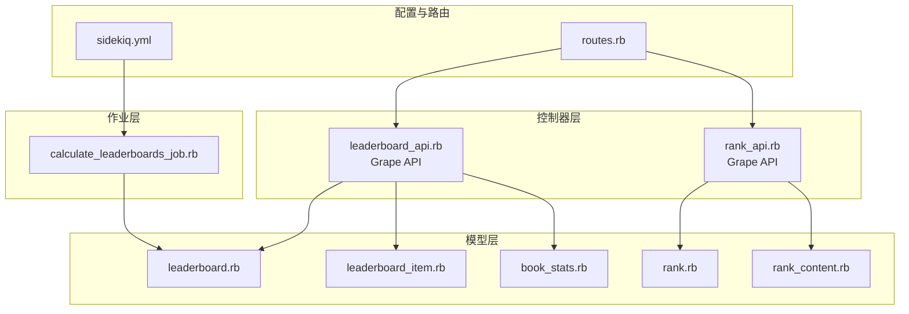
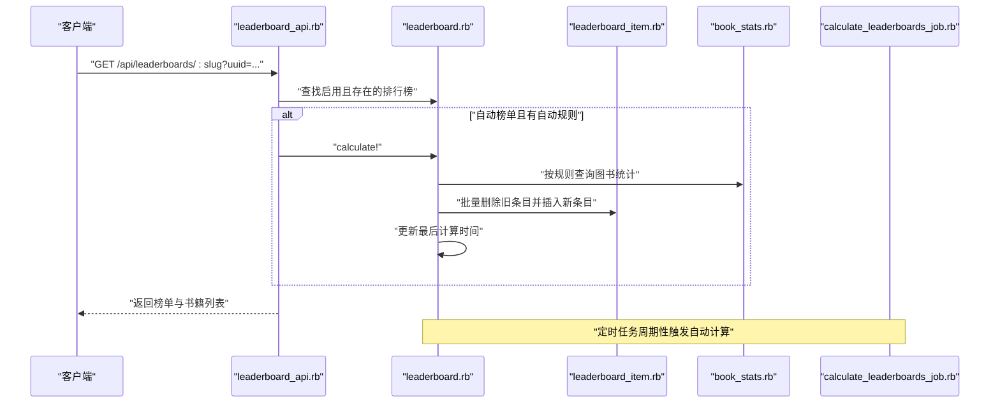
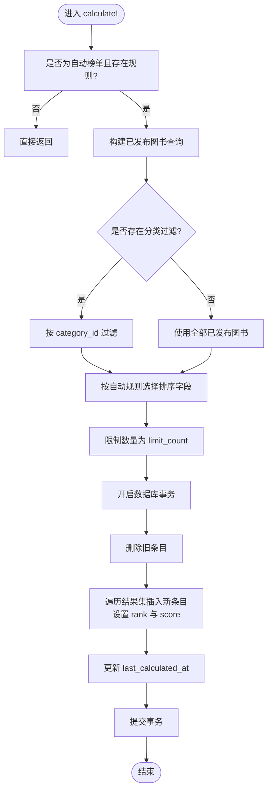
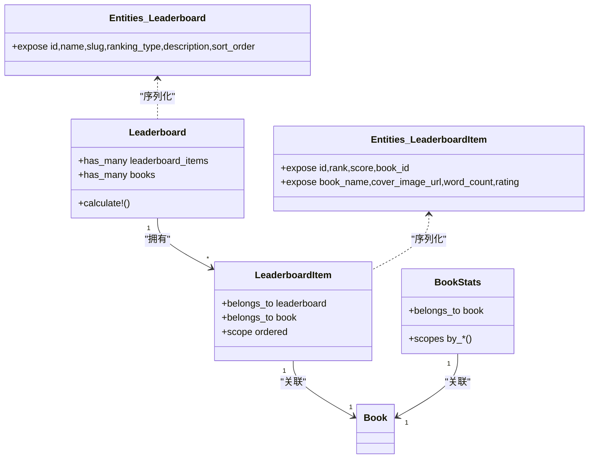
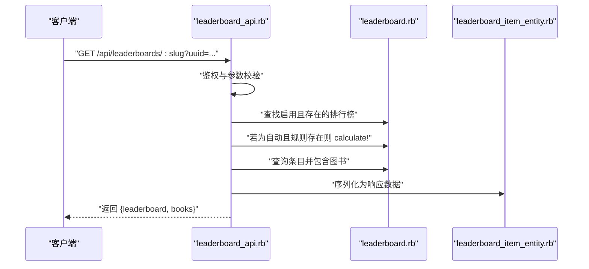
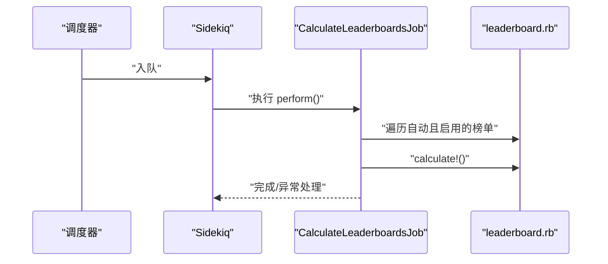
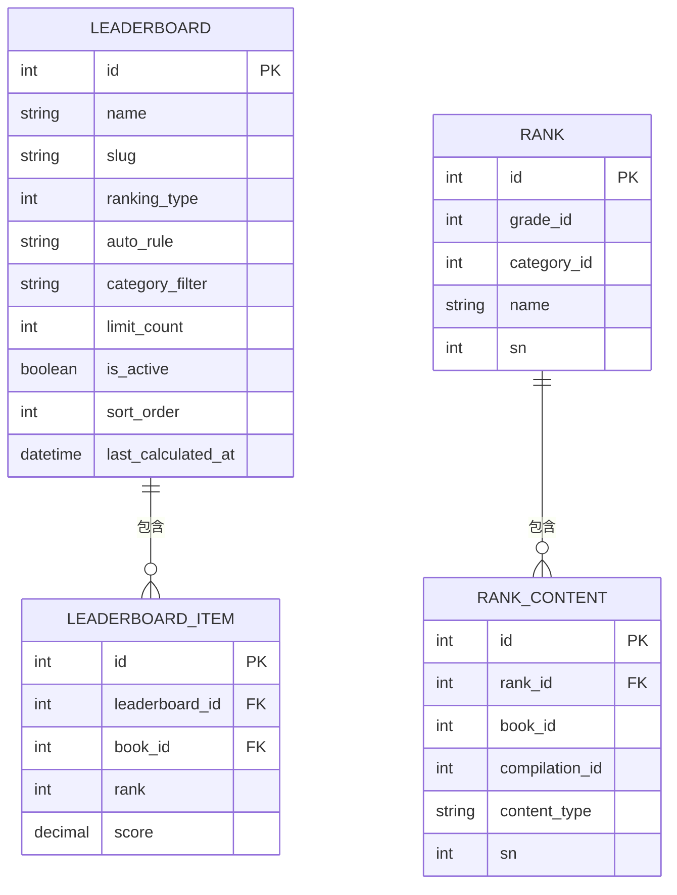
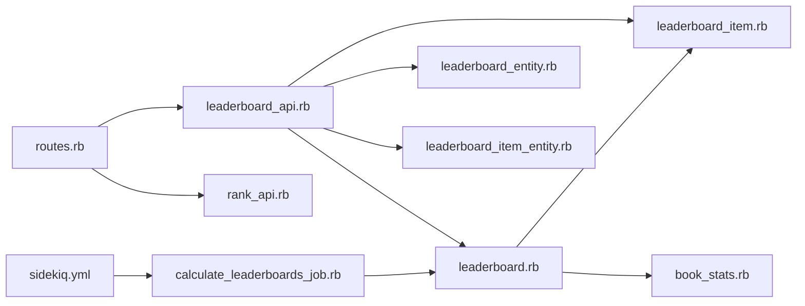

# 排行榜系统

<cite>
**本文引用的文件**
- [leaderboard_api.rb](file://app/controllers/api/leaderboards/leaderboard_api.rb)
- [leaderboard_helpers.rb](file://app/controllers/api/leaderboards/leaderboard_helpers.rb)
- [leaderboard.rb](file://app/models/leaderboard.rb)
- [leaderboard_item.rb](file://app/models/leaderboard_item.rb)
- [leaderboard_entity.rb](file://app/entities/leaderboard_entity.rb)
- [leaderboard_item_entity.rb](file://app/entities/leaderboard_item_entity.rb)
- [book_stats.rb](file://app/models/book_stats.rb)
- [calculate_leaderboards_job.rb](file://app/jobs/calculate_leaderboards_job.rb)
- [rank_api.rb](file://app/controllers/api/ranks/rank_api.rb)
- [rank_helpers.rb](file://app/controllers/api/ranks/rank_helpers.rb)
- [rank.rb](file://app/models/rank.rb)
- [rank_content.rb](file://app/models/rank_content.rb)
- [stats_service.rb](file://app/services/reading/stats_service.rb)
- [routes.rb](file://config/routes.rb)
- [sidekiq.yml](file://config/sidekiq.yml)
- [leaderboards_spec.rb](file://spec/requests/api/leaderboards_spec.rb)
</cite>

## 目录
1. [简介](#简介)
2. [项目结构](#项目结构)
3. [核心组件](#核心组件)
4. [架构总览](#架构总览)
5. [详细组件分析](#详细组件分析)
6. [依赖关系分析](#依赖关系分析)
7. [性能考虑](#性能考虑)
8. [故障排查指南](#故障排查指南)
9. [结论](#结论)
10. [附录](#附录)

## 简介
本文件面向“排行榜系统”的技术文档，围绕以下目标展开：
- 深入解释排行榜计算任务、排名规则、数据更新机制等核心功能的实现原理
- 详细说明排行榜服务的 API 接口、计算策略与缓存机制
- 包含用户积分计算、排名更新、数据同步的技术实现
- 提供实际代码示例路径，展示如何触发排行榜计算和获取排名结果
- 说明定时任务的配置方式与性能优化策略，特别是大数据量下的计算优化方案

## 项目结构
排行榜系统主要由三层构成：
- 控制器层：提供对外 API，负责鉴权、参数校验、调用业务逻辑与序列化输出
- 模型层：定义排行榜、排行榜条目、图书统计等实体及查询规则
- 作业层：通过 Sidekiq 异步执行定时计算任务

**图示来源**
- [leaderboard_api.rb:1-53](file://app/controllers/api/leaderboards/leaderboard_api.rb#L1-L53)
- [rank_api.rb:1-56](file://app/controllers/api/ranks/rank_api.rb#L1-L56)
- [leaderboard.rb:1-61](file://app/models/leaderboard.rb#L1-L61)
- [leaderboard_item.rb:1-18](file://app/models/leaderboard_item.rb#L1-L18)
- [book_stats.rb:1-31](file://app/models/book_stats.rb#L1-L31)
- [rank.rb:1-38](file://app/models/rank.rb#L1-L38)
- [rank_content.rb:1-48](file://app/models/rank_content.rb#L1-L48)
- [calculate_leaderboards_job.rb:1-19](file://app/jobs/calculate_leaderboards_job.rb#L1-L19)
- [routes.rb:1-30](file://config/routes.rb#L1-L30)
- [sidekiq.yml:1-8](file://config/sidekiq.yml#L1-L8)

**章节来源**
- [routes.rb:1-30](file://config/routes.rb#L1-L30)

## 核心组件
- 排行榜模型与条目
  - 排行榜实体：包含名称、标识、类型（自动/手动）、自动规则、分类过滤、限制数量、启用状态、排序字段、最后计算时间等
  - 排行榜条目：关联排行榜与图书，存储排名与分数
- 图书统计模型
  - 统计字段覆盖总阅读人数、总阅读次数、总时长、总字数、完读人数、完读率、近7天/30天阅读人数等
- 计算作业
  - 定时扫描自动排行榜，按规则重新计算并写入条目
- API 层
  - 提供获取启用榜单列表、按 slug 获取榜单书籍列表的接口；自动榜单在访问时可触发实时计算
- 缓存与序列化
  - 用户阅读统计使用 Redis 缓存短期数据；实体序列化输出榜单与条目信息

**章节来源**
- [leaderboard.rb:18-61](file://app/models/leaderboard.rb#L18-L61)
- [leaderboard_item.rb:12-18](file://app/models/leaderboard_item.rb#L12-L18)
- [book_stats.rb:19-31](file://app/models/book_stats.rb#L19-L31)
- [calculate_leaderboards_job.rb:4-19](file://app/jobs/calculate_leaderboards_job.rb#L4-L19)
- [leaderboard_api.rb:9-48](file://app/controllers/api/leaderboards/leaderboard_api.rb#L9-L48)
- [stats_service.rb:6-28](file://app/services/reading/stats_service.rb#L6-L28)
- [leaderboard_entity.rb:4-12](file://app/entities/leaderboard_entity.rb#L4-L12)
- [leaderboard_item_entity.rb:4-23](file://app/entities/leaderboard_item_entity.rb#L4-L23)

## 架构总览
下图展示了从客户端请求到数据落库与返回的完整流程。

**图示来源**
- [leaderboard_api.rb:31-48](file://app/controllers/api/leaderboards/leaderboard_api.rb#L31-L48)
- [leaderboard.rb:27-59](file://app/models/leaderboard.rb#L27-L59)
- [leaderboard_item.rb:12-18](file://app/models/leaderboard_item.rb#L12-L18)
- [book_stats.rb:19-31](file://app/models/book_stats.rb#L19-L31)
- [calculate_leaderboards_job.rb:9-13](file://app/jobs/calculate_leaderboards_job.rb#L9-L13)

## 详细组件分析

### 排行榜模型与计算策略
- 排行榜类型与规则
  - 类型枚举：自动/手动
  - 自动规则支持：近7天阅读人数、近30天阅读人数、评分、完读率、最新上架等
  - 分类过滤：可按 category_id 过滤候选图书集合
  - 展示上限：limit_count 控制返回数量
- 计算流程
  - 事务内清空旧条目，按规则排序取前 N，逐条写入 rank 与 score 字段，并更新 last_calculated_at
- 实时计算触发
  - 访问接口时若为自动榜单且存在规则，则立即计算并返回最新结果

**图示来源**
- [leaderboard.rb:27-59](file://app/models/leaderboard.rb#L27-L59)

**章节来源**
- [leaderboard.rb:18-61](file://app/models/leaderboard.rb#L18-L61)

### 排行榜条目与实体序列化
- 条目模型
  - 关联排行榜与图书，提供 ordered 查询作用域
- 实体序列化
  - 榜单实体：暴露 id、name、slug、ranking_type、description、sort_order
  - 条目实体：暴露 id、rank、score、book_id、book_name、封面、字数、评分等

**图示来源**
- [leaderboard.rb:18-25](file://app/models/leaderboard.rb#L18-L25)
- [leaderboard_item.rb:12-18](file://app/models/leaderboard_item.rb#L12-L18)
- [book_stats.rb:19-25](file://app/models/book_stats.rb#L19-L25)
- [leaderboard_entity.rb:4-12](file://app/entities/leaderboard_entity.rb#L4-L12)
- [leaderboard_item_entity.rb:4-23](file://app/entities/leaderboard_item_entity.rb#L4-L23)

**章节来源**
- [leaderboard_item.rb:12-18](file://app/models/leaderboard_item.rb#L12-L18)
- [leaderboard_entity.rb:4-12](file://app/entities/leaderboard_entity.rb#L4-L12)
- [leaderboard_item_entity.rb:4-23](file://app/entities/leaderboard_item_entity.rb#L4-L23)

### API 接口与调用流程
- 获取启用榜单列表
  - 路径：GET /api/leaderboards
  - 参数：uuid（用户标识）
  - 返回：启用中的排行榜集合（按 sort_order 升序）
- 获取指定榜单书籍列表
  - 路径：GET /api/leaderboards/:slug
  - 参数：slug（排行榜标识）、uuid（用户标识）
  - 行为：若为自动榜单且存在规则，访问时触发实时计算
  - 返回：榜单元信息与书籍条目集合（包含封面、字数、评分等）

**图示来源**
- [leaderboard_api.rb:15-48](file://app/controllers/api/leaderboards/leaderboard_api.rb#L15-L48)
- [leaderboard_item_entity.rb:4-23](file://app/entities/leaderboard_item_entity.rb#L4-L23)

**章节来源**
- [leaderboard_api.rb:9-48](file://app/controllers/api/leaderboards/leaderboard_api.rb#L9-L48)

### 定时任务与缓存机制
- 定时任务
  - 作业：CalculateLeaderboardsJob
  - 触发：遍历所有自动且启用的排行榜，逐一执行 calculate!
  - 配置：Sidekiq 并发度与队列
- 缓存机制
  - 用户阅读统计短期缓存（30 秒），降低频繁查询开销
- 数据同步
  - 计算采用数据库事务，确保条目写入一致性

**图示来源**
- [calculate_leaderboards_job.rb:9-17](file://app/jobs/calculate_leaderboards_job.rb#L9-L17)
- [sidekiq.yml:1-8](file://config/sidekiq.yml#L1-L8)

**章节来源**
- [calculate_leaderboards_job.rb:4-19](file://app/jobs/calculate_leaderboards_job.rb#L4-L19)
- [sidekiq.yml:1-8](file://config/sidekiq.yml#L1-L8)
- [stats_service.rb:7-28](file://app/services/reading/stats_service.rb#L7-L28)

### 与其他排行榜体系的关系
- 系统同时存在两类排行榜：
  - 自动计算的“排行榜”（leaderboard/leaderboard_item）：基于图书统计指标动态生成
  - 年级/分类维度的“等级榜”（rank/rank_content）：教师/家长设定的固定内容清单
- 两者职责分离，互不干扰

**图示来源**
- [leaderboard.rb:18-25](file://app/models/leaderboard.rb#L18-L25)
- [leaderboard_item.rb:12-18](file://app/models/leaderboard_item.rb#L12-L18)
- [rank.rb:20-24](file://app/models/rank.rb#L20-L24)
- [rank_content.rb:21-29](file://app/models/rank_content.rb#L21-L29)

**章节来源**
- [rank_api.rb:14-51](file://app/controllers/api/ranks/rank_api.rb#L14-L51)
- [rank_helpers.rb:9-29](file://app/controllers/api/ranks/rank_helpers.rb#L9-L29)
- [rank.rb:20-38](file://app/models/rank.rb#L20-L38)
- [rank_content.rb:21-48](file://app/models/rank_content.rb#L21-L48)

## 依赖关系分析
- 控制器依赖模型与实体序列化
- 计算作业依赖模型进行批量写入
- API 与定时任务共同驱动数据更新
- 路由挂载 Grape API，统一入口

**图示来源**
- [routes.rb:9-10](file://config/routes.rb#L9-L10)
- [leaderboard_api.rb:5-7](file://app/controllers/api/leaderboards/leaderboard_api.rb#L5-L7)
- [rank_api.rb:5-7](file://app/controllers/api/ranks/rank_api.rb#L5-L7)
- [leaderboard.rb:18-25](file://app/models/leaderboard.rb#L18-L25)
- [leaderboard_item.rb:12-18](file://app/models/leaderboard_item.rb#L12-L18)
- [book_stats.rb:19-25](file://app/models/book_stats.rb#L19-L25)
- [calculate_leaderboards_job.rb:4-19](file://app/jobs/calculate_leaderboards_job.rb#L4-L19)
- [sidekiq.yml:1-8](file://config/sidekiq.yml#L1-L8)

**章节来源**
- [routes.rb:1-30](file://config/routes.rb#L1-L30)

## 性能考虑
- 计算性能
  - 使用数据库侧排序与 limit，避免应用层排序大集合
  - 事务内批量删除与插入，减少锁竞争与往返次数
  - 自动榜单访问时实时计算，建议结合缓存与限流
- 缓存策略
  - 用户阅读统计短期缓存（30 秒），降低重复统计成本
- 定时任务并发
  - Sidekiq 并发度较低（默认 2），建议在高峰期评估扩容或拆分规则
- 大数据量优化建议
  - 将自动规则的排序字段建立合适索引（如 weekly_readers、monthly_readers、rating）
  - 分批处理：按类别或分页写入，避免一次性大批量写入
  - 异步导出：将排行榜结果导出为静态 JSON，前端直读，后端定时更新

[本节为通用性能指导，不直接分析具体文件]

## 故障排查指南
- 常见问题
  - 访问自动榜单无数据：确认自动规则是否为空、是否有满足条件的图书、是否已执行定时任务
  - 接口报错“排行榜不存在”：确认 slug 是否正确、是否启用
  - 定时任务失败：查看 Sidekiq 日志与异常堆栈
- 排查步骤
  - 核对排行榜状态与规则：[leaderboard.rb:22-25](file://app/models/leaderboard.rb#L22-L25)
  - 手动触发计算验证：[leaderboard.rb:27-59](file://app/models/leaderboard.rb#L27-L59)
  - 查看定时任务日志：[calculate_leaderboards_job.rb:14-16](file://app/jobs/calculate_leaderboards_job.rb#L14-L16)
  - 确认路由挂载与鉴权：[routes.rb:9-10](file://config/routes.rb#L9-L10)

**章节来源**
- [leaderboard_api.rb:34-35](file://app/controllers/api/leaderboards/leaderboard_api.rb#L34-L35)
- [calculate_leaderboards_job.rb:14-16](file://app/jobs/calculate_leaderboards_job.rb#L14-L16)

## 结论
本系统通过“自动规则 + 定时/实时计算 + 条目持久化”的模式，实现了灵活高效的图书排行榜能力。API 层提供简洁稳定的接口，模型层以清晰的数据结构支撑多维排序，定时任务保障数据新鲜度。配合短期缓存与事务写入，可在保证一致性的同时兼顾性能。建议在生产环境中进一步完善索引、监控与扩缩容策略，以应对更大规模的数据与流量。

[本节为总结性内容，不直接分析具体文件]

## 附录

### API 示例（示例路径）
- 获取启用榜单列表
  - 请求：GET /api/leaderboards?uuid={用户uuid}
  - 参考实现路径：[leaderboard_api.rb:15-22](file://app/controllers/api/leaderboards/leaderboard_api.rb#L15-L22)
- 获取指定榜单书籍列表
  - 请求：GET /api/leaderboards/{slug}?uuid={用户uuid}
  - 参考实现路径：[leaderboard_api.rb:31-47](file://app/controllers/api/leaderboards/leaderboard_api.rb#L31-L47)

### 触发计算示例（示例路径）
- 定时任务触发
  - 作业：CalculateLeaderboardsJob.perform
  - 参考实现路径：[calculate_leaderboards_job.rb:9-13](file://app/jobs/calculate_leaderboards_job.rb#L9-L13)
- 实时触发（访问接口）
  - 当为自动榜单且存在规则时，接口内部会调用 calculate!
  - 参考实现路径：[leaderboard_api.rb:37-38](file://app/controllers/api/leaderboards/leaderboard_api.rb#L37-L38)

### 测试参考（示例路径）
- 获取启用榜单列表测试
  - 参考路径：[leaderboards_spec.rb:8-22](file://spec/requests/api/leaderboards_spec.rb#L8-L22)
- 获取指定榜单书籍列表测试
  - 参考路径：[leaderboards_spec.rb:31-52](file://spec/requests/api/leaderboards_spec.rb#L31-L52)