# 支付集成服务

<cite>
**本文档引用的文件**
- [app/services/wechat_payment_service.rb](file://app/services/wechat_payment_service.rb)
- [app/services/alipay_payment_service.rb](file://app/services/alipay_payment_service.rb)
- [app/controllers/api/memberships/membership_api.rb](file://app/controllers/api/memberships/membership_api.rb)
- [app/workers/payment_callback_worker.rb](file://app/workers/payment_callback_worker.rb)
- [db/migrate/20260414011006_create_orders.rb](file://db/migrate/20260414011006_create_orders.rb)
- [spec/services/wechat_payment_service_spec.rb](file://spec/services/wechat_payment_service_spec.rb)
- [spec/services/alipay_payment_service_spec.rb](file://spec/services/alipay_payment_service_spec.rb)
- [spec/requests/api/memberships_spec.rb](file://spec/requests/api/memberships_spec.rb)
</cite>

## 目录
1. [简介](#简介)
2. [项目结构](#项目结构)
3. [核心组件](#核心组件)
4. [架构概览](#架构概览)
5. [详细组件分析](#详细组件分析)
6. [依赖关系分析](#依赖关系分析)
7. [性能考虑](#性能考虑)
8. [故障排除指南](#故障排除指南)
9. [结论](#结论)
10. [附录](#附录)

## 简介

本项目实现了完整的支付集成服务，支持微信支付和支付宝支付两种主流支付方式。该系统采用异步回调处理机制，通过消息队列确保支付结果的可靠处理，同时提供了完善的订单管理和状态同步功能。

支付服务的核心特性包括：
- 多支付渠道支持：微信支付App支付和支付宝App支付
- 安全的签名验证机制
- 异步回调处理和消息队列集成
- 完整的订单生命周期管理
- 数据一致性保证机制

## 项目结构

支付相关代码主要分布在以下目录结构中：

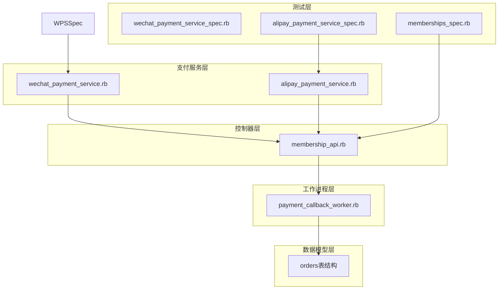

**图表来源**
- [app/services/wechat_payment_service.rb:1-112](file://app/services/wechat_payment_service.rb#L1-L112)
- [app/services/alipay_payment_service.rb:1-136](file://app/services/alipay_payment_service.rb#L1-L136)
- [app/controllers/api/memberships/membership_api.rb:1-168](file://app/controllers/api/memberships/membership_api.rb#L1-L168)

**章节来源**
- [app/services/wechat_payment_service.rb:1-112](file://app/services/wechat_payment_service.rb#L1-L112)
- [app/services/alipay_payment_service.rb:1-136](file://app/services/alipay_payment_service.rb#L1-L136)
- [app/controllers/api/memberships/membership_api.rb:1-168](file://app/controllers/api/memberships/membership_api.rb#L1-L168)

## 核心组件

### 支付服务架构

支付系统采用分层架构设计，每个支付渠道都有独立的服务类来处理特定的支付逻辑：

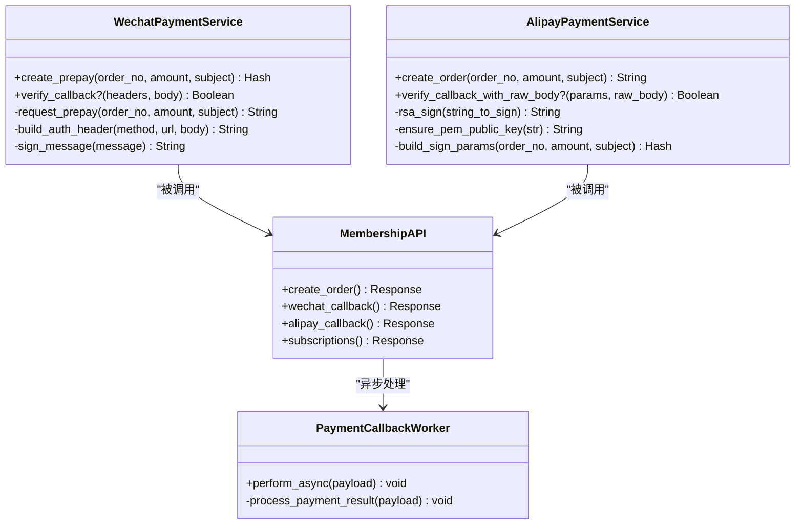

**图表来源**
- [app/services/wechat_payment_service.rb:10-112](file://app/services/wechat_payment_service.rb#L10-L112)
- [app/services/alipay_payment_service.rb:1-136](file://app/services/alipay_payment_service.rb#L1-L136)
- [app/controllers/api/memberships/membership_api.rb:35-135](file://app/controllers/api/memberships/membership_api.rb#L35-L135)
- [app/workers/payment_callback_worker.rb:1-50](file://app/workers/payment_callback_worker.rb#L1-L50)

### 支付订单模型

订单系统采用标准化的数据结构，支持多种支付状态和业务场景：

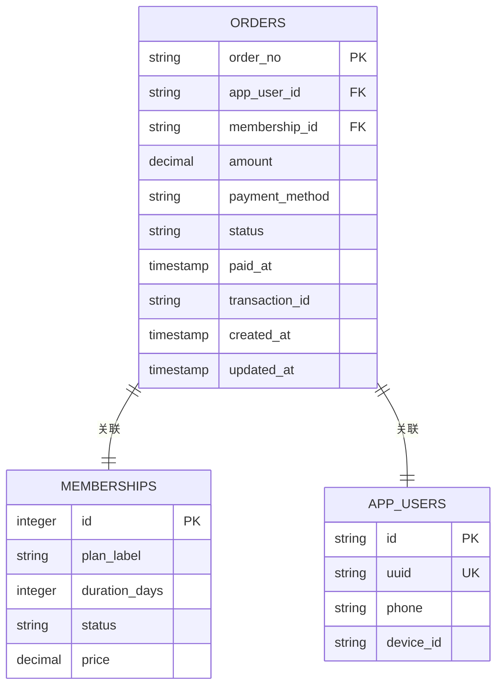

**图表来源**
- [db/migrate/20260414011006_create_orders.rb:1-50](file://db/migrate/20260414011006_create_orders.rb#L1-L50)

**章节来源**
- [db/migrate/20260414011006_create_orders.rb:1-50](file://db/migrate/20260414011006_create_orders.rb#L1-L50)

## 架构概览

支付系统采用事件驱动的异步架构，确保高并发场景下的稳定性和可靠性：

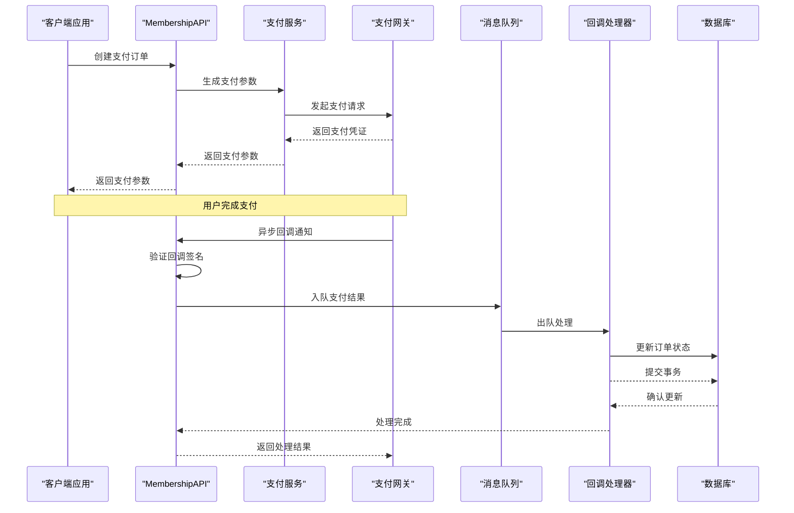

**图表来源**
- [app/controllers/api/memberships/membership_api.rb:100-168](file://app/controllers/api/memberships/membership_api.rb#L100-L168)
- [app/workers/payment_callback_worker.rb:1-50](file://app/workers/payment_callback_worker.rb#L1-L50)

## 详细组件分析

### 微信支付服务

微信支付服务实现了完整的App支付流程，包括预支付订单创建和签名验证：

#### 预支付订单创建流程

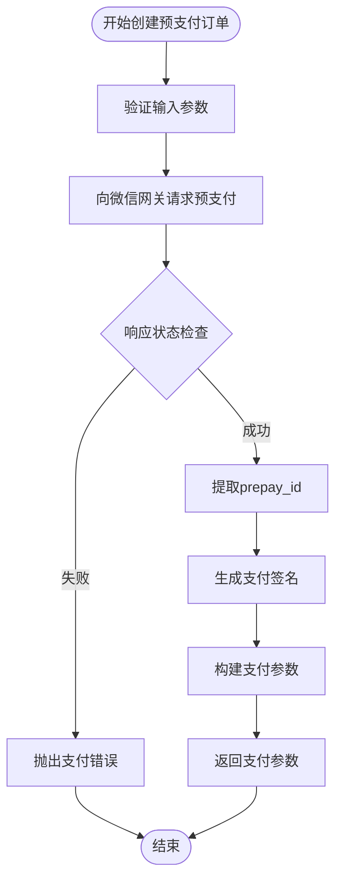

**图表来源**
- [app/services/wechat_payment_service.rb:19-37](file://app/services/wechat_payment_service.rb#L19-L37)
- [app/services/wechat_payment_service.rb:68-96](file://app/services/wechat_payment_service.rb#L68-L96)

#### 回调验证机制

微信支付采用平台证书验证机制，确保回调的真实性：

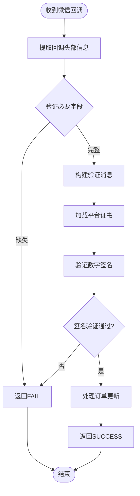

**图表来源**
- [app/services/wechat_payment_service.rb:43-64](file://app/services/wechat_payment_service.rb#L43-L64)

**章节来源**
- [app/services/wechat_payment_service.rb:10-112](file://app/services/wechat_payment_service.rb#L10-L112)

### 支付宝支付服务

支付宝支付服务提供了标准的App支付接口，支持完整的支付流程：

#### 支付订单创建流程

支付宝支付服务通过构建标准的支付参数字符串来启动支付流程：

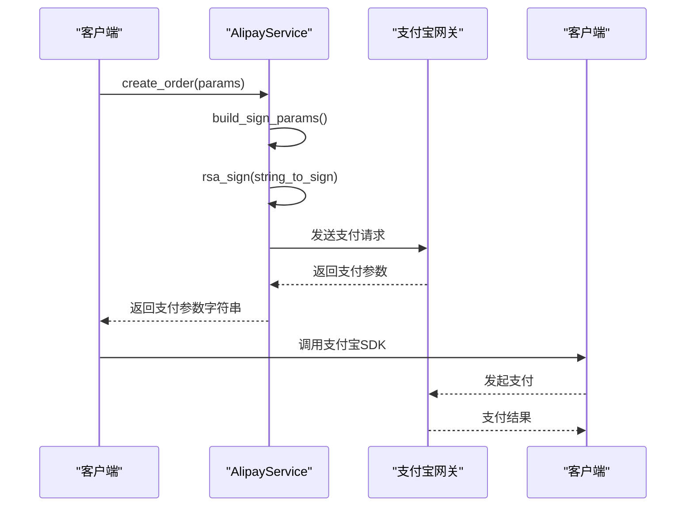

**图表来源**
- [app/services/alipay_payment_service.rb:107-136](file://app/services/alipay_payment_service.rb#L107-L136)

#### 回调验证流程

支付宝回调验证采用公钥签名验证机制：

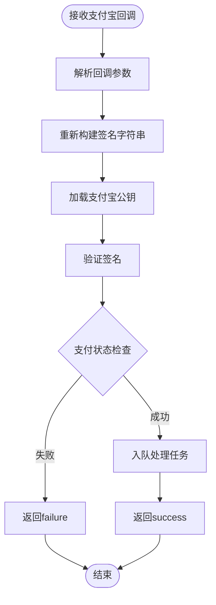

**图表来源**
- [app/controllers/api/memberships/membership_api.rb:35-52](file://app/controllers/api/memberships/membership_api.rb#L35-L52)

**章节来源**
- [app/services/alipay_payment_service.rb:1-136](file://app/services/alipay_payment_service.rb#L1-L136)

### 支付控制器

支付控制器负责处理所有支付相关的HTTP请求，包括订单创建、回调处理等功能：

#### 订单创建流程

控制器根据支付方式调用相应的支付服务：

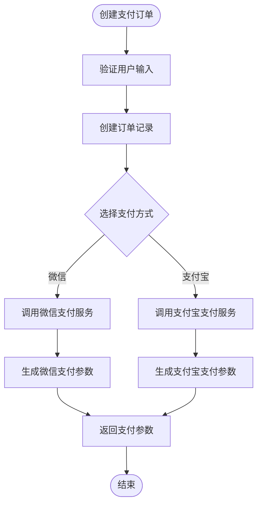

**图表来源**
- [app/controllers/api/memberships/membership_api.rb:100-122](file://app/controllers/api/memberships/membership_api.rb#L100-L122)

#### 回调处理流程

控制器负责接收和验证来自支付网关的回调：

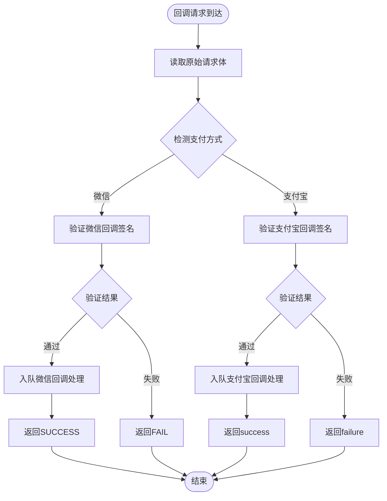

**图表来源**
- [app/controllers/api/memberships/membership_api.rb:149-168](file://app/controllers/api/memberships/membership_api.rb#L149-L168)

**章节来源**
- [app/controllers/api/memberships/membership_api.rb:35-135](file://app/controllers/api/memberships/membership_api.rb#L35-L135)

### 回调处理工作进程

回调处理器使用Sidekiq异步处理支付结果，确保系统的高可用性：

#### 支付结果处理流程

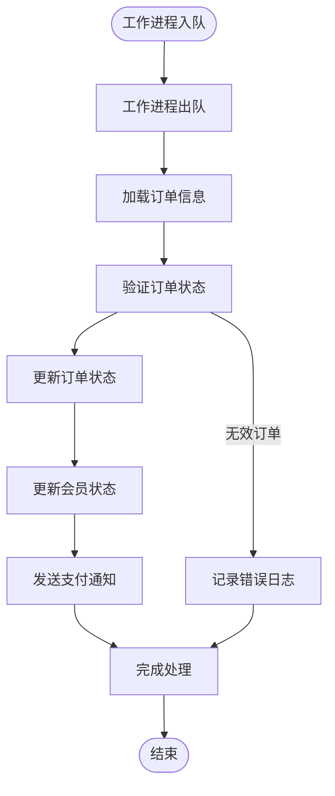

**图表来源**
- [app/workers/payment_callback_worker.rb:1-50](file://app/workers/payment_callback_worker.rb#L1-L50)

**章节来源**
- [app/workers/payment_callback_worker.rb:1-50](file://app/workers/payment_callback_worker.rb#L1-L50)

## 依赖关系分析

支付系统各组件之间的依赖关系如下：

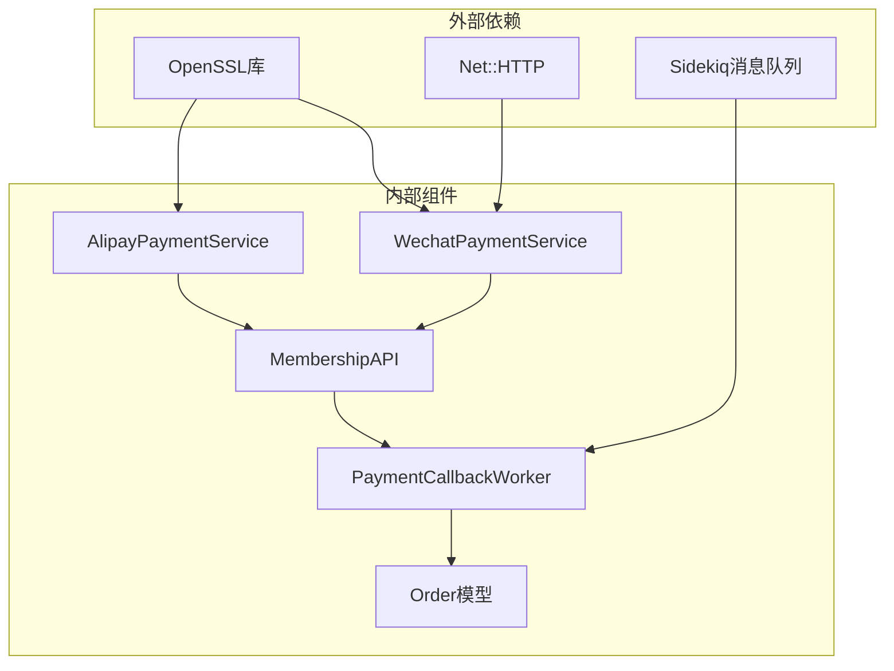

**图表来源**
- [app/services/wechat_payment_service.rb:3-7](file://app/services/wechat_payment_service.rb#L3-L7)
- [app/services/alipay_payment_service.rb:1-5](file://app/services/alipay_payment_service.rb#L1-L5)

### 环境变量配置

支付服务依赖以下关键环境变量：

| 环境变量 | 类型 | 描述 | 必需 |
|---------|------|------|------|
| WECHAT_APP_ID | String | 微信应用ID | 是 |
| WECHAT_MCH_ID | String | 微信商户ID | 是 |
| WECHAT_API_CERT | String | 微信API证书 | 是 |
| WECHAT_API_CERT_SERIAL | String | 微信证书序列号 | 是 |
| WECHAT_PLATFORM_CERT | String | 微信平台证书 | 是 |
| WECHAT_NOTIFY_URL | String | 微信回调地址 | 是 |
| ALIPAY_APP_ID | String | 支付宝应用ID | 是 |
| ALIPAY_PRIVATE_KEY | String | 支付宝私钥 | 是 |
| ALIPAY_PUBLIC_KEY | String | 支付宝公钥 | 是 |
| ALIPAY_RESPONSE_PUBLIC_KEY | String | 支付宝响应公钥 | 是 |
| ALIPAY_NOTIFY_URL | String | 支付宝回调地址 | 是 |

**章节来源**
- [app/services/wechat_payment_service.rb:13-112](file://app/services/wechat_payment_service.rb#L13-L112)
- [app/services/alipay_payment_service.rb:107-136](file://app/services/alipay_payment_service.rb#L107-L136)

## 性能考虑

### 异步处理优化

系统采用异步回调处理机制，通过消息队列分离高延迟的支付网关通信：

- **非阻塞回调处理**：回调请求立即返回，避免阻塞主线程
- **批量处理**：工作进程按顺序处理支付结果，减少资源竞争
- **重试机制**：失败的回调处理会自动重试，提高成功率

### 缓存策略

- **证书缓存**：平台证书在内存中缓存，减少重复加载开销
- **签名验证缓存**：近期的签名验证结果进行缓存，避免重复计算

### 并发控制

- **连接池管理**：HTTP请求使用连接池，复用网络连接
- **超时控制**：设置合理的超时时间，防止长时间阻塞
- **限流保护**：对支付网关请求进行限流，避免过载

## 故障排除指南

### 常见问题及解决方案

#### 支付回调验证失败

**问题现象**：支付回调返回FAIL或处理失败

**可能原因**：
1. 平台证书配置错误
2. 签名算法不匹配
3. 请求时间戳过期
4. 参数格式不正确

**解决步骤**：
1. 验证环境变量配置
2. 检查证书格式和有效期
3. 确认签名算法一致性
4. 校验请求参数完整性

#### 订单状态不一致

**问题现象**：订单状态与支付网关不一致

**解决步骤**：
1. 检查回调处理日志
2. 验证订单状态转换逻辑
3. 确认数据库事务完整性
4. 实施状态补偿机制

#### 支付网关超时

**问题现象**：支付请求超时或失败

**解决步骤**：
1. 检查网络连接稳定性
2. 验证API密钥有效性
3. 确认请求格式正确性
4. 实施重试机制

**章节来源**
- [spec/services/wechat_payment_service_spec.rb:64-92](file://spec/services/wechat_payment_service_spec.rb#L64-L92)
- [spec/services/alipay_payment_service_spec.rb:28-66](file://spec/services/alipay_payment_service_spec.rb#L28-L66)

## 结论

本支付集成服务提供了完整、可靠的多支付渠道解决方案。通过模块化的设计和异步处理机制，系统能够在高并发场景下保持稳定的性能表现。关键特性包括：

- **安全性**：完善的签名验证机制，支持多种加密算法
- **可靠性**：异步回调处理和消息队列确保支付结果的可靠处理
- **可扩展性**：模块化的架构设计便于添加新的支付渠道
- **可观测性**：完整的日志记录和监控机制

建议在生产环境中进一步完善：
- 添加更详细的错误处理和重试机制
- 实施更严格的参数验证
- 增加支付状态的主动查询机制
- 完善监控和告警系统

## 附录

### API接口定义

#### 创建支付订单

**请求方法**：POST `/api/memberships/create_order`

**请求参数**：
- uuid: 用户唯一标识符
- package_id: 套餐ID
- payment_method: 支付方式 (alipay 或 wechat)

**响应数据**：
- order: 订单信息
- payment_params: 支付参数
- msg: 操作消息

#### 微信支付回调

**请求方法**：POST `/api/memberships/wechat_callback`

**请求头**：
- Wechatpay-Timestamp: 时间戳
- Wechatpay-Nonce: 随机数
- Wechatpay-Signature: 数字签名
- Wechatpay-Serial: 证书序列号

**响应**：SUCCESS 或 FAIL

#### 支付宝支付回调

**请求方法**：POST `/api/memberships/alipay_callback`

**请求参数**：支付宝回调参数（包含签名）

**响应**：success 或 failure

### 支付状态说明

| 状态 | 描述 | 含义 |
|------|------|------|
| pending | 待支付 | 订单已创建但未支付 |
| paid | 已支付 | 支付已完成 |
| failed | 支付失败 | 支付过程中发生错误 |
| refunded | 已退款 | 已完成退款操作 |

### 安全最佳实践

1. **证书管理**：定期更新平台证书，确保证书有效性
2. **签名验证**：严格验证回调签名，防止伪造请求
3. **参数校验**：对所有外部输入进行严格校验
4. **日志审计**：完整记录支付相关操作日志
5. **监控告警**：建立完善的监控和告警机制