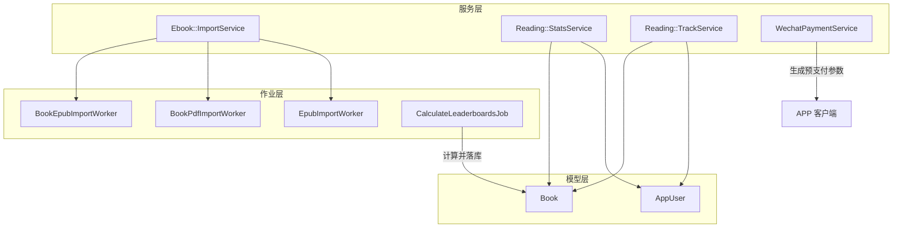
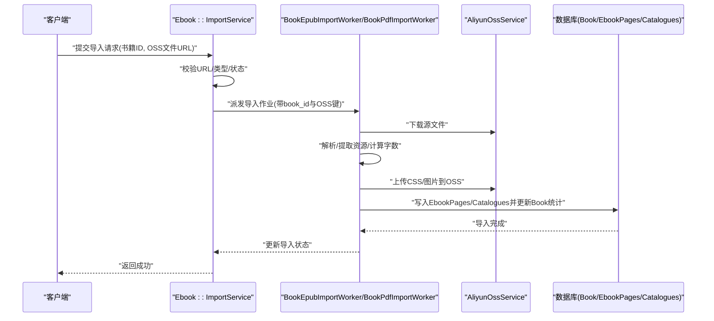
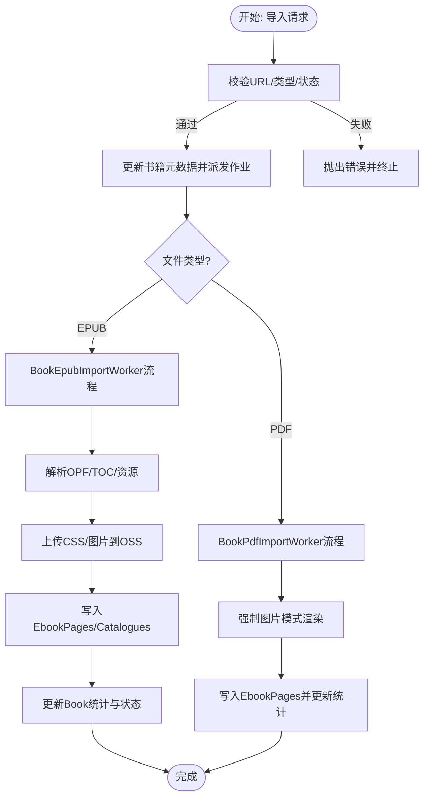
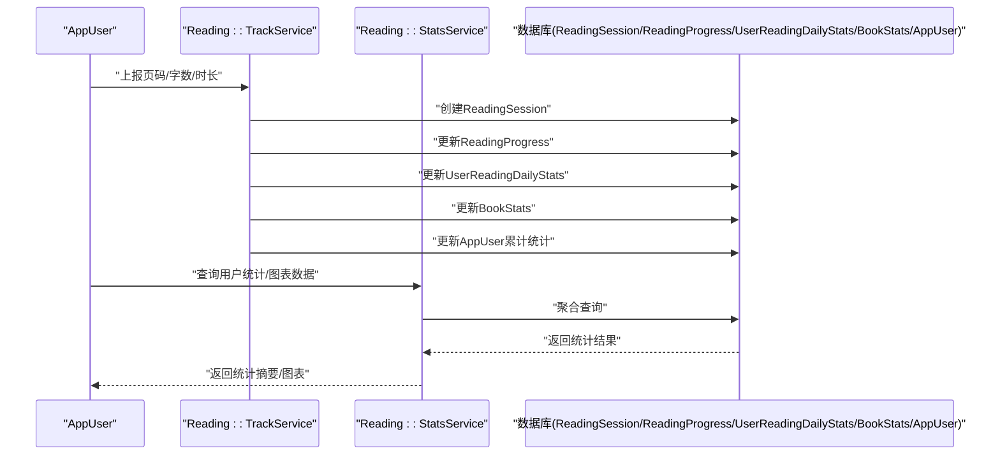
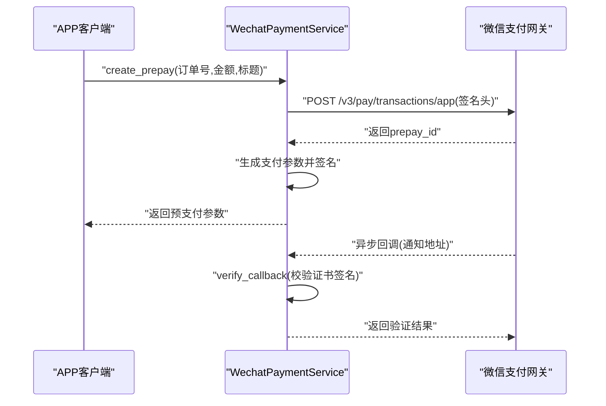
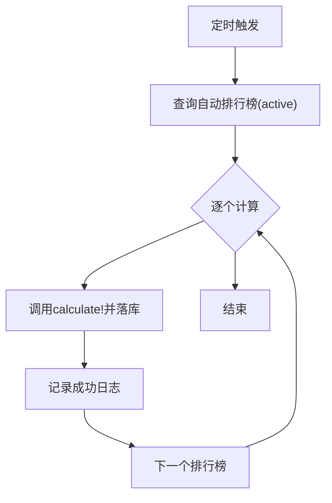
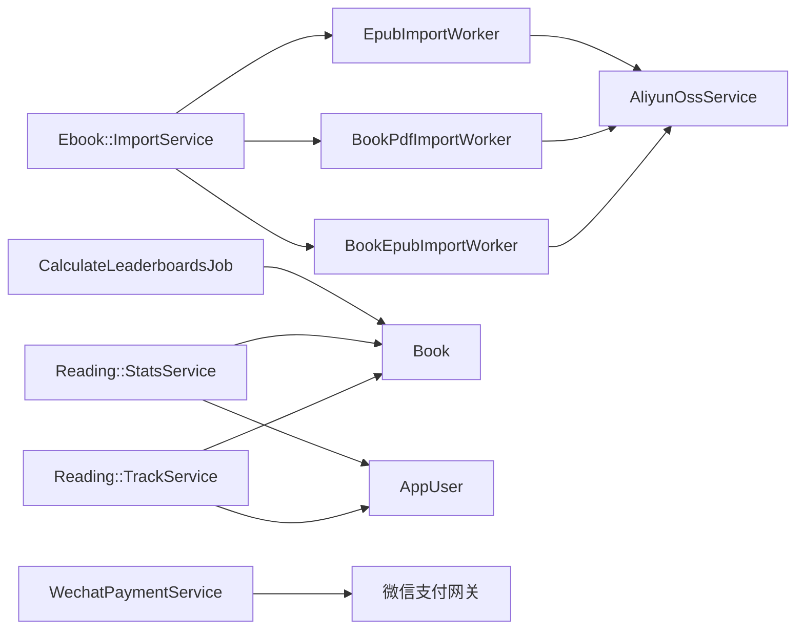

# 核心功能

<cite>
**本文档引用的文件**
- [app/services/ebook/import_service.rb](file://app/services/ebook/import_service.rb)
- [app/jobs/book_epub_import_worker.rb](file://app/jobs/book_epub_import_worker.rb)
- [app/jobs/book_pdf_import_worker.rb](file://app/jobs/book_pdf_import_worker.rb)
- [app/jobs/epub_import_worker.rb](file://app/jobs/epub_import_worker.rb)
- [app/services/reading/stats_service.rb](file://app/services/reading/stats_service.rb)
- [app/services/reading/track_service.rb](file://app/services/reading/track_service.rb)
- [app/services/wechat_payment_service.rb](file://app/services/wechat_payment_service.rb)
- [app/jobs/calculate_leaderboards_job.rb](file://app/jobs/calculate_leaderboards_job.rb)
- [app/models/book.rb](file://app/models/book.rb)
- [app/models/app_user.rb](file://app/models/app_user.rb)
</cite>

## 目录
1. [引言](#引言)
2. [项目结构](#项目结构)
3. [核心组件](#核心组件)
4. [架构总览](#架构总览)
5. [详细组件分析](#详细组件分析)
6. [依赖分析](#依赖分析)
7. [性能考虑](#性能考虑)
8. [故障排查指南](#故障排查指南)
9. [结论](#结论)
10. [附录](#附录)

## 引言
本文件聚焦语音图书平台的核心功能模块，围绕以下关键能力进行系统化说明：
- 电子书导入与导出：支持 PDF/EPUB 的批量导入、解析、页面与资源抽取、OSS 上传与索引重建，并提供 EPUB 导出流程。
- 阅读统计与追踪：实时记录阅读会话、用户进度、日度统计、图书统计与累计统计；提供周/月图表数据。
- 微信支付集成：基于微信支付 v3 的 App 预支付参数生成与回调签名验证。
- 排行榜计算：定时任务驱动的自动排行榜计算与落库。

文档面向开发者，提供服务类 API 说明、配置项、扩展点、数据流图与时序图，帮助快速理解与二次开发。

## 项目结构
围绕核心功能，相关代码主要分布在以下位置：
- 服务层：app/services 下的导入、阅读统计与追踪、微信支付等服务类。
- 作业层：app/jobs 下的导入/导出异步任务（Sidekiq）。
- 模型层：app/models 下的 Book、AppUser 等核心实体，承载状态与统计字段。
- 任务调度：app/jobs/calculate_leaderboards_job.rb 定时触发排行榜计算。

**图表来源**
- [app/services/ebook/import_service.rb:1-70](file://app/services/ebook/import_service.rb#L1-L70)
- [app/jobs/book_epub_import_worker.rb:1-328](file://app/jobs/book_epub_import_worker.rb#L1-L328)
- [app/jobs/book_pdf_import_worker.rb:1-84](file://app/jobs/book_pdf_import_worker.rb#L1-L84)
- [app/jobs/epub_import_worker.rb:1-282](file://app/jobs/epub_import_worker.rb#L1-L282)
- [app/services/reading/stats_service.rb:1-140](file://app/services/reading/stats_service.rb#L1-L140)
- [app/services/reading/track_service.rb:1-126](file://app/services/reading/track_service.rb#L1-L126)
- [app/services/wechat_payment_service.rb:1-113](file://app/services/wechat_payment_service.rb#L1-L113)
- [app/jobs/calculate_leaderboards_job.rb:1-19](file://app/jobs/calculate_leaderboards_job.rb#L1-L19)
- [app/models/book.rb:1-157](file://app/models/book.rb#L1-L157)
- [app/models/app_user.rb:1-140](file://app/models/app_user.rb#L1-L140)

**章节来源**
- [app/services/ebook/import_service.rb:1-70](file://app/services/ebook/import_service.rb#L1-L70)
- [app/jobs/book_epub_import_worker.rb:1-328](file://app/jobs/book_epub_import_worker.rb#L1-L328)
- [app/jobs/book_pdf_import_worker.rb:1-84](file://app/jobs/book_pdf_import_worker.rb#L1-L84)
- [app/jobs/epub_import_worker.rb:1-282](file://app/jobs/epub_import_worker.rb#L1-L282)
- [app/services/reading/stats_service.rb:1-140](file://app/services/reading/stats_service.rb#L1-L140)
- [app/services/reading/track_service.rb:1-126](file://app/services/reading/track_service.rb#L1-L126)
- [app/services/wechat_payment_service.rb:1-113](file://app/services/wechat_payment_service.rb#L1-L113)
- [app/jobs/calculate_leaderboards_job.rb:1-19](file://app/jobs/calculate_leaderboards_job.rb#L1-L19)
- [app/models/book.rb:1-157](file://app/models/book.rb#L1-L157)
- [app/models/app_user.rb:1-140](file://app/models/app_user.rb#L1-L140)

## 核心组件
- 电子书导入服务：校验 URL/类型，更新书籍元数据，按类型派发至具体导入 Worker。
- EPUB/PDF 导入 Worker：下载源文件、解包/解析、提取图片/CSS/文本、上传 OSS、重建索引与统计。
- 阅读统计服务：聚合用户/图书维度统计、生成周/月图表数据。
- 阅读追踪服务：事务内创建阅读会话、更新进度、日度统计、图书统计、累计统计。
- 微信支付服务：生成预支付参数、构建签名、回调签名验证。
- 排行榜计算作业：遍历自动排行榜并执行计算。

**章节来源**
- [app/services/ebook/import_service.rb:1-70](file://app/services/ebook/import_service.rb#L1-L70)
- [app/jobs/book_epub_import_worker.rb:1-328](file://app/jobs/book_epub_import_worker.rb#L1-L328)
- [app/jobs/book_pdf_import_worker.rb:1-84](file://app/jobs/book_pdf_import_worker.rb#L1-L84)
- [app/jobs/epub_import_worker.rb:1-282](file://app/jobs/epub_import_worker.rb#L1-L282)
- [app/services/reading/stats_service.rb:1-140](file://app/services/reading/stats_service.rb#L1-L140)
- [app/services/reading/track_service.rb:1-126](file://app/services/reading/track_service.rb#L1-L126)
- [app/services/wechat_payment_service.rb:1-113](file://app/services/wechat_payment_service.rb#L1-L113)
- [app/jobs/calculate_leaderboards_job.rb:1-19](file://app/jobs/calculate_leaderboards_job.rb#L1-L19)

## 架构总览
整体采用“服务编排 + 异步作业 + 模型持久化”的分层设计：
- 服务层负责业务编排与参数校验；
- 作业层通过 Sidekiq 异步执行耗时任务；
- 模型层承载状态与统计字段，提供查询与聚合接口；
- 定时任务驱动排行榜等周期性计算。

**图表来源**
- [app/services/ebook/import_service.rb:14-25](file://app/services/ebook/import_service.rb#L14-L25)
- [app/jobs/book_epub_import_worker.rb:17-173](file://app/jobs/book_epub_import_worker.rb#L17-L173)
- [app/jobs/book_pdf_import_worker.rb:16-67](file://app/jobs/book_pdf_import_worker.rb#L16-L67)
- [app/models/book.rb:83-84](file://app/models/book.rb#L83-L84)

## 详细组件分析

### 电子书导入与导出服务
- 功能职责
  - 导入入口：校验 URL/类型，禁止重复导入/重复处理；更新书籍元数据并派发异步作业。
  - EPUB 导入：下载 EPUB → 解包 → 解析 OPF/TOC → 提取 CSS/图片 → 替换相对路径 → 逐页入库 → 更新字数/页数/样式/导航链接 → 成功标记。
  - PDF 导入：下载 PDF → 强制图片模式渲染 → 生成图片页 → 上传图片到 OSS → 更新页数与统计。
  - EPUB 导出：下载 EPUB → 解包 → 上传 CSS/图片 → 更新引用 → 重新打包 → 上传新 EPUB → 更新 Book 导出状态。
- 关键 API 与参数
  - 导入服务初始化：接收书籍对象与 OSS 文件 URL。
  - 导入服务调用：执行校验与派发。
  - EPUB/PDF 导入作业参数：book_id、对应文件的 OSS 键。
  - EPUB 导入作业参数：book_id、epub_oss_key。
- 数据流与状态
  - 导入状态枚举：未导入、处理中、已完成、失败。
  - 成功后更新：page_count、word_count、styles_oss_url、nav_oss_url、imported_at、import_status。
- 扩展点
  - 新增文件类型：在导入服务中扩展支持列表并在派发逻辑中新增分支。
  - 自定义解析策略：在 Worker 内部调整解析/替换逻辑。
  - 资源上传策略：替换 OSS 服务实现或调整对象键命名规范。

**图表来源**
- [app/services/ebook/import_service.rb:14-25](file://app/services/ebook/import_service.rb#L14-L25)
- [app/jobs/book_epub_import_worker.rb:17-173](file://app/jobs/book_epub_import_worker.rb#L17-L173)
- [app/jobs/book_pdf_import_worker.rb:16-67](file://app/jobs/book_pdf_import_worker.rb#L16-L67)

**章节来源**
- [app/services/ebook/import_service.rb:1-70](file://app/services/ebook/import_service.rb#L1-L70)
- [app/jobs/book_epub_import_worker.rb:1-328](file://app/jobs/book_epub_import_worker.rb#L1-L328)
- [app/jobs/book_pdf_import_worker.rb:1-84](file://app/jobs/book_pdf_import_worker.rb#L1-L84)
- [app/jobs/epub_import_worker.rb:1-282](file://app/jobs/epub_import_worker.rb#L1-L282)
- [app/models/book.rb:83-84](file://app/models/book.rb#L83-L84)

### 阅读统计与追踪
- 统计服务
  - 用户统计摘要：总书数、已完成书数、总时长、总会话数、平均时长、完成率、连续阅读天数。
  - 图书统计：总读者、总阅读次数、总时长、完读人数、完成率、周/月活跃读者。
  - 用户进度列表与单书进度：支持分页与关联书信息。
  - 图表数据：按周/月聚合每日时长，补齐缺失日期。
- 追踪服务
  - 创建阅读会话：记录页码、字数、时长、日期。
  - 更新阅读进度：累计字数、时长、会话数，判断完读并标记完成时间。
  - 更新日度统计：当日会话数、总时长、总字数、首读计数。
  - 更新图书统计：总读者/阅读次数/时长/字数、周/月活跃读者/阅读次数、完读人数与完成率。
  - 更新用户累计统计：总字数、总分钟、新增书本数。
- 并发与一致性
  - 使用事务包裹会话与多处更新，避免竞态。
  - 通过“基于刚创建会话的计数”避免并发导致的重复计数。

**图表来源**
- [app/services/reading/track_service.rb:16-26](file://app/services/reading/track_service.rb#L16-L26)
- [app/services/reading/stats_service.rb:6-28](file://app/services/reading/stats_service.rb#L6-L28)
- [app/models/app_user.rb:88-92](file://app/models/app_user.rb#L88-L92)

**章节来源**
- [app/services/reading/stats_service.rb:1-140](file://app/services/reading/stats_service.rb#L1-L140)
- [app/services/reading/track_service.rb:1-126](file://app/services/reading/track_service.rb#L1-L126)
- [app/models/app_user.rb:88-124](file://app/models/app_user.rb#L88-L124)

### 微信支付集成
- 预支付参数生成
  - 输入：商户订单号、金额（元）、商品描述。
  - 输出：appid、partnerid、prepayid、package、noncestr、timestamp、sign。
  - 签名：使用私钥对消息进行 SHA256+RSA2048 签名，消息包含 appid/mchid/description/out_trade_no/notify_url/amount 等。
- 回调签名验证
  - 从回调头提取 Wechatpay-Timestamp、Wechatpay-Nonce、Wechatpay-Signature。
  - 使用平台证书公钥验证签名，消息为 timestamp\nnonce\nbody\n。
- 环境变量
  - WECHAT_APP_ID、WECHAT_MCH_ID、WECHAT_NOTIFY_URL、WECHAT_API_CERT、WECHAT_API_CERT_SERIAL、WECHAT_PLATFORM_CERT。
- 错误处理
  - 请求失败抛出 PaymentError；回调签名无效返回 false。

**图表来源**
- [app/services/wechat_payment_service.rb:19-37](file://app/services/wechat_payment_service.rb#L19-L37)
- [app/services/wechat_payment_service.rb:43-64](file://app/services/wechat_payment_service.rb#L43-L64)
- [app/services/wechat_payment_service.rb:68-96](file://app/services/wechat_payment_service.rb#L68-L96)
- [app/services/wechat_payment_service.rb:98-111](file://app/services/wechat_payment_service.rb#L98-L111)

**章节来源**
- [app/services/wechat_payment_service.rb:1-113](file://app/services/wechat_payment_service.rb#L1-L113)

### 排行榜计算
- 触发方式：定时任务遍历自动排行榜，逐个执行计算并记录日志。
- 执行流程：调用排行榜实例的计算方法，更新排行榜项与分数。
- 错误处理：捕获异常并记录错误日志，随后重新抛出以触发重试。

**图表来源**
- [app/jobs/calculate_leaderboards_job.rb:9-17](file://app/jobs/calculate_leaderboards_job.rb#L9-L17)

**章节来源**
- [app/jobs/calculate_leaderboards_job.rb:1-19](file://app/jobs/calculate_leaderboards_job.rb#L1-L19)

## 依赖分析
- 服务与作业耦合
  - 导入服务仅负责编排与派发，具体解析/上传由 Worker 承担，降低服务层复杂度。
- 作业与外部系统
  - Worker 依赖 OSS 服务进行下载/上传；EPUB 导入依赖 Zip/Nokogiri 解析；PDF 导入依赖页面渲染器。
- 模型与统计
  - Book 与 AppUser 承载导入状态、统计字段与关联集合；统计服务通过聚合查询减少事务开销。
- 定时任务
  - 排行榜计算作业与业务无直接耦合，通过枚举状态驱动。

**图表来源**
- [app/services/ebook/import_service.rb:61-67](file://app/services/ebook/import_service.rb#L61-L67)
- [app/jobs/book_epub_import_worker.rb:32-33](file://app/jobs/book_epub_import_worker.rb#L32-L33)
- [app/jobs/book_pdf_import_worker.rb:31-32](file://app/jobs/book_pdf_import_worker.rb#L31-L32)
- [app/jobs/epub_import_worker.rb:35-35](file://app/jobs/epub_import_worker.rb#L35-L35)
- [app/services/reading/track_service.rb:31-38](file://app/services/reading/track_service.rb#L31-L38)
- [app/services/reading/stats_service.rb:32-43](file://app/services/reading/stats_service.rb#L32-L43)
- [app/services/wechat_payment_service.rb:68-96](file://app/services/wechat_payment_service.rb#L68-L96)
- [app/jobs/calculate_leaderboards_job.rb:10-13](file://app/jobs/calculate_leaderboards_job.rb#L10-L13)

**章节来源**
- [app/services/ebook/import_service.rb:1-70](file://app/services/ebook/import_service.rb#L1-L70)
- [app/jobs/book_epub_import_worker.rb:1-328](file://app/jobs/book_epub_import_worker.rb#L1-L328)
- [app/jobs/book_pdf_import_worker.rb:1-84](file://app/jobs/book_pdf_import_worker.rb#L1-L84)
- [app/jobs/epub_import_worker.rb:1-282](file://app/jobs/epub_import_worker.rb#L1-L282)
- [app/services/reading/track_service.rb:1-126](file://app/services/reading/track_service.rb#L1-L126)
- [app/services/reading/stats_service.rb:1-140](file://app/services/reading/stats_service.rb#L1-L140)
- [app/services/wechat_payment_service.rb:1-113](file://app/services/wechat_payment_service.rb#L1-L113)
- [app/jobs/calculate_leaderboards_job.rb:1-19](file://app/jobs/calculate_leaderboards_job.rb#L1-L19)

## 性能考虑
- 缓存与聚合
  - 用户统计摘要使用短时缓存，减少频繁聚合查询压力。
  - 图表数据按周/月聚合，避免逐条扫描。
- 事务边界
  - 阅读追踪在单事务内完成多表更新，保证一致性的同时控制事务时长。
- IO 与并发
  - 导入/导出通过 Sidekiq 异步执行，避免阻塞主线程。
  - OSS 上传采用对象键复用与去重策略，减少冗余资源。
- 索引与查询
  - Book/ImportStatus 等常用过滤字段具备索引，提升筛选效率。

[本节为通用建议，无需特定文件来源]

## 故障排查指南
- 导入失败
  - 检查 OSS URL 是否有效、文件类型是否受支持、书籍状态是否允许导入。
  - 查看 Worker 日志中的错误堆栈与最终错误消息，定位解析/上传阶段问题。
- 阅读统计异常
  - 确认阅读会话是否创建成功、日度统计是否重复计数（并发场景下的首读判断）。
  - 核对图书统计的完成率计算逻辑与最近完读判定窗口。
- 微信支付
  - 确认回调头字段齐全、平台证书可用；检查签名算法与消息拼接格式。
  - 核对金额单位转换（元→分）与通知地址配置。
- 排行榜
  - 关注定时任务日志，确认自动排行榜状态与计算异常。

**章节来源**
- [app/jobs/book_epub_import_worker.rb:163-172](file://app/jobs/book_epub_import_worker.rb#L163-L172)
- [app/jobs/book_pdf_import_worker.rb:62-67](file://app/jobs/book_pdf_import_worker.rb#L62-L67)
- [app/services/reading/track_service.rb:88-114](file://app/services/reading/track_service.rb#L88-L114)
- [app/services/wechat_payment_service.rb:43-64](file://app/services/wechat_payment_service.rb#L43-L64)
- [app/jobs/calculate_leaderboards_job.rb:14-16](file://app/jobs/calculate_leaderboards_job.rb#L14-L16)

## 结论
本方案通过服务编排、异步作业与模型聚合，实现了从电子书导入到阅读统计、支付与排行榜的完整闭环。服务层保持轻量，作业层承担重活，模型层提供稳定的数据契约与查询接口。开发者可在不破坏现有流程的前提下，按需扩展文件类型、优化解析策略、增强统计维度与支付能力。

[本节为总结，无需特定文件来源]

## 附录
- 配置项清单（环境变量）
  - WECHAT_APP_ID：微信应用 ID
  - WECHAT_MCH_ID：商户号
  - WECHAT_NOTIFY_URL：支付回调通知地址
  - WECHAT_API_CERT：API 私钥（PEM）
  - WECHAT_API_CERT_SERIAL：API 证书序列号
  - WECHAT_PLATFORM_CERT：微信平台证书（回调验证）
  - OSS_ACCESS_KEY_ID/OSS_ACCESS_KEY_SECRET：阿里云 OSS 凭证（用于 URL 签名）

**章节来源**
- [app/services/wechat_payment_service.rb:25-56](file://app/services/wechat_payment_service.rb#L25-L56)
- [app/models/book.rb:104-141](file://app/models/book.rb#L104-L141)