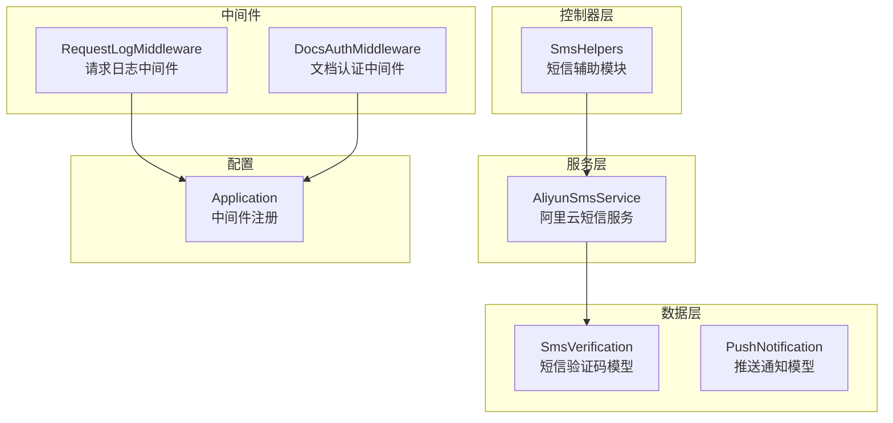
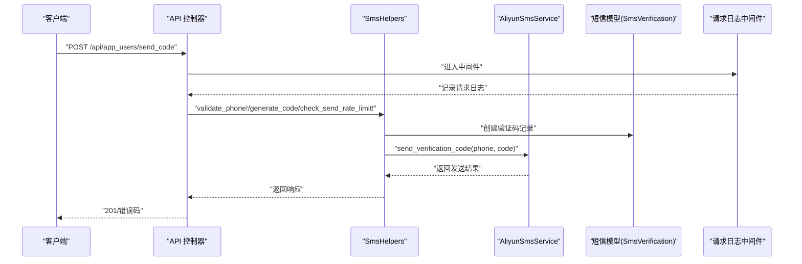
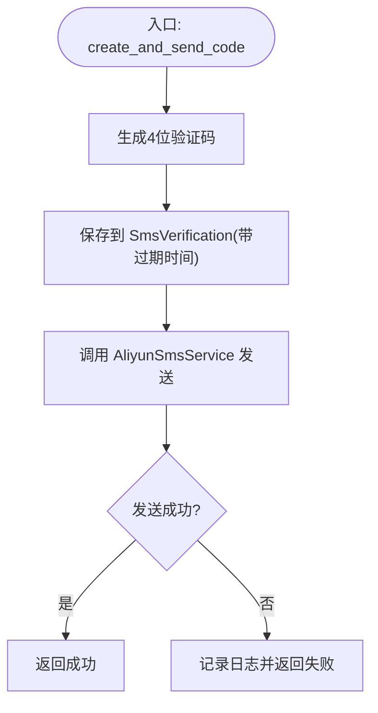
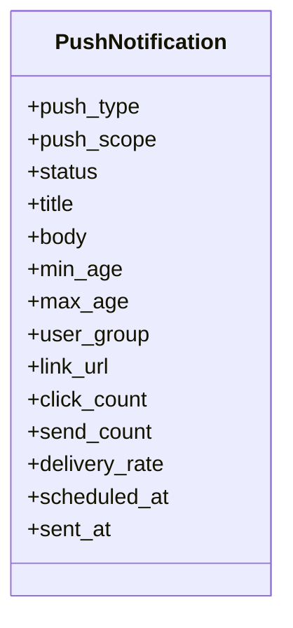
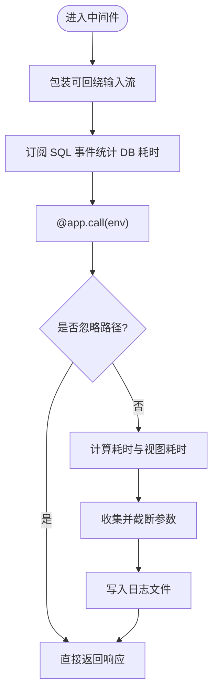
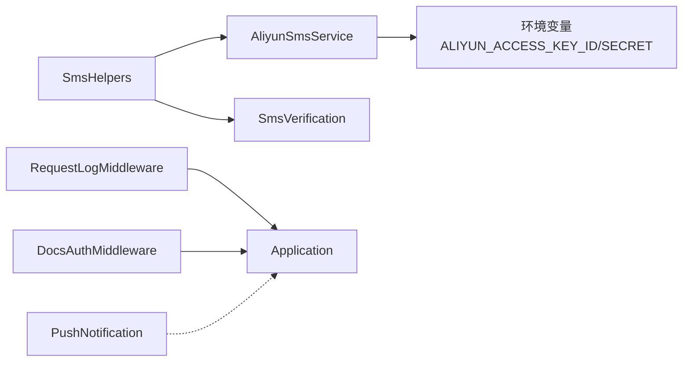

# 消息通知服务

<cite>
**本文引用的文件**
- [sms_helpers.rb](file://app/controllers/api/concerns/sms_helpers.rb)
- [aliyun_sms_service.rb](file://app/services/aliyun_sms_service.rb)
- [sms_verification.rb](file://app/models/sms_verification.rb)
- [create_sms_verifications.rb](file://db/migrate/20260414010921_create_sms_verifications.rb)
- [push_notification.rb](file://app/models/push_notification.rb)
- [request_log_middleware.rb](file://lib/request_log_middleware.rb)
- [docs_auth_middleware.rb](file://lib/docs_auth_middleware.rb)
- [application.rb](file://config/application.rb)
- [app_users_spec.rb](file://spec/requests/api/app_users_spec.rb)
- [push_notification_spec.rb](file://spec/models/push_notification_spec.rb)
- [push_notifications.rb](file://spec/factories/push_notifications.rb)
</cite>

## 目录
1. [简介](#简介)
2. [项目结构](#项目结构)
3. [核心组件](#核心组件)
4. [架构总览](#架构总览)
5. [详细组件分析](#详细组件分析)
6. [依赖关系分析](#依赖关系分析)
7. [性能考虑](#性能考虑)
8. [故障排查指南](#故障排查指南)
9. [结论](#结论)
10. [附录](#附录)

## 简介
本文件面向“消息通知服务”的设计与实现，重点覆盖以下方面：
- 短信通知：API 接口、模板配置、发送策略与安全控制
- 推送通知：数据模型、消息格式与客户端处理建议
- 请求日志：中间件实现原理与输出格式
- 认证与日志中间件：文档访问保护与统一请求日志

通过代码级分析与可视化图示，帮助开发者快速理解各模块职责、调用流程与最佳实践。

## 项目结构
消息通知相关的核心位置如下：
- 控制器辅助模块：封装短信验证码的生成、校验与发送频率控制
- 短信服务：对接阿里云短信服务，实现 HTTP POP 签名与发送
- 数据模型：短信验证码与推送通知的数据结构与约束
- 中间件：请求日志中间件与文档访问认证中间件
- 配置：应用启动时注册中间件

图表来源
- [sms_helpers.rb:1-57](file://app/controllers/api/concerns/sms_helpers.rb#L1-L57)
- [aliyun_sms_service.rb:1-100](file://app/services/aliyun_sms_service.rb#L1-L100)
- [sms_verification.rb:1-46](file://app/models/sms_verification.rb#L1-L46)
- [push_notification.rb:1-45](file://app/models/push_notification.rb#L1-L45)
- [request_log_middleware.rb:1-164](file://lib/request_log_middleware.rb#L1-L164)
- [docs_auth_middleware.rb:1-50](file://lib/docs_auth_middleware.rb#L1-L50)
- [application.rb:69-79](file://config/application.rb#L69-L79)

章节来源
- [application.rb:69-79](file://config/application.rb#L69-L79)

## 核心组件
- 短信验证码辅助模块：提供手机号格式校验、验证码生成、发送频率限制、验证码查找与消费等功能
- 阿里云短信服务：封装 HTTP POP 签名与发送流程，支持自定义签名与模板
- 短信验证码模型：管理验证码的存储、有效期、唯一性索引与消费标记
- 推送通知模型：定义推送类型、范围、状态与长度约束
- 请求日志中间件：统一记录请求耗时、数据库耗时、参数等信息
- 文档认证中间件：对 API 文档页面进行 Basic Auth 保护

章节来源
- [sms_helpers.rb:1-57](file://app/controllers/api/concerns/sms_helpers.rb#L1-L57)
- [aliyun_sms_service.rb:1-100](file://app/services/aliyun_sms_service.rb#L1-L100)
- [sms_verification.rb:1-46](file://app/models/sms_verification.rb#L1-L46)
- [push_notification.rb:1-45](file://app/models/push_notification.rb#L1-L45)
- [request_log_middleware.rb:1-164](file://lib/request_log_middleware.rb#L1-L164)
- [docs_auth_middleware.rb:1-50](file://lib/docs_auth_middleware.rb#L1-L50)

## 架构总览
短信通知与推送通知的整体交互如下：

图表来源
- [sms_helpers.rb:14-40](file://app/controllers/api/concerns/sms_helpers.rb#L14-L40)
- [aliyun_sms_service.rb:25-32](file://app/services/aliyun_sms_service.rb#L25-L32)
- [sms_verification.rb:22-34](file://app/models/sms_verification.rb#L22-L34)
- [request_log_middleware.rb:26-74](file://lib/request_log_middleware.rb#L26-L74)
- [app_users_spec.rb:85-116](file://spec/requests/api/app_users_spec.rb#L85-L116)

## 详细组件分析

### 短信通知组件
- 功能要点
  - 手机号格式校验：仅允许中国大陆手机号
  - 验证码生成：4 位数字，固定长度
  - 发送频率限制：单次冷却时间与当日最大发送次数
  - 验证码消费：一次性使用，过期自动失效
  - 阿里云短信发送：支持自定义签名与模板，内置签名与模板默认值
- 关键流程
  - 生成验证码并持久化
  - 调用短信服务发送
  - 返回发送结果给控制器

图表来源
- [sms_helpers.rb:24-29](file://app/controllers/api/concerns/sms_helpers.rb#L24-L29)
- [aliyun_sms_service.rb:25-32](file://app/services/aliyun_sms_service.rb#L25-L32)

章节来源
- [sms_helpers.rb:10-53](file://app/controllers/api/concerns/sms_helpers.rb#L10-L53)
- [aliyun_sms_service.rb:14-74](file://app/services/aliyun_sms_service.rb#L14-L74)
- [sms_verification.rb:22-44](file://app/models/sms_verification.rb#L22-L44)
- [create_sms_verifications.rb:1-15](file://db/migrate/20260414010921_create_sms_verifications.rb#L1-L15)

### 短信服务 API 与模板配置
- 接口定义
  - 方法：发送验证码
  - 参数：手机号、验证码、签名名称、模板编号
  - 返回：布尔值表示发送是否成功
- 模板与签名
  - 默认签名：浙江少年儿童出版社
  - 默认模板：SMS_333840584
  - 支持自定义签名与模板
- 安全与签名
  - 使用 HMAC-SHA1 对请求参数进行签名
  - 包含时间戳、随机数、版本号等标准字段
- 错误处理
  - 阿里云返回非 OK 时记录错误日志
  - 异常捕获并记录异常信息

章节来源
- [aliyun_sms_service.rb:14-74](file://app/services/aliyun_sms_service.rb#L14-L74)
- [aliyun_sms_service.rb:76-98](file://app/services/aliyun_sms_service.rb#L76-L98)

### 推送通知组件
- 数据模型
  - 标题与正文长度限制
  - 枚举类型：推送类型（系统/活动/提醒）、推送范围（全体/按年龄/按分组）、状态（草稿/已定时/已发送/失败）
  - 默认作用域：过滤已删除记录
- 测试与工厂
  - 单元测试覆盖长度校验、枚举值与状态方法
  - 工厂用于构造测试用例

图表来源
- [push_notification.rb:31-44](file://app/models/push_notification.rb#L31-L44)

章节来源
- [push_notification.rb:31-44](file://app/models/push_notification.rb#L31-L44)
- [push_notification_spec.rb:1-88](file://spec/models/push_notification_spec.rb#L1-L88)
- [push_notifications.rb:26-35](file://spec/factories/push_notifications.rb#L26-L35)

### 请求日志中间件
- 目标
  - 输出统一格式的日志，包含时间、状态码、数据库耗时、总耗时、请求方法、路径与参数
  - 写入独立日志文件
- 实现要点
  - 忽略健康检查与静态资源等无意义请求
  - 支持 JSON、form、multipart 多种参数解析
  - 参数截断防止日志过大
  - 订阅 SQL 事件统计数据库耗时

图表来源
- [request_log_middleware.rb:26-74](file://lib/request_log_middleware.rb#L26-L74)
- [request_log_middleware.rb:90-162](file://lib/request_log_middleware.rb#L90-L162)

章节来源
- [request_log_middleware.rb:8-164](file://lib/request_log_middleware.rb#L8-L164)

### 文档访问认证中间件
- 目标
  - 保护 API 文档页面（如 Swagger 文档），仅允许凭据正确访问
- 实现要点
  - 仅对指定路径生效
  - 通过环境变量启用与配置用户名与密码
  - 未通过认证返回 401 并提示需要密码

章节来源
- [docs_auth_middleware.rb:5-50](file://lib/docs_auth_middleware.rb#L5-L50)
- [application.rb:69-79](file://config/application.rb#L69-L79)

## 依赖关系分析
- 控制器辅助模块依赖短信服务与短信模型
- 短信服务依赖阿里云 API 与环境变量
- 中间件在应用启动时注册，影响所有请求
- 推送通知模型独立于短信服务，但共享统一的枚举与验证

图表来源
- [sms_helpers.rb:1-57](file://app/controllers/api/concerns/sms_helpers.rb#L1-L57)
- [aliyun_sms_service.rb:14-17](file://app/services/aliyun_sms_service.rb#L14-L17)
- [sms_verification.rb:1-46](file://app/models/sms_verification.rb#L1-L46)
- [request_log_middleware.rb:8-14](file://lib/request_log_middleware.rb#L8-L14)
- [docs_auth_middleware.rb:5-14](file://lib/docs_auth_middleware.rb#L5-L14)
- [application.rb:69-79](file://config/application.rb#L69-L79)
- [push_notification.rb:1-45](file://app/models/push_notification.rb#L1-L45)

## 性能考虑
- 短信发送
  - 使用一次性签名与最小必要参数，减少网络开销
  - 合理设置冷却时间与每日上限，避免短信轰炸
- 日志中间件
  - 参数截断与忽略静态资源请求，降低 I/O 压力
  - 仅在生产环境启用文档认证中间件，避免不必要的鉴权开销
- 数据库
  - 短信验证码表建立索引，提升查询效率

## 故障排查指南
- 短信发送失败
  - 检查阿里云返回码与日志错误信息
  - 确认签名与模板配置是否正确
  - 核对手机号格式与频率限制
- 验证码无效或过期
  - 确认验证码是否已被消费
  - 检查过期时间与数据库时间同步
- 日志缺失
  - 确认日志文件路径与权限
  - 检查是否被忽略的路径列表匹配
- 文档无法访问
  - 检查环境变量是否配置
  - 确认 Basic Auth 凭据是否正确

章节来源
- [aliyun_sms_service.rb:65-74](file://app/services/aliyun_sms_service.rb#L65-L74)
- [request_log_middleware.rb:78-83](file://lib/request_log_middleware.rb#L78-L83)
- [docs_auth_middleware.rb:28-38](file://lib/docs_auth_middleware.rb#L28-L38)
- [sms_verification.rb:36-44](file://app/models/sms_verification.rb#L36-L44)

## 结论
本消息通知服务以清晰的分层设计实现了短信与推送通知能力：
- 短信模块通过辅助模块与短信服务解耦，便于扩展与测试
- 推送通知模型具备明确的业务枚举与约束，利于后续扩展
- 中间件提供了统一的请求日志与文档保护，有助于运维与安全
建议在生产环境中完善监控告警、限流策略与日志轮转，并持续优化短信模板与推送内容的用户体验。

## 附录
- 使用示例（路径指引）
  - 发送验证码接口：参见测试用例路径
    - [app_users_spec.rb:85-116](file://spec/requests/api/app_users_spec.rb#L85-L116)
  - 推送通知模型与工厂：参见以下文件
    - [push_notification_spec.rb:1-88](file://spec/models/push_notification_spec.rb#L1-L88)
    - [push_notifications.rb:26-35](file://spec/factories/push_notifications.rb#L26-L35)
- 配置参数
  - 阿里云短信：ALIYUN_ACCESS_KEY_ID、ALIYUN_ACCESS_KEY_SECRET
  - 文档认证：DOCS_USERNAME、DOCS_PASSWORD
- 错误码与消息
  - 手机号格式不正确、验证码已发送、今日发送次数已达上限等

章节来源
- [aliyun_sms_service.rb:14-17](file://app/services/aliyun_sms_service.rb#L14-L17)
- [docs_auth_middleware.rb:28-38](file://lib/docs_auth_middleware.rb#L28-L38)
- [app_users_spec.rb:85-116](file://spec/requests/api/app_users_spec.rb#L85-L116)