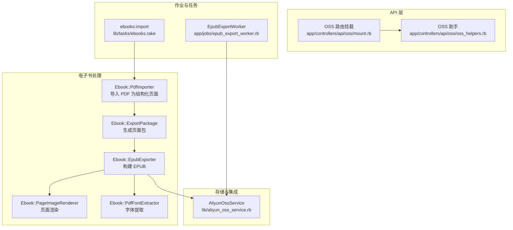
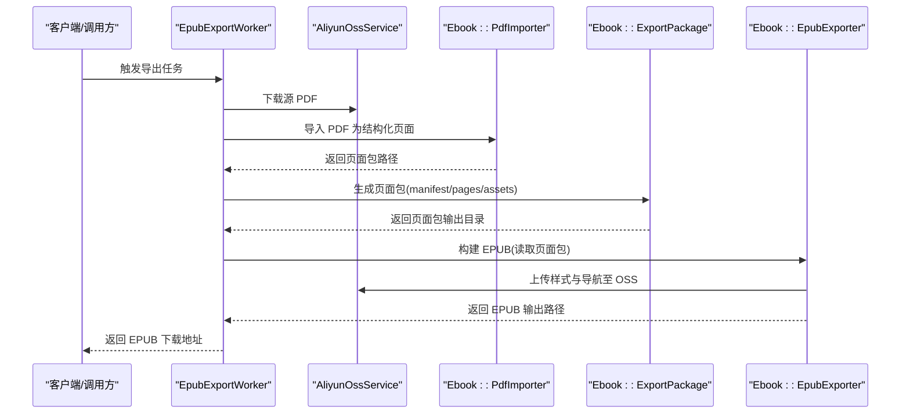
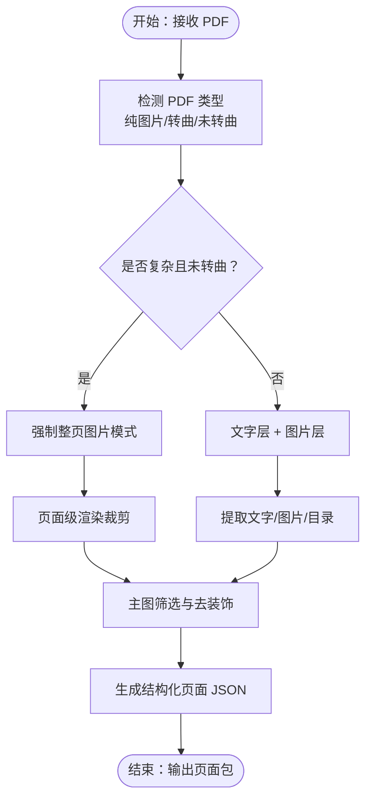
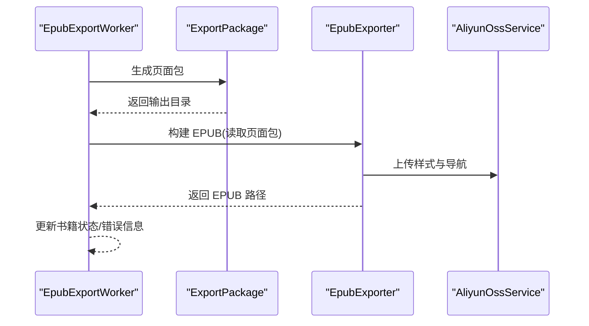
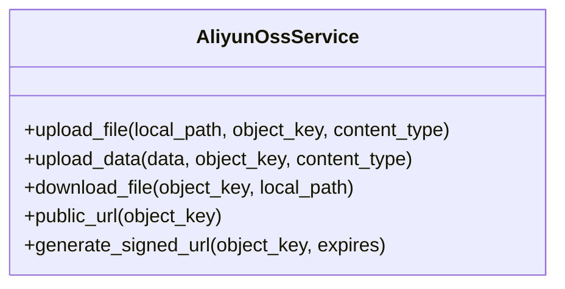
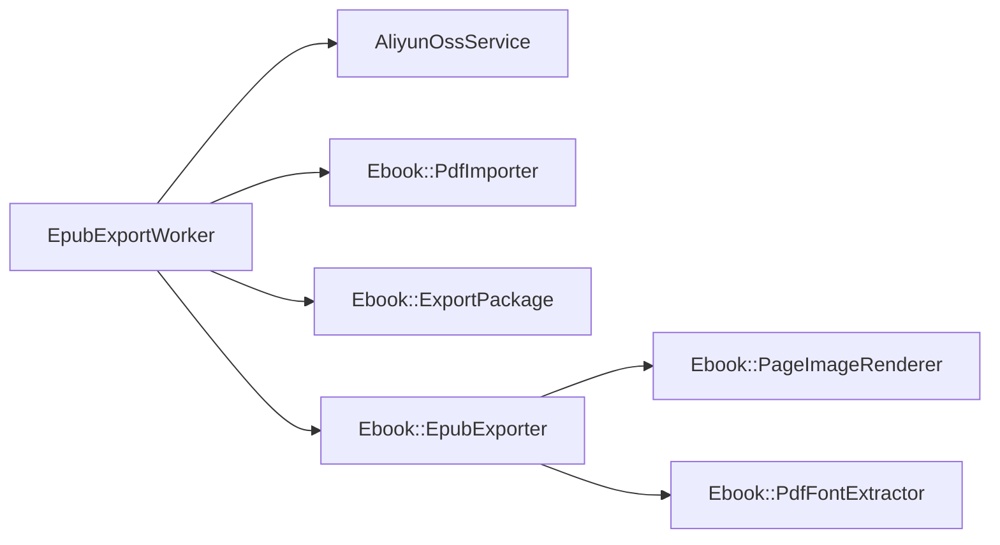

# 电子书处理服务

<cite>
**本文引用的文件**
- [app/jobs/epub_export_worker.rb](file://app/jobs/epub_export_worker.rb)
- [lib/tasks/ebooks.rake](file://lib/tasks/ebooks.rake)
- [docs/pdf_import_export.md](file://docs/pdf_import_export.md)
- [spec/services/ebook/pdf_importer_spec.rb](file://spec/services/ebook/pdf_importer_spec.rb)
- [spec/jobs/epub_export_worker_spec.rb](file://spec/jobs/epub_export_worker_spec.rb)
- [lib/aliyun_oss_service.rb](file://lib/aliyun_oss_service.rb)
- [spec/services/aliyun_oss_service_spec.rb](file://spec/services/aliyun_oss_service_spec.rb)
- [app/controllers/api/oss/oss_helpers.rb](file://app/controllers/api/oss/oss_helpers.rb)
- [app/controllers/api/oss/mount.rb](file://app/controllers/api/oss/mount.rb)
- [lib/ebook/epub_exporter.rb](file://lib/ebook/epub_exporter.rb)
</cite>

## 目录
1. [简介](#简介)
2. [项目结构](#项目结构)
3. [核心组件](#核心组件)
4. [架构总览](#架构总览)
5. [详细组件分析](#详细组件分析)
6. [依赖关系分析](#依赖关系分析)
7. [性能考量](#性能考量)
8. [故障排查指南](#故障排查指南)
9. [结论](#结论)
10. [附录](#附录)

## 简介
本文件面向电子书处理服务，系统性阐述以下能力与实现：
- EPUB 导入与导出：解析 EPUB 包、提取页面、内容重组与导出。
- PDF 处理：PDF 导入、页面提取、富文本结构化、图片主图筛选与页级渲染。
- 电子书页面渲染：基于页面包的固定布局 EPUB 生成与资源上传。
- API 接口与工作流：支持的文件格式、转换流程、错误处理与批量/异步处理。
- 存储与集成：与阿里云 OSS 的集成方式、对象命名策略与访问控制。

本服务采用“中间层页面包 + EPUB 构建”的混合策略，兼顾复杂 PDF 的还原质量与前端渲染一致性。

## 项目结构
围绕电子书处理的核心模块分布如下：
- 作业与任务：Sidekiq 作业负责导出流水线；Rake 任务提供本地批处理。
- 服务与工具：Ebook 命名空间下的导入、导出、页面渲染与字体提取工具。
- 控制器与帮助：OSS 相关 API 与签名 URL 辅助。
- 存储与集成：阿里云 OSS 服务封装与测试覆盖。

图表来源
- [app/jobs/epub_export_worker.rb](file://app/jobs/epub_export_worker.rb)
- [lib/tasks/ebooks.rake](file://lib/tasks/ebooks.rake)
- [lib/ebook/epub_exporter.rb](file://lib/ebook/epub_exporter.rb)
- [lib/aliyun_oss_service.rb](file://lib/aliyun_oss_service.rb)
- [app/controllers/api/oss/mount.rb](file://app/controllers/api/oss/mount.rb)
- [app/controllers/api/oss/oss_helpers.rb](file://app/controllers/api/oss/oss_helpers.rb)

章节来源
- [docs/pdf_import_export.md](file://docs/pdf_import_export.md)
- [lib/tasks/ebooks.rake](file://lib/tasks/ebooks.rake)
- [app/jobs/epub_export_worker.rb](file://app/jobs/epub_export_worker.rb)

## 核心组件
- 导入服务：将 PDF 转换为结构化页面，包含整页文本、逐行元数据、主图与目录信息。
- 页面包：包含清单与页面 JSON、资源资产，用于后续 EPUB 构建。
- EPUB 导出器：读取页面包，生成固定布局 EPUB，上传样式与导航至 OSS。
- 页面渲染器：对复杂页面进行整页渲染与裁剪，保证图片质量。
- 字体提取器：从源 PDF 提取内嵌字体，确保 EPUB 字形还原。
- OSS 服务：封装上传/下载/签名 URL 生成，支持临时授权访问。
- Sidekiq 作业：异步执行完整导出流水线，包含状态更新与错误回滚。
- Rake 任务：本地批处理入口，支持强制整页图片模式。

章节来源
- [docs/pdf_import_export.md](file://docs/pdf_import_export.md)
- [lib/ebook/epub_exporter.rb](file://lib/ebook/epub_exporter.rb)
- [lib/aliyun_oss_service.rb](file://lib/aliyun_oss_service.rb)
- [app/jobs/epub_export_worker.rb](file://app/jobs/epub_export_worker.rb)

## 架构总览
电子书处理采用“导入 → 页面包 → EPUB 构建 → 资源上传”的分阶段流水线，结合 OSS 实现资源持久化与 CDN 加速。

图表来源
- [app/jobs/epub_export_worker.rb](file://app/jobs/epub_export_worker.rb)
- [lib/aliyun_oss_service.rb](file://lib/aliyun_oss_service.rb)
- [lib/ebook/epub_exporter.rb](file://lib/ebook/epub_exporter.rb)

## 详细组件分析

### 导入服务：PDF 导入与页面结构化
- 输入：PDF 文件（支持未转曲、转曲、扫描型）。
- 处理：文字层 + 图片层提取；复杂页面整页渲染；主图筛选；目录解析。
- 输出：结构化页面 JSON（整页文本、逐行样式、图片、目录）。
- 关键点：
  - 支持强制整页图片模式，避免拼音与多层文本干扰。
  - 优先从源 PDF 内嵌字体提取真实字体文件，提升字形一致性。
  - 页面 JSON 包含字体元数据与角色标记，便于前端渲染。

图表来源
- [docs/pdf_import_export.md](file://docs/pdf_import_export.md)

章节来源
- [docs/pdf_import_export.md](file://docs/pdf_import_export.md)
- [spec/services/ebook/pdf_importer_spec.rb](file://spec/services/ebook/pdf_importer_spec.rb)

### 页面包与 EPUB 导出
- 页面包：包含 manifest.json、pages/*.json、assets/*。
- EPUB 构建：读取页面包，生成 mimetype、content.opf、nav.xhtml 与页面 xhtml。
- 资源上传：样式表、导航文件上传至 OSS，替换为公网 URL。
- 字体处理：优先提取源 PDF 内嵌字体，打包至 EPUB/fonts。

图表来源
- [app/jobs/epub_export_worker.rb](file://app/jobs/epub_export_worker.rb)
- [lib/ebook/epub_exporter.rb](file://lib/ebook/epub_exporter.rb)

章节来源
- [app/jobs/epub_export_worker.rb](file://app/jobs/epub_export_worker.rb)
- [lib/ebook/epub_exporter.rb](file://lib/ebook/epub_exporter.rb)

### 页面渲染与字体提取
- 页面渲染器：对复杂页面进行整页渲染，避免仅获取底层某一层图片。
- 字体提取器：从源 PDF 内嵌字体中提取真实字体文件，减少字形偏差。

章节来源
- [lib/ebook/epub_exporter.rb](file://lib/ebook/epub_exporter.rb)

### API 接口与工作流
- 支持的文件格式：PDF（未转曲、转曲、扫描）。
- 工作流入口：
  - API：POST /api/books/import_pdf（支持 force_image_pages 参数）。
  - Rake：ebooks:import（支持 PDF_PATH/TITLE/OUTPUT_DIR/EPUB_OUTPUT/SKIP_EPUB）。
  - 本地 worker：bin/ebook_worker（支持 --force-image-pages/--skip-epub）。
- 转换流程：导入 → 页面包 → EPUB 构建 → 资源上传 → 生成 EPUB 输出。

章节来源
- [docs/pdf_import_export.md](file://docs/pdf_import_export.md)
- [lib/tasks/ebooks.rake](file://lib/tasks/ebooks.rake)

### 错误处理机制
- 导入异常：捕获并记录错误，必要时回滚或标记失败状态。
- 导出异常：捕获并记录错误，更新书籍导出状态与错误信息，保留堆栈以便排查。
- OSS 异常：封装 UploadError/DownloadError，统一抛出与上层处理。

章节来源
- [app/jobs/epub_export_worker.rb](file://app/jobs/epub_export_worker.rb)
- [lib/aliyun_oss_service.rb](file://lib/aliyun_oss_service.rb)

### 批量处理与异步任务
- Sidekiq 作业：EpubExportWorker 异步执行完整流水线，支持并发与重试。
- Rake 任务：本地批处理，适合离线或开发环境。
- 测试覆盖：通过测试验证作业执行、OSS 上传与 EPUB 构建流程。

章节来源
- [app/jobs/epub_export_worker.rb](file://app/jobs/epub_export_worker.rb)
- [spec/jobs/epub_export_worker_spec.rb](file://spec/jobs/epub_export_worker_spec.rb)
- [lib/tasks/ebooks.rake](file://lib/tasks/ebooks.rake)

### 阿里云 OSS 集成与存储策略
- 上传/下载：支持本地文件与二进制数据上传，自动推断 Content-Type。
- 公网 URL：基于配置生成对象公网访问地址。
- 签名 URL：生成带过期时间的签名 URL，适用于私有桶或受控访问场景。
- 存储策略：
  - 以书籍 ID 为根目录组织资源（样式、导航、页面图片等）。
  - 对象键使用清晰的层级命名，便于检索与清理。
  - 导出阶段将样式与导航上传至 OSS，并替换为公网 URL。

图表来源
- [lib/aliyun_oss_service.rb](file://lib/aliyun_oss_service.rb)

章节来源
- [lib/aliyun_oss_service.rb](file://lib/aliyun_oss_service.rb)
- [spec/services/aliyun_oss_service_spec.rb](file://spec/services/aliyun_oss_service_spec.rb)
- [app/controllers/api/oss/oss_helpers.rb](file://app/controllers/api/oss/oss_helpers.rb)
- [app/controllers/api/oss/mount.rb](file://app/controllers/api/oss/mount.rb)

## 依赖关系分析
- 组件耦合：
  - EpubExportWorker 依赖 AliyunOssService、Ebook::PdfImporter、Ebook::ExportPackage、Ebook::EpubExporter。
  - Ebook::EpubExporter 依赖页面包与字体提取器，间接依赖页面渲染器。
- 外部依赖：
  - 阿里云 OSS SDK（bucket 操作、签名 URL）。
  - PDF 文本/图片提取与渲染工具链（由页面渲染器与字体提取器抽象）。
- 潜在循环依赖：
  - 通过服务层解耦，避免直接相互引用。

图表来源
- [app/jobs/epub_export_worker.rb](file://app/jobs/epub_export_worker.rb)
- [lib/ebook/epub_exporter.rb](file://lib/ebook/epub_exporter.rb)
- [lib/aliyun_oss_service.rb](file://lib/aliyun_oss_service.rb)

章节来源
- [app/jobs/epub_export_worker.rb](file://app/jobs/epub_export_worker.rb)
- [lib/ebook/epub_exporter.rb](file://lib/ebook/epub_exporter.rb)
- [lib/aliyun_oss_service.rb](file://lib/aliyun_oss_service.rb)

## 性能考量
- 页面渲染成本：复杂页面整页渲染会增加 CPU 与内存消耗，建议在必要时启用强制整页图片模式。
- 字体提取：内嵌字体提取与打包可能增加 I/O 与压缩开销，建议缓存与复用。
- 并发与队列：利用 Sidekiq 并发处理多个书籍导出任务，合理设置队列与重试策略。
- 资源上传：批量上传样式与导航时注意带宽与并发限制，避免触发限速。

## 故障排查指南
- 导入失败：
  - 检查 PDF 是否损坏或加密；确认强制整页图片模式是否合适。
  - 查看导入日志与页面包生成状态。
- 导出失败：
  - 检查 EPUB 构建阶段的样式与导航上传是否成功；核对 OSS 对象键与权限。
  - 关注书籍导出状态与错误信息字段。
- OSS 访问问题：
  - 确认对象键命名与桶配置；检查签名 URL 生成逻辑与过期时间。
  - 使用公有 URL 验证对象是否存在与可访问。

章节来源
- [app/jobs/epub_export_worker.rb](file://app/jobs/epub_export_worker.rb)
- [spec/jobs/epub_export_worker_spec.rb](file://spec/jobs/epub_export_worker_spec.rb)
- [spec/services/aliyun_oss_service_spec.rb](file://spec/services/aliyun_oss_service_spec.rb)

## 结论
该电子书处理服务通过“中间层页面包 + EPUB 构建”的混合策略，在保证复杂 PDF 还原质量的同时，提供了稳定的前端渲染基础。配合阿里云 OSS 的资源管理与签名 URL 能力，实现了可扩展的异步导出与高效分发。建议在生产环境中结合监控与告警，持续优化页面渲染与字体提取性能，并完善异常恢复与重试机制。

## 附录
- 使用示例（路径参考）：
  - Rake 批量导入与导出：[lib/tasks/ebooks.rake](file://lib/tasks/ebooks.rake)
  - Sidekiq 导出作业：[app/jobs/epub_export_worker.rb](file://app/jobs/epub_export_worker.rb)
  - PDF 导入服务测试：[spec/services/ebook/pdf_importer_spec.rb](file://spec/services/ebook/pdf_importer_spec.rb)
  - OSS 服务测试：[spec/services/aliyun_oss_service_spec.rb](file://spec/services/aliyun_oss_service_spec.rb)
  - OSS API 辅助与路由挂载：[app/controllers/api/oss/oss_helpers.rb](file://app/controllers/api/oss/oss_helpers.rb)、[app/controllers/api/oss/mount.rb](file://app/controllers/api/oss/mount.rb)
  - EPUB 导出器实现：[lib/ebook/epub_exporter.rb](file://lib/ebook/epub_exporter.rb)