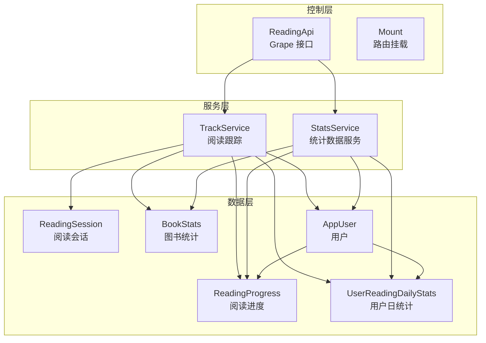
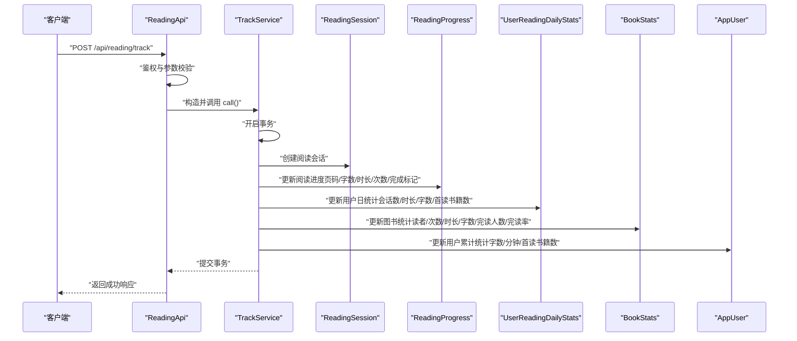
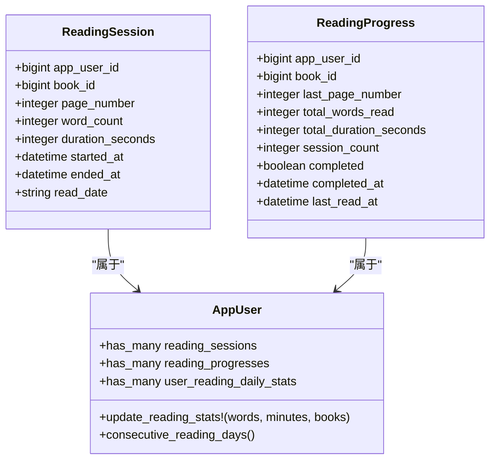
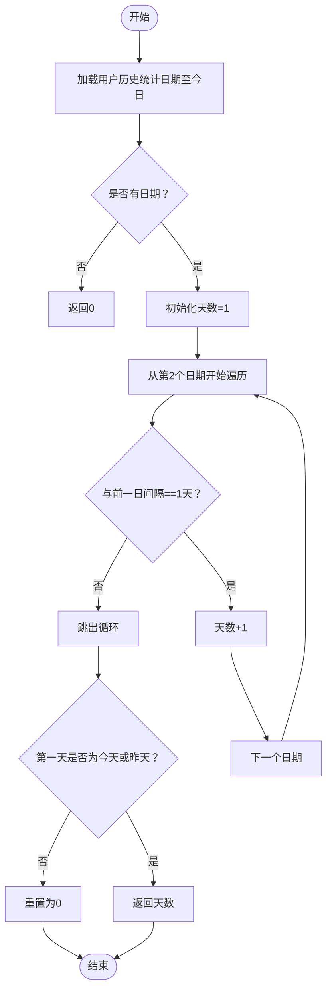
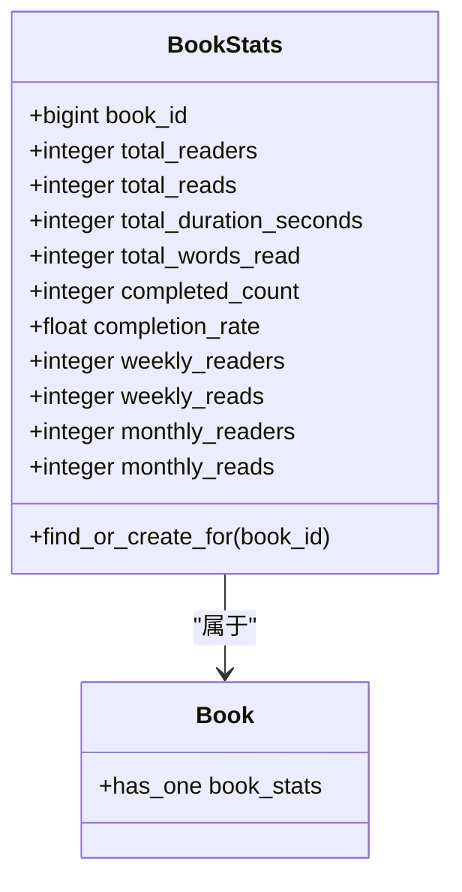
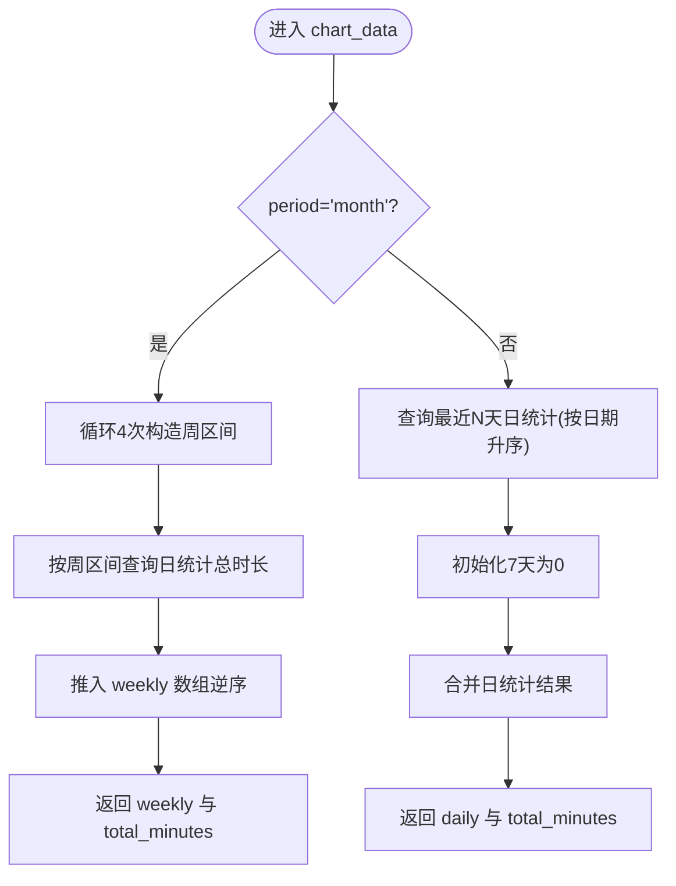
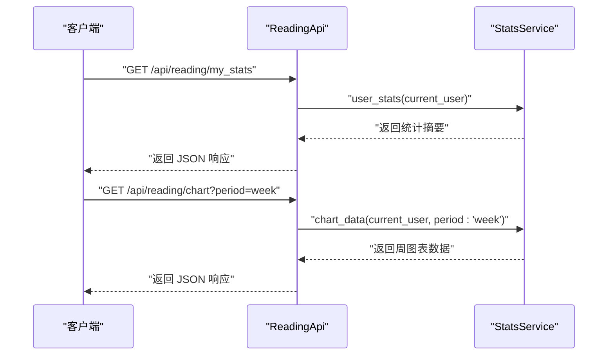
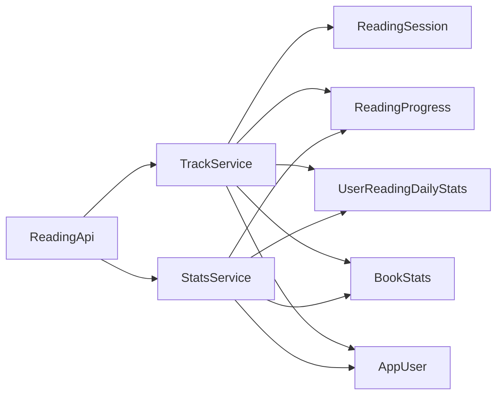
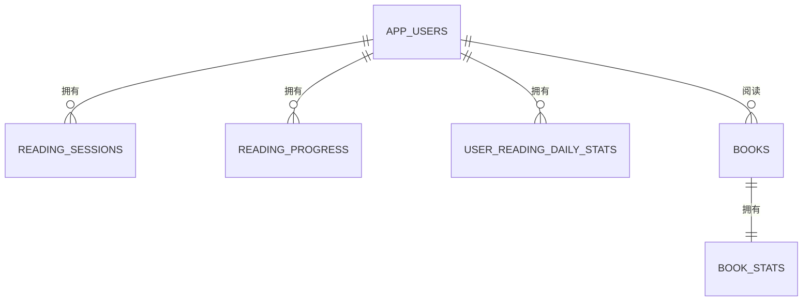

# 阅读统计分析

<cite>
**本文引用的文件**
- [app/services/reading/stats_service.rb](file://app/services/reading/stats_service.rb)
- [app/services/reading/track_service.rb](file://app/services/reading/track_service.rb)
- [app/controllers/api/readings/reading_api.rb](file://app/controllers/api/readings/reading_api.rb)
- [app/controllers/api/readings/mount.rb](file://app/controllers/api/readings/mount.rb)
- [app/models/reading_progress.rb](file://app/models/reading_progress.rb)
- [app/models/reading_session.rb](file://app/models/reading_session.rb)
- [app/models/user_reading_daily_stats.rb](file://app/models/user_reading_daily_stats.rb)
- [app/models/book_stats.rb](file://app/models/book_stats.rb)
- [app/models/app_user.rb](file://app/models/app_user.rb)
- [db/migrate/20260519030000_create_reading_statistics_tables.rb](file://db/migrate/20260519030000_create_reading_statistics_tables.rb)
- [spec/services/reading/stats_service_spec.rb](file://spec/services/reading/stats_service_spec.rb)
- [spec/services/reading/track_service_spec.rb](file://spec/services/reading/track_service_spec.rb)
- [spec/requests/api/reading_spec.rb](file://spec/requests/api/reading_spec.rb)
</cite>

## 目录
1. [简介](#简介)
2. [项目结构](#项目结构)
3. [核心组件](#核心组件)
4. [架构总览](#架构总览)
5. [组件详解](#组件详解)
6. [依赖关系分析](#依赖关系分析)
7. [性能与优化](#性能与优化)
8. [故障排查指南](#故障排查指南)
9. [结论](#结论)
10. [附录](#附录)

## 简介
本文件面向“阅读统计分析服务”的设计与实现，围绕以下目标展开：
- 阅读进度跟踪：基于会话与进度表记录用户的阅读页码、字数与时长，并在到达末页时标记完成。
- 学习时长统计：按日维度汇总用户阅读时长、字数、阅读次数与首读书籍数，支持连续阅读天数计算。
- 每日阅读数据分析：提供周/月维度的图表数据，补齐缺失日期并聚合时长。
- 统计数据服务：提供用户统计摘要、图书统计、进度列表与图表数据查询接口。
- 阅读会话管理：单次阅读行为以会话形式持久化，事务保证一致性。
- 聚合算法与性能优化：缓存、索引与批量查询策略降低热点查询压力。

## 项目结构
阅读统计分析服务由三层组成：
- 控制层：Grape 接口负责接收请求、鉴权与参数校验，调用服务层。
- 服务层：TrackService 执行阅读行为的原子性更新；StatsService 提供统计查询与图表聚合。
- 数据层：模型与迁移文件定义阅读会话、进度、日统计与图书统计的数据结构与索引。

**图示来源**
- [app/controllers/api/readings/reading_api.rb:1-93](file://app/controllers/api/readings/reading_api.rb#L1-L93)
- [app/controllers/api/readings/mount.rb:1-9](file://app/controllers/api/readings/mount.rb#L1-L9)
- [app/services/reading/track_service.rb:1-126](file://app/services/reading/track_service.rb#L1-L126)
- [app/services/reading/stats_service.rb:1-140](file://app/services/reading/stats_service.rb#L1-L140)
- [app/models/reading_session.rb:1-25](file://app/models/reading_session.rb#L1-L25)
- [app/models/reading_progress.rb:1-27](file://app/models/reading_progress.rb#L1-L27)
- [app/models/user_reading_daily_stats.rb:1-21](file://app/models/user_reading_daily_stats.rb#L1-L21)
- [app/models/book_stats.rb:1-31](file://app/models/book_stats.rb#L1-L31)
- [app/models/app_user.rb:1-140](file://app/models/app_user.rb#L1-L140)

**章节来源**
- [app/controllers/api/readings/reading_api.rb:1-93](file://app/controllers/api/readings/reading_api.rb#L1-L93)
- [app/controllers/api/readings/mount.rb:1-9](file://app/controllers/api/readings/mount.rb#L1-L9)
- [db/migrate/20260519030000_create_reading_statistics_tables.rb:1-90](file://db/migrate/20260519030000_create_reading_statistics_tables.rb#L1-L90)

## 核心组件
- TrackService：执行一次阅读行为的完整流程，包括创建会话、更新进度、更新日统计、更新图书统计与用户累计统计。
- StatsService：提供用户统计摘要、图书统计、进度列表、单书进度与图表数据（周/月）。
- ReadingSession/ReadingProgress/UserReadingDailyStats/BookStats：数据模型与索引，支撑实时与历史统计。
- ReadingApi/Mount：对外 API 入口，参数校验与响应封装。

**章节来源**
- [app/services/reading/track_service.rb:1-126](file://app/services/reading/track_service.rb#L1-L126)
- [app/services/reading/stats_service.rb:1-140](file://app/services/reading/stats_service.rb#L1-L140)
- [app/models/reading_session.rb:1-25](file://app/models/reading_session.rb#L1-L25)
- [app/models/reading_progress.rb:1-27](file://app/models/reading_progress.rb#L1-L27)
- [app/models/user_reading_daily_stats.rb:1-21](file://app/models/user_reading_daily_stats.rb#L1-L21)
- [app/models/book_stats.rb:1-31](file://app/models/book_stats.rb#L1-L31)
- [app/models/app_user.rb:1-140](file://app/models/app_user.rb#L1-L140)
- [app/controllers/api/readings/reading_api.rb:1-93](file://app/controllers/api/readings/reading_api.rb#L1-L93)

## 架构总览
下图展示了“上报阅读记录”请求到最终落库与统计更新的端到端流程：

**图示来源**
- [app/controllers/api/readings/reading_api.rb:11-34](file://app/controllers/api/readings/reading_api.rb#L11-L34)
- [app/services/reading/track_service.rb:16-26](file://app/services/reading/track_service.rb#L16-L26)
- [app/models/reading_session.rb:30-40](file://app/models/reading_session.rb#L30-L40)
- [app/models/reading_progress.rb:42-66](file://app/models/reading_progress.rb#L42-L66)
- [app/models/user_reading_daily_stats.rb:68-86](file://app/models/user_reading_daily_stats.rb#L68-L86)
- [app/models/book_stats.rb:88-115](file://app/models/book_stats.rb#L88-L115)
- [app/models/app_user.rb:87-92](file://app/models/app_user.rb#L87-L92)

## 组件详解

### 1) 阅读会话与进度管理
- 阅读会话（ReadingSession）：记录每次阅读的起止时间、页码、字数与时长，以及阅读日期。
- 阅读进度（ReadingProgress）：按用户-图书维度维护最新页码、累计字数、累计时长、会话次数、完成状态与最近阅读时间；当页码达到图书总页数时标记完成。
- 进度更新策略：仅在新页码大于历史最大页码时更新；累计字数与时长累加；会话次数递增；完成检测使用图书总页数阈值。

**图示来源**
- [app/models/reading_session.rb:1-25](file://app/models/reading_session.rb#L1-L25)
- [app/models/reading_progress.rb:1-27](file://app/models/reading_progress.rb#L1-L27)
- [app/models/app_user.rb:58-61](file://app/models/app_user.rb#L58-L61)

**章节来源**
- [app/models/reading_session.rb:1-25](file://app/models/reading_session.rb#L1-L25)
- [app/models/reading_progress.rb:1-27](file://app/models/reading_progress.rb#L1-L27)
- [app/services/reading/track_service.rb:30-66](file://app/services/reading/track_service.rb#L30-L66)

### 2) 日统计与活跃度分析
- 用户日统计（UserReadingDailyStats）：按用户-日期聚合当日会话数、总时长、总字数与首读书籍数。
- 连续阅读天数（AppUser.consecutive_reading_days）：从最近日期向前回溯，统计连续自然日数量，若中断则归零。

**图示来源**
- [app/models/app_user.rb:94-114](file://app/models/app_user.rb#L94-L114)
- [app/models/user_reading_daily_stats.rb:18-19](file://app/models/user_reading_daily_stats.rb#L18-L19)

**章节来源**
- [app/models/user_reading_daily_stats.rb:1-21](file://app/models/user_reading_daily_stats.rb#L1-L21)
- [app/models/app_user.rb:94-114](file://app/models/app_user.rb#L94-L114)
- [app/services/reading/track_service.rb:68-86](file://app/services/reading/track_service.rb#L68-L86)

### 3) 图书统计与完读率
- 图书统计（BookStats）：按图书维度维护总读者数、总阅读次数、总时长、总字数、完读人数与完读率；同时维护近7天与近30天的读者与次数。
- 完读率计算：完读人数/总读者数；首次阅读某书当天才计入读者与周/月读者。

**图示来源**
- [app/models/book_stats.rb:1-31](file://app/models/book_stats.rb#L1-L31)

**章节来源**
- [app/models/book_stats.rb:1-31](file://app/models/book_stats.rb#L1-L31)
- [app/services/reading/track_service.rb:88-115](file://app/services/reading/track_service.rb#L88-L115)

### 4) 统计数据服务（StatsService）
- 用户统计摘要（user_stats）：缓存30秒，聚合总书数、已完成书数、总时长（分钟）、总字数、平均时长（分钟）、完成率（百分比）、连续阅读天数。
- 图书统计（book_stats）：查询或返回默认空值。
- 用户进度列表（user_progress）：最近阅读的书籍进度，包含封面签名URL等。
- 单书进度（user_book_progress）：按用户-图书查询进度。
- 图表数据（chart_data）：支持周/月两种周期
  - 周：最近7天，补齐缺失日期，返回每日时长与总时长。
  - 月：最近4周，每组非重叠周区间求和，返回每周时长与总时长。

**图示来源**
- [app/services/reading/stats_service.rb:63-110](file://app/services/reading/stats_service.rb#L63-L110)

**章节来源**
- [app/services/reading/stats_service.rb:6-28](file://app/services/reading/stats_service.rb#L6-L28)
- [app/services/reading/stats_service.rb:30-44](file://app/services/reading/stats_service.rb#L30-L44)
- [app/services/reading/stats_service.rb:46-61](file://app/services/reading/stats_service.rb#L46-L61)
- [app/services/reading/stats_service.rb:63-110](file://app/services/reading/stats_service.rb#L63-L110)

### 5) API 接口定义
- POST /api/reading/track
  - 参数：uuid、book_id、page_number、word_count（可选，默认0）、duration_seconds（可选，默认0）
  - 行为：校验图书存在后，调用 TrackService 更新会话与统计
- GET /api/reading/my_stats
  - 参数：uuid
  - 行为：返回用户统计摘要
- GET /api/reading/chart
  - 参数：uuid、period（week 或 month）
  - 行为：返回周/月图表数据
- GET /api/reading/my_progress
  - 参数：uuid
  - 行为：返回用户最近阅读进度列表
- GET /api/reading/my_progress/:book_id
  - 参数：uuid、book_id
  - 行为：返回指定图书的阅读进度

**图示来源**
- [app/controllers/api/readings/reading_api.rb:36-59](file://app/controllers/api/readings/reading_api.rb#L36-L59)

**章节来源**
- [app/controllers/api/readings/reading_api.rb:1-93](file://app/controllers/api/readings/reading_api.rb#L1-L93)

## 依赖关系分析
- 控制层依赖服务层：ReadingApi 通过 Grape helpers 进行鉴权与参数校验，随后调用 StatsService/TrackService。
- 服务层依赖数据层：TrackService/StatsService 通过模型进行读写，利用索引加速查询。
- 模型间关系：ReadingSession/ReadingProgress/BookStats 与 AppUser/UserReadingDailyStats 形成清晰的一对多/一对一关系。

**图示来源**
- [app/controllers/api/readings/reading_api.rb:1-93](file://app/controllers/api/readings/reading_api.rb#L1-L93)
- [app/services/reading/track_service.rb:1-126](file://app/services/reading/track_service.rb#L1-L126)
- [app/services/reading/stats_service.rb:1-140](file://app/services/reading/stats_service.rb#L1-L140)
- [app/models/reading_session.rb:1-25](file://app/models/reading_session.rb#L1-L25)
- [app/models/reading_progress.rb:1-27](file://app/models/reading_progress.rb#L1-L27)
- [app/models/user_reading_daily_stats.rb:1-21](file://app/models/user_reading_daily_stats.rb#L1-L21)
- [app/models/book_stats.rb:1-31](file://app/models/book_stats.rb#L1-L31)
- [app/models/app_user.rb:1-140](file://app/models/app_user.rb#L1-L140)

**章节来源**
- [app/controllers/api/readings/reading_api.rb:1-93](file://app/controllers/api/readings/reading_api.rb#L1-L93)
- [app/services/reading/track_service.rb:1-126](file://app/services/reading/track_service.rb#L1-L126)
- [app/services/reading/stats_service.rb:1-140](file://app/services/reading/stats_service.rb#L1-L140)

## 性能与优化
- 缓存策略
  - StatsService.user_stats 使用短时缓存（30秒），减少重复聚合开销。
- 索引优化
  - 阅读会话与进度表均建立复合索引，加速用户-图书与用户-日期查询。
  - 图书统计表对周/月读者数建立索引，便于排行榜与筛选。
- 事务与幂等
  - TrackService 在单次调用内使用事务，确保会话、进度、日统计、图书统计与用户累计统计一致更新。
- 并发竞争规避
  - 日统计与图书统计中通过“基于刚创建会话计数”的方式判断当日首读，避免并发导致的重复计数。
- 查询优化
  - 图表数据按需拉取并补齐缺失日期，避免全量扫描；日统计采用 up_to_date/last_n_days 等作用域。

**章节来源**
- [app/services/reading/stats_service.rb:7-28](file://app/services/reading/stats_service.rb#L7-L28)
- [db/migrate/20260519030000_create_reading_statistics_tables.rb:14-16](file://db/migrate/20260519030000_create_reading_statistics_tables.rb#L14-L16)
- [db/migrate/20260519030000_create_reading_statistics_tables.rb](file://db/migrate/20260519030000_create_reading_statistics_tables.rb#L42)
- [db/migrate/20260519030000_create_reading_statistics_tables.rb:58-61](file://db/migrate/20260519030000_create_reading_statistics_tables.rb#L58-L61)
- [app/services/reading/track_service.rb:19-26](file://app/services/reading/track_service.rb#L19-L26)
- [app/services/reading/track_service.rb:79-83](file://app/services/reading/track_service.rb#L79-L83)
- [app/services/reading/track_service.rb:91-96](file://app/services/reading/track_service.rb#L91-L96)
- [app/models/user_reading_daily_stats.rb:18-19](file://app/models/user_reading_daily_stats.rb#L18-L19)

## 故障排查指南
- 上报阅读记录失败
  - 现象：返回图书不存在或参数错误。
  - 排查：确认 book_id 是否存在；检查 uuid、page_number、word_count、duration_seconds 是否传入。
  - 参考：接口参数校验与错误响应。
- 进度未更新或重复计数
  - 现象：进度页码未提升、字数/时长未增长、首读书籍数重复。
  - 排查：确认 page_number 是否大于 last_page_number；检查会话是否创建成功；核对并发场景下的首读判断逻辑。
- 图表数据异常
  - 现象：周/月图表缺少日期或数值为0。
  - 排查：确认日统计是否按时生成；补齐逻辑是否生效；日期边界是否正确。
- 完读率异常
  - 现象：完读人数/完读率不正确。
  - 排查：确认最近完成的进度是否在限定时间窗口内；图书统计的完成计数是否更新。

**章节来源**
- [app/controllers/api/readings/reading_api.rb:22-34](file://app/controllers/api/readings/reading_api.rb#L22-L34)
- [spec/requests/api/reading_spec.rb:26-45](file://spec/requests/api/reading_spec.rb#L26-L45)
- [spec/services/reading/track_service_spec.rb:132-157](file://spec/services/reading/track_service_spec.rb#L132-L157)
- [spec/services/reading/stats_service_spec.rb:82-115](file://spec/services/reading/stats_service_spec.rb#L82-L115)

## 结论
本服务通过“会话-进度-日统计-图书统计”的分层设计，实现了高并发下的阅读行为追踪与多维统计分析。TrackService 保证原子性与一致性，StatsService 提供高效查询与图表聚合，配合缓存与索引优化，满足实时与历史分析需求。建议在生产环境中结合业务峰值进行容量评估与缓存策略迭代。

## 附录

### A. 数据模型与索引概览

**图示来源**
- [db/migrate/20260519030000_create_reading_statistics_tables.rb:3-58](file://db/migrate/20260519030000_create_reading_statistics_tables.rb#L3-L58)
- [app/models/app_user.rb:58-61](file://app/models/app_user.rb#L58-L61)
- [app/models/book_stats.rb:19-20](file://app/models/book_stats.rb#L19-L20)

### B. API 示例路径
- 上报阅读记录：[app/controllers/api/readings/reading_api.rb:19-34](file://app/controllers/api/readings/reading_api.rb#L19-L34)
- 用户统计摘要：[app/controllers/api/readings/reading_api.rb:41-46](file://app/controllers/api/readings/reading_api.rb#L41-L46)
- 图表数据（周/月）：[app/controllers/api/readings/reading_api.rb:54-59](file://app/controllers/api/readings/reading_api.rb#L54-L59)
- 进度列表与单书进度：[app/controllers/api/readings/reading_api.rb:66-88](file://app/controllers/api/readings/reading_api.rb#L66-L88)

### C. 测试参考
- 阅读上报与进度更新：[spec/services/reading/track_service_spec.rb:9-113](file://spec/services/reading/track_service_spec.rb#L9-L113)
- 统计查询与图表数据：[spec/services/reading/stats_service_spec.rb:8-115](file://spec/services/reading/stats_service_spec.rb#L8-L115)
- 接口请求用例：[spec/requests/api/reading_spec.rb:8-45](file://spec/requests/api/reading_spec.rb#L8-L45)