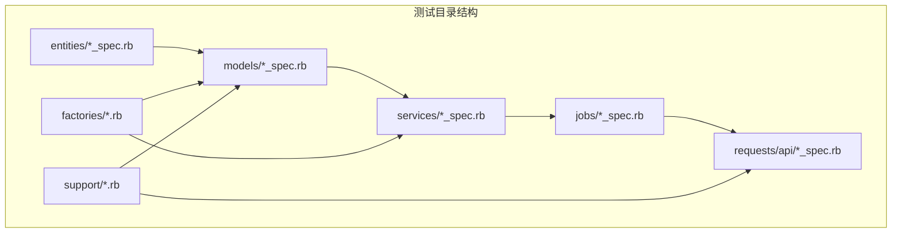
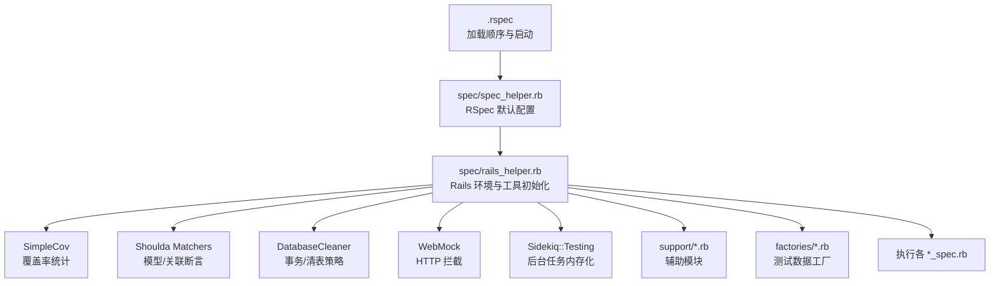
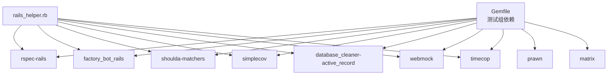
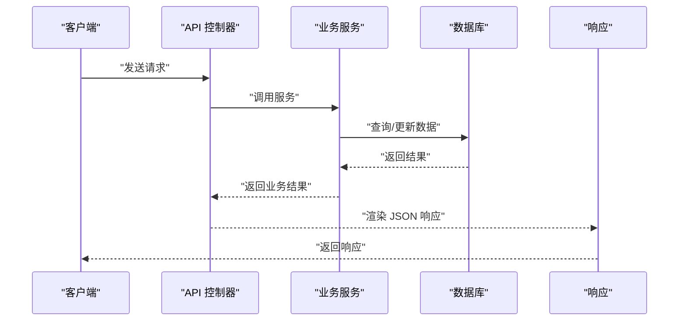

# 测试指南

<cite>
**本文引用的文件**
- [Gemfile](file://Gemfile)
- [.rspec](file://.rspec)
- [spec/spec_helper.rb](file://spec/spec_helper.rb)
- [spec/rails_helper.rb](file://spec/rails_helper.rb)
- [spec/support/api_auth_helper.rb](file://spec/support/api_auth_helper.rb)
- [spec/support/pdf_fixture_helper.rb](file://spec/support/pdf_fixture_helper.rb)
- [spec/factories/app_users.rb](file://spec/factories/app_users.rb)
- [spec/factories/books.rb](file://spec/factories/books.rb)
- [spec/factories/categories.rb](file://spec/factories/categories.rb)
- [spec/factories/chapters.rb](file://spec/factories/chapters.rb)
- [spec/factories/bookmarks.rb](file://spec/factories/bookmarks.rb)
- [spec/factories/bookshelves.rb](file://spec/factories/bookshelves.rb)
- [spec/factories/orders.rb](file://spec/factories/orders.rb)
- [spec/factories/memberships.rb](file://spec/factories/memberships.rb)
- [spec/factories/head_imgs.rb](file://spec/factories/head_imgs.rb)
- [spec/factories/reading_progress.rb](file://spec/factories/reading_progress.rb)
- [spec/factories/reading_sessions.rb](file://spec/factories/reading_sessions.rb)
- [spec/factories/leaderboards.rb](file://spec/factories/leaderboards.rb)
- [spec/factories/leaderboard_items.rb](file://spec/factories/leaderboard_items.rb)
- [spec/factories/packages.rb](file://spec/factories/packages.rb)
- [spec/factories/compilations.rb](file://spec/factories/compilations.rb)
- [spec/factories/suppliers.rb](file://spec/factories/suppliers.rb)
- [spec/factories/grades.rb](file://spec/factories/grades.rb)
- [spec/factories/ebook_pages.rb](file://spec/factories/ebook_pages.rb)
- [spec/factories/content_groups.rb](file://spec/factories/content_groups.rb)
- [spec/factories/contents.rb](file://spec/factories/contents.rb)
- [spec/factories/catalogues.rb](file://spec/factories/catalogues.rb)
- [spec/factories/parental_controls.rb](file://spec/factories/parental_controls.rb)
- [spec/factories/author.rb](file://spec/factories/author.rb)
- [spec/factories/api_auths.rb](file://spec/factories/api_auths.rb)
- [spec/factories/blacklisted_books.rb](file://spec/factories/blacklisted_books.rb)
- [spec/factories/book_levels.rb](file://spec/factories/book_levels.rb)
- [spec/factories/book_stats.rb](file://spec/factories/book_stats.rb)
- [spec/factories/category_subs.rb](file://spec/factories/category_subs.rb)
- [spec/factories/hot_searches.rb](file://spec/factories/hot_searches.rb)
- [spec/factories/head_imgs.rb](file://spec/factories/head_imgs.rb)
- [spec/factories/push_notifications.rb](file://spec/factories/push_notifications.rb)
- [spec/factories/recommends.rb](file://spec/factories/recommends.rb)
- [spec/factories/sms_verifications.rb](file://spec/factories/sms_verifications.rb)
- [spec/factories/suppliers.rb](file://spec/factories/suppliers.rb)
- [spec/factories/user_reading_daily_stats.rb](file://spec/factories/user_reading_daily_stats.rb)
- [spec/models/app_user_spec.rb](file://spec/models/app_user_spec.rb)
- [spec/models/book_spec.rb](file://spec/models/book_spec.rb)
- [spec/models/category_spec.rb](file://spec/models/category_spec.rb)
- [spec/models/chapter_spec.rb](file://spec/models/chapter_spec.rb)
- [spec/models/bookmark_spec.rb](file://spec/models/bookmark_spec.rb)
- [spec/models/bookshelf_spec.rb](file://spec/models/bookshelf_spec.rb)
- [spec/models/order_spec.rb](file://spec/models/order_spec.rb)
- [spec/models/membership_spec.rb](file://spec/models/membership_spec.rb)
- [spec/models/head_img_spec.rb](file://spec/models/head_img_spec.rb)
- [spec/models/reading_progress_spec.rb](file://spec/models/reading_progress_spec.rb)
- [spec/models/reading_session_spec.rb](file://spec/models/reading_session_spec.rb)
- [spec/models/leaderboard_spec.rb](file://spec/models/leaderboard_spec.rb)
- [spec/models/leaderboard_item_spec.rb](file://spec/models/leaderboard_item_spec.rb)
- [spec/models/package_spec.rb](file://spec/models/package_spec.rb)
- [spec/models/compilation_spec.rb](file://spec/models/compilation_spec.rb)
- [spec/models/supplier_spec.rb](file://spec/models/supplier_spec.rb)
- [spec/models/grade_spec.rb](file://spec/models/grade_spec.rb)
- [spec/models/ebook_page_spec.rb](file://spec/models/ebook_page_spec.rb)
- [spec/models/content_group_spec.rb](file://spec/models/content_group_spec.rb)
- [spec/models/content_spec.rb](file://spec/models/content_spec.rb)
- [spec/models/catalogue_spec.rb](file://spec/models/catalogue_spec.rb)
- [spec/models/parental_control_spec.rb](file://spec/models/parental_control_spec.rb)
- [spec/models/author_spec.rb](file://spec/models/author_spec.rb)
- [spec/models/api_auth_spec.rb](file://spec/models/api_auth_spec.rb)
- [spec/models/blacklisted_book_spec.rb](file://spec/models/blacklisted_book_spec.rb)
- [spec/models/book_level_spec.rb](file://spec/models/book_level_spec.rb)
- [spec/models/book_stats_spec.rb](file://spec/models/book_stats_spec.rb)
- [spec/models/category_sub_spec.rb](file://spec/models/category_sub_spec.rb)
- [spec/models/hot_search_spec.rb](file://spec/models/hot_search_spec.rb)
- [spec/models/head_img_spec.rb](file://spec/models/head_img_spec.rb)
- [spec/models/push_notification_spec.rb](file://spec/models/push_notification_spec.rb)
- [spec/models/recommend_spec.rb](file://spec/models/recommend_spec.rb)
- [spec/models/sms_verification_spec.rb](file://spec/models/sms_verification_spec.rb)
- [spec/models/supplier_spec.rb](file://spec/models/supplier_spec.rb)
- [spec/models/user_reading_daily_stats_spec.rb](file://spec/models/user_reading_daily_stats_spec.rb)
- [spec/services/wechat_auth_service_spec.rb](file://spec/services/wechat_auth_service_spec.rb)
- [spec/services/wechat_payment_service_spec.rb](file://spec/services/wechat_payment_service_spec.rb)
- [spec/services/alipay_payment_service_spec.rb](file://spec/services/alipay_payment_service_spec.rb)
- [spec/services/qq_auth_service_spec.rb](file://spec/services/qq_auth_service_spec.rb)
- [spec/services/aliyun_oss_service_spec.rb](file://spec/services/aliyun_oss_service_spec.rb)
- [spec/services/reading/stats_service_spec.rb](file://spec/services/reading/stats_service_spec.rb)
- [spec/services/reading/track_service_spec.rb](file://spec/services/reading/track_service_spec.rb)
- [spec/services/ebook/import_service_spec.rb](file://spec/services/ebook/import_service_spec.rb)
- [spec/services/ebook/export_package_spec.rb](file://spec/services/ebook/export_package_spec.rb)
- [spec/services/ebook/local_export_worker_spec.rb](file://spec/services/ebook/local_export_worker_spec.rb)
- [spec/services/ebook/page_image_renderer_spec.rb](file://spec/services/ebook/page_image_renderer_spec.rb)
- [spec/services/ebook/pdf_importer_spec.rb](file://spec/services/ebook/pdf_importer_spec.rb)
- [spec/services/ebook/pdf_importer_image_selection_spec.rb](file://spec/services/ebook/pdf_importer_image_selection_spec.rb)
- [spec/services/ebook/pdf_importer_image_export_spec.rb](file://spec/services/ebook/pdf_importer_image_export_spec.rb)
- [spec/jobs/book_epub_import_worker_spec.rb](file://spec/jobs/book_epub_import_worker_spec.rb)
- [spec/jobs/epub_export_worker_spec.rb](file://spec/jobs/epub_export_worker_spec.rb)
- [spec/jobs/epub_import_worker_spec.rb](file://spec/jobs/epub_import_worker_spec.rb)
- [spec/requests/api/books_spec.rb](file://spec/requests/api/books_spec.rb)
- [spec/requests/api/home_spec.rb](file://spec/requests/api/home_spec.rb)
- [spec/requests/api/health_spec.rb](file://spec/requests/api/health_spec.rb)
- [spec/requests/api/search_spec.rb](file://spec/requests/api/search_spec.rb)
- [spec/requests/api/leaderboards_spec.rb](file://spec/requests/api/leaderboards_spec.rb)
- [spec/requests/api/memberships_spec.rb](file://spec/requests/api/memberships_spec.rb)
- [spec/requests/api/head_imgs_spec.rb](file://spec/requests/api/head_imgs_spec.rb)
- [spec/requests/api/grades_spec.rb](file://spec/requests/api/grades_spec.rb)
- [spec/requests/api/ranks_spec.rb](file://spec/requests/api/ranks_spec.rb)
- [spec/requests/api/reading_spec.rb](file://spec/requests/api/reading_spec.rb)
- [spec/requests/api/compilations_spec.rb](file://spec/requests/api/compilations_spec.rb)
- [spec/requests/api/parental_spec.rb](file://spec/requests/api/parental_spec.rb)
- [spec/requests/api/app_users_spec.rb](file://spec/requests/api/app_users_spec.rb)
- [spec/requests/api/categories_spec.rb](file://spec/requests/api/categories_spec.rb)
- [spec/requests/api/blacklist_filtering_spec.rb](file://spec/requests/api/blacklist_filtering_spec.rb)
- [spec/requests/api/hot_keywords_spec.rb](file://spec/requests/api/hot_keywords_spec.rb)
- [spec/requests/api/oss_spec.rb](file://spec/requests/api/oss_spec.rb)
- [spec/requests/api/category_browse_spec.rb](file://spec/requests/api/category_browse_spec.rb)
- [spec/requests/api/grades_spec.rb](file://spec/requests/api/grades_spec.rb)
- [spec/requests/api/head_imgs_spec.rb](file://spec/requests/api/head_imgs_spec.rb)
- [spec/requests/api/health_spec.rb](file://spec/requests/api/health_spec.rb)
- [spec/requests/api/home_spec.rb](file://spec/requests/api/home_spec.rb)
- [spec/requests/api/search_spec.rb](file://spec/requests/api/search_spec.rb)
- [spec/requests/api/books_spec.rb](file://spec/requests/api/books_spec.rb)
- [spec/requests/api/leaderboards_spec.rb](file://spec/requests/api/leaderboards_spec.rb)
- [spec/requests/api/memberships_spec.rb](file://spec/requests/api/memberships_spec.rb)
- [spec/requests/api/compilations_spec.rb](file://spec/requests/api/compilations_spec.rb)
- [spec/requests/api/parental_spec.rb](file://spec/requests/api/parental_spec.rb)
- [spec/requests/api/app_users_spec.rb](file://spec/requests/api/app_users_spec.rb)
- [spec/requests/api/categories_spec.rb](file://spec/requests/api/categories_spec.rb)
- [spec/requests/api/blacklist_filtering_spec.rb](file://spec/requests/api/blacklist_filtering_spec.rb)
- [spec/requests/api/hot_keywords_spec.rb](file://spec/requests/api/hot_keywords_spec.rb)
- [spec/requests/api/oss_spec.rb](file://spec/requests/api/oss_spec.rb)
- [spec/requests/api/category_browse_spec.rb](file://spec/requests/api/category_browse_spec.rb)
</cite>

## 目录
1. 引言
2. 项目结构
3. 核心组件
4. 架构总览
5. 详细组件分析
6. 依赖分析
7. 性能考量
8. 故障排查指南
9. 结论
10. 附录

## 引言
本测试指南面向语音图书平台的开发与测试团队，系统性介绍项目的测试策略、测试框架使用方法与最佳实践。项目采用 RSpec 作为核心测试框架，结合 SimpleCov 实现代码覆盖率统计、FactoryBot 用于测试数据工厂、Shoulda Matchers 提升模型与关联测试效率，并通过 WebMock、Sidekiq::Testing 等工具隔离外部依赖与异步任务。测试覆盖单元测试（Model/Entity）、服务层（Service）、作业（Job）、以及 API 请求（Request）等多层面。

## 项目结构
测试相关文件主要集中在 spec 目录，按关注点划分为：
- entities：实体类行为测试
- models：模型与关联、验证、回调等测试
- services：业务服务逻辑测试
- jobs：后台作业测试
- requests/api：API 接口请求测试
- factories：FactoryBot 工厂定义
- support：通用辅助模块（如 API 认证、PDF 修复等）

**章节来源**
- [spec/spec_helper.rb:1-93](file://spec/spec_helper.rb#L1-L93)
- [spec/rails_helper.rb:1-78](file://spec/rails_helper.rb#L1-L78)

## 核心组件
- RSpec 配置与运行
  - .rspec 指定加载顺序与启动文件
  - spec_helper.rb 提供 RSpec 默认配置（期望、mock、共享上下文等）
  - rails_helper.rb 加载 Rails 环境、加载支持文件、设置 Shoulda Matchers、DatabaseCleaner、Sidekiq::Testing、SimpleCov 等
- 测试覆盖率
  - SimpleCov 按目录分组统计，最小覆盖率阈值为 80%
- 数据工厂
  - 所有模型均配套 FactoryBot 工厂，便于快速构建测试数据
- 外部依赖隔离
  - Sidekiq::Testing.fake! 将后台任务切换为内存模式
  - WebMock 用于拦截 HTTP 请求
- API 辅助
  - rails_helper.rb 中为 :request 类型示例提供 JSON 响应解析辅助

**章节来源**
- [.rspec:1-3](file://.rspec#L1-L3)
- [spec/spec_helper.rb:16-92](file://spec/spec_helper.rb#L16-L92)
- [spec/rails_helper.rb:6-16](file://spec/rails_helper.rb#L6-L16)
- [spec/rails_helper.rb:40-45](file://spec/rails_helper.rb#L40-L45)
- [spec/rails_helper.rb:48-77](file://spec/rails_helper.rb#L48-L77)

## 架构总览
下图展示了测试运行时的关键组件交互：RSpec 启动器加载 rails_helper，后者初始化 SimpleCov、Shoulda Matchers、DatabaseCleaner、WebMock、Sidekiq::Testing，并自动加载 support 下的辅助模块；随后按文件位置推断测试类型，执行对应测试。

**图表来源**
- [.rspec:1-3](file://.rspec#L1-L3)
- [spec/spec_helper.rb:16-92](file://spec/spec_helper.rb#L16-L92)
- [spec/rails_helper.rb:6-16](file://spec/rails_helper.rb#L6-L16)
- [spec/rails_helper.rb:40-45](file://spec/rails_helper.rb#L40-L45)
- [spec/rails_helper.rb:48-77](file://spec/rails_helper.rb#L48-L77)

**章节来源**
- [spec/rails_helper.rb:6-16](file://spec/rails_helper.rb#L6-L16)
- [spec/rails_helper.rb:48-77](file://spec/rails_helper.rb#L48-L77)

## 详细组件分析

### 单元测试（Model/Entity）
- 目标
  - 验证模型字段、验证规则、关联关系、回调与作用域
  - 使用 Shoulda Matchers 快速声明式断言
  - 使用 FactoryBot 工厂构造边界与异常场景数据
- 典型测试文件路径
  - [spec/models/app_user_spec.rb](file://spec/models/app_user_spec.rb)
  - [spec/models/book_spec.rb](file://spec/models/book_spec.rb)
  - [spec/models/category_spec.rb](file://spec/models/category_spec.rb)
  - [spec/models/chapter_spec.rb](file://spec/models/chapter_spec.rb)
  - [spec/models/bookmark_spec.rb](file://spec/models/bookmark_spec.rb)
  - [spec/models/bookshelf_spec.rb](file://spec/models/bookshelf_spec.rb)
  - [spec/models/order_spec.rb](file://spec/models/order_spec.rb)
  - [spec/models/membership_spec.rb](file://spec/models/membership_spec.rb)
  - [spec/models/head_img_spec.rb](file://spec/models/head_img_spec.rb)
  - [spec/models/reading_progress_spec.rb](file://spec/models/reading_progress_spec.rb)
  - [spec/models/reading_session_spec.rb](file://spec/models/reading_session_spec.rb)
  - [spec/models/leaderboard_spec.rb](file://spec/models/leaderboard_spec.rb)
  - [spec/models/leaderboard_item_spec.rb](file://spec/models/leaderboard_item_spec.rb)
  - [spec/models/package_spec.rb](file://spec/models/package_spec.rb)
  - [spec/models/compilation_spec.rb](file://spec/models/compilation_spec.rb)
  - [spec/models/supplier_spec.rb](file://spec/models/supplier_spec.rb)
  - [spec/models/grade_spec.rb](file://spec/models/grade_spec.rb)
  - [spec/models/ebook_page_spec.rb](file://spec/models/ebook_page_spec.rb)
  - [spec/models/content_group_spec.rb](file://spec/models/content_group_spec.rb)
  - [spec/models/content_spec.rb](file://spec/models/content_spec.rb)
  - [spec/models/catalogue_spec.rb](file://spec/models/catalogue_spec.rb)
  - [spec/models/parental_control_spec.rb](file://spec/models/parental_control_spec.rb)
  - [spec/models/author_spec.rb](file://spec/models/author_spec.rb)
  - [spec/models/api_auth_spec.rb](file://spec/models/api_auth_spec.rb)
  - [spec/models/blacklisted_book_spec.rb](file://spec/models/blacklisted_book_spec.rb)
  - [spec/models/book_level_spec.rb](file://spec/models/book_level_spec.rb)
  - [spec/models/book_stats_spec.rb](file://spec/models/book_stats_spec.rb)
  - [spec/models/category_sub_spec.rb](file://spec/models/category_sub_spec.rb)
  - [spec/models/hot_search_spec.rb](file://spec/models/hot_search_spec.rb)
  - [spec/models/head_img_spec.rb](file://spec/models/head_img_spec.rb)
  - [spec/models/push_notification_spec.rb](file://spec/models/push_notification_spec.rb)
  - [spec/models/recommend_spec.rb](file://spec/models/recommend_spec.rb)
  - [spec/models/sms_verification_spec.rb](file://spec/models/sms_verification_spec.rb)
  - [spec/models/supplier_spec.rb](file://spec/models/supplier_spec.rb)
  - [spec/models/user_reading_daily_stats_spec.rb](file://spec/models/user_reading_daily_stats_spec.rb)

**章节来源**
- [spec/rails_helper.rb:40-45](file://spec/rails_helper.rb#L40-L45)
- [spec/rails_helper.rb:48-77](file://spec/rails_helper.rb#L48-L77)

### 服务层测试（Service）
- 目标
  - 验证支付、认证、阅读统计与跟踪、Ebook 导入导出等业务逻辑
  - 使用 WebMock 模拟第三方接口
  - 使用 Timecop 或自定义时间控制策略
- 典型测试文件路径
  - [spec/services/wechat_auth_service_spec.rb](file://spec/services/wechat_auth_service_spec.rb)
  - [spec/services/wechat_payment_service_spec.rb](file://spec/services/wechat_payment_service_spec.rb)
  - [spec/services/alipay_payment_service_spec.rb](file://spec/services/alipay_payment_service_spec.rb)
  - [spec/services/qq_auth_service_spec.rb](file://spec/services/qq_auth_service_spec.rb)
  - [spec/services/aliyun_oss_service_spec.rb](file://spec/services/aliyun_oss_service_spec.rb)
  - [spec/services/reading/stats_service_spec.rb](file://spec/services/reading/stats_service_spec.rb)
  - [spec/services/reading/track_service_spec.rb](file://spec/services/reading/track_service_spec.rb)
  - [spec/services/ebook/import_service_spec.rb](file://spec/services/ebook/import_service_spec.rb)
  - [spec/services/ebook/export_package_spec.rb](file://spec/services/ebook/export_package_spec.rb)
  - [spec/services/ebook/local_export_worker_spec.rb](file://spec/services/ebook/local_export_worker_spec.rb)
  - [spec/services/ebook/page_image_renderer_spec.rb](file://spec/services/ebook/page_image_renderer_spec.rb)
  - [spec/services/ebook/pdf_importer_spec.rb](file://spec/services/ebook/pdf_importer_spec.rb)
  - [spec/services/ebook/pdf_importer_image_selection_spec.rb](file://spec/services/ebook/pdf_importer_image_selection_spec.rb)
  - [spec/services/ebook/pdf_importer_image_export_spec.rb](file://spec/services/ebook/pdf_importer_image_export_spec.rb)

**章节来源**
- [spec/rails_helper.rb:24-27](file://spec/rails_helper.rb#L24-L27)

### 作业测试（Job）
- 目标
  - 验证后台任务的执行流程、错误处理与重试策略
  - 使用 Sidekiq::Testing.fake! 将作业执行转为同步内存模式
- 典型测试文件路径
  - [spec/jobs/book_epub_import_worker_spec.rb](file://spec/jobs/book_epub_import_worker_spec.rb)
  - [spec/jobs/epub_export_worker_spec.rb](file://spec/jobs/epub_export_worker_spec.rb)
  - [spec/jobs/epub_import_worker_spec.rb](file://spec/jobs/epub_import_worker_spec.rb)

**章节来源**
- [spec/rails_helper.rb:26-27](file://spec/rails_helper.rb#L26-L27)

### API 测试（Request）
- 目标
  - 验证控制器路由、参数校验、鉴权、响应格式与状态码
  - 使用 json_response 辅助解析响应体
- 典型测试文件路径
  - [spec/requests/api/books_spec.rb](file://spec/requests/api/books_spec.rb)
  - [spec/requests/api/home_spec.rb](file://spec/requests/api/home_spec.rb)
  - [spec/requests/api/health_spec.rb](file://spec/requests/api/health_spec.rb)
  - [spec/requests/api/search_spec.rb](file://spec/requests/api/search_spec.rb)
  - [spec/requests/api/leaderboards_spec.rb](file://spec/requests/api/leaderboards_spec.rb)
  - [spec/requests/api/memberships_spec.rb](file://spec/requests/api/memberships_spec.rb)
  - [spec/requests/api/head_imgs_spec.rb](file://spec/requests/api/head_imgs_spec.rb)
  - [spec/requests/api/grades_spec.rb](file://spec/requests/api/grades_spec.rb)
  - [spec/requests/api/ranks_spec.rb](file://spec/requests/api/ranks_spec.rb)
  - [spec/requests/api/reading_spec.rb](file://spec/requests/api/reading_spec.rb)
  - [spec/requests/api/compilations_spec.rb](file://spec/requests/api/compilations_spec.rb)
  - [spec/requests/api/parental_spec.rb](file://spec/requests/api/parental_spec.rb)
  - [spec/requests/api/app_users_spec.rb](file://spec/requests/api/app_users_spec.rb)
  - [spec/requests/api/categories_spec.rb](file://spec/requests/api/categories_spec.rb)
  - [spec/requests/api/blacklist_filtering_spec.rb](file://spec/requests/api/blacklist_filtering_spec.rb)
  - [spec/requests/api/hot_keywords_spec.rb](file://spec/requests/api/hot_keywords_spec.rb)
  - [spec/requests/api/oss_spec.rb](file://spec/requests/api/oss_spec.rb)
  - [spec/requests/api/category_browse_spec.rb](file://spec/requests/api/category_browse_spec.rb)

**章节来源**
- [spec/rails_helper.rb:70-76](file://spec/rails_helper.rb#L70-L76)

### 测试数据工厂（FactoryBot）
- 目标
  - 以工厂快速构建测试数据，减少重复与耦合
- 工厂分布
  - 用户与设备：[spec/factories/app_users.rb](file://spec/factories/app_users.rb)
  - 图书与章节：[spec/factories/books.rb](file://spec/factories/books.rb)、[spec/factories/chapters.rb](file://spec/factories/chapters.rb)、[spec/factories/catalogues.rb](file://spec/factories/catalogues.rb)
  - 收藏与书架：[spec/factories/bookmarks.rb](file://spec/factories/bookmarks.rb)、[spec/factories/bookshelves.rb](file://spec/factories/bookshelves.rb)
  - 订单与会员：[spec/factories/orders.rb](file://spec/factories/orders.rb)、[spec/factories/memberships.rb](file://spec/factories/memberships.rb)
  - 头像与阅读：[spec/factories/head_imgs.rb](file://spec/factories/head_imgs.rb)、[spec/factories/reading_progress.rb](file://spec/factories/reading_progress.rb)、[spec/factories/reading_sessions.rb](file://spec/factories/reading_sessions.rb)
  - 排行榜与合辑：[spec/factories/leaderboards.rb](file://spec/factories/leaderboards.rb)、[spec/factories/leaderboard_items.rb](file://spec/factories/leaderboard_items.rb)、[spec/factories/compilations.rb](file://spec/factories/compilations.rb)
  - 分类与等级：[spec/factories/categories.rb](file://spec/factories/categories.rb)、[spec/factories/category_subs.rb](file://spec/factories/category_subs.rb)、[spec/factories/grades.rb](file://spec/factories/grades.rb)、[spec/factories/book_levels.rb](file://spec/factories/book_levels.rb)
  - 内容与页面：[spec/factories/ebook_pages.rb](file://spec/factories/ebook_pages.rb)、[spec/factories/content_groups.rb](file://spec/factories/content_groups.rb)、[spec/factories/contents.rb](file://spec/factories/contents.rb)
  - 其他：[spec/factories/suppliers.rb](file://spec/factories/suppliers.rb)、[spec/factories/hot_searches.rb](file://spec/factories/hot_searches.rb)、[spec/factories/push_notifications.rb](file://spec/factories/push_notifications.rb)、[spec/factories/recommends.rb](file://spec/factories/recommends.rb)、[spec/factories/sms_verifications.rb](file://spec/factories/sms_verifications.rb)、[spec/factories/user_reading_daily_stats.rb](file://spec/factories/user_reading_daily_stats.rb)
  - 黑名单与家长控制：[spec/factories/blacklisted_books.rb](file://spec/factories/blacklisted_books.rb)、[spec/factories/parental_controls.rb](file://spec/factories/parental_controls.rb)
  - 认证与作者：[spec/factories/api_auths.rb](file://spec/factories/api_auths.rb)、[spec/factories/author.rb](file://spec/factories/author.rb)

**章节来源**
- [spec/rails_helper.rb:50](file://spec/rails_helper.rb#L50)

### 支持模块（Support）
- 目标
  - 提供可复用的测试辅助能力，如 API 认证、PDF 修复等
- 典型文件
  - [spec/support/api_auth_helper.rb](file://spec/support/api_auth_helper.rb)
  - [spec/support/pdf_fixture_helper.rb](file://spec/support/pdf_fixture_helper.rb)

**章节来源**
- [spec/rails_helper.rb:29-30](file://spec/rails_helper.rb#L29-L30)

## 依赖分析
- 测试依赖与版本
  - 开发与测试环境：rspec-rails、factory_bot_rails、shoulda-matchers、simplecov、database_cleaner-active_record、webmock、timecop、rubocop-* 等
  - 测试专用：matrix、prawn、timecop、webmock
- 关键依赖作用
  - RSpec：测试框架与运行器
  - SimpleCov：覆盖率统计与阈值控制
  - Shoulda Matchers：模型/关联断言简化
  - DatabaseCleaner：事务/清表策略，保证测试隔离
  - WebMock：HTTP 请求拦截，模拟第三方服务
  - Sidekiq::Testing：后台任务内存化，避免真实队列
  - FactoryBot：测试数据工厂，提升可读性与可维护性

**图表来源**
- [Gemfile:25-44](file://Gemfile#L25-L44)
- [spec/rails_helper.rb:22-27](file://spec/rails_helper.rb#L22-L27)

**章节来源**
- [Gemfile:25-44](file://Gemfile#L25-L44)
- [spec/rails_helper.rb:22-27](file://spec/rails_helper.rb#L22-L27)

## 性能考量
- 测试运行性能优化建议
  - 使用事务回滚与清表策略配合 DatabaseCleaner，减少数据库操作开销
  - 在单文件运行时启用更详细的输出，便于定位慢用例（可通过 .rspec 配置）
  - 使用随机执行顺序发现潜在依赖问题，必要时固定种子进行调试
  - 控制并发与外部依赖调用，避免网络波动影响测试稳定性
- 覆盖率与性能平衡
  - 最低覆盖率阈值为 80%，建议优先补齐关键路径与异常分支，再逐步扩展

**章节来源**
- [spec/rails_helper.rb:58-68](file://spec/rails_helper.rb#L58-L68)
- [spec/spec_helper.rb:79-91](file://spec/spec_helper.rb#L79-L91)
- [spec/rails_helper.rb:8-16](file://spec/rails_helper.rb#L8-L16)

## 故障排查指南
- 常见问题与解决思路
  - 测试数据库迁移未应用：确保测试环境 schema 最新，rails_helper 会自动检查并中断
  - 外部 HTTP 请求导致不稳定：使用 WebMock 拦截并返回稳定响应
  - 后台任务阻塞或副作用：启用 Sidekiq::Testing.fake!，使作业立即执行
  - 断言不明确：使用 Shoulda Matchers 提升断言表达力；必要时开启详细输出
  - 覆盖率不足：补充关键路径与异常分支用例，确保达到 80% 阈值
- 定位与调试步骤
  - 使用 --seed 固定随机顺序，复现实验性失败
  - 使用 --only-failures 与 --next-failure 快速聚焦失败用例
  - 在 rails_helper 中临时开启详细输出，查看慢用例与失败堆栈

**章节来源**
- [spec/rails_helper.rb:32-37](file://spec/rails_helper.rb#L32-L37)
- [spec/rails_helper.rb:24-27](file://spec/rails_helper.rb#L24-L27)
- [spec/spec_helper.rb:54-59](file://spec/spec_helper.rb#L54-L59)
- [spec/spec_helper.rb:79-91](file://spec/spec_helper.rb#L79-L91)

## 结论
本测试体系以 RSpec 为核心，结合 SimpleCov、FactoryBot、Shoulda Matchers、DatabaseCleaner、WebMock、Sidekiq::Testing 等工具，形成从模型到服务、从作业到 API 的全链路测试覆盖。通过统一的数据工厂与支持模块，测试具备高可读性与可维护性；通过覆盖率阈值与随机执行策略，保障测试质量与稳定性。建议持续完善关键路径与异常分支用例，保持覆盖率与质量双达标。

## 附录

### 测试策略与规范
- 测试分层
  - 单元测试：模型/实体验证字段、验证、关联、作用域
  - 服务测试：业务逻辑、第三方接口交互
  - 作业测试：后台任务执行与错误处理
  - API 测试：路由、鉴权、参数校验、响应格式与状态码
- 编写规范
  - 使用 describe/context/it 描述清晰意图
  - 使用 Shoulda Matchers 简化断言
  - 使用 FactoryBot 工厂构造测试数据，避免硬编码
  - 对外部依赖使用 WebMock 拦截，对异步任务使用 Sidekiq::Testing
  - 保持测试独立，避免跨用例共享状态
- 覆盖率要求
  - 最低覆盖率阈值：80%
  - 建议优先补齐关键路径与异常分支

**章节来源**
- [spec/rails_helper.rb:8-16](file://spec/rails_helper.rb#L8-L16)
- [spec/rails_helper.rb:40-45](file://spec/rails_helper.rb#L40-L45)
- [spec/rails_helper.rb:50](file://spec/rails_helper.rb#L50)

### 运行测试套件与生成报告
- 运行方式
  - 使用 RSpec 命令运行全部或指定测试文件
  - 可通过 .rspec 配置默认加载顺序与输出格式
- 报告生成
  - SimpleCov 自动生成 HTML 报告，按目录分组显示覆盖率
- 调试失败
  - 使用 --seed 固定随机顺序
  - 使用 --only-failures 与 --next-failure 快速定位
  - 在 rails_helper 中开启详细输出

**章节来源**
- [.rspec:1-3](file://.rspec#L1-L3)
- [spec/rails_helper.rb:8-16](file://spec/rails_helper.rb#L8-L16)
- [spec/spec_helper.rb:54-59](file://spec/spec_helper.rb#L54-L59)
- [spec/spec_helper.rb:79-91](file://spec/spec_helper.rb#L79-L91)

### API 测试典型流程（序列图）
以下序列图展示一次典型的 API 请求测试流程：客户端发起请求 -> 控制器处理 -> 业务服务执行 -> 返回 JSON 响应 -> 断言状态码与响应体

**图表来源**
- [spec/requests/api/books_spec.rb](file://spec/requests/api/books_spec.rb)
- [spec/requests/api/home_spec.rb](file://spec/requests/api/home_spec.rb)
- [spec/requests/api/search_spec.rb](file://spec/requests/api/search_spec.rb)