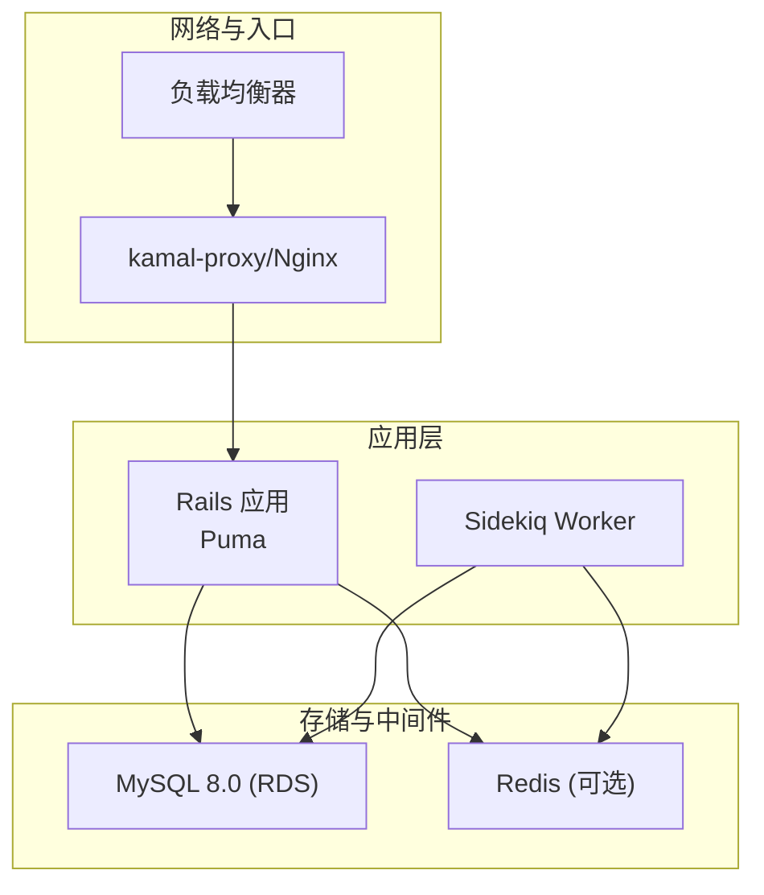
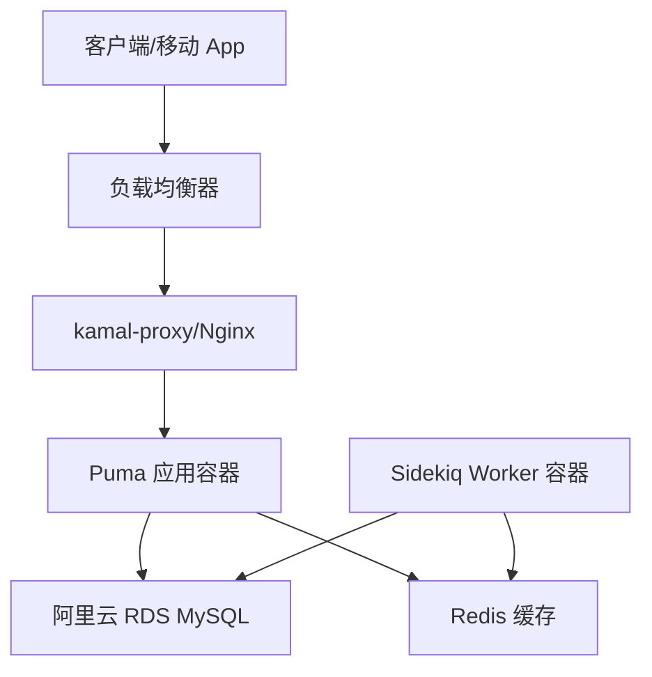
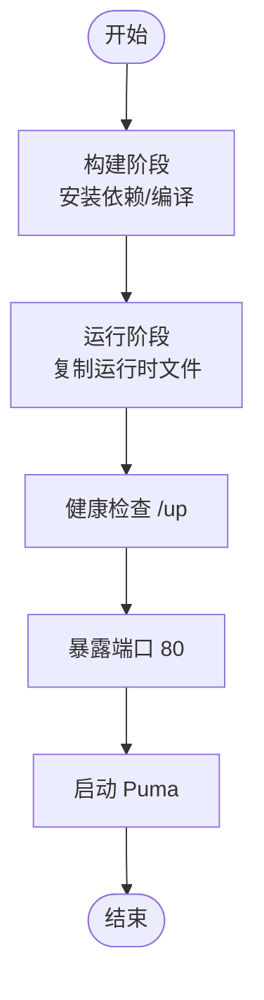
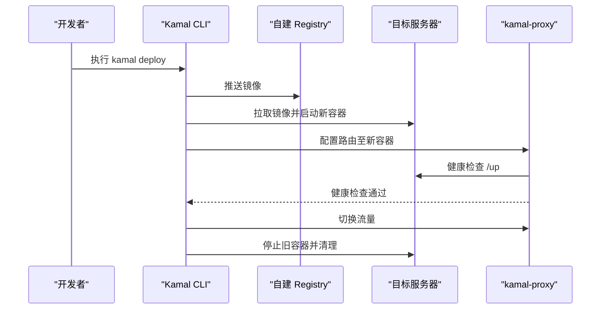
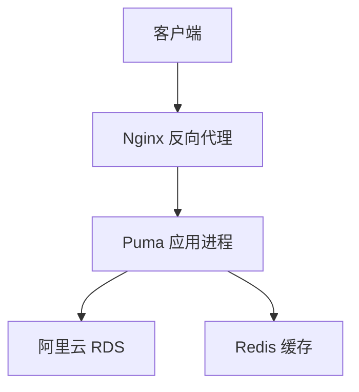
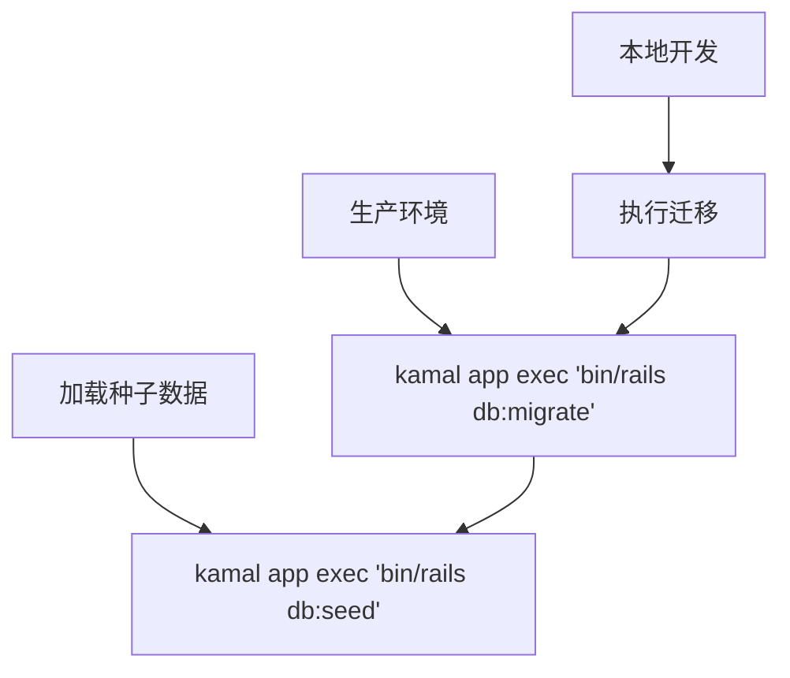
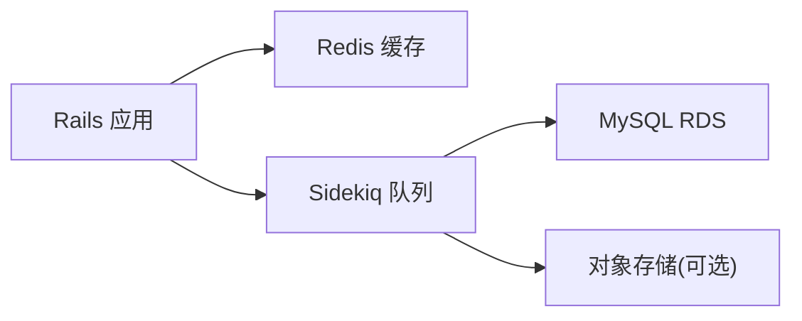
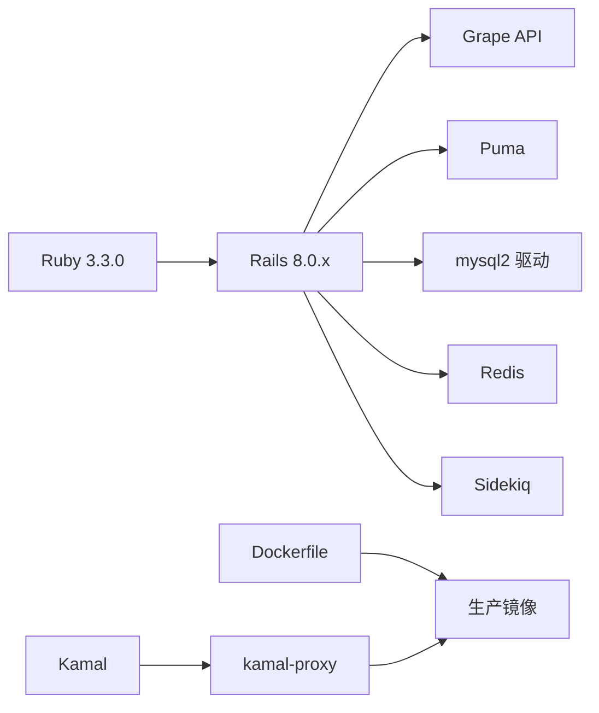

# 部署指南

<cite>
**本文引用的文件**
- [DEPLOYMENT.md](file://DEPLOYMENT.md)
- [KAMAL_DEPLOYMENT.md](file://KAMAL_DEPLOYMENT.md)
- [Dockerfile](file://Dockerfile)
- [docker-compose.yml](file://docker-compose.yml)
- [bin/safe_deploy.sh](file://bin/safe_deploy.sh)
- [config/deploy.yml](file://config/deploy.yml)
- [config/deploy.staging.yml](file://config/deploy.staging.yml)
- [config/puma.rb](file://config/puma.rb)
- [config/database.yml](file://config/database.yml)
- [config/sidekiq.yml](file://config/sidekiq.yml)
- [config/environments/production.rb](file://config/environments/production.rb)
- [Gemfile](file://Gemfile)
- [config.ru](file://config.ru)
- [Rakefile](file://Rakefile)
- [.kamal/hooks/](file://.kamal/hooks/)
</cite>

## 目录
1. [简介](#简介)
2. [项目结构](#项目结构)
3. [核心组件](#核心组件)
4. [架构总览](#架构总览)
5. [详细组件分析](#详细组件分析)
6. [依赖关系分析](#依赖关系分析)
7. [性能考虑](#性能考虑)
8. [故障排查指南](#故障排查指南)
9. [结论](#结论)
10. [附录](#附录)

## 简介
本指南面向语音图书平台的生产环境部署，覆盖多种部署方案与运维要点，包括：
- Docker 容器化部署
- Kamal 自动化部署（含国内网络优化）
- 传统服务器部署（基于 systemd + Nginx + Puma）
- 基础设施配置（数据库、缓存、负载均衡）
- 环境变量与密钥管理、SSL 证书、监控与告警
- 部署脚本与 CI/CD 流水线配置示例

## 项目结构
项目采用 Ruby on Rails 8 + Grape 提供 API，使用 Puma 作为应用服务器，数据库为 MySQL 8.0（生产使用阿里云 RDS），并通过 Sidekiq 处理后台任务。

图表来源
- [config/deploy.yml:10-17](file://config/deploy.yml#L10-L17)
- [config/puma.rb:32](file://config/puma.rb#L32)
- [config/database.yml:22-39](file://config/database.yml#L22-L39)
- [config/sidekiq.yml:1-8](file://config/sidekiq.yml#L1-L8)

章节来源
- [DEPLOYMENT.md:1-12](file://DEPLOYMENT.md#L1-L12)
- [config/deploy.yml:1-104](file://config/deploy.yml#L1-L104)

## 核心组件
- 应用服务器：Puma（生产默认监听 80 端口）
- 数据库：MySQL 8.0（生产使用阿里云 RDS）
- 缓存：Redis（生产环境替换默认内存缓存）
- 队列：Sidekiq（独立进程）
- 镜像与容器：Docker（多阶段构建，国内网络优化）
- 自动化部署：Kamal（零停机部署，kamal-proxy 路由）

章节来源
- [config/puma.rb:28-46](file://config/puma.rb#L28-L46)
- [config/database.yml:22-39](file://config/database.yml#L22-L39)
- [config/environments/production.rb:47-51](file://config/environments/production.rb#L47-L51)
- [config/sidekiq.yml:1-8](file://config/sidekiq.yml#L1-L8)
- [Dockerfile:1-63](file://Dockerfile#L1-L63)
- [KAMAL_DEPLOYMENT.md:31-87](file://KAMAL_DEPLOYMENT.md#L31-L87)

## 架构总览
下图展示生产部署的关键组件与交互路径，涵盖容器、代理、数据库与缓存。

图表来源
- [config/deploy.yml:10-17](file://config/deploy.yml#L10-L17)
- [config/deploy.yml:78-88](file://config/deploy.yml#L78-L88)
- [config/puma.rb:32](file://config/puma.rb#L32)
- [config/database.yml:22-39](file://config/database.yml#L22-L39)
- [config/sidekiq.yml:1-8](file://config/sidekiq.yml#L1-L8)

## 详细组件分析

### Docker 容器化部署
- 多阶段构建：分离编译与运行阶段，最终镜像仅包含运行时所需文件，减小体积并提升安全性。
- 国内网络优化：替换 Debian 源为阿里云镜像、RubyGems 使用阿里云镜像、基础镜像来自自建 Registry。
- 健康检查：容器内置健康检查，通过 /up 接口进行存活探针。
- 端口暴露：容器对外暴露 80 端口，与 Puma 监听端口一致。

图表来源
- [Dockerfile:17-53](file://Dockerfile#L17-L53)
- [Dockerfile:55-63](file://Dockerfile#L55-L63)

章节来源
- [Dockerfile:1-63](file://Dockerfile#L1-L63)
- [KAMAL_DEPLOYMENT.md:110-178](file://KAMAL_DEPLOYMENT.md#L110-L178)

### Kamal 自动化部署（零停机）
- 零停机机制：kamal-proxy 在新容器健康检查通过后才切换流量，旧容器优雅关闭。
- 多环境支持：通过不同部署配置文件支持 staging/production。
- 环境变量隔离：敏感配置通过 .kamal/secrets 注入，不进入代码仓库。
- 自动清理：部署完成后清理旧容器与镜像，避免磁盘占用。
- 回滚能力：按版本回滚，便于快速恢复。

图表来源
- [KAMAL_DEPLOYMENT.md:197-213](file://KAMAL_DEPLOYMENT.md#L197-L213)
- [config/deploy.yml:78-88](file://config/deploy.yml#L78-L88)

章节来源
- [KAMAL_DEPLOYMENT.md:1-541](file://KAMAL_DEPLOYMENT.md#L1-L541)
- [config/deploy.yml:1-104](file://config/deploy.yml#L1-L104)
- [config/deploy.staging.yml:1-74](file://config/deploy.staging.yml#L1-L74)

### 传统服务器部署（systemd + Nginx + Puma）
- 应用服务器：Puma 直接运行于服务器，监听 80 端口。
- 反向代理：Nginx 作为入口，处理静态资源与 SSL 终止，转发到 Puma。
- 负载均衡：可通过 Nginx 或上游 SLB 实现多实例横向扩展。
- 数据库：连接阿里云 RDS，确保安全组放通。
- 缓存：可选 Redis，用于共享缓存与队列。

图表来源
- [config/puma.rb:32](file://config/puma.rb#L32)
- [config/database.yml:22-39](file://config/database.yml#L22-L39)
- [config/environments/production.rb:47-51](file://config/environments/production.rb#L47-L51)

章节来源
- [DEPLOYMENT.md:146-228](file://DEPLOYMENT.md#L146-L228)
- [config/puma.rb:1-46](file://config/puma.rb#L1-L46)

### 数据库部署与迁移
- 生产数据库：阿里云 RDS，字符集 utf8mb4，建议开启自动备份。
- 迁移与种子：本地开发执行迁移；生产通过 Kamal 在容器内执行迁移与种子加载。
- 连接池：根据线程数与并发配置数据库连接池大小。

图表来源
- [DEPLOYMENT.md:249-260](file://DEPLOYMENT.md#L249-L260)
- [config/database.yml:9-12](file://config/database.yml#L9-L12)

章节来源
- [DEPLOYMENT.md:232-270](file://DEPLOYMENT.md#L232-L270)
- [config/database.yml:1-39](file://config/database.yml#L1-L39)

### 缓存与队列
- 缓存：生产环境使用 Redis 替换默认内存缓存，提高多实例共享能力。
- 队列：Sidekiq 独立进程，配置并发与队列优先级，结合数据库与对象存储使用。

图表来源
- [config/environments/production.rb:47-51](file://config/environments/production.rb#L47-L51)
- [config/sidekiq.yml:1-8](file://config/sidekiq.yml#L1-L8)
- [config/database.yml:22-39](file://config/database.yml#L22-L39)

章节来源
- [config/environments/production.rb:1-75](file://config/environments/production.rb#L1-L75)
- [config/sidekiq.yml:1-8](file://config/sidekiq.yml#L1-L8)

### 环境变量与密钥管理
- 生产环境关键变量：数据库连接、Redis、阿里云 OSS/短信/支付相关密钥、SSL/时区等。
- 密钥注入：通过 Kamal secrets 文件注入，避免硬编码与版本控制泄露。
- 本地开发：使用 .env 示例文件，开发环境数据库与 OSS 配置可本地化。

章节来源
- [config/deploy.yml:27-70](file://config/deploy.yml#L27-L70)
- [config/deploy.staging.yml:25-46](file://config/deploy.staging.yml#L25-L46)
- [DEPLOYMENT.md:46-56](file://DEPLOYMENT.md#L46-L56)

### SSL 证书与反向代理
- kamal-proxy：支持自动通过 Let's Encrypt 申请证书，需域名解析到服务器 IP。
- 传统部署：Nginx 侧 SSL 终止，将 HTTPS 流量转发至 Puma（80 端口）。
- 强制 HTTPS：生产环境强制 SSL，跳过健康检查路径静默。

章节来源
- [KAMAL_DEPLOYMENT.md:534](file://KAMAL_DEPLOYMENT.md#L534)
- [config/deploy.yml:78-88](file://config/deploy.yml#L78-L88)
- [config/environments/production.rb:21-28](file://config/environments/production.rb#L21-L28)

### 监控与日志
- 健康检查：/up 接口用于探活与负载均衡健康检查。
- 日志：生产环境按文件轮转，记录请求 ID 便于追踪。
- 运维命令：Kamal 提供日志查看、重启、回滚、版本查看等运维能力。

章节来源
- [DEPLOYMENT.md:369-387](file://DEPLOYMENT.md#L369-L387)
- [config/environments/production.rb:30-45](file://config/environments/production.rb#L30-L45)

### 部署脚本与 CI/CD
- 安全部署脚本：封装部署前检查、健康状态校验、部署后验证与自动回滚逻辑。
- CI/CD 建议：在流水线中集成 Docker 构建、推送镜像、Kamal 部署、健康检查与回滚策略。

章节来源
- [bin/safe_deploy.sh:1-82](file://bin/safe_deploy.sh#L1-L82)
- [KAMAL_DEPLOYMENT.md:197-213](file://KAMAL_DEPLOYMENT.md#L197-L213)

## 依赖关系分析
- Ruby 与 Rails：Ruby 3.3.0 + Rails 8.0.x，Grape 提供 API。
- 数据库驱动：mysql2，生产连接 RDS。
- Web 服务器：Puma，生产默认监听 80。
- 缓存与队列：redis、sidekiq。
- 镜像构建：Docker 多阶段构建，国内网络优化。
- 自动化部署：kamal + kamal-proxy。

图表来源
- [Gemfile:1-24](file://Gemfile#L1-L24)
- [Dockerfile:1-63](file://Dockerfile#L1-L63)
- [config/puma.rb:32](file://config/puma.rb#L32)
- [config/database.yml:5-12](file://config/database.yml#L5-L12)
- [config/environments/production.rb:47-51](file://config/environments/production.rb#L47-L51)
- [config/sidekiq.yml:1-8](file://config/sidekiq.yml#L1-L8)

章节来源
- [Gemfile:1-45](file://Gemfile#L1-L45)
- [config.ru:1-7](file://config.ru#L1-L7)
- [Rakefile:1-7](file://Rakefile#L1-L7)

## 性能考虑
- Puma 并发：生产环境启用 worker 数量与线程数需结合 CPU 与内存配置，避免过度竞争 GVL。
- 连接池：数据库连接池大小与线程数匹配，避免连接争用。
- 缓存：Redis 共享缓存减少数据库压力，合理设置过期时间。
- 镜像优化：jemalloc、Bootsnap 预编译、多阶段构建降低内存与启动时间。
- 网络优化：国内网络场景下，使用阿里云镜像源与自建 Registry 提升构建与拉取效率。

章节来源
- [config/puma.rb:8-46](file://config/puma.rb#L8-L46)
- [config/database.yml:9-12](file://config/database.yml#L9-L12)
- [KAMAL_DEPLOYMENT.md:336-341](file://KAMAL_DEPLOYMENT.md#L336-L341)

## 故障排查指南
- Docker 构建失败：确保安装 default-libmysqlclient-dev 等依赖。
- 数据库连接失败：检查 RDS 安全组与白名单。
- Puma 启动失败：核对 Puma 端口与 master.key。
- kamal-proxy 健康检查失败：确保 Puma 监听 80 端口且 /up 可访问。
- db:prepare 未执行：修改 docker-entrypoint，增加对 puma 启动命令的检测。
- 时区不正确：在部署配置中设置 TZ=Asia/Shanghai。

章节来源
- [DEPLOYMENT.md:391-406](file://DEPLOYMENT.md#L391-L406)
- [KAMAL_DEPLOYMENT.md:251-270](file://KAMAL_DEPLOYMENT.md#L251-L270)
- [KAMAL_DEPLOYMENT.md:342-364](file://KAMAL_DEPLOYMENT.md#L342-L364)
- [KAMAL_DEPLOYMENT.md:429-442](file://KAMAL_DEPLOYMENT.md#L429-L442)

## 结论
本部署指南提供了从容器化到自动化部署的完整方案，结合国内网络优化与零停机发布策略，确保语音图书平台在生产环境的稳定性与可维护性。建议在正式上线前完成本地 Docker 验证、数据库迁移与缓存/队列配置，并建立完善的监控与回滚机制。

## 附录
- 部署命令与流程参考
  - Docker 构建与运行：[Dockerfile:1-63](file://Dockerfile#L1-L63)、[docker-compose.yml:1-53](file://docker-compose.yml#L1-L53)
  - Kamal 部署：[config/deploy.yml:1-104](file://config/deploy.yml#L1-L104)、[config/deploy.staging.yml:1-74](file://config/deploy.staging.yml#L1-L74)
  - 安全部署脚本：[bin/safe_deploy.sh:1-82](file://bin/safe_deploy.sh#L1-L82)
- 基础设施与运维
  - Puma 配置：[config/puma.rb:1-46](file://config/puma.rb#L1-L46)
  - 数据库配置：[config/database.yml:1-39](file://config/database.yml#L1-L39)
  - 生产环境配置：[config/environments/production.rb:1-75](file://config/environments/production.rb#L1-L75)
  - Sidekiq 配置：[config/sidekiq.yml:1-8](file://config/sidekiq.yml#L1-L8)
  - Ruby 与依赖：[Gemfile:1-45](file://Gemfile#L1-L45)
  - 应用启动入口：[config.ru:1-7](file://config.ru#L1-L7)
  - 任务入口：[Rakefile:1-7](file://Rakefile#L1-L7)