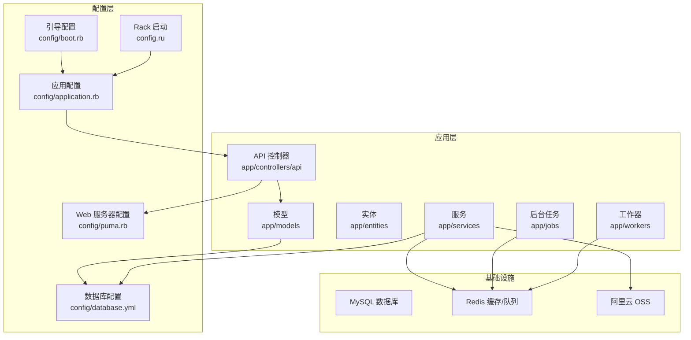
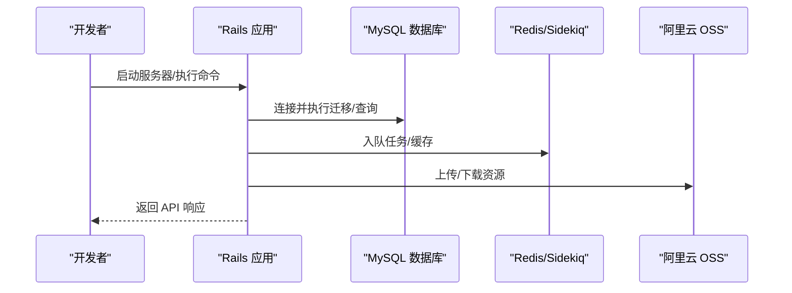
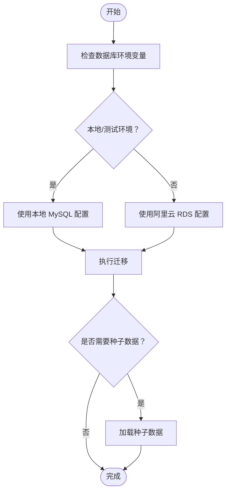
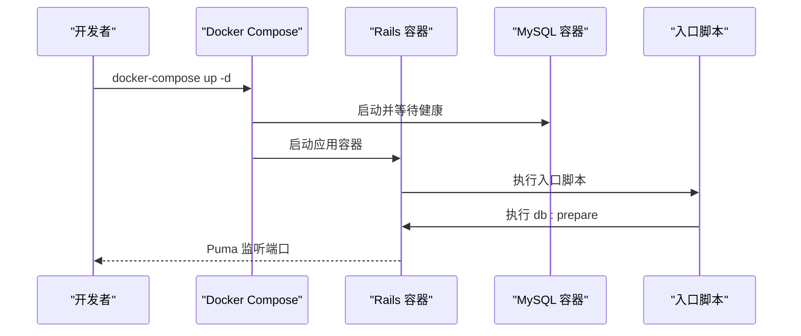
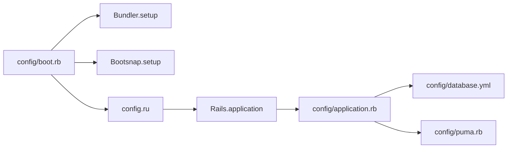

# 开发环境搭建

<cite>
**本文引用的文件**
- [Gemfile](file://Gemfile)
- [README.md](file://README.md)
- [DEPLOYMENT.md](file://DEPLOYMENT.md)
- [KAMAL_DEPLOYMENT.md](file://KAMAL_DEPLOYMENT.md)
- [Dockerfile](file://Dockerfile)
- [docker-compose.yml](file://docker-compose.yml)
- [.ruby-version](file://.ruby-version)
- [config/database.yml](file://config/database.yml)
- [config/puma.rb](file://config/puma.rb)
- [config/application.rb](file://config/application.rb)
- [config/boot.rb](file://config/boot.rb)
- [config.ru](file://config.ru)
- [.rubocop.yml](file://.rubocop.yml)
</cite>

## 目录
1. [简介](#简介)
2. [项目结构](#项目结构)
3. [核心组件](#核心组件)
4. [架构总览](#架构总览)
5. [详细组件分析](#详细组件分析)
6. [依赖关系分析](#依赖关系分析)
7. [性能考虑](#性能考虑)
8. [故障排除指南](#故障排除指南)
9. [结论](#结论)
10. [附录](#附录)

## 简介
本指南面向语音图书平台（VoiceBook）的本地开发与部署，覆盖以下主题：
- Ruby 环境安装与版本管理
- 数据库设置（本地 MySQL 与阿里云 RDS）
- 依赖包安装与环境变量配置
- 数据库初始化与种子数据加载
- 两种部署方式：Docker 容器化与传统本地部署
- 常见开发工具配置（IDE、调试、代码格式化）
- 开发环境验证方法与故障排除

## 项目结构
项目采用 Rails 8 + Grape API + Sidekiq 的架构，核心目录与职责概览：
- app/controllers/api：Grape API 控制器层
- app/models / app/entities / app/services / app/jobs：领域模型、实体、服务与后台任务
- config：Rails 应用配置（数据库、Puma、CORS、Sidekiq 等）
- db：迁移脚本、schema、种子数据
- lib：自定义中间件与工具
- docker-compose.yml：本地 Docker 开发环境编排
- Dockerfile：生产镜像构建（也可用于本地容器化开发）

图表来源
- [config/database.yml:1-39](file://config/database.yml#L1-L39)
- [config/puma.rb:1-46](file://config/puma.rb#L1-L46)
- [config/application.rb:1-81](file://config/application.rb#L1-L81)
- [config/boot.rb:1-5](file://config/boot.rb#L1-L5)
- [config.ru:1-7](file://config.ru#L1-L7)

章节来源
- [README.md:106-118](file://README.md#L106-L118)
- [DEPLOYMENT.md:15-56](file://DEPLOYMENT.md#L15-L56)

## 核心组件
- Ruby 与 Rails：Ruby 3.3.0，Rails 8.0.x，Grape API，Sidekiq 队列
- 数据库：MySQL 8.0（开发使用本地或 Docker，生产使用阿里云 RDS）
- 缓存与队列：Redis + Sidekiq
- 存储：阿里云 OSS
- 渲染：poppler-utils（pdftocairo）用于 PDF→EPUB 处理
- 测试：RSpec + FactoryBot + Webmock

章节来源
- [README.md:9-21](file://README.md#L9-L21)
- [Gemfile:1-45](file://Gemfile#L1-L45)
- [KAMAL_DEPLOYMENT.md:300-341](file://KAMAL_DEPLOYMENT.md#L300-L341)

## 架构总览
本地开发与部署的关键交互如下：

图表来源
- [config/database.yml:1-39](file://config/database.yml#L1-L39)
- [config/application.rb:35-37](file://config/application.rb#L35-L37)
- [config/puma.rb:32-38](file://config/puma.rb#L32-L38)

## 详细组件分析

### Ruby 环境与依赖安装
- Ruby 版本：3.3.0（通过 rvm 或 rbenv 安装）
- 安装依赖：bundle install
- 镜像加速：使用阿里云 RubyGems 镜像源
- 开发与测试依赖：rspec、rubocop、factory_bot、simplecov 等

章节来源
- [.ruby-version:1-2](file://.ruby-version#L1-L2)
- [Gemfile:1-45](file://Gemfile#L1-L45)
- [DEPLOYMENT.md:17-33](file://DEPLOYMENT.md#L17-L33)

### 数据库设置
- 开发与测试：使用本地 MySQL（socket 或 TCP），默认数据库名见配置
- 生产：使用阿里云 RDS，通过环境变量注入连接信息
- 迁移与种子：db:create → db:migrate → db:seed

图表来源
- [config/database.yml:14-38](file://config/database.yml#L14-L38)
- [README.md:106-118](file://README.md#L106-L118)

章节来源
- [config/database.yml:1-39](file://config/database.yml#L1-L39)
- [README.md:106-118](file://README.md#L106-L118)

### 环境变量配置
- 开发/测试：可通过 .env 或直接导出环境变量
- 生产：通过 Kamal secrets 或 Docker 环境变量注入
- 关键变量：
  - DATABASE_PRD_*：RDS 连接信息
  - REDIS_URL / REDIS_PASSWORD：Redis 连接
  - SECRET_KEY_BASE：Rails 加密密钥
  - RAILS_MASTER_KEY：Rails credentials 解密密钥（如使用）
  - OSS 相关：ALIYUN_ACCESS_KEY_ID、ALIYUN_ACCESS_KEY_SECRET、OSS_BUCKET_NAME、OSS_ENDPOINT

章节来源
- [README.md:97-105](file://README.md#L97-L105)
- [DEPLOYMENT.md:198-209](file://DEPLOYMENT.md#L198-L209)
- [KAMAL_DEPLOYMENT.md:89-103](file://KAMAL_DEPLOYMENT.md#L89-L103)

### 数据库初始化
- 创建数据库、执行迁移、加载种子
- Docker Compose：本地 MySQL 服务随应用容器启动
- 生产：通过 Kamal 在目标服务器执行 db:migrate/db:seed

章节来源
- [README.md:106-118](file://README.md#L106-L118)
- [docker-compose.yml:5-53](file://docker-compose.yml#L5-L53)
- [DEPLOYMENT.md:249-260](file://DEPLOYMENT.md#L249-L260)

### Web 服务器与进程模型
- Puma：默认端口 80（生产），开发可用 3000
- 线程与进程：通过 RAILS_MAX_THREADS、WEB_CONCURRENCY 控制
- 预加载：生产环境可启用 preload_app!

章节来源
- [config/puma.rb:28-46](file://config/puma.rb#L28-L46)
- [KAMAL_DEPLOYMENT.md:180-186](file://KAMAL_DEPLOYMENT.md#L180-L186)

### 队列与缓存
- 队列：Sidekiq（Active Job queue_adapter）
- 缓存：Redis（应用内可共享 Redis URL）
- 开发/测试：默认使用本地 Redis

章节来源
- [config/application.rb:35-56](file://config/application.rb#L35-L56)
- [config/database.yml:22-29](file://config/database.yml#L22-L29)

### 存储与对象存储
- 阿里云 OSS：上传/下载资源，bucket 默认私有，需签名 URL 访问
- SDK：aliyun-sdk gem（版本 0.8）

章节来源
- [README.md:183-187](file://README.md#L183-L187)
- [Gemfile:5](file://Gemfile#L5)

### 容器化部署（Docker）
- 生产镜像：多阶段构建，使用阿里云镜像源加速
- 开发容器：Docker Compose 启动 Rails + MySQL；Redis 通过环境变量指向外部服务
- 健康检查：容器入口脚本会在启动时执行 db:prepare

图表来源
- [Dockerfile:55-62](file://Dockerfile#L55-L62)
- [docker-compose.yml:24-53](file://docker-compose.yml#L24-L53)

章节来源
- [Dockerfile:1-63](file://Dockerfile#L1-L63)
- [docker-compose.yml:1-53](file://docker-compose.yml#L1-L53)
- [DEPLOYMENT.md:99-114](file://DEPLOYMENT.md#L99-L114)

### 传统本地部署（非容器）
- 安装 Ruby 3.3.0、MySQL、poppler-utils
- bundle install、db:create/migrate/seed
- 启动 rails server，默认端口 3000
- 可选：Sidekiq 启动队列处理

章节来源
- [DEPLOYMENT.md:17-64](file://DEPLOYMENT.md#L17-L64)
- [README.md:106-118](file://README.md#L106-L118)

### 开发工具配置
- 代码风格：RuboCop（Rails/RSpec 插件），自定义规则
- IDE：建议启用 Ruby LSP（.ruby-lsp 目录已提供 Gemfile）
- 调试：Rails 控制台、Puma 调试、Sidekiq Web UI（按需启用）
- 代码格式化：配合编辑器扩展与 RuboCop

章节来源
- [.rubocop.yml:1-179](file://.rubocop.yml#L1-L179)
- [README.md:120-127](file://README.md#L120-L127)

## 依赖关系分析
应用启动与配置加载链路如下：

图表来源
- [config/boot.rb:1-5](file://config/boot.rb#L1-L5)
- [config.ru:1-7](file://config.ru#L1-L7)
- [config/application.rb:1-81](file://config/application.rb#L1-L81)
- [config/database.yml:1-39](file://config/database.yml#L1-L39)
- [config/puma.rb:1-46](file://config/puma.rb#L1-L46)

章节来源
- [config/application.rb:1-81](file://config/application.rb#L1-L81)
- [config/boot.rb:1-5](file://config/boot.rb#L1-L5)
- [config.ru:1-7](file://config.ru#L1-L7)

## 性能考虑
- 线程与并发：根据 IO 密集程度调整 RAILS_MAX_THREADS 与 WEB_CONCURRENCY
- 内存优化：jemalloc（Dockerfile 已配置），减少内存碎片
- 启动加速：Bootsnap 预编译，减少冷启动时间
- 队列吞吐：Sidekiq worker 数量与 Redis 连接池需与线程数匹配

章节来源
- [KAMAL_DEPLOYMENT.md:336-341](file://KAMAL_DEPLOYMENT.md#L336-L341)
- [config/puma.rb:28-39](file://config/puma.rb#L28-L39)

## 故障排除指南
- Docker 构建失败（gem 安装错误）
  - 确认已安装 build-essential、default-libmysqlclient-dev、pkg-config 等依赖
- 连接数据库失败
  - 检查 RDS 安全组白名单与内网可达性
  - 本地 MySQL 绑定地址需允许容器访问（参考本地 Docker 测试章节）
- Puma 启动失败
  - 确认 Puma 端口与 EXPOSE 一致（生产默认 80）
  - 确认 RAILS_MASTER_KEY/SECRET_KEY_BASE 注入
- 健康检查失败
  - 确保 /up 接口可访问，容器内 Puma 已启动
- db:prepare 未执行
  - 确认入口脚本对 puma 启动命令的检测逻辑生效
- 端口冲突或权限问题
  - 修改 Puma 端口或以 root 权限运行（不推荐）
- 时区与日志时间戳
  - 在部署配置中设置 TZ=Asia/Shanghai

章节来源
- [DEPLOYMENT.md:391-406](file://DEPLOYMENT.md#L391-L406)
- [KAMAL_DEPLOYMENT.md:239-298](file://KAMAL_DEPLOYMENT.md#L239-L298)
- [KAMAL_DEPLOYMENT.md:429-442](file://KAMAL_DEPLOYMENT.md#L429-L442)

## 结论
本指南提供了从 Ruby 环境、数据库、依赖安装到容器化与传统部署的完整开发环境搭建路径。建议优先使用 Docker Compose 快速启动本地开发环境，生产部署采用 Kamal + Docker + kamal-proxy 的零停机方案。结合 RuboCop 与 IDE 配置，可显著提升开发效率与代码质量。

## 附录

### 开发环境验证清单
- Ruby 3.3.0 正常加载
- bundle install 成功
- MySQL 可连接（本地或 RDS）
- db:create → db:migrate → db:seed 成功
- Rails server 启动并返回 Hello World 页面
- API 健康检查 /api/up 可访问
- Docker Compose 启动 web/db 容器并健康

章节来源
- [README.md:106-118](file://README.md#L106-L118)
- [DEPLOYMENT.md:58-78](file://DEPLOYMENT.md#L58-L78)
- [docker-compose.yml:24-53](file://docker-compose.yml#L24-L53)