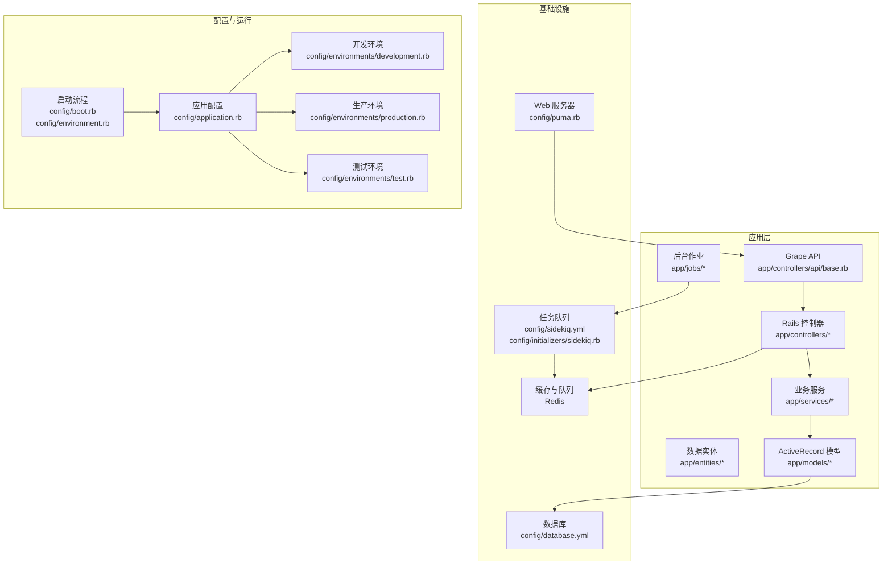
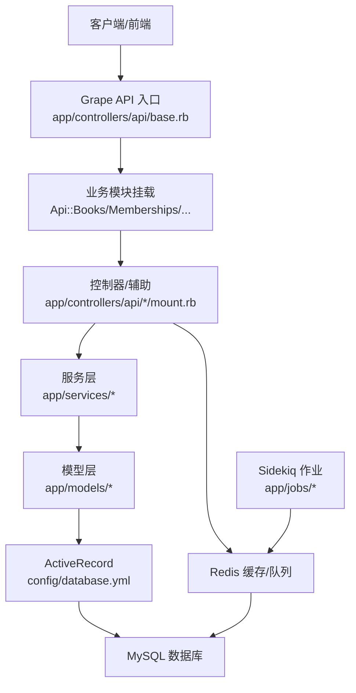
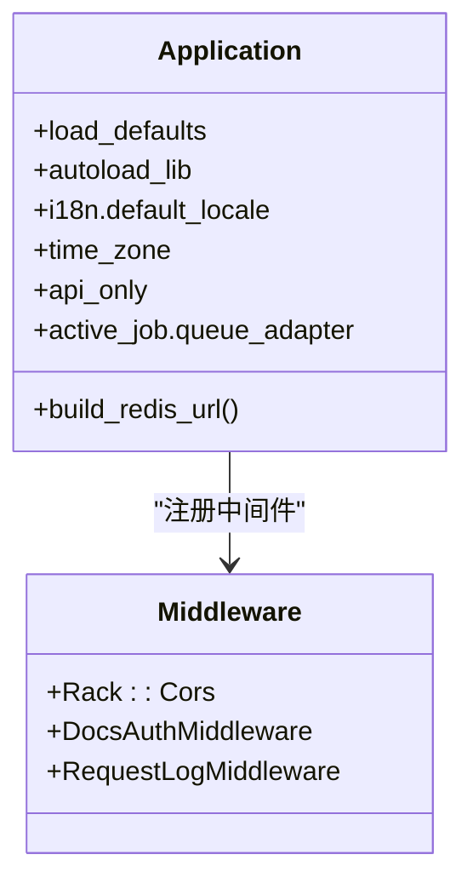
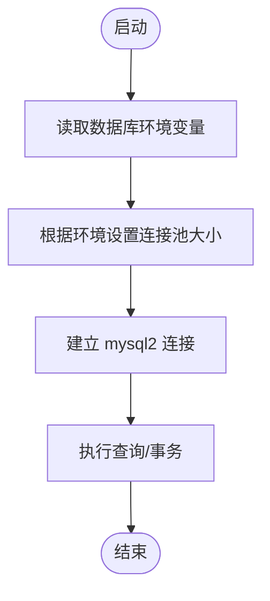
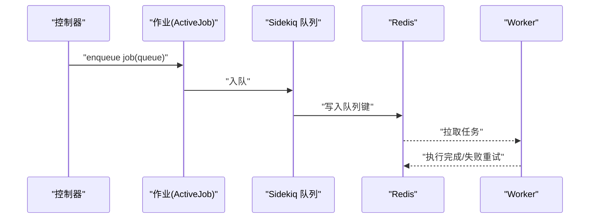
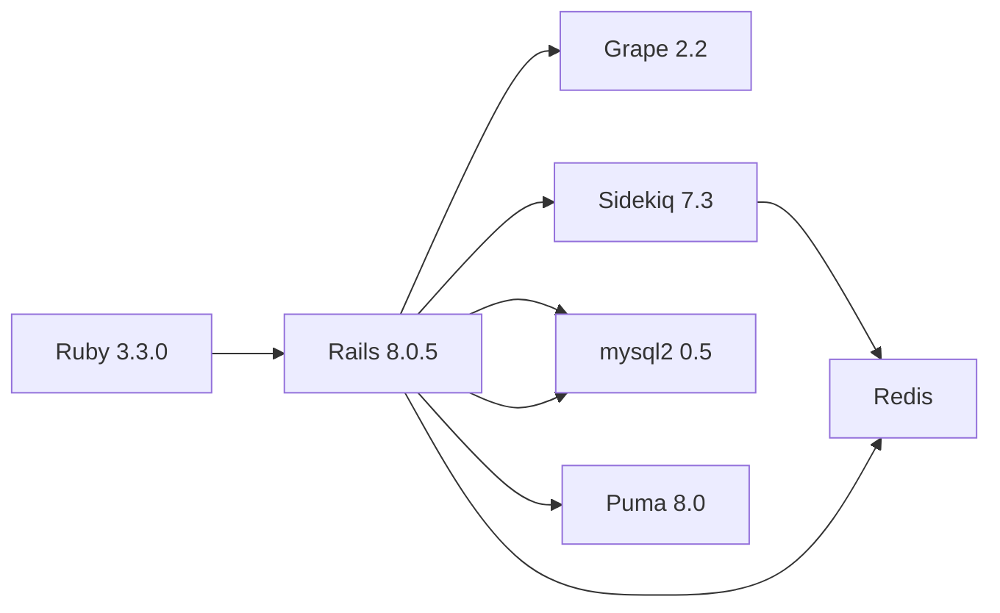

# 技术栈介绍

<cite>
**本文档引用的文件**
- [Gemfile](file://Gemfile)
- [Gemfile.lock](file://Gemfile.lock)
- [.ruby-version](file://.ruby-version)
- [config/application.rb](file://config/application.rb)
- [config/database.yml](file://config/database.yml)
- [config/sidekiq.yml](file://config/sidekiq.yml)
- [config/boot.rb](file://config/boot.rb)
- [config/environment.rb](file://config/environment.rb)
- [config/environments/development.rb](file://config/environments/development.rb)
- [config/environments/production.rb](file://config/environments/production.rb)
- [config/environments/test.rb](file://config/environments/test.rb)
- [config/puma.rb](file://config/puma.rb)
- [config/initializers/sidekiq.rb](file://config/initializers/sidekiq.rb)
- [config/initializers/cors.rb](file://config/initializers/cors.rb)
- [config/initializers/entities.rb](file://config/initializers/entities.rb)
- [app/controllers/api/base.rb](file://app/controllers/api/base.rb)
- [app/models/application_record.rb](file://app/models/application_record.rb)
- [app/jobs/application_job.rb](file://app/jobs/application_job.rb)
</cite>

## 目录
1. [简介](#简介)
2. [项目结构](#项目结构)
3. [核心组件](#核心组件)
4. [架构总览](#架构总览)
5. [详细组件分析](#详细组件分析)
6. [依赖关系分析](#依赖关系分析)
7. [性能考虑](#性能考虑)
8. [故障排查指南](#故障排查指南)
9. [结论](#结论)
10. [附录](#附录)

## 简介
本技术栈文档面向语音图书平台（VoiceBook）项目，系统梳理并解释项目采用的核心技术组件与架构选择，包括 Ruby 3.x 版本特性、Rails 8 框架、MySQL 数据库、Sidekiq 异步任务处理、Redis 缓存、Puma Web 服务器、以及 API 框架 Grape 等。文档还涵盖开发工具链（RSpec、RuboCop）、测试框架、部署与运维相关配置，并提供版本要求与兼容性信息，帮助开发者快速理解并高效开展开发工作。

## 项目结构
项目采用标准 Rails 8 应用结构，API 层基于 Grape 框架实现，业务逻辑分布在控制器、实体、服务、作业与模型中；后台任务通过 Sidekiq 处理；缓存与队列统一由 Redis 提供；数据库连接池与线程模型由 Puma 控制；环境配置与初始化器分别位于 config 目录下。

**图表来源**
- [config/application.rb:16-80](file://config/application.rb#L16-L80)
- [config/puma.rb:1-46](file://config/puma.rb#L1-L46)
- [config/sidekiq.yml:1-8](file://config/sidekiq.yml#L1-L8)
- [config/initializers/sidekiq.rb:1-22](file://config/initializers/sidekiq.rb#L1-L22)
- [config/database.yml:1-39](file://config/database.yml#L1-L39)
- [app/controllers/api/base.rb:1-65](file://app/controllers/api/base.rb#L1-L65)

**章节来源**
- [config/application.rb:1-81](file://config/application.rb#L1-L81)
- [config/puma.rb:1-46](file://config/puma.rb#L1-L46)
- [config/sidekiq.yml:1-8](file://config/sidekiq.yml#L1-L8)
- [config/initializers/sidekiq.rb:1-22](file://config/initializers/sidekiq.rb#L1-L22)
- [config/database.yml:1-39](file://config/database.yml#L1-L39)
- [app/controllers/api/base.rb:1-65](file://app/controllers/api/base.rb#L1-L65)

## 核心组件
- Ruby 3.3.0：项目明确指定 Ruby 版本为 3.3.0，充分利用 Ruby 3 的性能与语法特性，如模式匹配、beginless ranges、并行数组解构等，提升开发效率与运行性能。
- Rails 8.0.5：采用 Rails 8 作为 MVC 框架，启用 API-only 模式，结合 Grape 实现 RESTful API，减少视图层开销，聚焦于高性能后端服务。
- MySQL 8：数据库适配器为 mysql2，生产环境支持阿里云 RDS，连接池大小可配置，满足高并发读写需求。
- Sidekiq 7.3：后台任务队列采用 Sidekiq，支持多队列与超时控制，配合 Redis 提供可靠的任务调度与持久化日志。
- Redis：统一作为缓存与队列后端，生产环境使用 Redis 缓存存储，开发/测试环境使用本地 Redis 或内存存储。
- Puma：多线程/多进程 Web 服务器，支持生产环境 worker 预加载与线程池配置，平衡吞吐与延迟。
- Grape：轻量级 API 框架，提供 Swagger 文档自动生成与模块化挂载，便于维护大型 API 网关。
- 测试与质量：RSpec 用于单元与集成测试，RuboCop 用于代码风格与规范检查，FactoryBot、Faker、Shoulda Matchers 提升测试效率与覆盖率。

**章节来源**
- [.ruby-version:1-2](file://.ruby-version#L1-L2)
- [Gemfile:1-45](file://Gemfile#L1-L45)
- [Gemfile.lock:655-660](file://Gemfile.lock#L655-L660)
- [config/application.rb:16-80](file://config/application.rb#L16-L80)
- [config/database.yml:1-39](file://config/database.yml#L1-L39)
- [config/sidekiq.yml:1-8](file://config/sidekiq.yml#L1-L8)
- [config/puma.rb:1-46](file://config/puma.rb#L1-L46)
- [app/controllers/api/base.rb:1-65](file://app/controllers/api/base.rb#L1-L65)

## 架构总览
语音图书平台采用“API 网关 + 微服务化业务模块”的架构设计。Grape 作为统一入口，挂载多个业务模块（用户、图书、阅读、榜单等），控制器负责参数校验与响应封装，服务层封装复杂业务逻辑，模型层负责数据持久化，后台作业通过 Sidekiq 异步执行耗时任务，Redis 同时承担缓存与队列职责，MySQL 存储结构化数据，Puma 提供高性能 HTTP 服务。

**图表来源**
- [app/controllers/api/base.rb:24-38](file://app/controllers/api/base.rb#L24-L38)
- [config/database.yml:1-39](file://config/database.yml#L1-L39)
- [config/initializers/sidekiq.rb:7-21](file://config/initializers/sidekiq.rb#L7-L21)

**章节来源**
- [app/controllers/api/base.rb:1-65](file://app/controllers/api/base.rb#L1-L65)
- [config/database.yml:1-39](file://config/database.yml#L1-L39)
- [config/initializers/sidekiq.rb:1-22](file://config/initializers/sidekiq.rb#L1-L22)

## 详细组件分析

### Ruby 3.x 版本特性与选型
- 版本与镜像：Ruby 3.3.0，使用阿里云镜像源加速安装。
- 性能与特性：利用 Ruby 3 的并行数组解构、beginless ranges、模式匹配等特性，简化复杂逻辑；结合 Bootsnap 与 Zeitwerk 自动加载优化启动速度。
- 兼容性：与 Rails 8、Sidekiq 7.3、Grape 2.2 等生态组件保持良好兼容。

**章节来源**
- [.ruby-version:1-2](file://.ruby-version#L1-L2)
- [Gemfile:1-45](file://Gemfile#L1-L45)
- [Gemfile.lock:655-660](file://Gemfile.lock#L655-L660)
- [config/boot.rb:1-5](file://config/boot.rb#L1-L5)

### Rails 8 框架与 API-only 模式
- API-only：禁用传统视图与会话，仅保留控制器与模型，降低开销，提升 API 性能。
- 主要 Railtie：仅引入 active_model、active_job、active_record、action_controller、action_view、rails/test_unit。
- 国际化与时区：默认中文与北京时间，便于国内业务场景。
- 中间件：CORS 支持、文档访问鉴权中间件、请求日志中间件。

**图表来源**
- [config/application.rb:16-80](file://config/application.rb#L16-L80)

**章节来源**
- [config/application.rb:1-81](file://config/application.rb#L1-L81)
- [config/environments/development.rb:1-59](file://config/environments/development.rb#L1-L59)
- [config/environments/production.rb:1-75](file://config/environments/production.rb#L1-L75)
- [config/environments/test.rb:1-47](file://config/environments/test.rb#L1-L47)

### 数据库与连接池（MySQL 8 + mysql2）
- 适配器：mysql2 (~> 0.5)，UTF8MB4 字符集与排序规则，确保中文与表情符号正确存储。
- 连接池：开发/测试使用默认池大小，生产环境可通过环境变量 DATABASE_POOL_SIZE 调整至 100。
- RDS 支持：生产环境通过环境变量配置数据库主机、端口、用户名与密码，适配阿里云 RDS。

**图表来源**
- [config/database.yml:1-39](file://config/database.yml#L1-L39)

**章节来源**
- [config/database.yml:1-39](file://config/database.yml#L1-L39)

### Sidekiq 异步任务与队列
- 队列配置：default、import、export、mailers、payment 等队列，超时 25 秒。
- 并发：默认并发 2，可根据 CPU 与任务类型调整。
- Redis 配置：统一通过 Application.build_redis_url 构建 URL，支持密码与端口解析。
- 日志：服务端将日志轮转写入 log/sidekiq.log，并输出到 stdout。

**图表来源**
- [config/sidekiq.yml:1-8](file://config/sidekiq.yml#L1-L8)
- [config/initializers/sidekiq.rb:7-21](file://config/initializers/sidekiq.rb#L7-L21)
- [config/application.rb:42-56](file://config/application.rb#L42-L56)

**章节来源**
- [config/sidekiq.yml:1-8](file://config/sidekiq.yml#L1-L8)
- [config/initializers/sidekiq.rb:1-22](file://config/initializers/sidekiq.rb#L1-L22)
- [config/application.rb:35-56](file://config/application.rb#L35-L56)

### Redis 缓存与共享
- 缓存存储：生产环境使用 Redis 缓存存储，替代内存缓存，支持多实例共享。
- 构建 URL：统一从环境变量 REDIS_URL/REDIS_PASSWORD 解析，开发/测试环境回退到本地 redis://localhost:6379/0。
- 作用范围：Sidekiq 与 Rails cache_store 共用同一 Redis 实例。

**章节来源**
- [config/application.rb:42-56](file://config/application.rb#L42-L56)
- [config/environments/production.rb:47-51](file://config/environments/production.rb#L47-L51)
- [config/initializers/sidekiq.rb:7-21](file://config/initializers/sidekiq.rb#L7-L21)

### Puma Web 服务器
- 线程：默认 3 线程，可通过 RAILS_MAX_THREADS 调整；需与数据库连接池大小匹配。
- 进程：生产环境启用 worker，WEB_CONCURRENCY 控制进程数；支持 preload_app! 提升内存利用率。
- 端口：默认 80，可通过 PORT 覆盖；支持 tmp_restart 插件热重启。

**章节来源**
- [config/puma.rb:1-46](file://config/puma.rb#L1-L46)

### API 框架（Grape + Swagger）
- 模块化挂载：通过 Api::Base.mount 将用户、图书、阅读、榜单等模块挂载到统一入口。
- 健康检查：提供 /up 与根路径 / 接口，便于负载均衡与容器健康检查。
- 文档生成：集成 grape-swagger，自动导出 OpenAPI 3.0 文档，标签覆盖首页、用户、图书、搜索、会员、OSS、家长管控、阅读、排行榜、年级、分类等。

**章节来源**
- [app/controllers/api/base.rb:1-65](file://app/controllers/api/base.rb#L1-L65)

### 开发工具链与测试
- 测试框架：RSpec（rails_helper/spec_helper），集成 Shoulda Matchers、FactoryBot、Faker、Timecop、WebMock。
- 代码质量：RuboCop（rubocop、rubocop-rails、rubocop-rspec、rubocop-gradual）。
- 覆盖率：SimpleCov。
- 注释与文档：Annotaterb。

**章节来源**
- [Gemfile:25-44](file://Gemfile#L25-L44)
- [Gemfile.lock:350-357](file://Gemfile.lock#L350-L357)

## 依赖关系分析
- Ruby 3.3.0 与 Rails 8.0.5：Rails 8.0.5 与 Ruby 3.3.0 兼容，Zeitwerk 自动加载与 Bootsnap 提升启动性能。
- Grape 2.2：与 Rails 8 兼容，提供路由、参数验证、Swagger 文档能力。
- Sidekiq 7.3：依赖 Redis 客户端，与 Rails ActiveJob 集成，queue_adapter 已配置为 sidekiq。
- mysql2 0.5：适配 MySQL 8，UTF8MB4 字符集，连接池与线程模型需与 Puma 协调。
- Puma 8.0：多线程/多进程，建议线程数与数据库连接池一致，避免资源争用。

**图表来源**
- [Gemfile.lock:294-307](file://Gemfile.lock#L294-L307)
- [Gemfile.lock:458-469](file://Gemfile.lock#L458-L469)
- [Gemfile.lock:395-400](file://Gemfile.lock#L395-L400)
- [Gemfile.lock:223-223](file://Gemfile.lock#L223-L223)
- [Gemfile.lock:280-281](file://Gemfile.lock#L280-L281)

**章节来源**
- [Gemfile.lock:1-660](file://Gemfile.lock#L1-L660)

## 性能考虑
- 启动与自动加载：Bootsnap 与 Zeitwerk 结合，减少启动时间；Entity 类显式 require，避免与模型命名冲突。
- 线程与连接池：Puma 线程数与数据库连接池大小需匹配，避免过度竞争；生产环境启用 worker 与 preload_app!。
- 缓存策略：生产环境使用 Redis 缓存，缩短热点数据访问路径；开发/测试使用内存或空缓存存储。
- 队列并发：Sidekiq 并发与队列数量应与 CPU 核心数匹配，避免阻塞；合理设置超时与重试策略。
- API 文档：Swagger 自动生成，减少手工维护成本，提升联调效率。

[本节为通用指导，不直接分析具体文件]

## 故障排查指南
- 健康检查：通过 /up 接口确认服务可用性；若返回非 200，检查 Puma、Sidekiq、Redis 与数据库状态。
- 日志定位：生产环境日志包含 request_id 标签；Sidekiq 日志写入 log/sidekiq.log；请求日志中间件输出到 log/puma.log。
- 缓存问题：确认 REDIS_URL/REDIS_PASSWORD 环境变量是否正确；开发/测试环境可回退到本地 Redis。
- 数据库连接：核对 DATABASE_POOL_SIZE、DATABASE_PRD_* 环境变量；检查 mysql2 适配器与字符集配置。
- 队列堆积：查看 Sidekiq UI/日志，确认队列名称与并发设置；检查 Worker 执行耗时与异常重试次数。

**章节来源**
- [app/controllers/api/base.rb:12-22](file://app/controllers/api/base.rb#L12-L22)
- [config/environments/production.rb:30-34](file://config/environments/production.rb#L30-L34)
- [config/initializers/sidekiq.rb:12-16](file://config/initializers/sidekiq.rb#L12-L16)
- [config/application.rb:42-56](file://config/application.rb#L42-L56)
- [config/database.yml:22-29](file://config/database.yml#L22-L29)

## 结论
语音图书平台采用“Ruby 3 + Rails 8 + Grape API + Sidekiq + Redis + MySQL”技术栈，围绕 API-only 模式构建高性能后端服务。通过模块化 API 设计、统一的缓存与队列后端、完善的测试与质量工具链，项目具备良好的扩展性与可维护性。建议在生产环境中合理配置线程/进程与连接池，持续优化队列并发与缓存命中率，保障高并发场景下的稳定性与性能。

[本节为总结性内容，不直接分析具体文件]

## 附录

### 版本与兼容性摘要
- Ruby：3.3.0（.ruby-version）
- Rails：8.0.5（Gemfile.lock）
- Grape：2.2（Gemfile.lock）
- Sidekiq：7.3（Gemfile.lock）
- Redis：>= 4.0（Gemfile.lock）
- mysql2：~ 0.5（Gemfile.lock）
- Puma：>= 5.0（Gemfile.lock）

**章节来源**
- [.ruby-version:1-2](file://.ruby-version#L1-L2)
- [Gemfile.lock:655-660](file://Gemfile.lock#L655-L660)