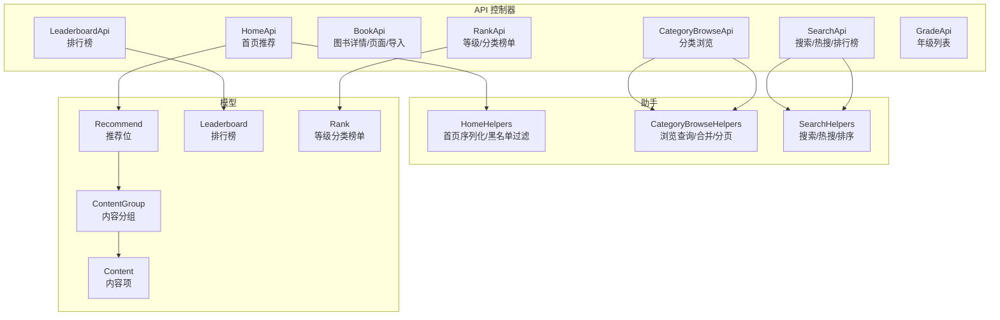
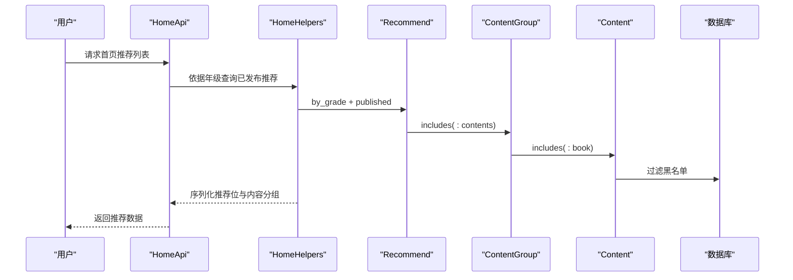
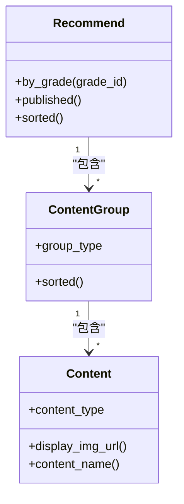
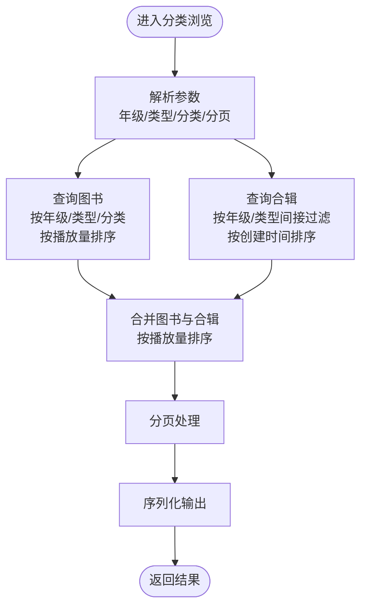
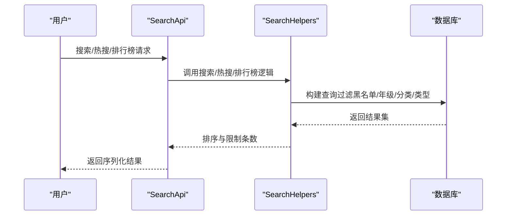
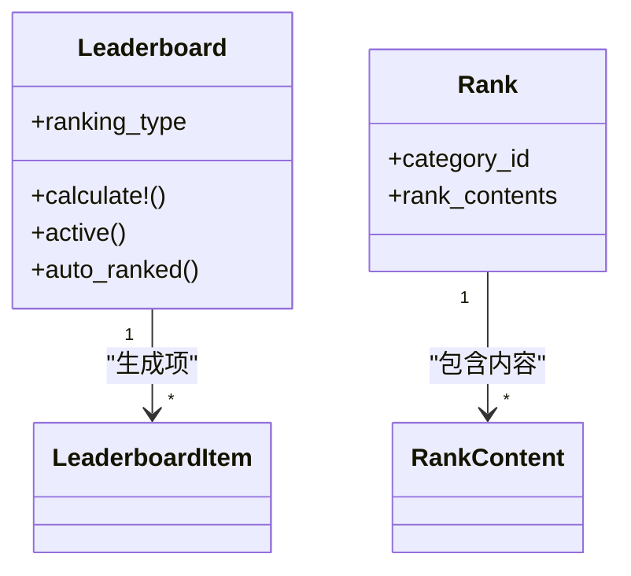
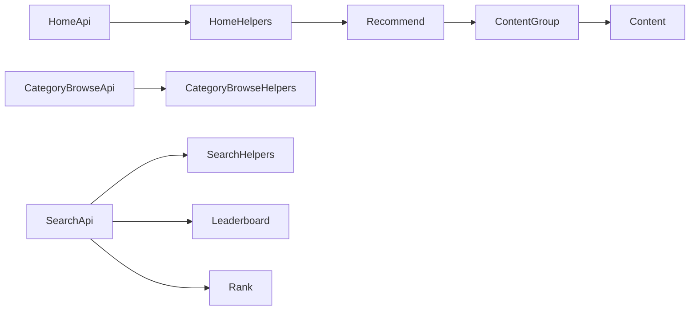
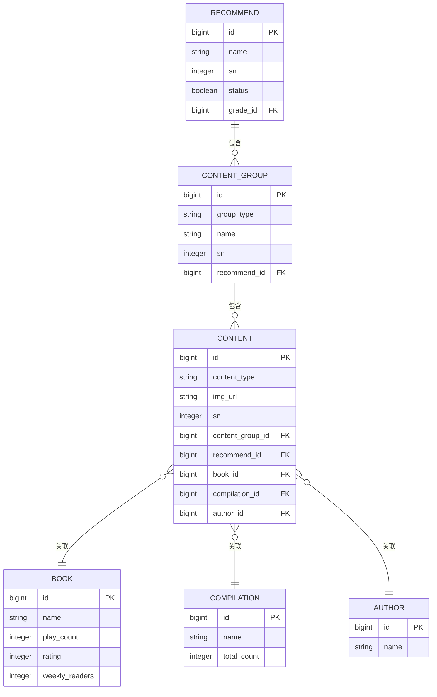

# 内容发现与推荐

<cite>
**本文引用的文件**
- [app/controllers/api/home/home_api.rb](file://app/controllers/api/home/home_api.rb)
- [app/controllers/api/home/home_helpers.rb](file://app/controllers/api/home/home_helpers.rb)
- [app/controllers/api/categories/category_browse_api.rb](file://app/controllers/api/categories/category_browse_api.rb)
- [app/controllers/api/categories/category_browse_helpers.rb](file://app/controllers/api/categories/category_browse_helpers.rb)
- [app/controllers/api/books/book_api.rb](file://app/controllers/api/books/book_api.rb)
- [app/controllers/api/books/search_api.rb](file://app/controllers/api/books/search_api.rb)
- [app/controllers/api/books/search_helpers.rb](file://app/controllers/api/books/search_helpers.rb)
- [app/controllers/api/leaderboards/leaderboard_api.rb](file://app/controllers/api/leaderboards/leaderboard_api.rb)
- [app/controllers/api/ranks/rank_api.rb](file://app/controllers/api/ranks/rank_api.rb)
- [app/controllers/api/grades/grade_api.rb](file://app/controllers/api/grades/grade_api.rb)
- [app/models/recommend.rb](file://app/models/recommend.rb)
- [app/models/content_group.rb](file://app/models/content_group.rb)
- [app/models/content.rb](file://app/models/content.rb)
- [app/models/leaderboard.rb](file://app/models/leaderboard.rb)
- [app/models/rank.rb](file://app/models/rank.rb)
- [db/schema.rb](file://db/schema.rb)
</cite>

## 目录
1. [简介](#简介)
2. [项目结构](#项目结构)
3. [核心组件](#核心组件)
4. [架构总览](#架构总览)
5. [详细组件分析](#详细组件分析)
6. [依赖关系分析](#依赖关系分析)
7. [性能考量](#性能考量)
8. [故障排查指南](#故障排查指南)
9. [结论](#结论)
10. [附录](#附录)

## 简介
本文件面向内容发现与推荐系统，围绕以下目标进行系统化梳理与说明：
- 分类浏览：学科分类、难度分级、筛选条件
- 首页内容编排：轮播图、推荐位、快捷入口
- 个性化推荐：协同过滤、内容推荐、混合推荐
- 热门内容聚合：热销榜单、新书推荐、专题策划
- 推荐策略、内容排序与用户体验优化

系统采用 Ruby on Rails + Grape API 构建，数据模型以“推荐位-内容分组-内容”三层结构组织首页内容；同时提供分类浏览、搜索、排行榜与等级体系支撑内容发现。

## 项目结构
后端采用控制器-助手-实体-模型分层，API 命名空间清晰，便于扩展与维护：
- 控制器层：负责路由、鉴权、参数校验与响应封装
- 助手层：封装跨控制器复用的业务逻辑（如序列化、查询、排序）
- 实体层：对外输出的数据结构定义
- 模型层：数据模型与索引，承载推荐、内容分组、排行榜等核心领域

图表来源
- [app/controllers/api/home/home_api.rb:1-42](file://app/controllers/api/home/home_api.rb#L1-L42)
- [app/controllers/api/home/home_helpers.rb:1-114](file://app/controllers/api/home/home_helpers.rb#L1-L114)
- [app/controllers/api/categories/category_browse_api.rb:1-67](file://app/controllers/api/categories/category_browse_api.rb#L1-L67)
- [app/controllers/api/categories/category_browse_helpers.rb:1-139](file://app/controllers/api/categories/category_browse_helpers.rb#L1-L139)
- [app/controllers/api/books/search_api.rb:1-128](file://app/controllers/api/books/search_api.rb#L1-L128)
- [app/controllers/api/books/search_helpers.rb:1-63](file://app/controllers/api/books/search_helpers.rb#L1-L63)
- [app/models/recommend.rb:1-40](file://app/models/recommend.rb#L1-L40)
- [app/models/content_group.rb:1-61](file://app/models/content_group.rb#L1-L61)
- [app/models/content.rb:1-79](file://app/models/content.rb#L1-L79)
- [app/models/leaderboard.rb:1-61](file://app/models/leaderboard.rb#L1-L61)
- [app/models/rank.rb:1-38](file://app/models/rank.rb#L1-L38)

章节来源
- [app/controllers/api/home/home_api.rb:1-42](file://app/controllers/api/home/home_api.rb#L1-L42)
- [app/controllers/api/categories/category_browse_api.rb:1-67](file://app/controllers/api/categories/category_browse_api.rb#L1-L67)
- [app/controllers/api/books/search_api.rb:1-128](file://app/controllers/api/books/search_api.rb#L1-L128)
- [app/controllers/api/leaderboards/leaderboard_api.rb:1-53](file://app/controllers/api/leaderboards/leaderboard_api.rb#L1-L53)
- [app/controllers/api/ranks/rank_api.rb:1-56](file://app/controllers/api/ranks/rank_api.rb#L1-L56)
- [app/controllers/api/grades/grade_api.rb:1-25](file://app/controllers/api/grades/grade_api.rb#L1-L25)

## 核心组件
- 推荐系统（首页编排）
  - 推荐位：按年级维度发布，支持多内容分组
  - 内容分组：多种布局类型（轮播、一行N列、双排三列、单列、作者展示、子推荐）
  - 内容项：图书、合辑、作者、推荐、排行榜等
- 分类浏览
  - 支持按年级、内容类型、一级/二级分类筛选
  - 图书与合辑合并排序，图书按播放量、合辑按创建时间排序
- 搜索与热搜
  - 支持书名/作者模糊搜索，按周读者数与播放量排序
  - 提供热门关键词、按作者检索、排行榜与热搜榜单
- 热门聚合
  - 自动/手动排行榜：按周读者数、月读者数、评分、完读率、最新等规则
  - 等级分类榜单：按年级与分类维度组织内容
- 用户体验
  - 黑名单过滤（家长管控）
  - OSS 签名直链，提升加载性能
  - 分页与排序策略，兼顾新鲜度与热度

章节来源
- [app/models/recommend.rb:1-40](file://app/models/recommend.rb#L1-L40)
- [app/models/content_group.rb:1-61](file://app/models/content_group.rb#L1-L61)
- [app/models/content.rb:1-79](file://app/models/content.rb#L1-L79)
- [app/controllers/api/home/home_helpers.rb:1-114](file://app/controllers/api/home/home_helpers.rb#L1-L114)
- [app/controllers/api/categories/category_browse_helpers.rb:1-139](file://app/controllers/api/categories/category_browse_helpers.rb#L1-L139)
- [app/controllers/api/books/search_helpers.rb:1-63](file://app/controllers/api/books/search_helpers.rb#L1-L63)
- [app/models/leaderboard.rb:1-61](file://app/models/leaderboard.rb#L1-L61)
- [app/models/rank.rb:1-38](file://app/models/rank.rb#L1-L38)

## 架构总览
系统以“首页推荐位-内容分组-内容项”为核心编排结构，结合分类浏览、搜索、排行榜与等级体系，形成完整的内容发现闭环。

图表来源
- [app/controllers/api/home/home_api.rb:14-24](file://app/controllers/api/home/home_api.rb#L14-L24)
- [app/controllers/api/home/home_helpers.rb:13-21](file://app/controllers/api/home/home_helpers.rb#L13-L21)
- [app/models/recommend.rb:32-34](file://app/models/recommend.rb#L32-L34)
- [app/models/content_group.rb:23-25](file://app/models/content_group.rb#L23-L25)
- [app/models/content.rb:25-30](file://app/models/content.rb#L25-L30)

## 详细组件分析

### 组件A：首页推荐与内容编排
- 功能要点
  - 按年级返回已发布推荐位
  - 展示内容分组与内容项，支持多布局类型
  - 黑名单过滤与 OSS 签名直链
- 数据流
  - 控制器获取当前用户年级
  - 查询对应推荐位及其内容分组与内容
  - 序列化输出，包含图书、合辑、作者、推荐、排行榜等

图表来源
- [app/models/recommend.rb:25-39](file://app/models/recommend.rb#L25-L39)
- [app/models/content_group.rb:23-60](file://app/models/content_group.rb#L23-L60)
- [app/models/content.rb:25-78](file://app/models/content.rb#L25-L78)

章节来源
- [app/controllers/api/home/home_api.rb:14-38](file://app/controllers/api/home/home_api.rb#L14-L38)
- [app/controllers/api/home/home_helpers.rb:9-110](file://app/controllers/api/home/home_helpers.rb#L9-L110)
- [app/models/recommend.rb:25-39](file://app/models/recommend.rb#L25-L39)
- [app/models/content_group.rb:23-60](file://app/models/content_group.rb#L23-L60)
- [app/models/content.rb:25-78](file://app/models/content.rb#L25-L78)

### 组件B：分类浏览（学科分类、难度分级、筛选条件）
- 功能要点
  - 支持按年级、内容类型、一级/二级分类筛选
  - 图书与合辑合并排序：图书按播放量，合辑按创建时间
  - 二级分类联动：按年级筛选与内容关联
- 处理流程

图表来源
- [app/controllers/api/categories/category_browse_api.rb:25-48](file://app/controllers/api/categories/category_browse_api.rb#L25-L48)
- [app/controllers/api/categories/category_browse_helpers.rb:9-75](file://app/controllers/api/categories/category_browse_helpers.rb#L9-L75)

章节来源
- [app/controllers/api/categories/category_browse_api.rb:14-62](file://app/controllers/api/categories/category_browse_api.rb#L14-L62)
- [app/controllers/api/categories/category_browse_helpers.rb:9-91](file://app/controllers/api/categories/category_browse_helpers.rb#L9-L91)

### 组件C：搜索与热搜（热门关键词、排行榜、按作者检索）
- 功能要点
  - 搜索：书名/作者模糊匹配，按周读者数与播放量排序
  - 热搜：按分类与类型（热读/评分/新品/奖项/经典）聚合
  - 排行榜：支持分类与周期过滤
  - 按作者检索：按播放量与月读者数排序
- 流程示意

图表来源
- [app/controllers/api/books/search_api.rb:19-123](file://app/controllers/api/books/search_api.rb#L19-L123)
- [app/controllers/api/books/search_helpers.rb:9-59](file://app/controllers/api/books/search_helpers.rb#L9-L59)

章节来源
- [app/controllers/api/books/search_api.rb:14-123](file://app/controllers/api/books/search_api.rb#L14-L123)
- [app/controllers/api/books/search_helpers.rb:9-59](file://app/controllers/api/books/search_helpers.rb#L9-L59)

### 组件D：排行榜与等级分类榜单
- 自动榜单
  - 支持按周读者数、月读者数、评分、完读率、最新等规则
  - 定时/触发计算，生成榜单项
- 等级分类榜单
  - 按年级与分类维度组织内容，支持分类维度

图表来源
- [app/models/leaderboard.rb:18-59](file://app/models/leaderboard.rb#L18-L59)
- [app/models/rank.rb:20-32](file://app/models/rank.rb#L20-L32)

章节来源
- [app/controllers/api/leaderboards/leaderboard_api.rb:10-48](file://app/controllers/api/leaderboards/leaderboard_api.rb#L10-L48)
- [app/controllers/api/ranks/rank_api.rb:14-51](file://app/controllers/api/ranks/rank_api.rb#L14-L51)
- [app/models/leaderboard.rb:18-59](file://app/models/leaderboard.rb#L18-L59)
- [app/models/rank.rb:20-32](file://app/models/rank.rb#L20-L32)

### 组件E：个性化推荐策略（协同过滤、内容推荐、混合推荐）
- 当前实现现状
  - 首页推荐基于“推荐位-内容分组-内容项”结构，按年级发布
  - 搜索与热搜使用热度指标（周读者数、评分、播放量）
  - 分类浏览以播放量与创建时间作为排序依据
- 个性化建议
  - 协同过滤：基于相似用户行为构建用户-物品交互矩阵，推荐高分物品
  - 内容推荐：基于图书特征（分类、作者、标签）与用户偏好向量
  - 混合推荐：加权融合协同与内容推荐，引入多样性与新颖性约束
  - 排序优化：引入再平衡因子（曝光-反馈）与去重策略
- 用户体验优化
  - 黑名单过滤与家长管控
  - OSS 签名直链与懒加载
  - 分页与预取，降低首屏延迟

章节来源
- [app/controllers/api/home/home_helpers.rb:25-32](file://app/controllers/api/home/home_helpers.rb#L25-L32)
- [app/controllers/api/books/search_helpers.rb:22-59](file://app/controllers/api/books/search_helpers.rb#L22-L59)
- [app/controllers/api/categories/category_browse_helpers.rb:49-55](file://app/controllers/api/categories/category_browse_helpers.rb#L49-L55)

## 依赖关系分析
- 控制器依赖助手进行序列化与查询封装
- 推荐系统三层结构：推荐位-内容分组-内容项，强内聚弱耦合
- 排行榜与等级分类榜单分别服务于“自动聚合”与“分级组织”
- 数据模型索引覆盖常用查询字段，保障性能

图表来源
- [app/controllers/api/home/home_api.rb:5-7](file://app/controllers/api/home/home_api.rb#L5-L7)
- [app/controllers/api/home/home_helpers.rb:5-7](file://app/controllers/api/home/home_helpers.rb#L5-L7)
- [app/controllers/api/categories/category_browse_api.rb:5-7](file://app/controllers/api/categories/category_browse_api.rb#L5-L7)
- [app/controllers/api/categories/category_browse_helpers.rb:5-7](file://app/controllers/api/categories/category_browse_helpers.rb#L5-L7)
- [app/controllers/api/books/search_api.rb:5-10](file://app/controllers/api/books/search_api.rb#L5-L10)
- [app/controllers/api/books/search_helpers.rb:5-7](file://app/controllers/api/books/search_helpers.rb#L5-L7)
- [app/models/recommend.rb:25-27](file://app/models/recommend.rb#L25-L27)
- [app/models/content_group.rb:23-25](file://app/models/content_group.rb#L23-L25)
- [app/models/content.rb:25-30](file://app/models/content.rb#L25-L30)
- [app/models/leaderboard.rb:18-20](file://app/models/leaderboard.rb#L18-L20)
- [app/models/rank.rb:20-24](file://app/models/rank.rb#L20-L24)

章节来源
- [db/schema.rb:115-157](file://db/schema.rb#L115-L157)
- [db/schema.rb:184-192](file://db/schema.rb#L184-L192)
- [db/schema.rb:204-206](file://db/schema.rb#L204-L206)

## 性能考量
- 查询优化
  - 使用 includes 预加载关联对象，减少 N+1 查询
  - distinct 与 select 精准投影，避免全表扫描
  - 合理使用索引字段（播放量、创建时间、状态、年级关联）
- 排序与分页
  - 搜索与热搜按热点字段排序，必要时使用复合索引
  - 分页限制 per_page 上限，防止大页请求
- 缓存与直链
  - OSS 签名直链降低服务端压力
  - 热点榜单可引入缓存与异步刷新
- 推荐排序
  - 引入再平衡因子，兼顾曝光与反馈
  - 混合推荐中加入多样性与新颖性权重

## 故障排查指南
- 首页推荐为空
  - 检查用户年级是否存在，确认推荐位状态为已发布
  - 排查黑名单过滤导致的内容项被剔除
- 分类浏览结果异常
  - 校验参数（年级/类型/分类）是否正确
  - 确认图书与合辑的关联关系与排序逻辑
- 搜索无结果或排序异常
  - 检查关键字拼写与模糊匹配
  - 确认周读者数与播放量统计是否正常
- 排行榜未更新
  - 触发自动计算或检查规则配置
  - 校验分类过滤与展示上限

章节来源
- [app/controllers/api/home/home_api.rb:17-21](file://app/controllers/api/home/home_api.rb#L17-L21)
- [app/controllers/api/home/home_helpers.rb:25-32](file://app/controllers/api/home/home_helpers.rb#L25-L32)
- [app/controllers/api/categories/category_browse_api.rb:30-37](file://app/controllers/api/categories/category_browse_api.rb#L30-L37)
- [app/controllers/api/books/search_api.rb:24-30](file://app/controllers/api/books/search_api.rb#L24-L30)
- [app/models/leaderboard.rb:27-59](file://app/models/leaderboard.rb#L27-L59)

## 结论
本系统以“推荐位-内容分组-内容项”为核心，结合分类浏览、搜索、排行榜与等级体系，构建了从内容发现到个性化推荐的完整路径。当前实现侧重于结构化编排与热度聚合，建议在现有基础上引入协同过滤与内容推荐的混合策略，并持续优化排序与缓存机制，以进一步提升推荐质量与用户体验。

## 附录
- 数据模型概览（部分）

图表来源
- [db/schema.rb:115-157](file://db/schema.rb#L115-L157)
- [db/schema.rb:184-192](file://db/schema.rb#L184-L192)
- [app/models/recommend.rb:25-27](file://app/models/recommend.rb#L25-L27)
- [app/models/content_group.rb:23-25](file://app/models/content_group.rb#L23-L25)
- [app/models/content.rb:25-30](file://app/models/content.rb#L25-L30)