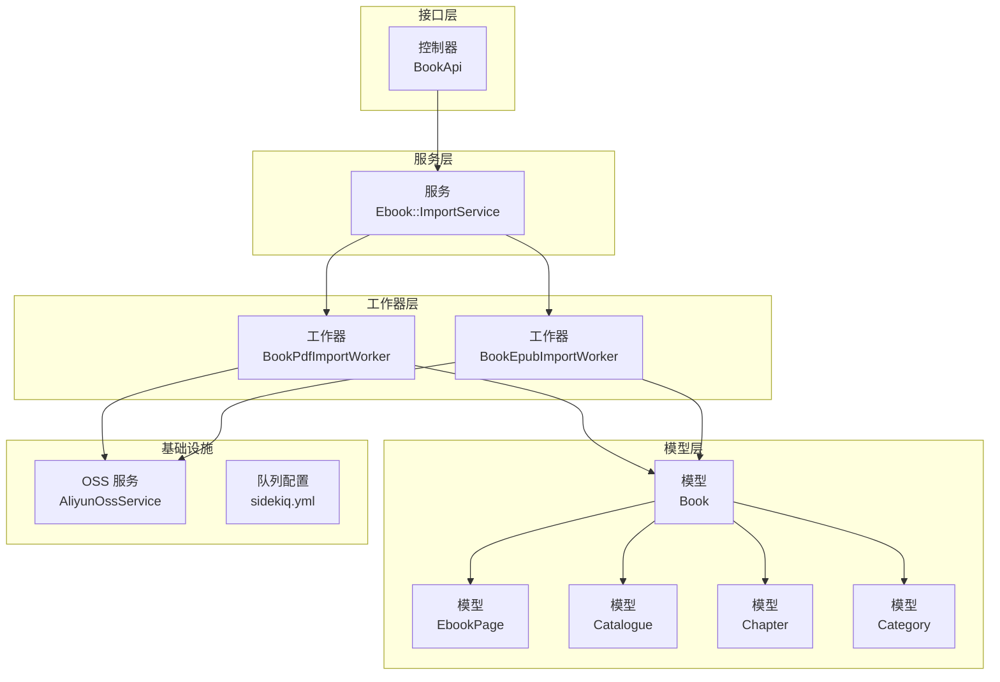
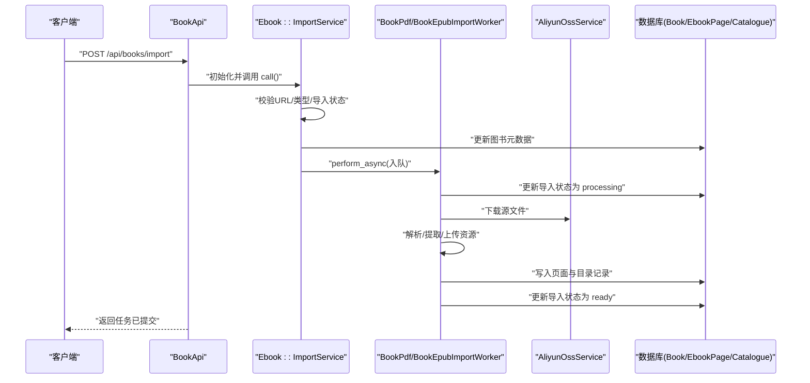
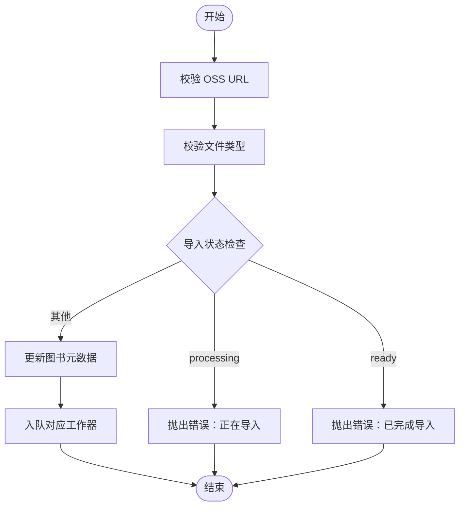
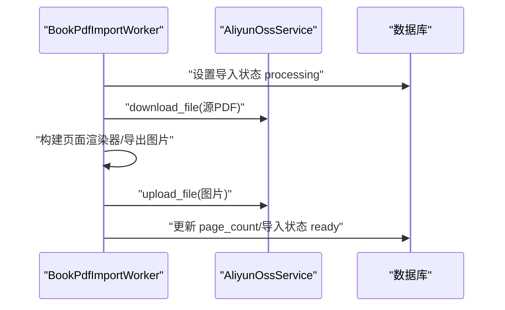
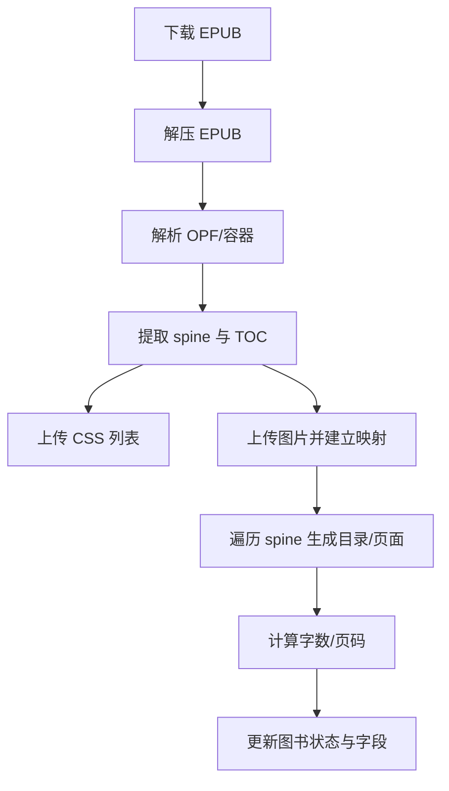
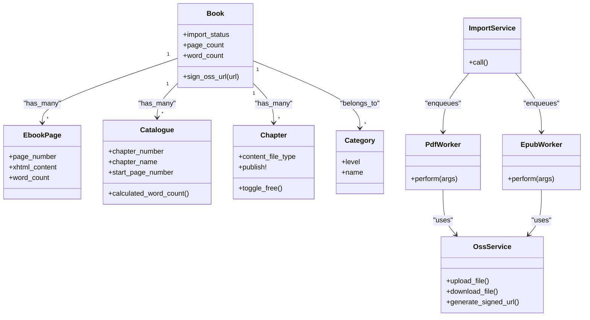

# 图书资源管理

<cite>
**本文档引用的文件**
- [app/services/ebook/import_service.rb](file://app/services/ebook/import_service.rb)
- [app/controllers/api/books/book_api.rb](file://app/controllers/api/books/book_api.rb)
- [app/models/book.rb](file://app/models/book.rb)
- [app/models/category.rb](file://app/models/category.rb)
- [app/models/chapter.rb](file://app/models/chapter.rb)
- [app/jobs/book_pdf_import_worker.rb](file://app/jobs/book_pdf_import_worker.rb)
- [app/jobs/book_epub_import_worker.rb](file://app/jobs/book_epub_import_worker.rb)
- [app/models/ebook_page.rb](file://app/models/ebook_page.rb)
- [app/models/catalogue.rb](file://app/models/catalogue.rb)
- [app/entities/book.rb](file://app/entities/book.rb)
- [app/entities/ebook_page.rb](file://app/entities/ebook_page.rb)
- [lib/aliyun_oss_service.rb](file://lib/aliyun_oss_service.rb)
- [config/sidekiq.yml](file://config/sidekiq.yml)
- [db/migrate/20260421090000_add_ebook_fields_to_books.rb](file://db/migrate/20260421090000_add_ebook_fields_to_books.rb)
- [docs/pdf_import_export.md](file://docs/pdf_import_export.md)
- [lib/tasks/ebooks.rake](file://lib/tasks/ebooks.rake)
</cite>

## 目录
1. [引言](#引言)
2. [项目结构](#项目结构)
3. [核心组件](#核心组件)
4. [架构总览](#架构总览)
5. [详细组件分析](#详细组件分析)
6. [依赖关系分析](#依赖关系分析)
7. [性能考虑](#性能考虑)
8. [故障排查指南](#故障排查指南)
9. [结论](#结论)
10. [附录](#附录)

## 引言
本项目是一个面向儿童阅读场景的图书资源管理系统，重点围绕电子书导入与内容组织展开，支持 PDF/EPUB 两种格式的批量导入、目录生成、章节划分、页面处理与状态管理。系统采用服务层封装导入流程，通过 Sidekiq 异步队列执行具体文件处理任务，并将解析后的页面与目录持久化至数据库，最终通过 API 为客户端提供稳定的查询与阅读能力。

## 项目结构
系统采用典型的 Rails 分层架构：
- 控制器层：负责请求参数校验、鉴权与响应封装
- 服务层：封装业务流程（如电子书导入）
- 模型层：定义数据结构与关联关系
- 工作器（Jobs）：异步执行耗时任务（PDF/EPUB 导入）
- 实体层：对外输出的序列化结构
- 基础设施：OSS 服务、Sidekiq 配置、迁移脚本

**图表来源**
- [app/controllers/api/books/book_api.rb:100-124](file://app/controllers/api/books/book_api.rb#L100-L124)
- [app/services/ebook/import_service.rb:14-25](file://app/services/ebook/import_service.rb#L14-L25)
- [app/jobs/book_pdf_import_worker.rb:15-20](file://app/jobs/book_pdf_import_worker.rb#L15-L20)
- [app/jobs/book_epub_import_worker.rb:16-21](file://app/jobs/book_epub_import_worker.rb#L16-L21)
- [app/models/book.rb:57-101](file://app/models/book.rb#L57-L101)
- [app/models/ebook_page.rb:25-33](file://app/models/ebook_page.rb#L25-L33)
- [app/models/catalogue.rb:24-41](file://app/models/catalogue.rb#L24-L41)
- [lib/aliyun_oss_service.rb:9-109](file://lib/aliyun_oss_service.rb#L9-L109)
- [config/sidekiq.yml:1-8](file://config/sidekiq.yml#L1-L8)

**章节来源**
- [app/controllers/api/books/book_api.rb:100-124](file://app/controllers/api/books/book_api.rb#L100-L124)
- [app/services/ebook/import_service.rb:14-25](file://app/services/ebook/import_service.rb#L14-L25)
- [app/jobs/book_pdf_import_worker.rb:15-20](file://app/jobs/book_pdf_import_worker.rb#L15-L20)
- [app/jobs/book_epub_import_worker.rb:16-21](file://app/jobs/book_epub_import_worker.rb#L16-L21)
- [app/models/book.rb:57-101](file://app/models/book.rb#L57-L101)
- [app/models/ebook_page.rb:25-33](file://app/models/ebook_page.rb#L25-L33)
- [app/models/catalogue.rb:24-41](file://app/models/catalogue.rb#L24-L41)
- [lib/aliyun_oss_service.rb:9-109](file://lib/aliyun_oss_service.rb#L9-L109)
- [config/sidekiq.yml:1-8](file://config/sidekiq.yml#L1-L8)

## 核心组件
- 电子书导入服务：统一入口，校验文件类型与导入状态，更新图书元数据并入队相应工作器
- PDF/EPUB 导入工作器：分别实现 PDF 强制图片模式与 EPUB 解析、目录抽取、样式与图片上传、页面与目录落库
- 图书模型：承载导入状态、页面计数、字数统计、OSS URL 签名等
- 页面与目录模型：维护页面编号、XHTML 内容、章节起始页与章节字数计算
- OSS 服务：封装上传、下载、签名 URL 等操作
- Sidekiq 配置：定义队列与并发策略

**章节来源**
- [app/services/ebook/import_service.rb:5-25](file://app/services/ebook/import_service.rb#L5-L25)
- [app/jobs/book_pdf_import_worker.rb:10-13](file://app/jobs/book_pdf_import_worker.rb#L10-L13)
- [app/jobs/book_epub_import_worker.rb:11-14](file://app/jobs/book_epub_import_worker.rb#L11-L14)
- [app/models/book.rb:83-84](file://app/models/book.rb#L83-L84)
- [app/models/ebook_page.rb:25-33](file://app/models/ebook_page.rb#L25-L33)
- [app/models/catalogue.rb:30-40](file://app/models/catalogue.rb#L30-L40)
- [lib/aliyun_oss_service.rb:21-62](file://lib/aliyun_oss_service.rb#L21-L62)
- [config/sidekiq.yml:1-8](file://config/sidekiq.yml#L1-L8)

## 架构总览
系统通过 API 接收导入请求，调用导入服务进行前置校验与状态检查，随后根据文件类型分派到 PDF 或 EPUB 导入工作器。工作器在临时目录中完成下载、解析、上传与落库，期间大量使用 OSS 服务与 Sidekiq 异步队列，保证主线程快速返回与高吞吐处理。

**图表来源**
- [app/controllers/api/books/book_api.rb:106-124](file://app/controllers/api/books/book_api.rb#L106-L124)
- [app/services/ebook/import_service.rb:14-25](file://app/services/ebook/import_service.rb#L14-L25)
- [app/jobs/book_pdf_import_worker.rb:21-24](file://app/jobs/book_pdf_import_worker.rb#L21-L24)
- [app/jobs/book_epub_import_worker.rb:22-25](file://app/jobs/book_epub_import_worker.rb#L22-L25)
- [lib/aliyun_oss_service.rb:54-62](file://lib/aliyun_oss_service.rb#L54-L62)

## 详细组件分析

### 电子书导入服务（Ebook::ImportService）
职责与流程：
- 校验 OSS 文件 URL 与扩展名（仅支持 pdf、epub）
- 检查图书导入状态，防止重复或并发导入
- 更新图书的文件类型、文件名与内容 URL
- 根据扩展名选择对应工作器并异步入队

**图表来源**
- [app/services/ebook/import_service.rb:14-25](file://app/services/ebook/import_service.rb#L14-L25)
- [app/services/ebook/import_service.rb:45-51](file://app/services/ebook/import_service.rb#L45-L51)
- [app/services/ebook/import_service.rb:53-67](file://app/services/ebook/import_service.rb#L53-L67)

**章节来源**
- [app/services/ebook/import_service.rb:5-25](file://app/services/ebook/import_service.rb#L5-L25)
- [app/services/ebook/import_service.rb:45-51](file://app/services/ebook/import_service.rb#L45-L51)
- [app/services/ebook/import_service.rb:53-67](file://app/services/ebook/import_service.rb#L53-L67)

### PDF 导入工作器（BookPdfImportWorker）
职责与流程：
- 下载 PDF 至临时目录
- 使用页面渲染器将每页渲染为图片（强制图片模式）
- 将图片上传至 OSS，建立图片前缀路径
- 统计页面数量并更新图书导入状态为 ready

**图表来源**
- [app/jobs/book_pdf_import_worker.rb:16-68](file://app/jobs/book_pdf_import_worker.rb#L16-L68)
- [lib/aliyun_oss_service.rb:54-62](file://lib/aliyun_oss_service.rb#L54-L62)

**章节来源**
- [app/jobs/book_pdf_import_worker.rb:10-13](file://app/jobs/book_pdf_import_worker.rb#L10-L13)
- [app/jobs/book_pdf_import_worker.rb:26-59](file://app/jobs/book_pdf_import_worker.rb#L26-L59)
- [app/jobs/book_pdf_import_worker.rb:62-68](file://app/jobs/book_pdf_import_worker.rb#L62-L68)

### EPUB 导入工作器（BookEpubImportWorker）
职责与流程：
- 下载 EPUB 至临时目录并解压
- 解析 OPF 获取阅读顺序（spine）与目录（TOC，优先 nav.xhtml，回退 toc.ncx）
- 提取并上传 CSS 与图片至 OSS，建立相对路径到 OSS URL 的映射
- 遍历 spine，为每个 TOC 条目创建目录与页面记录，计算字数与页码
- 更新图书内容类型、总字数、页数、样式 URL、导入时间与状态

**图表来源**
- [app/jobs/book_epub_import_worker.rb:30-45](file://app/jobs/book_epub_import_worker.rb#L30-L45)
- [app/jobs/book_epub_import_worker.rb:47-71](file://app/jobs/book_epub_import_worker.rb#L47-L71)
- [app/jobs/book_epub_import_worker.rb:73-77](file://app/jobs/book_epub_import_worker.rb#L73-L77)
- [app/jobs/book_epub_import_worker.rb:96-157](file://app/jobs/book_epub_import_worker.rb#L96-L157)

**章节来源**
- [app/jobs/book_epub_import_worker.rb:11-14](file://app/jobs/book_epub_import_worker.rb#L11-L14)
- [app/jobs/book_epub_import_worker.rb:47-71](file://app/jobs/book_epub_import_worker.rb#L47-L71)
- [app/jobs/book_epub_import_worker.rb:96-157](file://app/jobs/book_epub_import_worker.rb#L96-L157)

### 图书模型（Book）
关键字段与行为：
- 导入状态枚举：未导入、导入中、已完成、失败
- EPUB 导出状态枚举：未导出、导出中、已完成、导出失败
- 提供 OSS URL 签名工具方法，兼容中文路径
- 定义多处作用域与过滤逻辑（黑名单、状态、类型等）

**章节来源**
- [app/models/book.rb:83-84](file://app/models/book.rb#L83-L84)
- [app/models/book.rb:104-141](file://app/models/book.rb#L104-L141)
- [app/models/book.rb:96-101](file://app/models/book.rb#L96-L101)

### 页面与目录模型（EbookPage/Catalogue）
- EbookPage：唯一性约束（book_id + page_number），提供有序查询与范围查询
- Catalogue：按章节序号排序，提供章节字数计算（基于起始页到下一章起始页的页面字数求和）

**章节来源**
- [app/models/ebook_page.rb:25-33](file://app/models/ebook_page.rb#L25-L33)
- [app/models/catalogue.rb:27-40](file://app/models/catalogue.rb#L27-L40)

### 章节模型（Chapter）
- 支持多种内容文件类型（epub/pdf/mp3/mp4/wav），提供图标与颜色标识
- 提供发布/下线与免费/付费切换能力

**章节来源**
- [app/models/chapter.rb:29-60](file://app/models/chapter.rb#L29-L60)
- [app/models/chapter.rb:79-101](file://app/models/chapter.rb#L79-L101)

### 分类体系（Category）
- 支持层级与排序，提供分类与合集的多对多关联
- 提供常用查询作用域（按层级、排序、最近）

**章节来源**
- [app/models/category.rb:17-26](file://app/models/category.rb#L17-L26)

### 实体模型（Entities）
- Book 实体：对封面、EPUB、样式表 URL 进行签名包装，暴露作者、供应商、章节等信息
- EbookPage 实体：对图片 URL 进行签名包装

**章节来源**
- [app/entities/book.rb:37-55](file://app/entities/book.rb#L37-L55)
- [app/entities/ebook_page.rb:8-10](file://app/entities/ebook_page.rb#L8-L10)

### OSS 服务（AliyunOssService）
- 提供上传文件/数据、下载文件、生成公有 URL 与签名 URL 的能力
- 自动推断内容类型，封装异常

**章节来源**
- [lib/aliyun_oss_service.rb:21-62](file://lib/aliyun_oss_service.rb#L21-L62)
- [lib/aliyun_oss_service.rb:77-92](file://lib/aliyun_oss_service.rb#L77-L92)

### Sidekiq 配置
- 定义 import 队列与较低并发，确保导入任务串行化与稳定性

**章节来源**
- [config/sidekiq.yml:1-8](file://config/sidekiq.yml#L1-L8)

## 依赖关系分析
- 控制器依赖导入服务；导入服务根据文件类型依赖对应工作器
- 工作器依赖 OSS 服务与数据库事务；EPUB 工作器还依赖 ZIP/Nokogiri
- 模型间存在一对多/多对多关系：Book 与 EbookPage/Catalogue/Chapter/Category/Author/Supplier 等
- 实体层依赖模型与签名工具

**图表来源**
- [app/models/book.rb:57-101](file://app/models/book.rb#L57-L101)
- [app/models/ebook_page.rb:25-33](file://app/models/ebook_page.rb#L25-L33)
- [app/models/catalogue.rb:24-41](file://app/models/catalogue.rb#L24-L41)
- [app/models/chapter.rb:26-101](file://app/models/chapter.rb#L26-L101)
- [app/models/category.rb:17-26](file://app/models/category.rb#L17-L26)
- [app/services/ebook/import_service.rb:61-67](file://app/services/ebook/import_service.rb#L61-L67)
- [app/jobs/book_pdf_import_worker.rb:15-13](file://app/jobs/book_pdf_import_worker.rb#L15-L13)
- [app/jobs/book_epub_import_worker.rb:16-14](file://app/jobs/book_epub_import_worker.rb#L16-L14)
- [lib/aliyun_oss_service.rb:21-62](file://lib/aliyun_oss_service.rb#L21-L62)

**章节来源**
- [app/models/book.rb:57-101](file://app/models/book.rb#L57-L101)
- [app/models/ebook_page.rb:25-33](file://app/models/ebook_page.rb#L25-L33)
- [app/models/catalogue.rb:24-41](file://app/models/catalogue.rb#L24-L41)
- [app/models/chapter.rb:26-101](file://app/models/chapter.rb#L26-L101)
- [app/models/category.rb:17-26](file://app/models/category.rb#L17-L26)
- [app/services/ebook/import_service.rb:61-67](file://app/services/ebook/import_service.rb#L61-L67)
- [app/jobs/book_pdf_import_worker.rb:15-13](file://app/jobs/book_pdf_import_worker.rb#L15-L13)
- [app/jobs/book_epub_import_worker.rb:16-14](file://app/jobs/book_epub_import_worker.rb#L16-L14)
- [lib/aliyun_oss_service.rb:21-62](file://lib/aliyun_oss_service.rb#L21-L62)

## 性能考虑
- 异步导入：通过 Sidekiq 将耗时的文件解析与资源上传移至后台，避免阻塞 API 响应
- 临时目录与本地存储：在工作器内使用临时目录进行解压与导出，减少对持久存储的压力
- 数据库事务：EPUB 导入在单事务中批量删除旧记录并写入新记录，保证一致性与原子性
- 字数统计：仅在首次页面计入字数，避免重复累加导致的性能与准确性问题
- 索引优化：为导入状态添加索引，加速状态查询与筛选

**章节来源**
- [config/sidekiq.yml:1-8](file://config/sidekiq.yml#L1-L8)
- [app/jobs/book_epub_import_worker.rb:96-157](file://app/jobs/book_epub_import_worker.rb#L96-L157)
- [db/migrate/20260421090000_add_ebook_fields_to_books.rb:15](file://db/migrate/20260421090000_add_ebook_fields_to_books.rb#L15)

## 故障排查指南
常见错误与定位：
- 导入状态冲突：正在导入或已完成导入时再次提交任务会触发错误提示
- OSS URL 无效：URL 缺失或路径不正确会导致校验失败
- EPUB 解析失败：缺少 container.xml、nav.xhtml 或 toc.ncx 时会抛出异常
- 数据库验证失败：页面编号唯一性约束或章节文件类型不在允许集合内会触发验证错误
- 日志与重试：工作器捕获异常并更新导入状态与错误信息，建议结合日志定位具体错误栈

**章节来源**
- [app/services/ebook/import_service.rb:17-21](file://app/services/ebook/import_service.rb#L17-L21)
- [app/services/ebook/import_service.rb:45-51](file://app/services/ebook/import_service.rb#L45-L51)
- [app/jobs/book_epub_import_worker.rb:49-50](file://app/jobs/book_epub_import_worker.rb#L49-L50)
- [app/jobs/book_epub_import_worker.rb:163-172](file://app/jobs/book_epub_import_worker.rb#L163-L172)

## 结论
本系统围绕电子书导入与内容组织建立了清晰的服务-工作器-模型三层架构，通过 Sidekiq 异步处理与 OSS 资源管理，实现了 PDF/EPUB 的稳定导入、目录与页面的结构化落库，并提供了完善的 API 查询能力。后续可在以下方面持续优化：批量导入的并发控制、缓存策略、索引与查询优化、以及更细粒度的状态监控与告警。

## 附录
- PDF 导入导出说明文档：包含标准工作流、页面存储结构与本地调试导出包的说明
- Rake 任务：提供 PDF 导入与 EPUB 重建的命令行入口

**章节来源**
- [docs/pdf_import_export.md:18-34](file://docs/pdf_import_export.md#L18-L34)
- [docs/pdf_import_export.md:110-162](file://docs/pdf_import_export.md#L110-L162)
- [lib/tasks/ebooks.rake:5-28](file://lib/tasks/ebooks.rake#L5-L28)