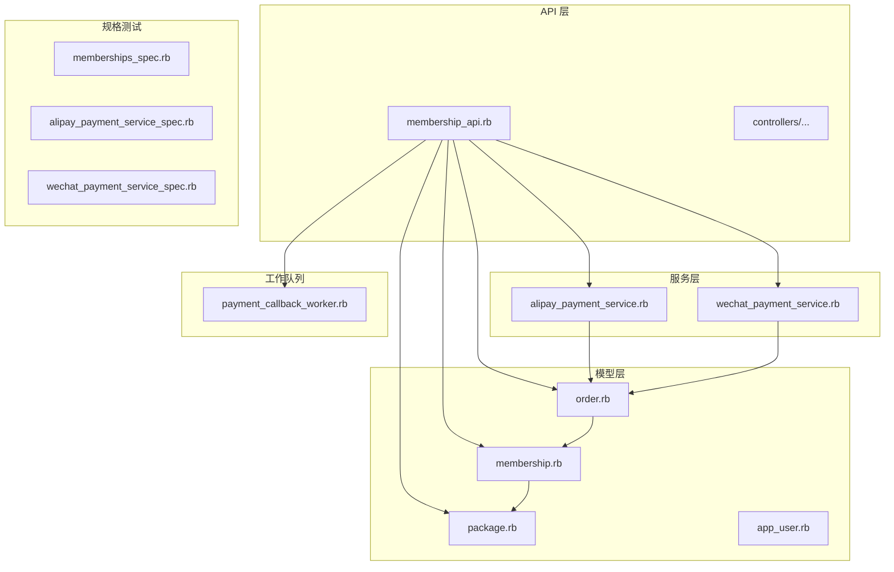
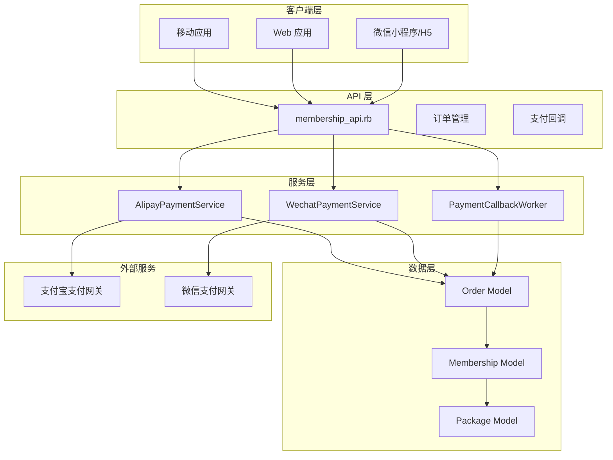
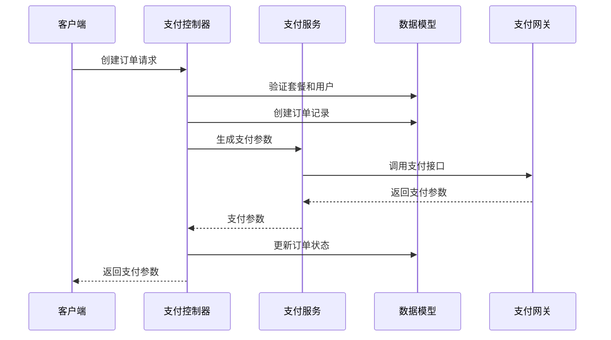
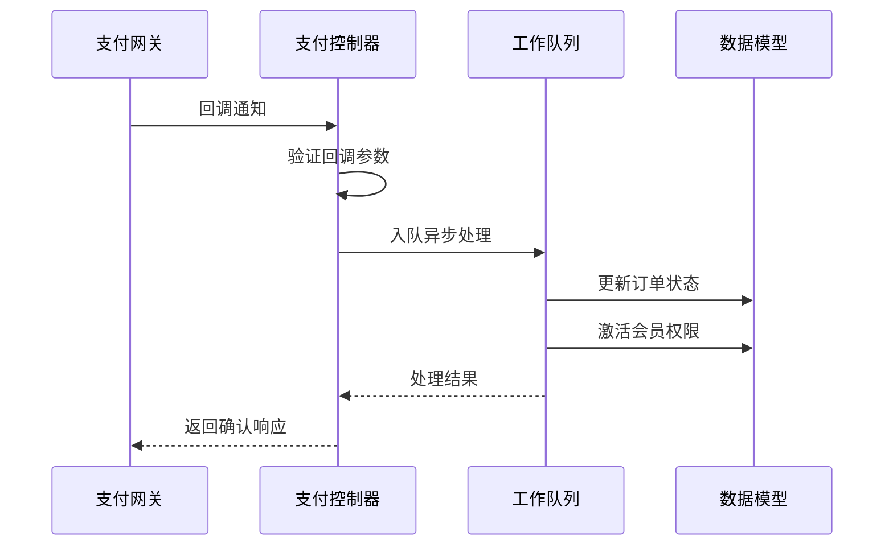
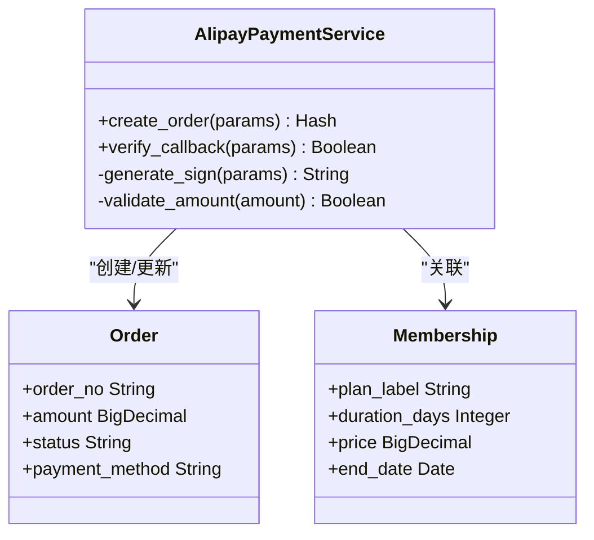
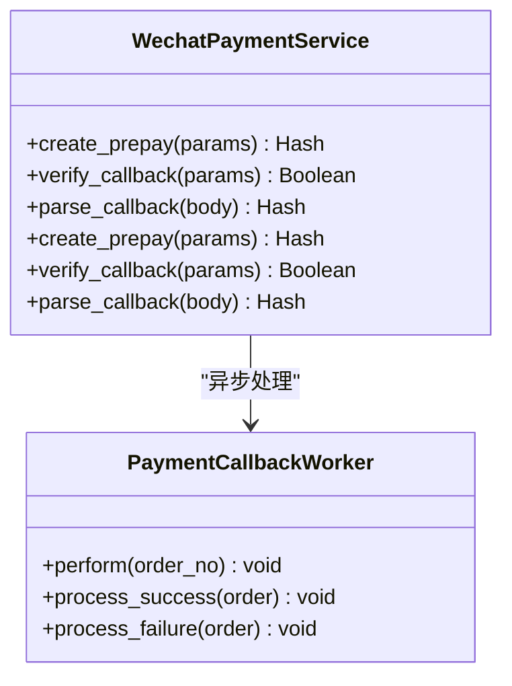
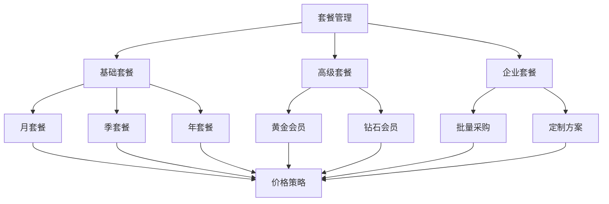
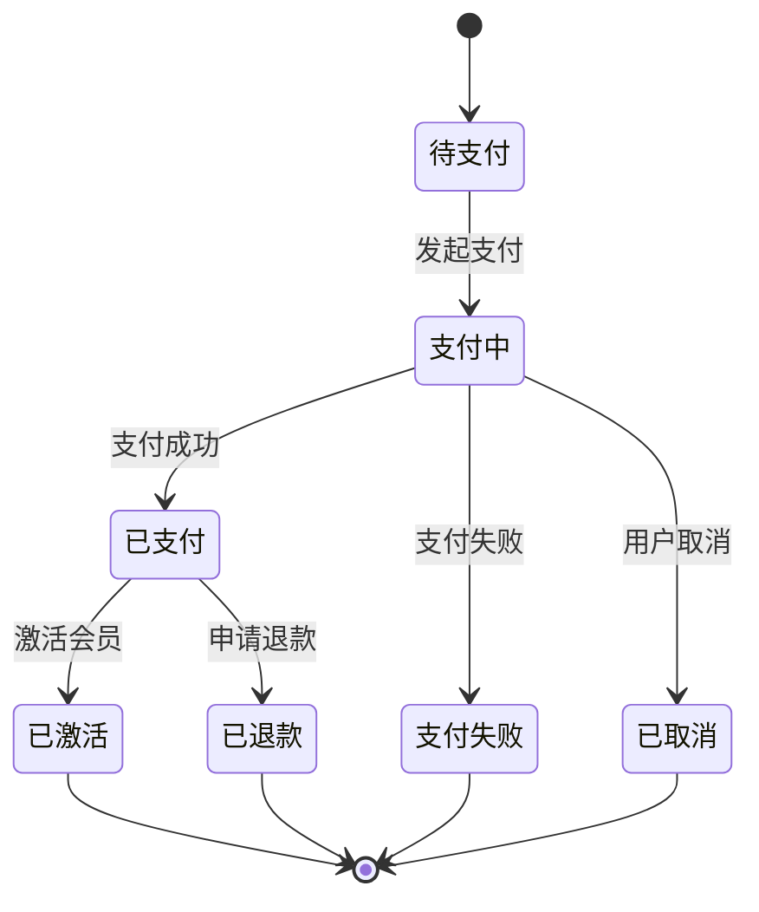
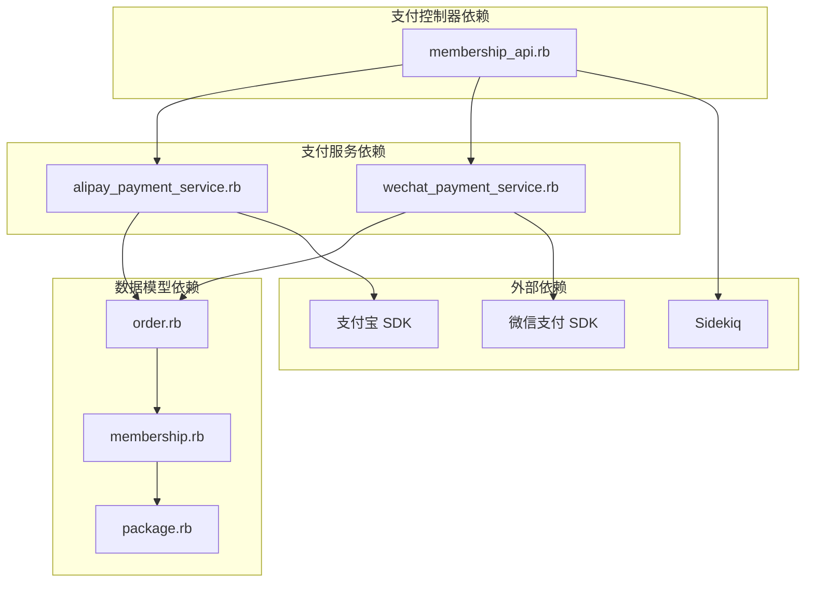

# 支付与会员系统

<cite>
**本文档引用的文件**
- [membership_api.rb](file://app/controllers/api/memberships/membership_api.rb)
- [memberships_spec.rb](file://spec/requests/api/memberships_spec.rb)
- [alipay_payment_service.rb](file://app/services/alipay_payment_service.rb)
- [wechat_payment_service.rb](file://app/services/wechat_payment_service.rb)
- [payment_callback_worker.rb](file://app/workers/payment_callback_worker.rb)
- [order.rb](file://app/models/order.rb)
- [membership.rb](file://app/models/membership.rb)
- [package.rb](file://app/models/package.rb)
- [app_user.rb](file://app/models/app_user.rb)
- [alipay_payment_service_spec.rb](file://spec/services/alipay_payment_service_spec.rb)
- [wechat_payment_service_spec.rb](file://spec/services/wechat_payment_service_spec.rb)
</cite>

## 目录
1. [简介](#简介)
2. [项目结构](#项目结构)
3. [核心组件](#核心组件)
4. [架构概览](#架构概览)
5. [详细组件分析](#详细组件分析)
6. [依赖关系分析](#依赖关系分析)
7. [性能考虑](#性能考虑)
8. [故障排除指南](#故障排除指南)
9. [结论](#结论)

## 简介

本项目是一个基于 Ruby on Rails 的语音书应用，集成了完整的支付与会员管理系统。系统支持多种支付方式，包括微信支付（公众号支付、小程序支付、H5支付）和支付宝支付（扫码支付、手机网站支付），并提供灵活的会员套餐管理功能。

系统采用模块化设计，通过服务层抽象支付逻辑，控制器负责业务流程协调，模型层处理数据持久化，工作队列处理异步回调处理。整个支付流程遵循严格的安全部署和异常处理机制。

## 项目结构

支付与会员系统主要分布在以下目录结构中：

**图表来源**
- [membership_api.rb:1-200](file://app/controllers/api/memberships/membership_api.rb#L1-L200)
- [alipay_payment_service.rb:1-200](file://app/services/alipay_payment_service.rb#L1-L200)
- [wechat_payment_service.rb:1-200](file://app/services/wechat_payment_service.rb#L1-L200)

**章节来源**
- [membership_api.rb:1-200](file://app/controllers/api/memberships/membership_api.rb#L1-L200)
- [alipay_payment_service.rb:1-200](file://app/services/alipay_payment_service.rb#L1-L200)
- [wechat_payment_service.rb:1-200](file://app/services/wechat_payment_service.rb#L1-L200)

## 核心组件

### 支付控制器 (Membership API)

支付控制器是整个支付系统的核心入口，负责处理会员购买、订单创建、支付回调等核心业务逻辑。

**主要功能特性：**
- 订单创建与管理
- 多支付方式支持（微信支付、支付宝）
- 支付参数生成
- 订单状态查询
- 异步回调处理

**章节来源**
- [membership_api.rb:1-200](file://app/controllers/api/memberships/membership_api.rb#L1-L200)

### 支付服务层

系统实现了两个核心支付服务，分别处理不同支付渠道的业务逻辑。

**支付宝支付服务：**
- 生成支付宝支付订单
- 处理支付宝回调验证
- 支付参数签名机制
- 金额精度控制

**微信支付服务：**
- 生成微信预支付订单
- 处理微信回调验证
- 多种支付场景支持
- 回调参数完整性检查

**章节来源**
- [alipay_payment_service.rb:1-200](file://app/services/alipay_payment_service.rb#L1-L200)
- [wechat_payment_service.rb:1-200](file://app/services/wechat_payment_service.rb#L1-L200)

### 数据模型层

系统通过精简的数据模型实现支付与会员管理的核心功能。

**订单模型 (Order)：**
- 支付状态管理
- 金额记录
- 支付方式标识
- 关联会员信息

**会员模型 (Membership)：**
- 套餐关联
- 有效期管理
- 状态跟踪
- 权益计算

**章节来源**
- [order.rb:1-200](file://app/models/order.rb#L1-L200)
- [membership.rb:1-200](file://app/models/membership.rb#L1-L200)

## 架构概览

系统采用分层架构设计，确保各层职责清晰，便于维护和扩展。

**图表来源**
- [membership_api.rb:1-200](file://app/controllers/api/memberships/membership_api.rb#L1-L200)
- [alipay_payment_service.rb:1-200](file://app/services/alipay_payment_service.rb#L1-L200)
- [wechat_payment_service.rb:1-200](file://app/services/wechat_payment_service.rb#L1-L200)

## 详细组件分析

### 支付控制器详细分析

支付控制器实现了完整的会员购买流程，包括订单创建、支付参数生成和状态查询等功能。

#### 订单创建流程

**图表来源**
- [membership_api.rb:90-125](file://app/controllers/api/memberships/membership_api.rb#L90-L125)

#### 支付回调处理流程

**图表来源**
- [membership_api.rb:149-168](file://app/controllers/api/memberships/membership_api.rb#L149-L168)
- [payment_callback_worker.rb:1-200](file://app/workers/payment_callback_worker.rb#L1-L200)

**章节来源**
- [membership_api.rb:90-168](file://app/controllers/api/memberships/membership_api.rb#L90-L168)

### 支付服务组件分析

#### 支付宝支付服务

支付宝支付服务实现了完整的支付流程，包括订单创建、参数签名和回调验证。

**图表来源**
- [alipay_payment_service.rb:1-200](file://app/services/alipay_payment_service.rb#L1-L200)
- [order.rb:1-200](file://app/models/order.rb#L1-L200)
- [membership.rb:1-200](file://app/models/membership.rb#L1-L200)

#### 微信支付服务

微信支付服务支持多种支付场景，提供了灵活的支付解决方案。

**图表来源**
- [wechat_payment_service.rb:1-200](file://app/services/wechat_payment_service.rb#L1-L200)
- [payment_callback_worker.rb:1-200](file://app/workers/payment_callback_worker.rb#L1-L200)

**章节来源**
- [alipay_payment_service.rb:1-200](file://app/services/alipay_payment_service.rb#L1-L200)
- [wechat_payment_service.rb:1-200](file://app/services/wechat_payment_service.rb#L1-L200)

### 会员套餐管理

系统提供了灵活的会员套餐管理功能，支持多种套餐类型和定价策略。

#### 套餐设计模式

**图表来源**
- [package.rb:1-200](file://app/models/package.rb#L1-L200)
- [membership.rb:1-200](file://app/models/membership.rb#L1-L200)

**章节来源**
- [package.rb:1-200](file://app/models/package.rb#L1-L200)
- [membership.rb:1-200](file://app/models/membership.rb#L1-L200)

### 订单处理流程

系统实现了完整的订单生命周期管理，从创建到完成的全过程跟踪。

**图表来源**
- [order.rb:1-200](file://app/models/order.rb#L1-L200)
- [membership.rb:1-200](file://app/models/membership.rb#L1-L200)

**章节来源**
- [order.rb:1-200](file://app/models/order.rb#L1-L200)
- [membership.rb:1-200](file://app/models/membership.rb#L1-L200)

## 依赖关系分析

系统采用松耦合的设计，通过接口和抽象类实现模块间的解耦。

**图表来源**
- [membership_api.rb:1-200](file://app/controllers/api/memberships/membership_api.rb#L1-L200)
- [alipay_payment_service.rb:1-200](file://app/services/alipay_payment_service.rb#L1-L200)
- [wechat_payment_service.rb:1-200](file://app/services/wechat_payment_service.rb#L1-L200)

**章节来源**
- [membership_api.rb:1-200](file://app/controllers/api/memberships/membership_api.rb#L1-L200)
- [alipay_payment_service.rb:1-200](file://app/services/alipay_payment_service.rb#L1-L200)
- [wechat_payment_service.rb:1-200](file://app/services/wechat_payment_service.rb#L1-L200)

## 性能考虑

系统在设计时充分考虑了性能优化和可扩展性要求：

### 异步处理机制
- 使用 Sidekiq 处理支付回调，避免阻塞主线程
- 工作队列支持并发处理多个回调请求
- 异常重试机制确保回调处理的可靠性

### 缓存策略
- 支付参数缓存减少重复计算
- 用户状态缓存提升查询性能
- 套餐信息缓存优化展示效率

### 数据库优化
- 合理的索引设计提升查询速度
- 批量操作减少数据库往返
- 连接池配置优化数据库连接

## 故障排除指南

### 支付回调处理

#### 常见问题及解决方案

**微信支付回调验证失败**
- 检查回调参数完整性
- 验证签名算法一致性
- 确认回调地址配置正确

**支付宝回调签名验证失败**
- 确认公钥配置正确
- 检查参数排序规则
- 验证金额精度处理

**订单状态异常**
- 检查订单状态转换逻辑
- 验证幂等性处理
- 确认异步处理队列状态

**章节来源**
- [membership_api.rb:149-168](file://app/controllers/api/memberships/membership_api.rb#L149-L168)
- [payment_callback_worker.rb:1-200](file://app/workers/payment_callback_worker.rb#L1-L200)

### 支付安全机制

系统实现了多层次的安全防护机制：

**参数验证**
- 输入参数完整性检查
- 数据类型验证
- 业务规则约束

**签名验证**
- 支付参数签名验证
- 回调请求真实性验证
- 防重放攻击机制

**异常处理**
- 详细的错误日志记录
- 友好的错误信息反馈
- 安全的异常信息处理

**章节来源**
- [alipay_payment_service.rb:1-200](file://app/services/alipay_payment_service.rb#L1-L200)
- [wechat_payment_service.rb:1-200](file://app/services/wechat_payment_service.rb#L1-L200)

## 结论

本支付与会员系统通过模块化设计实现了高度可扩展的支付解决方案。系统支持多种支付方式，提供了完善的会员管理功能，并采用了严格的安全机制和异常处理策略。

**主要优势：**
- 支持多种支付渠道，满足不同用户需求
- 模块化设计便于维护和扩展
- 完善的异步处理机制提升系统性能
- 严格的安全机制保障交易安全
- 详细的测试覆盖确保代码质量

**未来改进方向：**
- 增加更多支付渠道支持
- 优化性能监控和日志记录
- 扩展会员权益管理功能
- 增强数据分析和报表功能