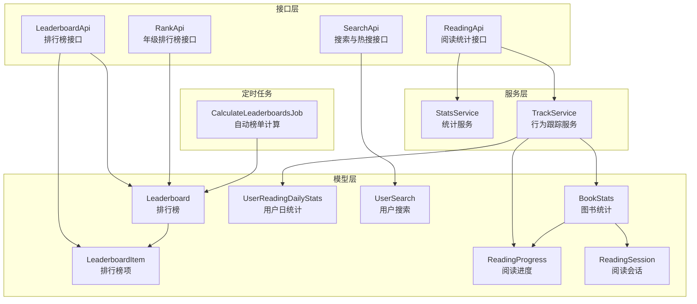
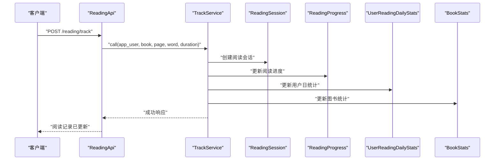
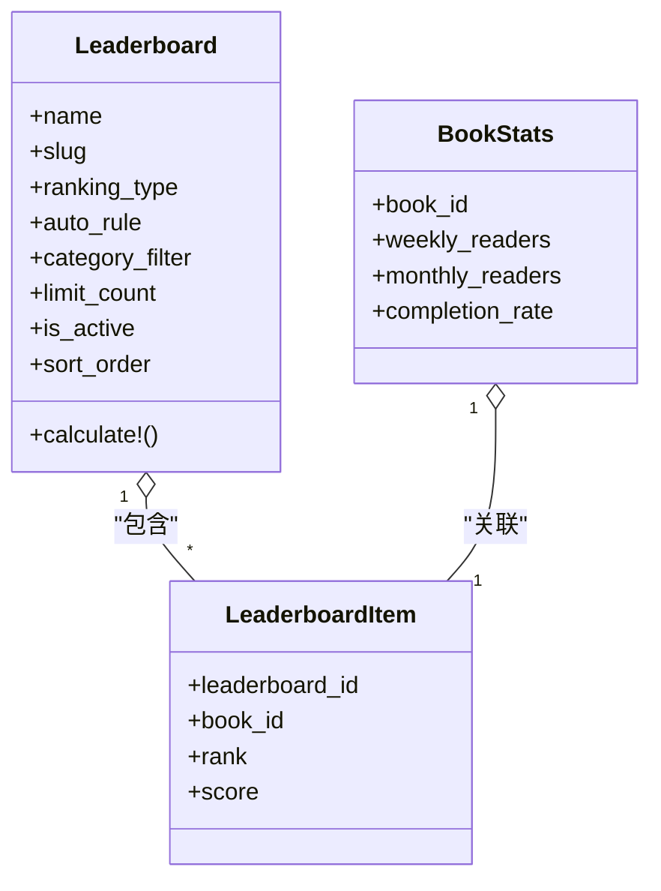
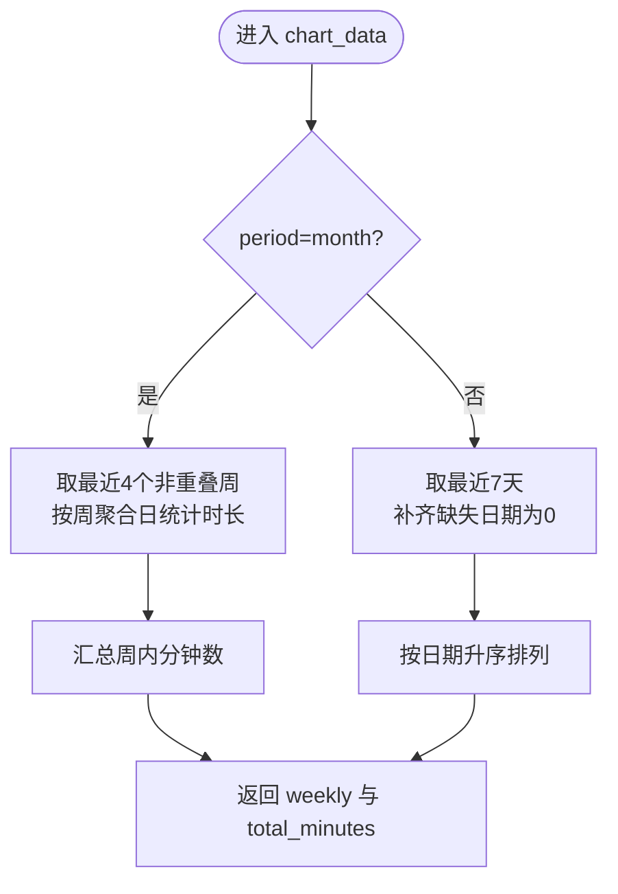
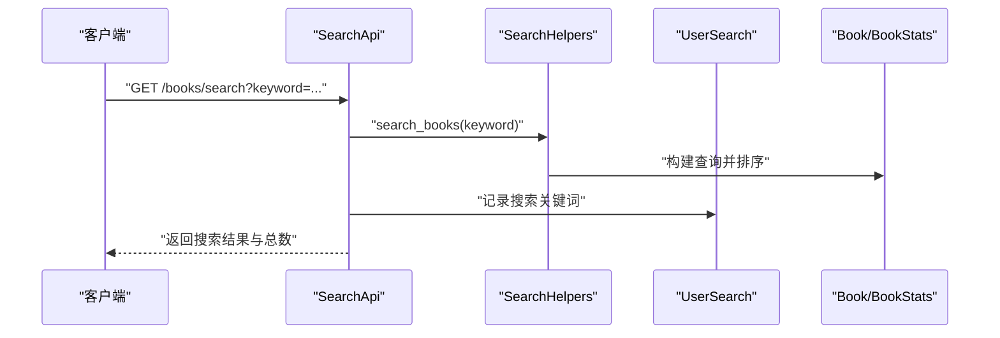
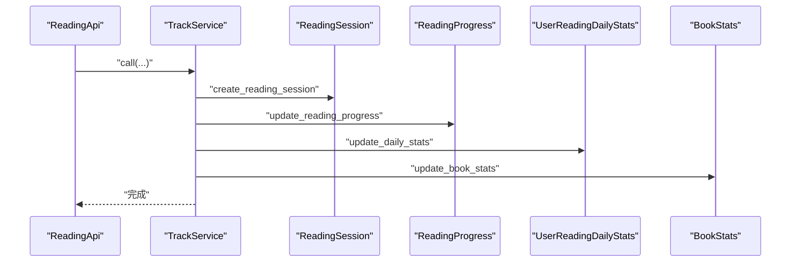
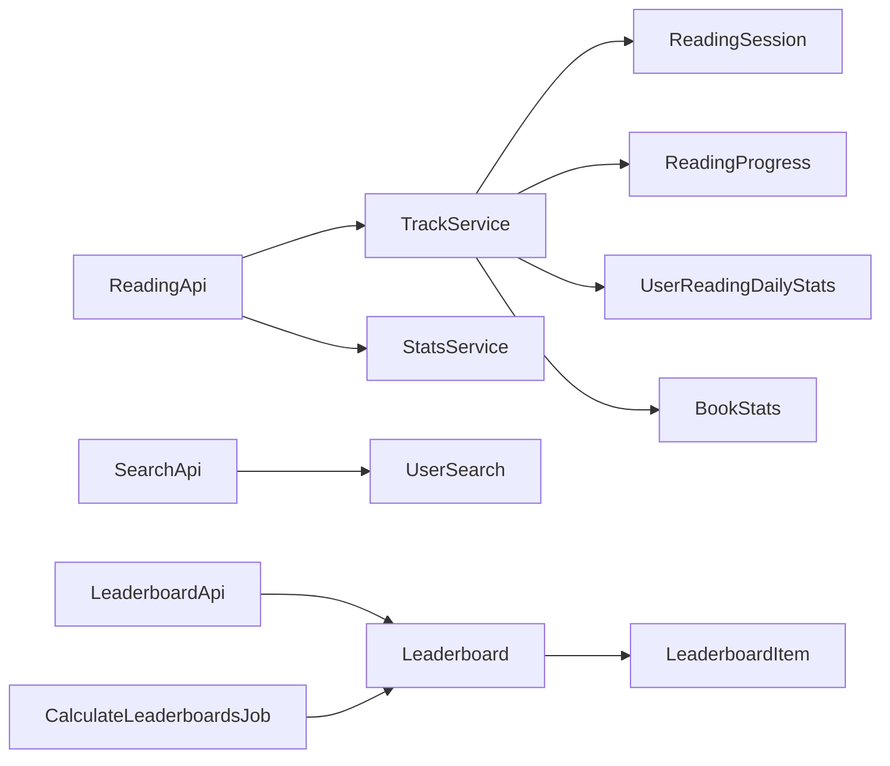

# 数据统计分析

<cite>
**本文引用的文件**
- [app/controllers/api/leaderboards/leaderboard_api.rb](file://app/controllers/api/leaderboards/leaderboard_api.rb)
- [app/controllers/api/ranks/rank_api.rb](file://app/controllers/api/ranks/rank_api.rb)
- [app/controllers/api/readings/reading_api.rb](file://app/controllers/api/readings/reading_api.rb)
- [app/controllers/api/books/search_api.rb](file://app/controllers/api/books/search_api.rb)
- [app/services/reading/stats_service.rb](file://app/services/reading/stats_service.rb)
- [app/services/reading/track_service.rb](file://app/services/reading/track_service.rb)
- [app/models/leaderboard.rb](file://app/models/leaderboard.rb)
- [app/models/book_stats.rb](file://app/models/book_stats.rb)
- [app/models/user_reading_daily_stats.rb](file://app/models/user_reading_daily_stats.rb)
- [app/models/user_search.rb](file://app/models/user_search.rb)
- [app/jobs/calculate_leaderboards_job.rb](file://app/jobs/calculate_leaderboards_job.rb)
- [app/controllers/api/books/leaderboard_helpers.rb](file://app/controllers/api/books/leaderboard_helpers.rb)
- [app/controllers/api/books/search_helpers.rb](file://app/controllers/api/books/search_helpers.rb)
- [app/models/reading_progress.rb](file://app/models/reading_progress.rb)
- [app/models/reading_session.rb](file://app/models/reading_session.rb)
- [db/migrate/20260519030000_create_reading_statistics_tables.rb](file://db/migrate/20260519030000_create_reading_statistics_tables.rb)
</cite>

## 目录
1. [简介](#简介)
2. [项目结构](#项目结构)
3. [核心组件](#核心组件)
4. [架构总览](#架构总览)
5. [详细组件分析](#详细组件分析)
6. [依赖关系分析](#依赖关系分析)
7. [性能考量](#性能考量)
8. [故障排查指南](#故障排查指南)
9. [结论](#结论)
10. [附录](#附录)

## 简介
本文件面向“数据统计分析系统”的实现与使用，围绕以下核心能力进行系统化梳理：
- 排行榜功能：阅读时长榜、完成度榜、活跃用户榜（自动/手动）
- 阅读统计数据：日统计、周/月趋势分析、个人与图书维度统计
- 热词搜索分析：搜索热度、关键词推荐、搜索行为分析
- 用户行为追踪：使用时长、阅读偏好、留存分析

系统通过接口层暴露能力，服务层负责统计计算与缓存策略，模型层承载数据结构与索引优化，定时任务保障自动榜单的周期性刷新。

## 项目结构
系统采用典型的分层架构：
- 控制器层（Grape API）：提供对外接口，参数校验与鉴权，调用服务层并序列化输出
- 服务层：封装统计计算、行为跟踪逻辑，保证事务一致性与缓存命中
- 模型层：定义统计表结构、索引与常用查询作用域
- 定时任务：后台计算自动榜单，降低请求路径的计算开销

**图示来源**
- [app/controllers/api/leaderboards/leaderboard_api.rb:1-53](file://app/controllers/api/leaderboards/leaderboard_api.rb#L1-L53)
- [app/controllers/api/ranks/rank_api.rb:1-56](file://app/controllers/api/ranks/rank_api.rb#L1-L56)
- [app/controllers/api/readings/reading_api.rb:1-93](file://app/controllers/api/readings/reading_api.rb#L1-L93)
- [app/controllers/api/books/search_api.rb:1-128](file://app/controllers/api/books/search_api.rb#L1-L128)
- [app/services/reading/stats_service.rb:1-140](file://app/services/reading/stats_service.rb#L1-L140)
- [app/services/reading/track_service.rb:1-126](file://app/services/reading/track_service.rb#L1-L126)
- [app/models/leaderboard.rb:1-61](file://app/models/leaderboard.rb#L1-L61)
- [app/models/book_stats.rb:1-31](file://app/models/book_stats.rb#L1-L31)
- [app/models/user_reading_daily_stats.rb:1-21](file://app/models/user_reading_daily_stats.rb#L1-L21)
- [app/models/reading_progress.rb:1-27](file://app/models/reading_progress.rb#L1-L27)
- [app/models/reading_session.rb:1-25](file://app/models/reading_session.rb#L1-L25)
- [app/models/user_search.rb:1-14](file://app/models/user_search.rb#L1-L14)
- [app/jobs/calculate_leaderboards_job.rb:1-19](file://app/jobs/calculate_leaderboards_job.rb#L1-L19)

**章节来源**
- [app/controllers/api/leaderboards/leaderboard_api.rb:1-53](file://app/controllers/api/leaderboards/leaderboard_api.rb#L1-L53)
- [app/controllers/api/ranks/rank_api.rb:1-56](file://app/controllers/api/ranks/rank_api.rb#L1-L56)
- [app/controllers/api/readings/reading_api.rb:1-93](file://app/controllers/api/readings/reading_api.rb#L1-L93)
- [app/controllers/api/books/search_api.rb:1-128](file://app/controllers/api/books/search_api.rb#L1-L128)

## 核心组件
- 排行榜接口：提供自动/手动榜单查询、实时计算与结果序列化
- 年级排行榜接口：按用户年级返回对应榜单及内容
- 阅读统计接口：个人统计摘要、图表数据、进度列表与单书进度
- 行为跟踪服务：单次上报阅读记录，原子性更新会话、进度、日统计、图书统计与用户累计统计
- 统计服务：聚合用户/图书维度指标，生成图表数据并缓存
- 自动榜单任务：定时批量计算自动规则，写入排行榜项
- 搜索与热搜接口：关键词搜索、热搜榜单、热门关键词

**章节来源**
- [app/controllers/api/leaderboards/leaderboard_api.rb:1-53](file://app/controllers/api/leaderboards/leaderboard_api.rb#L1-L53)
- [app/controllers/api/ranks/rank_api.rb:1-56](file://app/controllers/api/ranks/rank_api.rb#L1-L56)
- [app/controllers/api/readings/reading_api.rb:1-93](file://app/controllers/api/readings/reading_api.rb#L1-L93)
- [app/services/reading/track_service.rb:1-126](file://app/services/reading/track_service.rb#L1-L126)
- [app/services/reading/stats_service.rb:1-140](file://app/services/reading/stats_service.rb#L1-L140)
- [app/jobs/calculate_leaderboards_job.rb:1-19](file://app/jobs/calculate_leaderboards_job.rb#L1-L19)
- [app/controllers/api/books/search_api.rb:1-128](file://app/controllers/api/books/search_api.rb#L1-L128)

## 架构总览
系统以“接口层-服务层-模型层-定时任务”为主线，结合数据库索引与缓存策略，实现高并发下的统计能力。

**图示来源**
- [app/controllers/api/readings/reading_api.rb:1-93](file://app/controllers/api/readings/reading_api.rb#L1-L93)
- [app/services/reading/track_service.rb:1-126](file://app/services/reading/track_service.rb#L1-L126)
- [app/models/reading_session.rb:1-25](file://app/models/reading_session.rb#L1-L25)
- [app/models/reading_progress.rb:1-27](file://app/models/reading_progress.rb#L1-L27)
- [app/models/user_reading_daily_stats.rb:1-21](file://app/models/user_reading_daily_stats.rb#L1-L21)
- [app/models/book_stats.rb:1-31](file://app/models/book_stats.rb#L1-L31)

## 详细组件分析

### 排行榜功能
- 功能概述
  - 支持自动与手动两种榜单类型，自动榜单依据规则动态计算，手动榜单由运营配置
  - 提供榜单列表与单项榜单的书籍列表，支持分类过滤与展示顺序控制
- 关键流程
  - 查询启用的自动榜单，必要时触发实时计算
  - 自动榜单按规则（如近7日读者数、近30日读者数、评分、完读率、最新）排序并写入排行榜项
- 数据结构
  - 排行榜表与排行榜项表，图书与榜单多对多关系

**图示来源**
- [app/models/leaderboard.rb:1-61](file://app/models/leaderboard.rb#L1-L61)
- [app/models/book_stats.rb:1-31](file://app/models/book_stats.rb#L1-L31)

**章节来源**
- [app/controllers/api/leaderboards/leaderboard_api.rb:1-53](file://app/controllers/api/leaderboards/leaderboard_api.rb#L1-L53)
- [app/models/leaderboard.rb:1-61](file://app/models/leaderboard.rb#L1-L61)
- [app/jobs/calculate_leaderboards_job.rb:1-19](file://app/jobs/calculate_leaderboards_job.rb#L1-L19)

### 阅读统计数据
- 功能概述
  - 个人统计：总书数、已完成书数、总时长、总字数、平均时长、完成率、连续阅读天数
  - 图表数据：按周/月聚合日统计，补齐缺失日期，返回累计分钟数
  - 进度管理：用户阅读进度列表与单书进度
- 统计口径
  - 日统计：按用户+日期聚合会话时长、字数、阅读次数与首读书籍数
  - 图书统计：总读者、总次数、总时长、总字数、完读人数、完读率、近7/30天读者与次数
- 缓存策略
  - 使用缓存短期存储个人统计摘要，降低重复查询成本

**图示来源**
- [app/services/reading/stats_service.rb:63-110](file://app/services/reading/stats_service.rb#L63-L110)

**章节来源**
- [app/controllers/api/readings/reading_api.rb:1-93](file://app/controllers/api/readings/reading_api.rb#L1-L93)
- [app/services/reading/stats_service.rb:1-140](file://app/services/reading/stats_service.rb#L1-L140)
- [app/models/user_reading_daily_stats.rb:1-21](file://app/models/user_reading_daily_stats.rb#L1-L21)
- [app/models/book_stats.rb:1-31](file://app/models/book_stats.rb#L1-L31)

### 热词搜索分析
- 功能概述
  - 搜索接口：关键词搜索图书，同时记录用户搜索行为
  - 热搜榜单：按分类与类型（热门、评分、新书、大奖/经典）生成榜单
  - 热词推荐：按全局搜索次数降序返回热门关键词
- 数据流
  - 搜索请求写入用户搜索记录，用于后续热词分析
  - 热搜榜单基于图书统计字段与子分类进行筛选与排序

**图示来源**
- [app/controllers/api/books/search_api.rb:1-128](file://app/controllers/api/books/search_api.rb#L1-L128)
- [app/controllers/api/books/search_helpers.rb:1-63](file://app/controllers/api/books/search_helpers.rb#L1-L63)
- [app/models/user_search.rb:1-14](file://app/models/user_search.rb#L1-L14)

**章节来源**
- [app/controllers/api/books/search_api.rb:1-128](file://app/controllers/api/books/search_api.rb#L1-L128)
- [app/controllers/api/books/search_helpers.rb:1-63](file://app/controllers/api/books/search_helpers.rb#L1-L63)
- [app/models/user_search.rb:1-14](file://app/models/user_search.rb#L1-L14)

### 用户行为追踪
- 功能概述
  - 单次上报：创建阅读会话、更新阅读进度、更新日统计、更新图书统计、更新用户累计统计
  - 并发安全：通过“今日首次阅读同一本书”的会话计数判断，避免重复累加
  - 完读检测：在极短时间内检测到完读行为，更新图书统计中的完读人数与完读率
- 关键点
  - 事务包裹，确保多表一致性
  - 会话与进度分别维护，便于后续趋势与留存分析

**图示来源**
- [app/controllers/api/readings/reading_api.rb:19-34](file://app/controllers/api/readings/reading_api.rb#L19-L34)
- [app/services/reading/track_service.rb:16-26](file://app/services/reading/track_service.rb#L16-L26)
- [app/models/reading_session.rb:1-25](file://app/models/reading_session.rb#L1-L25)
- [app/models/reading_progress.rb:1-27](file://app/models/reading_progress.rb#L1-L27)
- [app/models/user_reading_daily_stats.rb:1-21](file://app/models/user_reading_daily_stats.rb#L1-L21)
- [app/models/book_stats.rb:1-31](file://app/models/book_stats.rb#L1-L31)

**章节来源**
- [app/services/reading/track_service.rb:1-126](file://app/services/reading/track_service.rb#L1-L126)
- [app/models/reading_session.rb:1-25](file://app/models/reading_session.rb#L1-L25)
- [app/models/reading_progress.rb:1-27](file://app/models/reading_progress.rb#L1-L27)
- [app/models/user_reading_daily_stats.rb:1-21](file://app/models/user_reading_daily_stats.rb#L1-L21)
- [app/models/book_stats.rb:1-31](file://app/models/book_stats.rb#L1-L31)

### 年级排行榜（Ranks）
- 功能概述
  - 根据用户年级返回对应排行榜列表，并包含各榜单内容
  - 按指定排行榜ID返回内容（图书或合集），并验证权限
- 设计要点
  - 通过年级约束排行榜可见范围，确保内容适配性

**章节来源**
- [app/controllers/api/ranks/rank_api.rb:1-56](file://app/controllers/api/ranks/rank_api.rb#L1-L56)

## 依赖关系分析
- 控制器依赖服务层进行业务处理，服务层依赖模型层进行数据持久化
- 自动榜单依赖定时任务批量计算，减少接口路径的计算压力
- 图表数据依赖日统计表，日统计依赖会话与进度表
- 搜索热度依赖用户搜索表的聚合统计

**图示来源**
- [app/controllers/api/readings/reading_api.rb:1-93](file://app/controllers/api/readings/reading_api.rb#L1-L93)
- [app/services/reading/track_service.rb:1-126](file://app/services/reading/track_service.rb#L1-L126)
- [app/services/reading/stats_service.rb:1-140](file://app/services/reading/stats_service.rb#L1-L140)
- [app/controllers/api/books/search_api.rb:1-128](file://app/controllers/api/books/search_api.rb#L1-L128)
- [app/models/leaderboard.rb:1-61](file://app/models/leaderboard.rb#L1-L61)
- [app/jobs/calculate_leaderboards_job.rb:1-19](file://app/jobs/calculate_leaderboards_job.rb#L1-L19)

**章节来源**
- [app/controllers/api/readings/reading_api.rb:1-93](file://app/controllers/api/readings/reading_api.rb#L1-L93)
- [app/controllers/api/books/search_api.rb:1-128](file://app/controllers/api/books/search_api.rb#L1-L128)
- [app/models/leaderboard.rb:1-61](file://app/models/leaderboard.rb#L1-L61)
- [app/jobs/calculate_leaderboards_job.rb:1-19](file://app/jobs/calculate_leaderboards_job.rb#L1-L19)

## 性能考量
- 缓存策略
  - 个人统计摘要使用短时缓存，降低重复查询开销
- 索引优化
  - 会话与进度表、日统计表、图书统计表均建立复合索引，加速高频查询
- 批处理与异步
  - 自动榜单通过定时任务批量计算，避免高峰时段阻塞
- 数据聚合
  - 图表数据按周/月聚合，减少前端渲染压力；缺失日期补零，保证连续性

**章节来源**
- [app/services/reading/stats_service.rb:7-28](file://app/services/reading/stats_service.rb#L7-L28)
- [db/migrate/20260519030000_create_reading_statistics_tables.rb:14-87](file://db/migrate/20260519030000_create_reading_statistics_tables.rb#L14-L87)

## 故障排查指南
- 排行榜为空或未更新
  - 检查自动榜单是否启用且规则存在
  - 触发或检查定时任务执行情况
- 阅读统计异常
  - 确认会话与进度是否正确创建
  - 核对日统计与图书统计的并发计数逻辑
- 图表数据缺失
  - 检查日统计表中是否存在目标日期记录
  - 确认补齐逻辑是否生效
- 搜索热词不准确
  - 核对用户搜索记录是否正常写入
  - 检查聚合查询的分组与排序条件

**章节来源**
- [app/jobs/calculate_leaderboards_job.rb:1-19](file://app/jobs/calculate_leaderboards_job.rb#L1-L19)
- [app/services/reading/track_service.rb:80-83](file://app/services/reading/track_service.rb#L80-L83)
- [app/services/reading/stats_service.rb:95-108](file://app/services/reading/stats_service.rb#L95-L108)
- [app/models/user_search.rb:7-12](file://app/models/user_search.rb#L7-L12)

## 结论
本系统通过清晰的分层设计与完善的统计模型，实现了从行为采集、实时计算到可视化展示的闭环。排行榜、阅读统计、热词分析与用户行为追踪四大能力相互支撑，既满足日常运营需求，又具备良好的扩展性与可维护性。建议持续关注缓存命中率、索引覆盖与定时任务稳定性，以进一步提升整体性能与可靠性。

## 附录
- 数据表结构概览（节选）
  - 阅读会话、阅读进度、用户日统计、图书统计、排行榜、排行榜项
- 关键查询与排序
  - 榜样查询按规则字段降序，热搜榜单按近7日读者数或评分排序
- 可视化建议
  - 日趋势：折线图（补齐缺失日期）
  - 周/月趋势：柱状图（4周或N日）
  - 排行榜：前N名条形图或表格
  - 热词：词云或柱状图

**章节来源**
- [db/migrate/20260519030000_create_reading_statistics_tables.rb:1-90](file://db/migrate/20260519030000_create_reading_statistics_tables.rb#L1-L90)
- [app/controllers/api/books/leaderboard_helpers.rb:29-42](file://app/controllers/api/books/leaderboard_helpers.rb#L29-L42)
- [app/controllers/api/books/search_helpers.rb:40-58](file://app/controllers/api/books/search_helpers.rb#L40-L58)