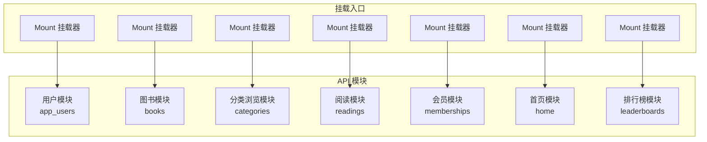
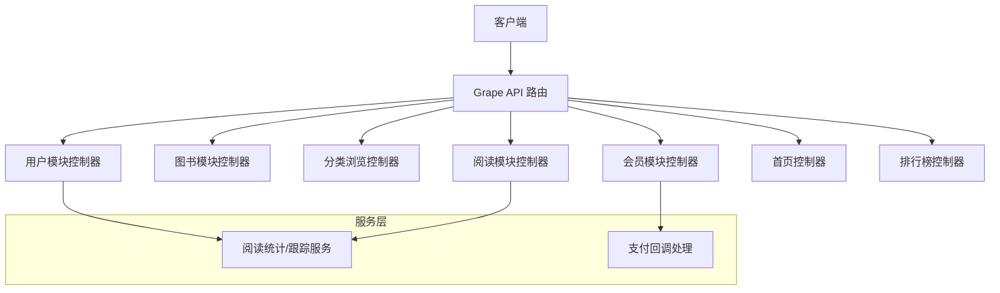
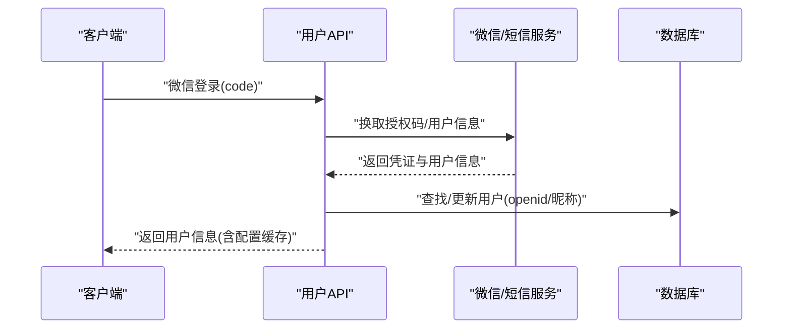
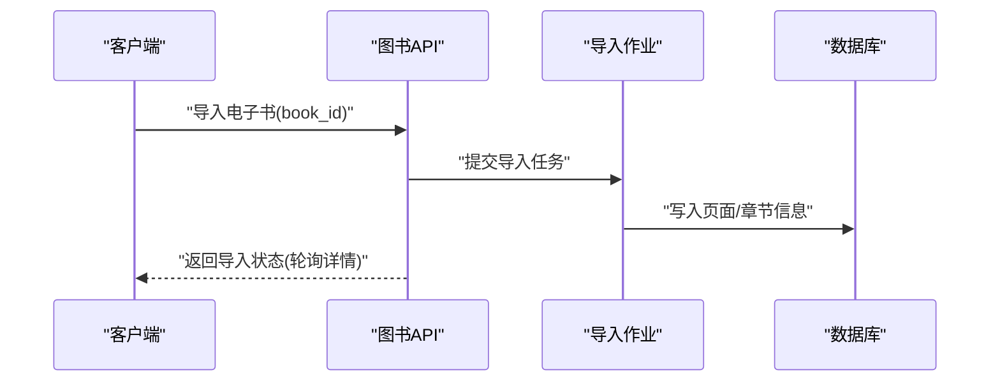
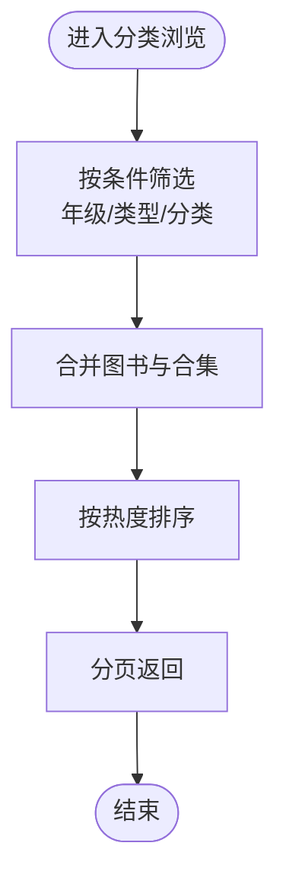
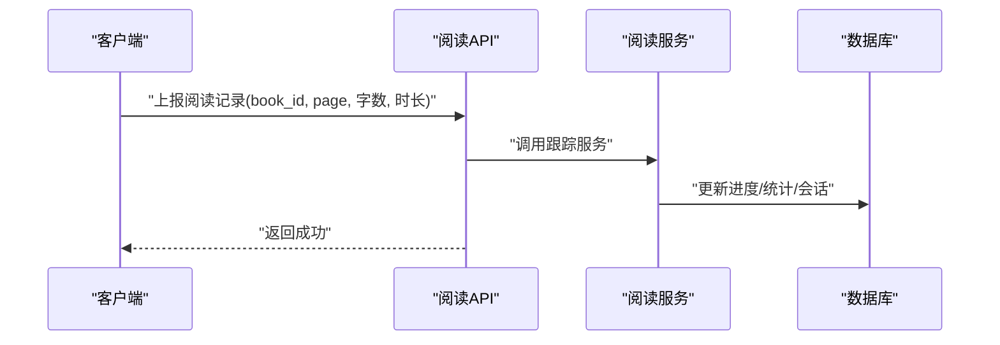
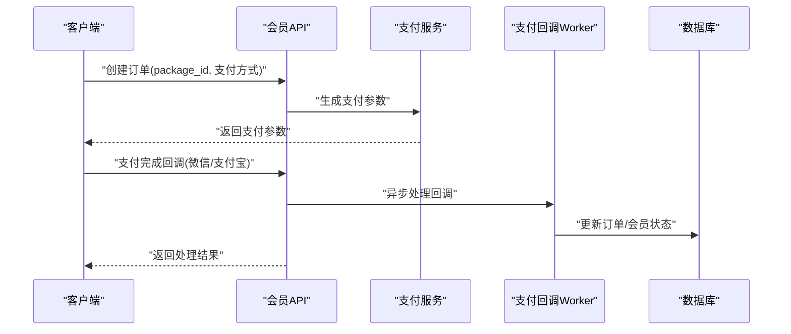
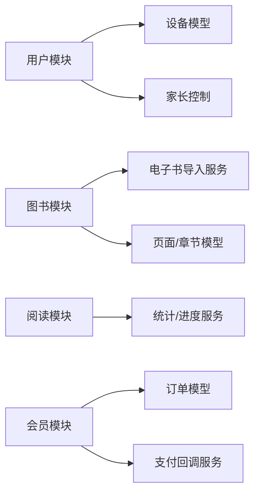

# 核心功能模块

<cite>
**本文档引用的文件**
- [app/controllers/api/app_users/mount.rb](file://app/controllers/api/app_users/mount.rb)
- [app/controllers/api/app_users/app_user_api.rb](file://app/controllers/api/app_users/app_user_api.rb)
- [app/controllers/api/books/mount.rb](file://app/controllers/api/books/mount.rb)
- [app/controllers/api/books/book_api.rb](file://app/controllers/api/books/book_api.rb)
- [app/controllers/api/books/search_api.rb](file://app/controllers/api/books/search_api.rb)
- [app/controllers/api/categories/mount.rb](file://app/controllers/api/categories/mount.rb)
- [app/controllers/api/categories/category_browse_api.rb](file://app/controllers/api/categories/category_browse_api.rb)
- [app/controllers/api/readings/mount.rb](file://app/controllers/api/readings/mount.rb)
- [app/controllers/api/readings/reading_api.rb](file://app/controllers/api/readings/reading_api.rb)
- [app/controllers/api/memberships/mount.rb](file://app/controllers/api/memberships/mount.rb)
- [app/controllers/api/memberships/membership_api.rb](file://app/controllers/api/memberships/membership_api.rb)
- [app/controllers/api/home/mount.rb](file://app/controllers/api/home/mount.rb)
- [app/controllers/api/home/home_api.rb](file://app/controllers/api/home/home_api.rb)
- [app/controllers/api/leaderboards/mount.rb](file://app/controllers/api/leaderboards/mount.rb)
- [app/controllers/api/leaderboards/leaderboard_api.rb](file://app/controllers/api/leaderboards/leaderboard_api.rb)
</cite>

## 目录
1. [简介](#简介)
2. [项目结构](#项目结构)
3. [核心组件](#核心组件)
4. [架构总览](#架构总览)
5. [详细组件分析](#详细组件分析)
6. [依赖分析](#依赖分析)
7. [性能考虑](#性能考虑)
8. [故障排查指南](#故障排查指南)
9. [结论](#结论)

## 简介
本文件面向语音图书平台的核心功能模块，系统性梳理以下业务域的技术实现与价值：
- 用户管理系统：设备匿名创建、多源登录（手机验证码/密码/微信/QQ）、资料维护、设备绑定与切换、注销与解绑
- 图书资源管理：合集与图书详情、目录与章节、电子书导入（PDF/EPUB）、页面清单与XHTML渲染、封面批量获取
- 阅读体验功能：阅读进度上报、阅读统计与图表、书架与阅读进度查询
- 支付与会员体系：套餐列表、订单创建、微信与支付宝支付回调、订阅记录查询
- 数据统计分析：热门搜索词、排行榜与热搜榜单、阅读时长趋势

## 项目结构
平台采用 Grape API + Rails 的分层架构，按功能域划分模块，每个模块包含独立的挂载类与控制器，便于扩展与维护。

图示来源
- [app/controllers/api/app_users/mount.rb:1-11](file://app/controllers/api/app_users/mount.rb#L1-L11)
- [app/controllers/api/books/mount.rb:1-13](file://app/controllers/api/books/mount.rb#L1-L13)
- [app/controllers/api/categories/mount.rb:1-10](file://app/controllers/api/categories/mount.rb#L1-L10)
- [app/controllers/api/readings/mount.rb:1-10](file://app/controllers/api/readings/mount.rb#L1-L10)
- [app/controllers/api/memberships/mount.rb:1-11](file://app/controllers/api/memberships/mount.rb#L1-L11)
- [app/controllers/api/home/mount.rb:1-10](file://app/controllers/api/home/mount.rb#L1-L10)
- [app/controllers/api/leaderboards/mount.rb:1-10](file://app/controllers/api/leaderboards/mount.rb#L1-L10)

章节来源
- [app/controllers/api/app_users/mount.rb:1-11](file://app/controllers/api/app_users/mount.rb#L1-L11)
- [app/controllers/api/books/mount.rb:1-13](file://app/controllers/api/books/mount.rb#L1-L13)
- [app/controllers/api/categories/mount.rb:1-10](file://app/controllers/api/categories/mount.rb#L1-L10)
- [app/controllers/api/readings/mount.rb:1-10](file://app/controllers/api/readings/mount.rb#L1-L10)
- [app/controllers/api/memberships/mount.rb:1-11](file://app/controllers/api/memberships/mount.rb#L1-L11)
- [app/controllers/api/home/mount.rb:1-10](file://app/controllers/api/home/mount.rb#L1-L10)
- [app/controllers/api/leaderboards/mount.rb:1-10](file://app/controllers/api/leaderboards/mount.rb#L1-L10)

## 核心组件
- 用户模块：提供设备匿名创建、多源登录、资料更新、注销与解绑等能力，支撑跨设备与社交账号的统一身份
- 图书模块：提供图书详情、目录、章节媒体链接、电子书导入、页面清单/XHTML样式表、封面批量获取
- 分类浏览模块：按年级/内容类型/一级/二级分类筛选图书与合集，并提供二级分类联动
- 阅读模块：上报阅读进度、统计阅读时长与字数、查询个人阅读进度与图表
- 会员模块：提供套餐列表、订单创建、微信/支付宝支付回调、订阅记录查询
- 首页模块：提供推荐位与内容组的拉取
- 排行榜模块：提供内置与自动榜单的书籍列表

章节来源
- [app/controllers/api/app_users/app_user_api.rb:1-331](file://app/controllers/api/app_users/app_user_api.rb#L1-L331)
- [app/controllers/api/books/book_api.rb:1-242](file://app/controllers/api/books/book_api.rb#L1-L242)
- [app/controllers/api/categories/category_browse_api.rb:1-67](file://app/controllers/api/categories/category_browse_api.rb#L1-L67)
- [app/controllers/api/readings/reading_api.rb:1-93](file://app/controllers/api/readings/reading_api.rb#L1-L93)
- [app/controllers/api/memberships/membership_api.rb:1-206](file://app/controllers/api/memberships/membership_api.rb#L1-L206)
- [app/controllers/api/home/home_api.rb:1-42](file://app/controllers/api/home/home_api.rb#L1-L42)
- [app/controllers/api/leaderboards/leaderboard_api.rb:1-53](file://app/controllers/api/leaderboards/leaderboard_api.rb#L1-L53)

## 架构总览
平台以模块化 API 为核心，各模块通过挂载器集中注册，控制器负责具体业务逻辑与参数校验，服务层封装复杂流程（如阅读统计、支付回调），实体层统一输出响应结构。

图示来源
- [app/controllers/api/app_users/app_user_api.rb:1-331](file://app/controllers/api/app_users/app_user_api.rb#L1-L331)
- [app/controllers/api/books/book_api.rb:1-242](file://app/controllers/api/books/book_api.rb#L1-L242)
- [app/controllers/api/categories/category_browse_api.rb:1-67](file://app/controllers/api/categories/category_browse_api.rb#L1-L67)
- [app/controllers/api/readings/reading_api.rb:1-93](file://app/controllers/api/readings/reading_api.rb#L1-L93)
- [app/controllers/api/memberships/membership_api.rb:1-206](file://app/controllers/api/memberships/membership_api.rb#L1-L206)
- [app/controllers/api/home/home_api.rb:1-42](file://app/controllers/api/home/home_api.rb#L1-L42)
- [app/controllers/api/leaderboards/leaderboard_api.rb:1-53](file://app/controllers/api/leaderboards/leaderboard_api.rb#L1-L53)

## 详细组件分析

### 用户管理系统
- 业务价值：统一身份与设备绑定，支持多源登录与资料维护，保障用户在多终端的一致体验
- 技术要点：
  - 设备匿名创建与用户迁移：通过设备 ID 创建匿名用户，支持手机号绑定与社交账号绑定后的账户合并
  - 多源登录：手机号验证码/密码、微信授权、QQ 授权；微信登录时若存在已绑手机号的主账户，自动迁移设备与数据
  - 资料维护：支持昵称、年级、头像更新；非 VIP 用户不可选 VIP 头像
  - 安全与解绑：支持注销账户（保留设备并重建匿名账户）、退出登录（解绑当前设备）、解绑微信
  - 配置缓存：家长控制时长配置高频读取使用缓存，降低数据库压力

图示来源
- [app/controllers/api/app_users/app_user_api.rb:101-153](file://app/controllers/api/app_users/app_user_api.rb#L101-L153)

章节来源
- [app/controllers/api/app_users/app_user_api.rb:1-331](file://app/controllers/api/app_users/app_user_api.rb#L1-L331)

### 图书资源管理
- 业务价值：为阅读体验提供完整的图书与内容资源，支持电子书导入与页面级展示
- 技术要点：
  - 合集与图书详情：支持按合集获取资源列表、图书详情、目录与章节媒体链接
  - 电子书导入：提交导入任务，触发后台作业解析 PDF/EPUB 并生成页面与 XHTML
  - 页面与样式：提供页面清单、单页内容、XHTML 内容与样式表下载；封面批量获取
  - 权限与黑名单：访问图书/页面前进行黑名单校验，确保内容合规

图示来源
- [app/controllers/api/books/book_api.rb:100-124](file://app/controllers/api/books/book_api.rb#L100-L124)

章节来源
- [app/controllers/api/books/book_api.rb:1-242](file://app/controllers/api/books/book_api.rb#L1-L242)

### 分类浏览与搜索推荐
- 业务价值：帮助用户高效发现内容，提升转化与留存
- 技术要点：
  - 分类浏览：按年级、内容类型、一级/二级分类筛选图书与合集，合并排序并分页
  - 二级分类联动：提供一级分类下的二级分类列表，支持左侧筛选
  - 搜索与推荐：支持关键词搜索、热门搜索词、作者检索、排行榜与热搜榜单

图示来源
- [app/controllers/api/categories/category_browse_api.rb:25-47](file://app/controllers/api/categories/category_browse_api.rb#L25-L47)

章节来源
- [app/controllers/api/categories/category_browse_api.rb:1-67](file://app/controllers/api/categories/category_browse_api.rb#L1-L67)
- [app/controllers/api/books/search_api.rb:1-128](file://app/controllers/api/books/search_api.rb#L1-L128)

### 阅读体验功能
- 业务价值：记录用户阅读行为，提供个性化统计与进度追踪，增强粘性
- 技术要点：
  - 进度上报：上报页码、字数与时长，驱动阅读统计与会话记录
  - 统计与图表：支持按周/月维度的阅读时长图表、个人阅读统计、书架进度
  - 服务层：阅读统计与进度跟踪由服务层封装，保证一致性与可测试性

图示来源
- [app/controllers/api/readings/reading_api.rb:19-34](file://app/controllers/api/readings/reading_api.rb#L19-L34)

章节来源
- [app/controllers/api/readings/reading_api.rb:1-93](file://app/controllers/api/readings/reading_api.rb#L1-L93)

### 支付与会员体系
- 业务价值：提供灵活的会员付费路径，保障交易安全与幂等
- 技术要点：
  - 套餐与订单：列出可用套餐，创建待支付会员订单，生成支付参数
  - 支付回调：分别处理微信与支付宝异步回调，校验签名后投递支付结果至工作队列
  - 订阅记录：查询当前用户的会员购买历史与有效期

图示来源
- [app/controllers/api/memberships/membership_api.rb:75-122](file://app/controllers/api/memberships/membership_api.rb#L75-L122)
- [app/controllers/api/memberships/membership_api.rb:149-201](file://app/controllers/api/memberships/membership_api.rb#L149-L201)

章节来源
- [app/controllers/api/memberships/membership_api.rb:1-206](file://app/controllers/api/memberships/membership_api.rb#L1-L206)

### 数据统计分析
- 业务价值：通过阅读时长、排行榜、热搜词等指标驱动运营决策与内容优化
- 技术要点：
  - 阅读时长图表：按周/月聚合用户阅读时长，支持折线图数据
  - 热搜词：统计用户搜索关键词热度，支持运营投放与内容引导
  - 排行榜与热搜：内置榜单与自动榜单，支持分类与类型过滤

章节来源
- [app/controllers/api/readings/reading_api.rb:48-59](file://app/controllers/api/readings/reading_api.rb#L48-L59)
- [app/controllers/api/books/search_api.rb:33-46](file://app/controllers/api/books/search_api.rb#L33-L46)
- [app/controllers/api/leaderboards/leaderboard_api.rb:10-48](file://app/controllers/api/leaderboards/leaderboard_api.rb#L10-L48)

## 依赖分析
- 模块耦合：各模块通过挂载器集中注册，控制器间低耦合，职责清晰
- 外部依赖：微信/QQ 登录、短信服务、对象存储 OSS、支付服务（微信/支付宝）、作业队列（Sidekiq）
- 关键依赖链：
  - 用户模块依赖设备模型与家长控制配置
  - 图书模块依赖电子书导入服务与章节/页面模型
  - 阅读模块依赖统计与进度服务
  - 会员模块依赖订单与支付回调服务

图示来源
- [app/controllers/api/app_users/app_user_api.rb:187-197](file://app/controllers/api/app_users/app_user_api.rb#L187-L197)
- [app/controllers/api/books/book_api.rb:115-115](file://app/controllers/api/books/book_api.rb#L115-L115)
- [app/controllers/api/readings/reading_api.rb:25-31](file://app/controllers/api/readings/reading_api.rb#L25-L31)
- [app/controllers/api/memberships/membership_api.rb:93-98](file://app/controllers/api/memberships/membership_api.rb#L93-L98)

## 性能考虑
- 缓存策略：用户配置高频接口使用缓存，结合版本号避免脏读
- 分页与排序：分类浏览与搜索结果分页，避免一次性加载大量数据
- 异步处理：电子书导入、支付回调通过作业队列异步执行，提升接口响应
- 存储访问：对热点字段（如家长控制时长）进行缓存，减少数据库查询

## 故障排查指南
- 登录与授权
  - 微信登录失败：检查授权码有效性与用户信息获取异常日志
  - 手机号登录：确认验证码是否正确、速率限制与手机号绑定状态
- 电子书导入
  - 导入任务未生效：检查导入作业是否执行、文件 URL 是否有效
- 支付回调
  - 回调验签失败：核对原始 body 读取逻辑与签名参数，关注日志中的原始报文片段
- 阅读统计
  - 进度未更新：确认上报参数与用户权限，检查服务层调用链

章节来源
- [app/controllers/api/app_users/app_user_api.rb:117-122](file://app/controllers/api/app_users/app_user_api.rb#L117-L122)
- [app/controllers/api/books/book_api.rb:115-124](file://app/controllers/api/books/book_api.rb#L115-L124)
- [app/controllers/api/memberships/membership_api.rb:47-50](file://app/controllers/api/memberships/membership_api.rb#L47-L50)
- [app/controllers/api/memberships/membership_api.rb:198-200](file://app/controllers/api/memberships/membership_api.rb#L198-L200)

## 结论
平台围绕“用户—图书—阅读—支付—运营”闭环构建核心能力，模块化设计与服务层封装提升了可维护性与扩展性。建议持续完善埋点与指标体系，优化导入与回调链路的可观测性，并加强异常场景的自动化恢复与告警。