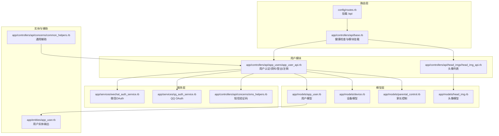
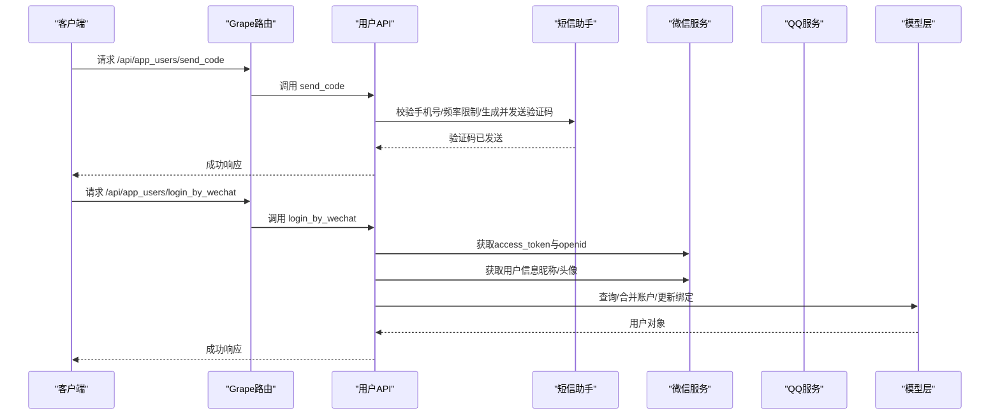
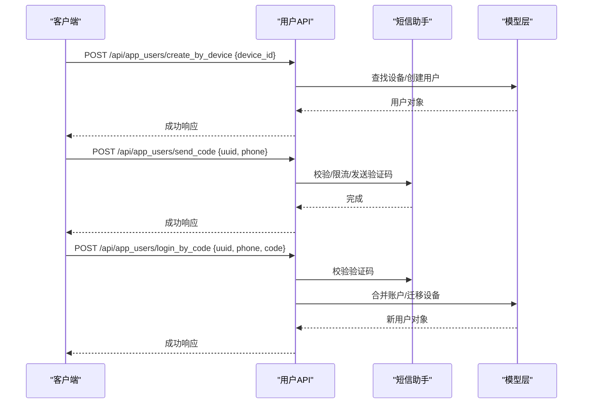
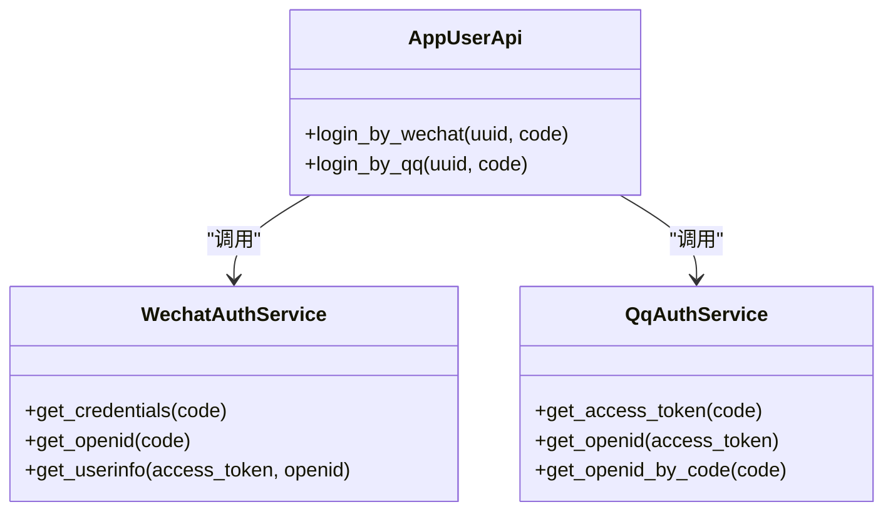
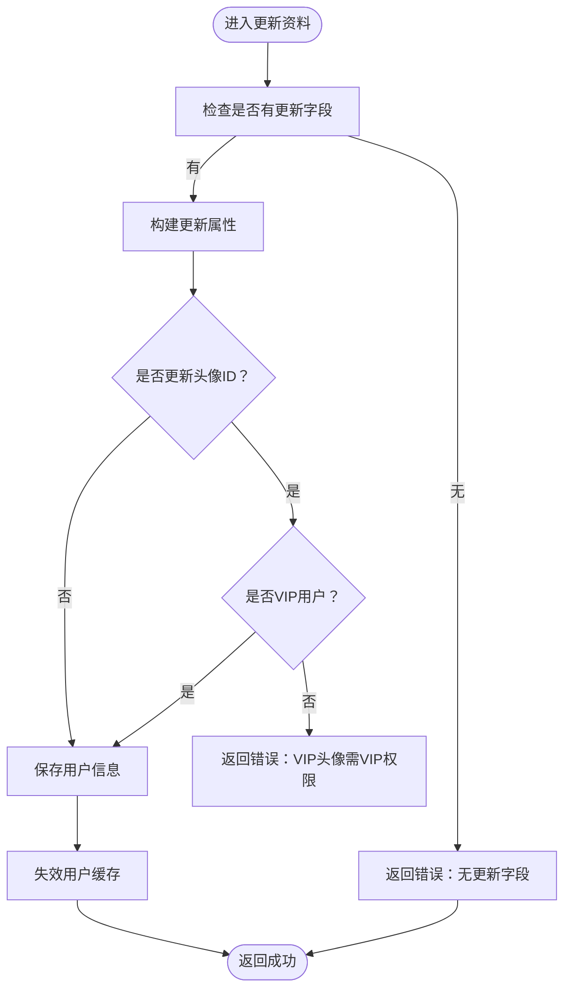
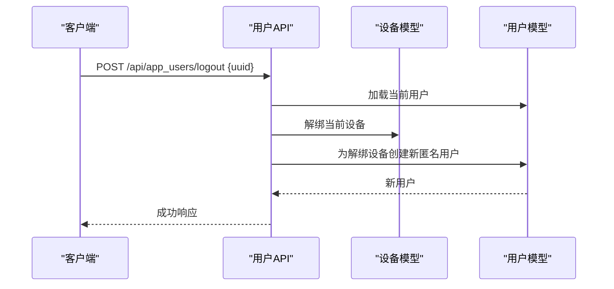
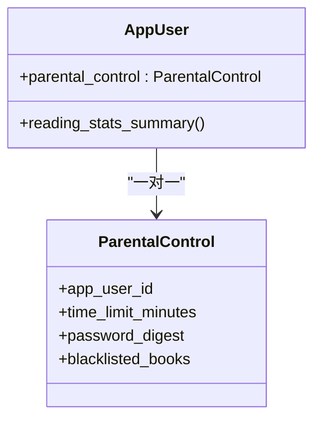
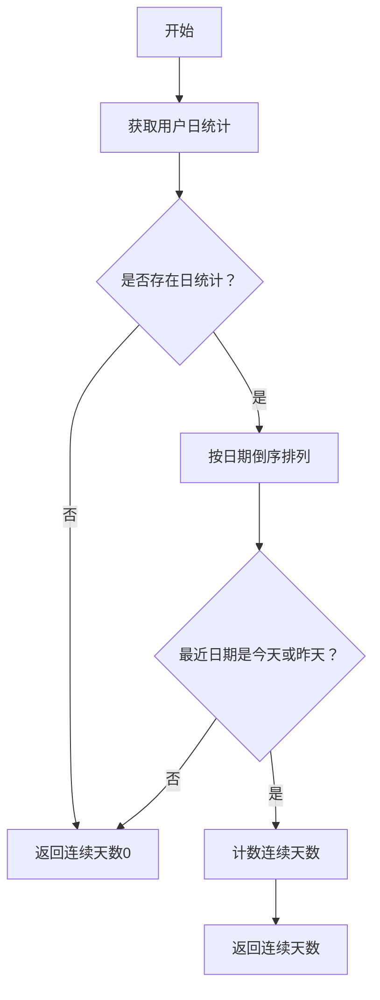
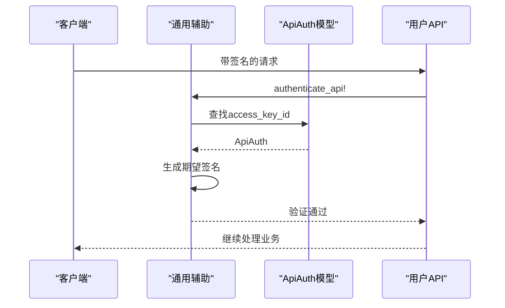
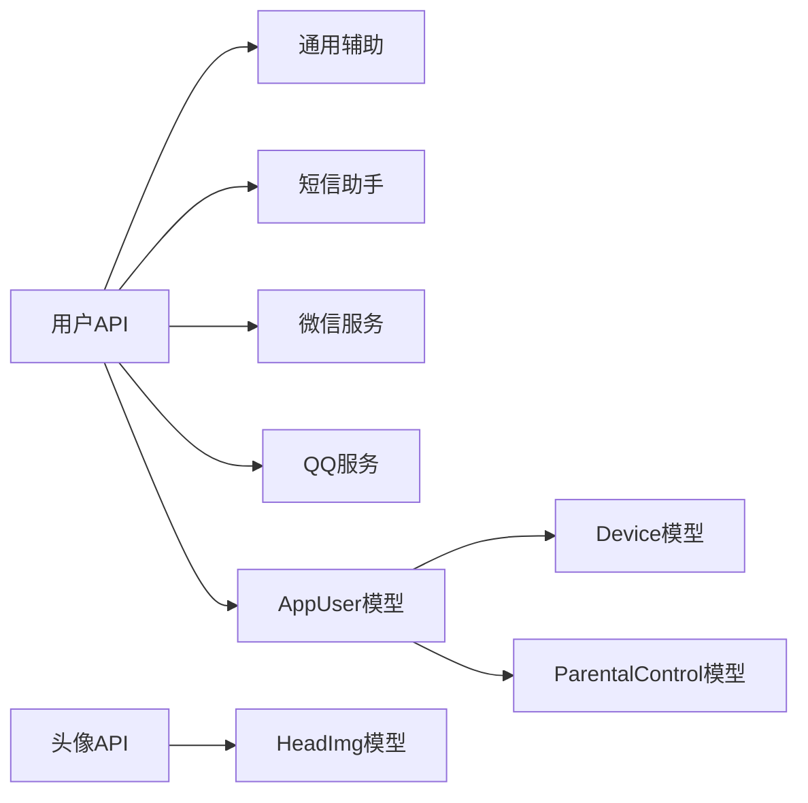

# 用户管理系统

<cite>
**本文引用的文件**
- [app/controllers/api/app_users/app_user_api.rb](file://app/controllers/api/app_users/app_user_api.rb)
- [app/models/app_user.rb](file://app/models/app_user.rb)
- [app/services/wechat_auth_service.rb](file://app/services/wechat_auth_service.rb)
- [app/services/qq_auth_service.rb](file://app/services/qq_auth_service.rb)
- [app/controllers/api/concerns/sms_helpers.rb](file://app/controllers/api/concerns/sms_helpers.rb)
- [app/models/device.rb](file://app/models/device.rb)
- [app/models/parental_control.rb](file://app/models/parental_control.rb)
- [app/entities/app_user.rb](file://app/entities/app_user.rb)
- [db/migrate/20260511000000_create_devices.rb](file://db/migrate/20260511000000_create_devices.rb)
- [config/routes.rb](file://config/routes.rb)
- [app/controllers/api/base.rb](file://app/controllers/api/base.rb)
- [app/controllers/api/concerns/common_helpers.rb](file://app/controllers/api/concerns/common_helpers.rb)
- [app/models/head_img.rb](file://app/models/head_img.rb)
- [app/controllers/api/head_imgs/head_img_api.rb](file://app/controllers/api/head_imgs/head_img_api.rb)
</cite>

## 目录
1. [简介](#简介)
2. [项目结构](#项目结构)
3. [核心组件](#核心组件)
4. [架构总览](#架构总览)
5. [详细组件分析](#详细组件分析)
6. [依赖分析](#依赖分析)
7. [性能考虑](#性能考虑)
8. [故障排查指南](#故障排查指南)
9. [结论](#结论)
10. [附录](#附录)

## 简介
本项目为“用户管理系统”，围绕用户生命周期与家庭场景下的儿童阅读需求，提供以下能力：
- 用户注册与登录：设备匿名创建、手机号+验证码登录、密码登录、微信/QQ第三方登录
- 个人资料管理：昵称、年级、头像（含VIP头像限制）
- 设备绑定与多设备共享：一个账户可绑定多个设备，实现跨设备数据同步
- 家长控制：时间限制、内容过滤（黑名单）、家长密码
- 用户状态与统计：活跃度统计、阅读时长/字数/册数、连续阅读天数
- 安全与认证：基于UUID的用户鉴权、API签名认证、短信验证码、第三方OAuth
- API与实体：统一响应格式、Swagger文档、OpenAPI 3.0

## 项目结构
系统采用Rails + Grape API的分层架构，API通过挂载方式组织模块，控制器负责路由与参数校验，服务层处理第三方交互，模型层承载业务数据与约束。

**图表来源**
- [config/routes.rb:1-30](file://config/routes.rb#L1-L30)
- [app/controllers/api/base.rb:1-65](file://app/controllers/api/base.rb#L1-L65)
- [app/controllers/api/app_users/app_user_api.rb:1-331](file://app/controllers/api/app_users/app_user_api.rb#L1-L331)
- [app/controllers/api/head_imgs/head_img_api.rb:1-29](file://app/controllers/api/head_imgs/head_img_api.rb#L1-L29)
- [app/models/app_user.rb:1-140](file://app/models/app_user.rb#L1-L140)
- [app/models/device.rb:1-52](file://app/models/device.rb#L1-L52)
- [app/models/parental_control.rb:1-36](file://app/models/parental_control.rb#L1-L36)
- [app/models/head_img.rb:1-23](file://app/models/head_img.rb#L1-L23)
- [app/services/wechat_auth_service.rb:1-85](file://app/services/wechat_auth_service.rb#L1-L85)
- [app/services/qq_auth_service.rb:1-87](file://app/services/qq_auth_service.rb#L1-L87)
- [app/controllers/api/concerns/sms_helpers.rb:1-57](file://app/controllers/api/concerns/sms_helpers.rb#L1-L57)
- [app/entities/app_user.rb:1-41](file://app/entities/app_user.rb#L1-L41)
- [app/controllers/api/concerns/common_helpers.rb:1-133](file://app/controllers/api/concerns/common_helpers.rb#L1-L133)

**章节来源**
- [config/routes.rb:1-30](file://config/routes.rb#L1-L30)
- [app/controllers/api/base.rb:1-65](file://app/controllers/api/base.rb#L1-L65)

## 核心组件
- 用户认证与会话
  - 设备匿名创建：按设备ID创建匿名用户，避免未登录态下无法使用
  - 手机号+验证码登录：支持多设备共享同一账户，手机号可被合并
  - 密码登录：手机号+密码登录
  - 第三方登录：微信授权登录、QQ授权登录
  - 注销与退出：注销账户会解绑设备并为每个设备创建新匿名用户；退出登录仅解绑当前设备
- 个人资料管理
  - 昵称、年级、头像更新；非VIP不可选VIP头像
- 设备绑定与多设备共享
  - 一个账户可绑定多个设备；设备解绑后不影响其他设备
- 家长控制
  - 时间限制（分钟）、家长密码、内容黑名单（黑书）
- 用户状态与统计
  - 阅读时长/字数/册数、连续阅读天数、VIP状态
- 安全与认证
  - UUID鉴权、API签名认证、短信验证码、第三方OAuth

**章节来源**
- [app/controllers/api/app_users/app_user_api.rb:1-331](file://app/controllers/api/app_users/app_user_api.rb#L1-L331)
- [app/models/app_user.rb:1-140](file://app/models/app_user.rb#L1-L140)
- [app/models/device.rb:1-52](file://app/models/device.rb#L1-L52)
- [app/models/parental_control.rb:1-36](file://app/models/parental_control.rb#L1-L36)
- [app/controllers/api/concerns/sms_helpers.rb:1-57](file://app/controllers/api/concerns/sms_helpers.rb#L1-L57)
- [app/services/wechat_auth_service.rb:1-85](file://app/services/wechat_auth_service.rb#L1-L85)
- [app/services/qq_auth_service.rb:1-87](file://app/services/qq_auth_service.rb#L1-L87)

## 架构总览
系统通过Grape在根路径/api下挂载各业务模块，用户模块提供认证、资料、登出、注销等接口；设备模型支撑多设备共享；家长控制模型提供儿童模式与内容过滤；实体层统一输出用户信息；服务层封装微信/QQ第三方登录；短信助手提供验证码发送与校验。

**图表来源**
- [app/controllers/api/app_users/app_user_api.rb:29-44](file://app/controllers/api/app_users/app_user_api.rb#L29-L44)
- [app/controllers/api/app_users/app_user_api.rb:101-153](file://app/controllers/api/app_users/app_user_api.rb#L101-L153)
- [app/controllers/api/concerns/sms_helpers.rb:14-40](file://app/controllers/api/concerns/sms_helpers.rb#L14-L40)
- [app/services/wechat_auth_service.rb:19-44](file://app/services/wechat_auth_service.rb#L19-L44)

## 详细组件分析

### 用户认证与登录流程
- 设备匿名创建
  - 输入：设备ID
  - 输出：用户对象（若设备已绑定用户则复用）
- 发送验证码
  - 输入：uuid（可选）、手机号
  - 校验：手机号格式、发送频率限制、每日上限
  - 输出：验证码有效期
- 验证码登录/注册
  - 输入：uuid、手机号、验证码
  - 流程：校验验证码、若手机号已绑定其他用户则迁移设备与第三方绑定信息并销毁旧用户
- 密码登录
  - 输入：uuid、手机号、密码
  - 校验：手机号存在且密码正确
- 微信登录
  - 输入：uuid、授权码
  - 流程：换取access_token与openid，获取用户信息（昵称/头像），处理主账户合并与绑定
- QQ登录
  - 输入：uuid、授权码
  - 流程：换取openid，若未绑定则写入并生成默认昵称
- 退出登录/注销
  - 退出：解绑当前设备并为该设备创建新匿名用户
  - 注销：删除用户及资源，为每个设备创建新匿名用户

**图表来源**
- [app/controllers/api/app_users/app_user_api.rb:13-27](file://app/controllers/api/app_users/app_user_api.rb#L13-L27)
- [app/controllers/api/app_users/app_user_api.rb:29-44](file://app/controllers/api/app_users/app_user_api.rb#L29-L44)
- [app/controllers/api/app_users/app_user_api.rb:46-82](file://app/controllers/api/app_users/app_user_api.rb#L46-L82)
- [app/controllers/api/concerns/sms_helpers.rb:14-40](file://app/controllers/api/concerns/sms_helpers.rb#L14-L40)

**章节来源**
- [app/controllers/api/app_users/app_user_api.rb:13-82](file://app/controllers/api/app_users/app_user_api.rb#L13-L82)
- [app/controllers/api/concerns/sms_helpers.rb:14-40](file://app/controllers/api/concerns/sms_helpers.rb#L14-L40)

### 第三方登录服务
- 微信OAuth
  - 获取access_token与openid
  - 获取用户信息（昵称、头像、性别）
  - 异常处理：授权失败或用户信息获取失败时记录日志并抛错
- QQ OAuth
  - 获取access_token
  - 通过access_token获取openid（解析callback格式）
  - 异常处理：授权失败或openid解析失败时记录日志并抛错

**图表来源**
- [app/services/wechat_auth_service.rb:1-85](file://app/services/wechat_auth_service.rb#L1-L85)
- [app/services/qq_auth_service.rb:1-87](file://app/services/qq_auth_service.rb#L1-L87)
- [app/controllers/api/app_users/app_user_api.rb:101-176](file://app/controllers/api/app_users/app_user_api.rb#L101-L176)

**章节来源**
- [app/services/wechat_auth_service.rb:1-85](file://app/services/wechat_auth_service.rb#L1-L85)
- [app/services/qq_auth_service.rb:1-87](file://app/services/qq_auth_service.rb#L1-L87)

### 个人资料管理与头像系统
- 更新资料
  - 支持昵称、年级、头像ID更新
  - 非VIP用户不可选择VIP头像
- 头像列表
  - 返回全部头像（普通/VIP），客户端根据VIP状态决定可选范围
- 用户实体
  - 输出包含头像、昵称、年级、阅读统计、VIP状态、家长控制开关与时间限制等

**图表来源**
- [app/controllers/api/app_users/app_user_api.rb:211-239](file://app/controllers/api/app_users/app_user_api.rb#L211-L239)
- [app/models/head_img.rb:1-23](file://app/models/head_img.rb#L1-L23)
- [app/entities/app_user.rb:1-41](file://app/entities/app_user.rb#L1-L41)

**章节来源**
- [app/controllers/api/app_users/app_user_api.rb:211-239](file://app/controllers/api/app_users/app_user_api.rb#L211-L239)
- [app/controllers/api/head_imgs/head_img_api.rb:1-29](file://app/controllers/api/head_imgs/head_img_api.rb#L1-L29)
- [app/entities/app_user.rb:1-41](file://app/entities/app_user.rb#L1-L41)

### 设备绑定与多设备共享
- 设备模型
  - 唯一索引device_id，支持绑定/解绑
  - bind!/unbind!幂等操作，支持并发
- 用户模型
  - has_many :devices，优先从devices表取最新device_id
- 用户API
  - 退出登录：解绑当前设备并为该设备创建新匿名用户
  - 注销：遍历设备ID，逐个为设备创建新匿名用户

**图表来源**
- [app/models/device.rb:1-52](file://app/models/device.rb#L1-L52)
- [app/models/app_user.rb:82-85](file://app/models/app_user.rb#L82-L85)
- [app/controllers/api/app_users/app_user_api.rb:294-310](file://app/controllers/api/app_users/app_user_api.rb#L294-L310)

**章节来源**
- [app/models/device.rb:1-52](file://app/models/device.rb#L1-L52)
- [app/models/app_user.rb:82-85](file://app/models/app_user.rb#L82-L85)
- [app/controllers/api/app_users/app_user_api.rb:294-310](file://app/controllers/api/app_users/app_user_api.rb#L294-L310)

### 家长控制与儿童模式
- 家长控制模型
  - 关联用户，唯一约束
  - 可设置时间限制（分钟）、家长密码、内容黑名单
- 用户API
  - 配置接口：高频读取家长时间限制，使用缓存降低数据库压力
- 实体
  - 输出家长控制开关与时间限制

**图表来源**
- [app/models/app_user.rb:57-57](file://app/models/app_user.rb#L57-L57)
- [app/models/parental_control.rb:1-36](file://app/models/parental_control.rb#L1-L36)
- [app/controllers/api/app_users/app_user_api.rb:178-198](file://app/controllers/api/app_users/app_user_api.rb#L178-L198)
- [app/entities/app_user.rb:30-35](file://app/entities/app_user.rb#L30-L35)

**章节来源**
- [app/models/parental_control.rb:1-36](file://app/models/parental_control.rb#L1-L36)
- [app/controllers/api/app_users/app_user_api.rb:178-198](file://app/controllers/api/app_users/app_user_api.rb#L178-L198)
- [app/entities/app_user.rb:30-35](file://app/entities/app_user.rb#L30-L35)

### 用户状态与统计
- 阅读统计
  - 总时长/字数/册数、连续阅读天数计算
- 用户实体
  - 输出阅读统计字段
- 设备迁移与统计
  - 注销/合并账户时保持阅读统计不丢失（由模型关联与业务流程保证）

**图表来源**
- [app/models/app_user.rb:94-114](file://app/models/app_user.rb#L94-L114)
- [app/entities/app_user.rb:20-22](file://app/entities/app_user.rb#L20-L22)

**章节来源**
- [app/models/app_user.rb:87-124](file://app/models/app_user.rb#L87-L124)
- [app/entities/app_user.rb:20-22](file://app/entities/app_user.rb#L20-L22)

### 安全与认证机制
- 用户鉴权
  - 基于uuid缓存加载用户，未授权访问返回错误
- API签名认证
  - X-Access-Key-Id + X-Sign，参数按字母排序拼接后与secret进行SHA1签名
- 短信验证码
  - 4位数字验证码，有效期5分钟，发送频率与当日上限限制
- 第三方OAuth
  - 微信/QQ授权码换取token与openid，异常捕获与日志记录

**图表来源**
- [app/controllers/api/concerns/common_helpers.rb:97-113](file://app/controllers/api/concerns/common_helpers.rb#L97-L113)
- [app/controllers/api/concerns/common_helpers.rb:115-124](file://app/controllers/api/concerns/common_helpers.rb#L115-L124)

**章节来源**
- [app/controllers/api/concerns/common_helpers.rb:77-95](file://app/controllers/api/concerns/common_helpers.rb#L77-L95)
- [app/controllers/api/concerns/common_helpers.rb:97-113](file://app/controllers/api/concerns/common_helpers.rb#L97-L113)
- [app/controllers/api/concerns/sms_helpers.rb:14-40](file://app/controllers/api/concerns/sms_helpers.rb#L14-L40)

## 依赖分析
- 控制器依赖
  - 用户API依赖通用辅助、短信助手、微信/QQ服务、模型层
- 模型依赖
  - AppUser关联Device/ParentalControl/HeadImg等，具备阅读统计与VIP状态
- 数据迁移
  - 设备表独立建模，历史数据回填

**图表来源**
- [app/controllers/api/app_users/app_user_api.rb:1-331](file://app/controllers/api/app_users/app_user_api.rb#L1-L331)
- [app/controllers/api/concerns/common_helpers.rb:1-133](file://app/controllers/api/concerns/common_helpers.rb#L1-L133)
- [app/controllers/api/concerns/sms_helpers.rb:1-57](file://app/controllers/api/concerns/sms_helpers.rb#L1-L57)
- [app/services/wechat_auth_service.rb:1-85](file://app/services/wechat_auth_service.rb#L1-L85)
- [app/services/qq_auth_service.rb:1-87](file://app/services/qq_auth_service.rb#L1-L87)
- [app/models/app_user.rb:1-140](file://app/models/app_user.rb#L1-L140)
- [app/models/device.rb:1-52](file://app/models/device.rb#L1-L52)
- [app/models/parental_control.rb:1-36](file://app/models/parental_control.rb#L1-L36)
- [app/controllers/api/head_imgs/head_img_api.rb:1-29](file://app/controllers/api/head_imgs/head_img_api.rb#L1-L29)
- [app/models/head_img.rb:1-23](file://app/models/head_img.rb#L1-L23)

**章节来源**
- [db/migrate/20260511000000_create_devices.rb:1-22](file://db/migrate/20260511000000_create_devices.rb#L1-L22)

## 性能考虑
- 缓存策略
  - 用户鉴权：按uuid缓存1小时
  - 家长时间限制：按用户更新时间版本化缓存5分钟
- 高频接口
  - 用户配置接口使用缓存，减少数据库查询
- 并发控制
  - 设备绑定/解绑采用幂等与异常重试，避免唯一索引冲突
- 数据库索引
  - 用户表phone/uuid/wechat_openid/qq_openid唯一索引，设备表device_id唯一索引

[本节为通用指导，无需具体文件分析]

## 故障排查指南
- 未授权访问
  - 现象：返回未授权错误
  - 排查：确认uuid有效、缓存未过期
- 验证码问题
  - 现象：验证码无效/过期、发送过于频繁、当日上限
  - 排查：检查手机号格式、发送频率与当日计数
- 微信/QQ登录失败
  - 现象：授权码已使用/过期、用户信息获取失败
  - 排查：确认授权scope、access_token有效性、回调参数
- 设备绑定异常
  - 现象：设备无法绑定/解绑
  - 排查：确认device_id唯一性、并发情况下的重试

**章节来源**
- [app/controllers/api/concerns/common_helpers.rb:92-95](file://app/controllers/api/concerns/common_helpers.rb#L92-L95)
- [app/controllers/api/concerns/sms_helpers.rb:31-40](file://app/controllers/api/concerns/sms_helpers.rb#L31-L40)
- [app/controllers/api/app_users/app_user_api.rb:150-153](file://app/controllers/api/app_users/app_user_api.rb#L150-L153)
- [app/models/device.rb:34-50](file://app/models/device.rb#L34-L50)

## 结论
本用户管理系统以清晰的模块划分与完善的认证体系为基础，覆盖从设备匿名创建到多设备共享、从手机号/密码/第三方登录到家长控制与儿童模式的完整用户生命周期。通过缓存与索引优化提升高频接口性能，通过服务层封装第三方登录与短信验证码增强可维护性。建议在生产环境中完善监控与告警，持续优化家长控制策略与内容过滤规则。

[本节为总结，无需具体文件分析]

## 附录

### API接口规范（节选）
- 健康检查
  - GET /api/up
- 用户模块
  - POST /api/app_users/create_by_device
  - POST /api/app_users/send_code
  - POST /api/app_users/login_by_code
  - POST /api/app_users/login_by_password
  - POST /api/app_users/login_by_wechat
  - POST /api/app_users/login_by_qq
  - GET /api/app_users/config
  - GET /api/app_users/info
  - PUT /api/app_users/update_profile
  - POST /api/app_users/reset_password
  - POST /api/app_users/delete_account
  - POST /api/app_users/logout
  - POST /api/app_users/unbind_wechat
- 头像模块
  - GET /api/head_imgs/index

**章节来源**
- [config/routes.rb:9-10](file://config/routes.rb#L9-L10)
- [app/controllers/api/base.rb:24-37](file://app/controllers/api/base.rb#L24-L37)
- [app/controllers/api/app_users/app_user_api.rb:12-327](file://app/controllers/api/app_users/app_user_api.rb#L12-L327)
- [app/controllers/api/head_imgs/head_img_api.rb:9-25](file://app/controllers/api/head_imgs/head_img_api.rb#L9-L25)

### 数据模型设计要点
- 用户表
  - 字段：uuid、phone、wechat_openid、qq_openid、nickname、grade_id、head_img_id、is_vip、vip_expires_at、reading_*统计、role等
  - 索引：uuid/phone/wechat_openid/qq_openid唯一
- 设备表
  - 字段：device_id、app_user_id
  - 索引：device_id唯一
- 家长控制表
  - 字段：app_user_id、time_limit_minutes、password_digest、phone
  - 约束：app_user_id唯一

**章节来源**
- [app/models/app_user.rb:1-33](file://app/models/app_user.rb#L1-L33)
- [db/migrate/20260511000000_create_devices.rb:1-22](file://db/migrate/20260511000000_create_devices.rb#L1-L22)
- [app/models/parental_control.rb:1-36](file://app/models/parental_control.rb#L1-L36)