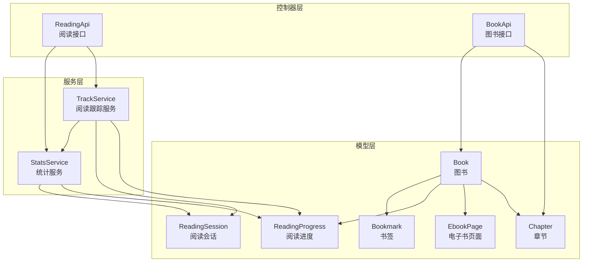
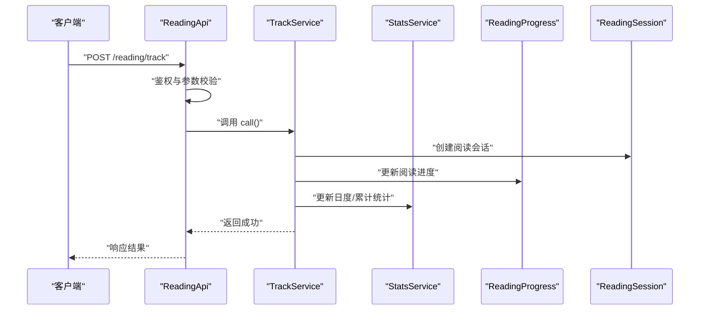
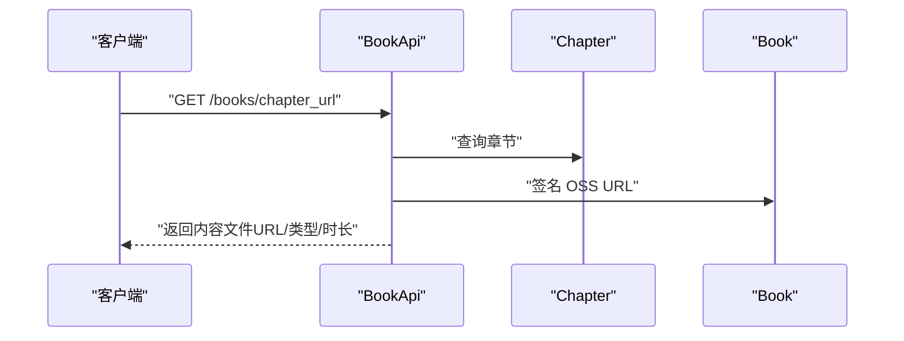
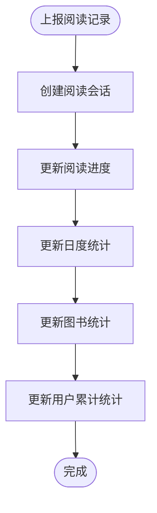
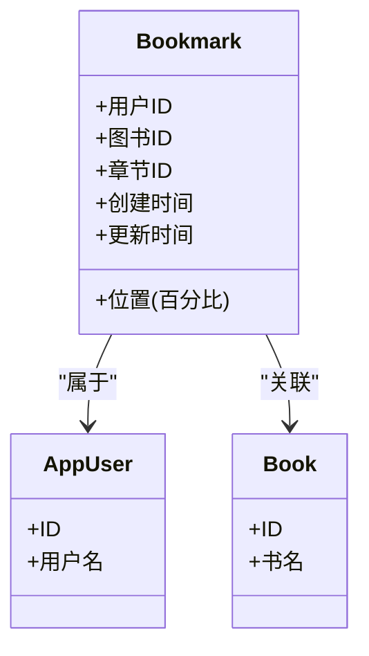
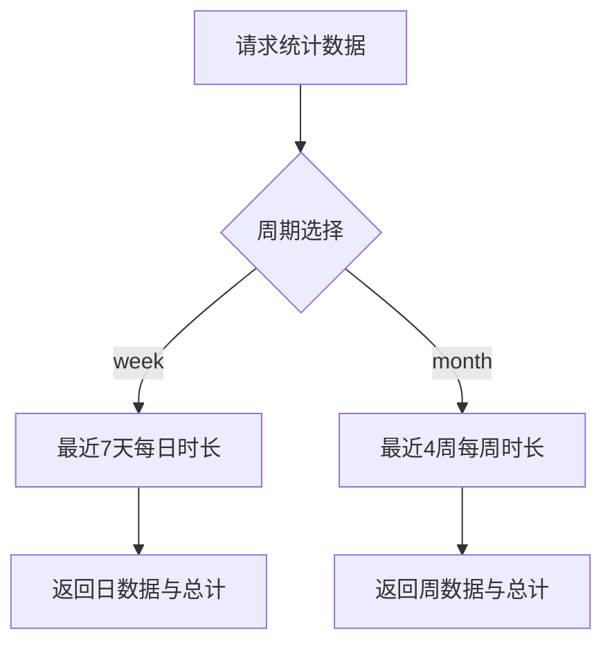
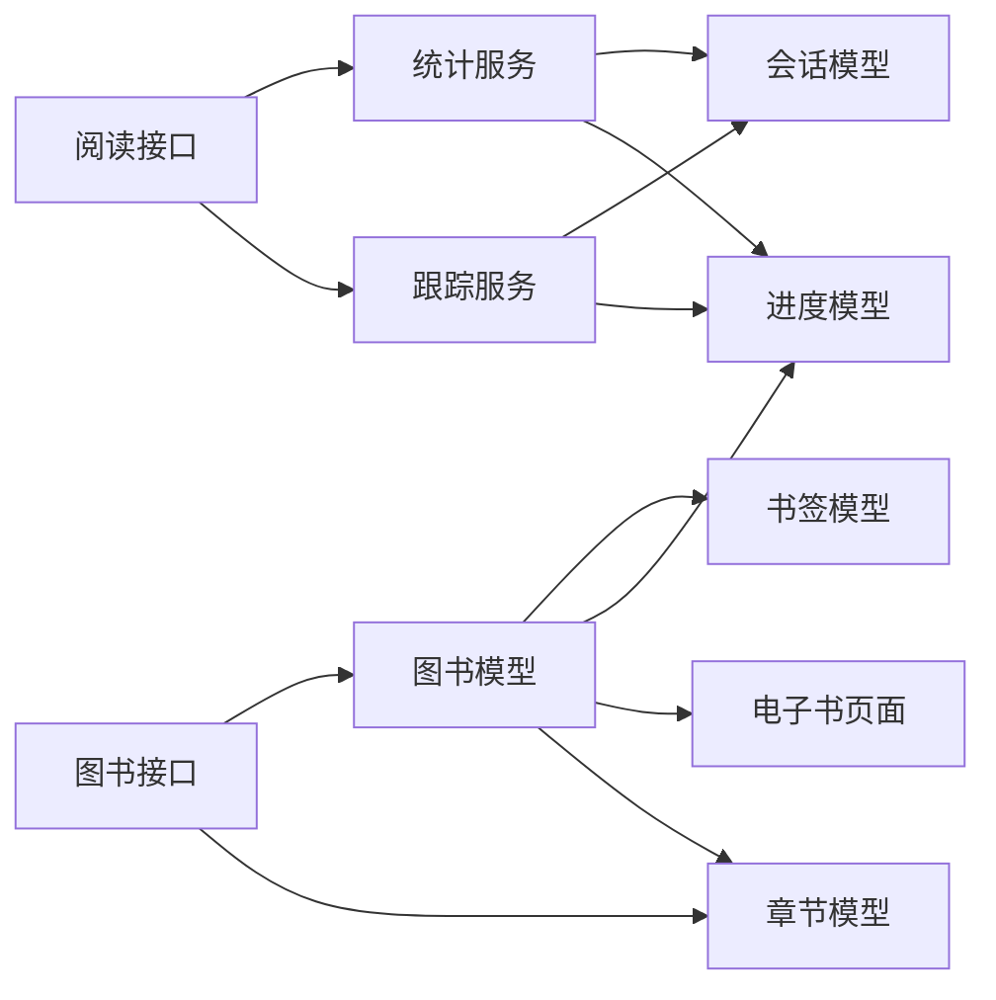

# 阅读体验功能

<cite>
**本文档引用的文件**
- [app/controllers/api/readings/reading_api.rb](file://app/controllers/api/readings/reading_api.rb)
- [app/services/reading/track_service.rb](file://app/services/reading/track_service.rb)
- [app/services/reading/stats_service.rb](file://app/services/reading/stats_service.rb)
- [app/models/reading_progress.rb](file://app/models/reading_progress.rb)
- [app/models/reading_session.rb](file://app/models/reading_session.rb)
- [app/models/bookmark.rb](file://app/models/bookmark.rb)
- [app/controllers/api/books/book_api.rb](file://app/controllers/api/books/book_api.rb)
- [app/models/book.rb](file://app/models/book.rb)
- [app/models/chapter.rb](file://app/models/chapter.rb)
- [app/models/ebook_page.rb](file://app/models/ebook_page.rb)
</cite>

## 目录
1. [引言](#引言)
2. [项目结构](#项目结构)
3. [核心组件](#核心组件)
4. [架构概览](#架构概览)
5. [详细组件分析](#详细组件分析)
6. [依赖分析](#依赖分析)
7. [性能考虑](#性能考虑)
8. [故障排除指南](#故障排除指南)
9. [结论](#结论)

## 引言
本文件面向阅读体验功能的技术与产品团队，系统性梳理语音播放系统、阅读进度跟踪、书签管理与阅读统计分析等核心能力。文档基于代码库实际实现进行分析，重点覆盖：
- 语音播放系统：章节音频/视频获取、时长与质量控制、播放控制接口
- 阅读进度跟踪：会话管理、自动保存、断点续读、历史记录
- 书签管理：书签创建、位置标记、分类整理与同步机制
- 阅读统计分析：时长统计、阅读习惯、学习报告
- 阅读会话管理、进度持久化与用户体验优化策略

## 项目结构
阅读体验功能主要分布在以下模块：
- 控制器层：提供 API 接口，负责鉴权、参数校验与响应封装
- 服务层：封装业务逻辑，包括阅读跟踪、统计计算与会话管理
- 模型层：定义数据结构与关联关系，支撑进度、会话、书签与章节等核心实体
- 数据库迁移：定义阅读进度、会话、书签、章节与统计表结构

**图示来源**
- [app/controllers/api/readings/reading_api.rb:1-93](file://app/controllers/api/readings/reading_api.rb#L1-L93)
- [app/controllers/api/books/book_api.rb:1-242](file://app/controllers/api/books/book_api.rb#L1-L242)
- [app/services/reading/track_service.rb:1-126](file://app/services/reading/track_service.rb#L1-L126)
- [app/services/reading/stats_service.rb:1-140](file://app/services/reading/stats_service.rb#L1-L140)
- [app/models/reading_progress.rb:1-27](file://app/models/reading_progress.rb#L1-L27)
- [app/models/reading_session.rb:1-25](file://app/models/reading_session.rb#L1-L25)
- [app/models/bookmark.rb:1-33](file://app/models/bookmark.rb#L1-L33)
- [app/models/book.rb:1-157](file://app/models/book.rb#L1-L157)
- [app/models/chapter.rb:1-103](file://app/models/chapter.rb#L1-L103)
- [app/models/ebook_page.rb:1-34](file://app/models/ebook_page.rb#L1-L34)

**章节来源**
- [app/controllers/api/readings/reading_api.rb:1-93](file://app/controllers/api/readings/reading_api.rb#L1-L93)
- [app/controllers/api/books/book_api.rb:1-242](file://app/controllers/api/books/book_api.rb#L1-L242)

## 核心组件
- 阅读跟踪服务：负责创建阅读会话、更新阅读进度、维护日度与累计统计，并在事务中保证一致性
- 统计服务：提供用户阅读统计摘要、图书阅读统计、进度列表与图表数据（日/周）
- 阅读进度模型：记录用户对图书的最后阅读页码、累计字数与时长、会话次数、完成状态与最近阅读时间
- 阅读会话模型：记录每次阅读的起止时间、页码、字数与时长、阅读日期
- 书签模型：记录用户在图书中的阅读位置（百分比）与章节信息
- 图书与章节模型：提供章节音频/视频 URL、时长与内容类型，支持签名访问

**章节来源**
- [app/services/reading/track_service.rb:1-126](file://app/services/reading/track_service.rb#L1-L126)
- [app/services/reading/stats_service.rb:1-140](file://app/services/reading/stats_service.rb#L1-L140)
- [app/models/reading_progress.rb:1-27](file://app/models/reading_progress.rb#L1-L27)
- [app/models/reading_session.rb:1-25](file://app/models/reading_session.rb#L1-L25)
- [app/models/bookmark.rb:1-33](file://app/models/bookmark.rb#L1-L33)
- [app/models/book.rb:1-157](file://app/models/book.rb#L1-L157)
- [app/models/chapter.rb:1-103](file://app/models/chapter.rb#L1-L103)

## 架构概览
阅读体验功能采用“控制器-服务-模型”分层架构，通过服务层聚合多个领域操作，确保业务一致性与可测试性。

**图示来源**
- [app/controllers/api/readings/reading_api.rb:19-34](file://app/controllers/api/readings/reading_api.rb#L19-L34)
- [app/services/reading/track_service.rb:16-26](file://app/services/reading/track_service.rb#L16-L26)
- [app/services/reading/stats_service.rb:6-28](file://app/services/reading/stats_service.rb#L6-L28)

## 详细组件分析

### 语音播放系统
语音播放系统围绕“章节内容文件”展开，提供音频/视频 URL 获取与时长信息，支持签名访问以保障安全。

- 章节内容文件 URL 获取
  - 接口：图书接口中的章节 URL 获取
  - 功能：返回章节内容文件 URL、文件类型与时长
  - 安全：使用 OSS 签名生成临时访问链接
- 图书与章节模型
  - 章节模型包含内容文件 URL、类型与时长字段
  - 图书模型提供统一的 OSS URL 签名工具
- 播放控制
  - 时长与时序：通过章节时长字段控制播放进度
  - 音频质量：由内容文件类型与存储质量决定
  - 断点续播：结合阅读进度与书签位置实现

**图示来源**
- [app/controllers/api/books/book_api.rb:65-79](file://app/controllers/api/books/book_api.rb#L65-L79)
- [app/models/chapter.rb:1-103](file://app/models/chapter.rb#L1-L103)
- [app/models/book.rb:104-141](file://app/models/book.rb#L104-L141)

**章节来源**
- [app/controllers/api/books/book_api.rb:59-79](file://app/controllers/api/books/book_api.rb#L59-L79)
- [app/models/chapter.rb:1-103](file://app/models/chapter.rb#L1-L103)
- [app/models/book.rb:104-141](file://app/models/book.rb#L104-L141)

### 阅读进度跟踪
阅读进度跟踪通过“阅读会话”与“阅读进度”两个维度实现，确保用户在不同设备与场景下都能获得一致的阅读体验。

- 阅读会话
  - 记录每次阅读的起止时间、页码、字数与时长、阅读日期
  - 支持按日期与图书筛选，用于日度统计与首次阅读判断
- 阅读进度
  - 记录用户对图书的最后阅读页码、累计字数与时长、会话次数、完成状态与最近阅读时间
  - 完成判定：当最后阅读页码达到图书总页数时标记完成
- 事务一致性
  - 在单个事务中创建会话、更新进度、维护日度与累计统计，避免并发竞态

**图示来源**
- [app/services/reading/track_service.rb:16-26](file://app/services/reading/track_service.rb#L16-L26)
- [app/services/reading/track_service.rb:30-40](file://app/services/reading/track_service.rb#L30-L40)
- [app/services/reading/track_service.rb:42-66](file://app/services/reading/track_service.rb#L42-L66)
- [app/services/reading/track_service.rb:68-86](file://app/services/reading/track_service.rb#L68-L86)
- [app/services/reading/track_service.rb:88-115](file://app/services/reading/track_service.rb#L88-L115)
- [app/services/reading/track_service.rb:117-123](file://app/services/reading/track_service.rb#L117-L123)

**章节来源**
- [app/services/reading/track_service.rb:1-126](file://app/services/reading/track_service.rb#L1-L126)
- [app/models/reading_progress.rb:1-27](file://app/models/reading_progress.rb#L1-L27)
- [app/models/reading_session.rb:1-25](file://app/models/reading_session.rb#L1-L25)

### 书签管理
书签用于记录用户在图书中的阅读位置（百分比），支持跨设备同步与快速定位。

- 书签模型
  - 字段：位置（百分比）、用户与图书关联、章节关联
  - 验证：位置非负
  - 作用域：按创建时间倒序排列
- 创建与同步
  - 用户可在任意页面设置书签，系统以百分比形式持久化
  - 可与阅读进度联动，实现断点续读与快速跳转

**图示来源**
- [app/models/bookmark.rb:1-33](file://app/models/bookmark.rb#L1-L33)

**章节来源**
- [app/models/bookmark.rb:1-33](file://app/models/bookmark.rb#L1-L33)

### 阅读统计分析
统计服务提供用户与图书层面的阅读统计摘要、进度列表与图表数据，支持日/周维度分析。

- 用户统计摘要
  - 总阅读时长、总字数、平均会话时长、完成率、连续阅读天数
- 图书统计
  - 总读者数、总阅读次数、总阅读时长、完读人数、完读率、周/月活跃读者
- 进度列表与单本进度
  - 最近阅读的图书列表与某本图书的详细进度
- 图表数据
  - 日维度：最近7天每日时长（补零）
  - 周维度：最近4周每周时长（非重叠周区间）

**图示来源**
- [app/services/reading/stats_service.rb:66-110](file://app/services/reading/stats_service.rb#L66-L110)

**章节来源**
- [app/services/reading/stats_service.rb:1-140](file://app/services/reading/stats_service.rb#L1-L140)

## 依赖分析
- 控制器依赖服务：阅读接口依赖跟踪与统计服务；图书接口依赖章节与图书模型
- 服务依赖模型：跟踪服务依赖进度与会话模型；统计服务依赖进度与会话模型
- 模型间关系：图书包含章节与电子书页面；进度与会话均关联用户与图书；书签关联用户与图书

**图示来源**
- [app/controllers/api/readings/reading_api.rb:1-93](file://app/controllers/api/readings/reading_api.rb#L1-L93)
- [app/controllers/api/books/book_api.rb:1-242](file://app/controllers/api/books/book_api.rb#L1-L242)
- [app/services/reading/track_service.rb:1-126](file://app/services/reading/track_service.rb#L1-L126)
- [app/services/reading/stats_service.rb:1-140](file://app/services/reading/stats_service.rb#L1-L140)
- [app/models/reading_progress.rb:1-27](file://app/models/reading_progress.rb#L1-L27)
- [app/models/reading_session.rb:1-25](file://app/models/reading_session.rb#L1-L25)
- [app/models/bookmark.rb:1-33](file://app/models/bookmark.rb#L1-L33)
- [app/models/book.rb:1-157](file://app/models/book.rb#L1-L157)
- [app/models/chapter.rb:1-103](file://app/models/chapter.rb#L1-L103)
- [app/models/ebook_page.rb:1-34](file://app/models/ebook_page.rb#L1-L34)

## 性能考虑
- 缓存策略：用户统计摘要使用短时缓存，降低数据库压力
- 查询优化：统计服务按日期范围与最近记录进行筛选，避免全表扫描
- 并发控制：跟踪服务在事务中执行，确保会话、进度与统计的一致性
- 签名访问：章节内容文件通过 OSS 签名生成临时链接，减少暴露风险与带宽浪费

**章节来源**
- [app/services/reading/stats_service.rb:7-27](file://app/services/reading/stats_service.rb#L7-L27)
- [app/services/reading/track_service.rb:19-25](file://app/services/reading/track_service.rb#L19-L25)
- [app/models/reading_session.rb:20-23](file://app/models/reading_session.rb#L20-L23)

## 故障排除指南
- 阅读记录上报失败
  - 检查用户鉴权与参数完整性
  - 确认图书存在且未加入黑名单
- 统计数据异常
  - 核对日度统计的首次阅读判断逻辑（基于当日首次会话）
  - 检查完读判定条件（最后页码达到总页数）
- 章节内容无法访问
  - 确认章节内容文件 URL 存在且已签名
  - 检查 OSS 凭据与签名有效期

**章节来源**
- [app/controllers/api/readings/reading_api.rb:19-34](file://app/controllers/api/readings/reading_api.rb#L19-L34)
- [app/controllers/api/books/book_api.rb:65-79](file://app/controllers/api/books/book_api.rb#L65-L79)
- [app/services/reading/track_service.rb:68-86](file://app/services/reading/track_service.rb#L68-L86)

## 结论
阅读体验功能通过清晰的分层设计与严谨的事务处理，实现了从语音播放到进度跟踪、书签管理与统计分析的完整闭环。建议在后续迭代中持续关注缓存命中率、查询性能与并发一致性，同时增强播放控制与断点续读的交互细节，进一步提升用户体验。