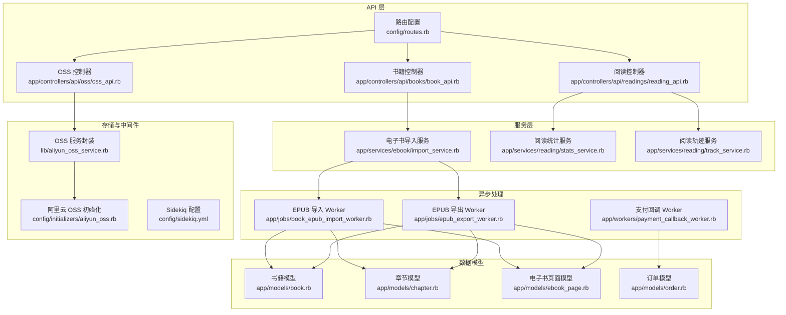
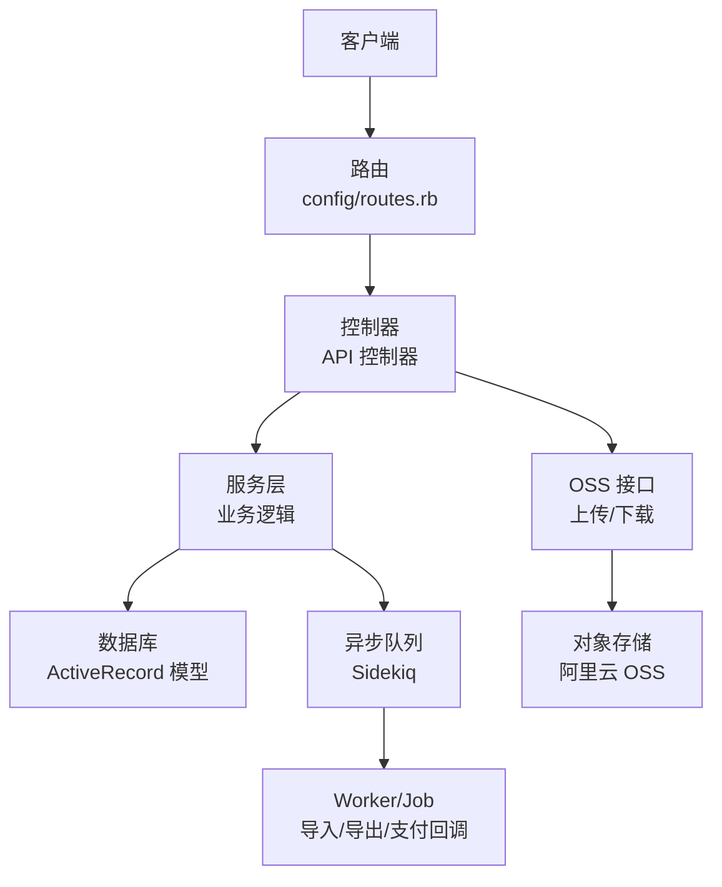
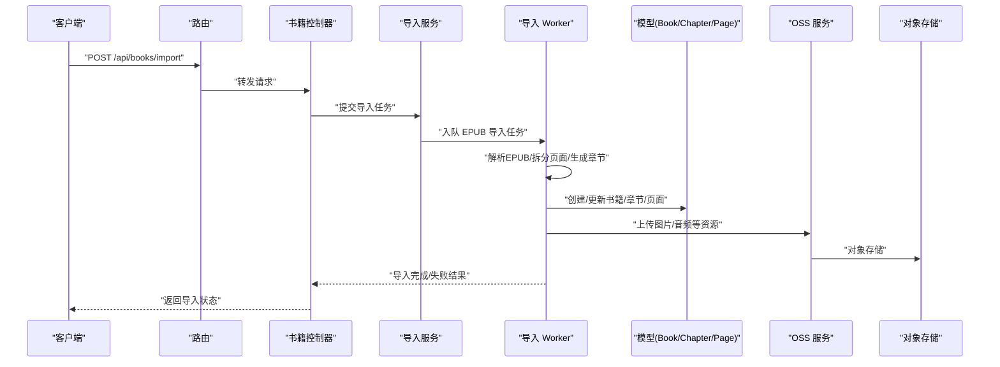
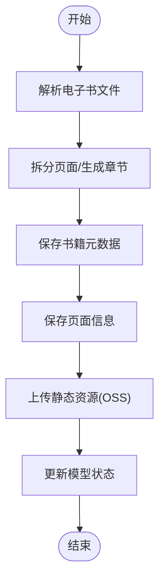
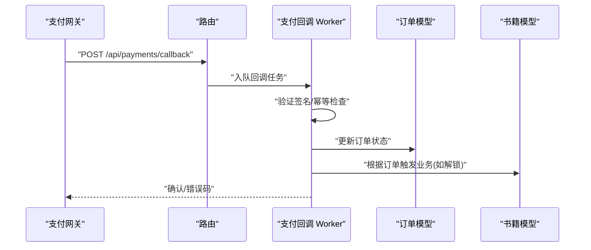
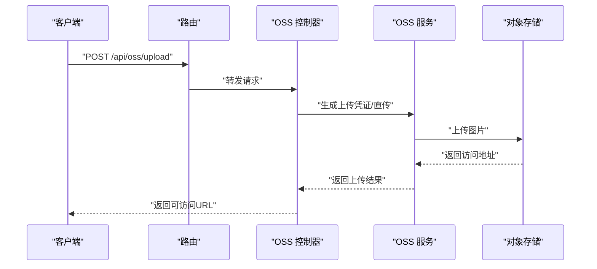
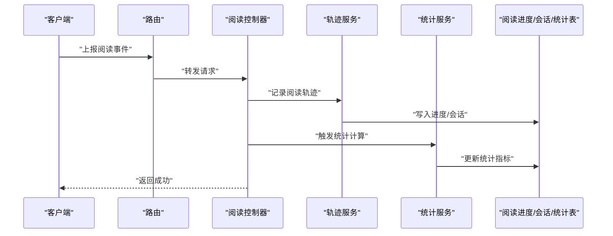
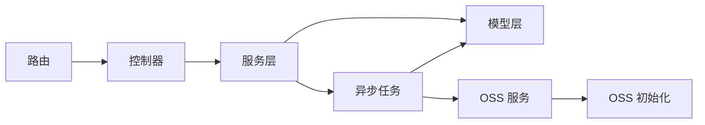

# 数据流设计

<cite>
**本文档引用的文件**
- [app/controllers/api/books/book_api.rb](file://app/controllers/api/books/book_api.rb)
- [app/services/ebook/import_service.rb](file://app/services/ebook/import_service.rb)
- [lib/aliyun_oss_service.rb](file://lib/aliyun_oss_service.rb)
- [app/workers/payment_callback_worker.rb](file://app/workers/payment_callback_worker.rb)
- [app/jobs/book_epub_import_worker.rb](file://app/jobs/book_epub_import_worker.rb)
- [app/jobs/epub_export_worker.rb](file://app/jobs/epub_export_worker.rb)
- [app/controllers/api/oss/oss_api.rb](file://app/controllers/api/oss/oss_api.rb)
- [app/controllers/api/readings/reading_api.rb](file://app/controllers/api/readings/reading_api.rb)
- [app/services/reading/stats_service.rb](file://app/services/reading/stats_service.rb)
- [app/services/reading/track_service.rb](file://app/services/reading/track_service.rb)
- [app/models/book.rb](file://app/models/book.rb)
- [app/models/chapter.rb](file://app/models/chapter.rb)
- [app/models/ebook_page.rb](file://app/models/ebook_page.rb)
- [app/models/order.rb](file://app/models/order.rb)
- [config/routes.rb](file://config/routes.rb)
- [config/sidekiq.yml](file://config/sidekiq.yml)
- [config/initializers/aliyun_oss.rb](file://config/initializers/aliyun_oss.rb)
- [docs/pdf_import_export.md](file://docs/pdf_import_export.md)
</cite>

## 目录
1. [简介](#简介)
2. [项目结构](#项目结构)
3. [核心组件](#核心组件)
4. [架构总览](#架构总览)
5. [详细组件分析](#详细组件分析)
6. [依赖关系分析](#依赖关系分析)
7. [性能考虑](#性能考虑)
8. [故障排查指南](#故障排查指南)
9. [结论](#结论)
10. [附录](#附录)

## 简介
本文件面向语音图书平台的数据流设计，系统围绕“电子书导入与导出、支付回调处理、图片资源上传、阅读行为追踪与统计”等核心场景构建。本文从用户请求到数据处理的完整链路出发，梳理API请求处理、业务逻辑执行、数据持久化与异步任务处理的协作方式；并重点阐述电子书导入导出的数据流转、支付回调的数据传递、图片资源上传的存储流程，以及跨组件间的数据传输格式、缓存策略与数据一致性保障机制。

## 项目结构
系统采用典型的 Rails 分层架构：控制器负责API入口与参数校验，服务层封装业务逻辑，模型层负责数据持久化，Sidekiq 负责异步任务编排，OSS 提供对象存储能力。路由集中定义于配置文件中，按功能域划分子模块（如书籍、阅读、分类、榜单、支付等）。

图表来源
- [config/routes.rb](file://config/routes.rb)
- [app/controllers/api/books/book_api.rb](file://app/controllers/api/books/book_api.rb)
- [app/controllers/api/readings/reading_api.rb](file://app/controllers/api/readings/reading_api.rb)
- [app/controllers/api/oss/oss_api.rb](file://app/controllers/api/oss/oss_api.rb)
- [app/services/ebook/import_service.rb](file://app/services/ebook/import_service.rb)
- [app/services/reading/stats_service.rb](file://app/services/reading/stats_service.rb)
- [app/services/reading/track_service.rb](file://app/services/reading/track_service.rb)
- [app/jobs/book_epub_import_worker.rb](file://app/jobs/book_epub_import_worker.rb)
- [app/jobs/epub_export_worker.rb](file://app/jobs/epub_export_worker.rb)
- [app/workers/payment_callback_worker.rb](file://app/workers/payment_callback_worker.rb)
- [config/initializers/aliyun_oss.rb](file://config/initializers/aliyun_oss.rb)
- [lib/aliyun_oss_service.rb](file://lib/aliyun_oss_service.rb)
- [config/sidekiq.yml](file://config/sidekiq.yml)
- [app/models/book.rb](file://app/models/book.rb)
- [app/models/chapter.rb](file://app/models/chapter.rb)
- [app/models/ebook_page.rb](file://app/models/ebook_page.rb)
- [app/models/order.rb](file://app/models/order.rb)

章节来源
- [config/routes.rb](file://config/routes.rb)
- [config/sidekiq.yml](file://config/sidekiq.yml)

## 核心组件
- API 控制器：接收用户请求，进行参数校验与鉴权，调用服务层执行业务，并返回标准化响应。
- 服务层：封装领域业务逻辑，如电子书导入、阅读统计与轨迹记录、支付回调处理等。
- 异步任务：通过 Sidekiq Worker/Job 执行耗时或外部依赖操作（如EPUB导入导出、支付回调处理），避免阻塞请求线程。
- 存储与中间件：OSS 初始化与封装，提供对象存储能力；路由集中管理各模块API。
- 数据模型：承载业务实体与关系，确保数据一致性与查询效率。

章节来源
- [app/controllers/api/books/book_api.rb](file://app/controllers/api/books/book_api.rb)
- [app/services/ebook/import_service.rb](file://app/services/ebook/import_service.rb)
- [app/workers/payment_callback_worker.rb](file://app/workers/payment_callback_worker.rb)
- [app/jobs/book_epub_import_worker.rb](file://app/jobs/book_epub_import_worker.rb)
- [app/jobs/epub_export_worker.rb](file://app/jobs/epub_export_worker.rb)
- [lib/aliyun_oss_service.rb](file://lib/aliyun_oss_service.rb)
- [config/initializers/aliyun_oss.rb](file://config/initializers/aliyun_oss.rb)
- [app/models/book.rb](file://app/models/book.rb)
- [app/models/chapter.rb](file://app/models/chapter.rb)
- [app/models/ebook_page.rb](file://app/models/ebook_page.rb)
- [app/models/order.rb](file://app/models/order.rb)

## 架构总览
系统采用“请求-服务-持久化-异步”的分层模式，API 层负责输入输出与控制流，服务层负责业务规则，模型层负责数据持久化，异步任务负责耗时与外部交互，OSS 提供静态资源存储。

图表来源
- [config/routes.rb](file://config/routes.rb)
- [app/controllers/api/books/book_api.rb](file://app/controllers/api/books/book_api.rb)
- [app/services/ebook/import_service.rb](file://app/services/ebook/import_service.rb)
- [app/jobs/book_epub_import_worker.rb](file://app/jobs/book_epub_import_worker.rb)
- [app/jobs/epub_export_worker.rb](file://app/jobs/epub_export_worker.rb)
- [app/workers/payment_callback_worker.rb](file://app/workers/payment_callback_worker.rb)
- [lib/aliyun_oss_service.rb](file://lib/aliyun_oss_service.rb)
- [config/initializers/aliyun_oss.rb](file://config/initializers/aliyun_oss.rb)

## 详细组件分析

### 电子书导入与导出数据流
电子书导入导出涉及文件解析、页面拆分、章节生成、元数据写入与静态资源上传。系统通过服务层协调，异步任务执行耗时操作，最终更新书籍与页面模型。

图表来源
- [app/controllers/api/books/book_api.rb](file://app/controllers/api/books/book_api.rb)
- [app/services/ebook/import_service.rb](file://app/services/ebook/import_service.rb)
- [app/jobs/book_epub_import_worker.rb](file://app/jobs/book_epub_import_worker.rb)
- [app/models/book.rb](file://app/models/book.rb)
- [app/models/chapter.rb](file://app/models/chapter.rb)
- [app/models/ebook_page.rb](file://app/models/ebook_page.rb)
- [lib/aliyun_oss_service.rb](file://lib/aliyun_oss_service.rb)
- [config/initializers/aliyun_oss.rb](file://config/initializers/aliyun_oss.rb)

图表来源
- [app/services/ebook/import_service.rb](file://app/services/ebook/import_service.rb)
- [app/jobs/book_epub_import_worker.rb](file://app/jobs/book_epub_import_worker.rb)
- [lib/aliyun_oss_service.rb](file://lib/aliyun_oss_service.rb)

章节来源
- [app/controllers/api/books/book_api.rb](file://app/controllers/api/books/book_api.rb)
- [app/services/ebook/import_service.rb](file://app/services/ebook/import_service.rb)
- [app/jobs/book_epub_import_worker.rb](file://app/jobs/book_epub_import_worker.rb)
- [app/jobs/epub_export_worker.rb](file://app/jobs/epub_export_worker.rb)
- [app/models/book.rb](file://app/models/book.rb)
- [app/models/chapter.rb](file://app/models/chapter.rb)
- [app/models/ebook_page.rb](file://app/models/ebook_page.rb)
- [lib/aliyun_oss_service.rb](file://lib/aliyun_oss_service.rb)
- [docs/pdf_import_export.md](file://docs/pdf_import_export.md)

### 支付回调处理数据流
支付回调通过异步 Worker 处理，避免阻塞主请求线程。回调数据经由服务层校验与落库，最终触发相关业务动作（如解锁书籍、发放会员权益等）。

图表来源
- [app/workers/payment_callback_worker.rb](file://app/workers/payment_callback_worker.rb)
- [app/models/order.rb](file://app/models/order.rb)
- [config/routes.rb](file://config/routes.rb)

章节来源
- [app/workers/payment_callback_worker.rb](file://app/workers/payment_callback_worker.rb)
- [app/models/order.rb](file://app/models/order.rb)
- [config/routes.rb](file://config/routes.rb)

### 图片资源上传与存储流程
图片上传通过 OSS 控制器与封装的 OSS 服务完成，支持直传与服务端转存两种模式。上传完成后返回访问地址，供前端展示与后续导出使用。

图表来源
- [app/controllers/api/oss/oss_api.rb](file://app/controllers/api/oss/oss_api.rb)
- [lib/aliyun_oss_service.rb](file://lib/aliyun_oss_service.rb)
- [config/initializers/aliyun_oss.rb](file://config/initializers/aliyun_oss.rb)

章节来源
- [app/controllers/api/oss/oss_api.rb](file://app/controllers/api/oss/oss_api.rb)
- [lib/aliyun_oss_service.rb](file://lib/aliyun_oss_service.rb)
- [config/initializers/aliyun_oss.rb](file://config/initializers/aliyun_oss.rb)

### 阅读行为追踪与统计数据流
阅读行为包括进度跟踪与统计计算，分别由轨迹服务与统计服务处理。控制器负责接收事件，服务层负责聚合与落库，最终用于榜单、推荐等上层应用。

图表来源
- [app/controllers/api/readings/reading_api.rb](file://app/controllers/api/readings/reading_api.rb)
- [app/services/reading/track_service.rb](file://app/services/reading/track_service.rb)
- [app/services/reading/stats_service.rb](file://app/services/reading/stats_service.rb)
- [app/models/reading_progress.rb](file://app/models/reading_progress.rb)
- [app/models/reading_session.rb](file://app/models/reading_session.rb)
- [app/models/user_reading_daily_stats.rb](file://app/models/user_reading_daily_stats.rb)

章节来源
- [app/controllers/api/readings/reading_api.rb](file://app/controllers/api/readings/reading_api.rb)
- [app/services/reading/track_service.rb](file://app/services/reading/track_service.rb)
- [app/services/reading/stats_service.rb](file://app/services/reading/stats_service.rb)

## 依赖关系分析
- 控制器依赖服务层与模型层，不直接操作数据库或外部系统。
- 服务层依赖模型层与异步任务，协调业务规则与外部集成。
- 异步任务依赖模型层与存储服务，执行耗时或不可靠操作。
- OSS 服务通过初始化配置与对象存储对接，提供统一接口。
- 路由集中管理各模块API，明确请求入口与命名空间。

图表来源
- [config/routes.rb](file://config/routes.rb)
- [app/controllers/api/books/book_api.rb](file://app/controllers/api/books/book_api.rb)
- [app/services/ebook/import_service.rb](file://app/services/ebook/import_service.rb)
- [app/jobs/book_epub_import_worker.rb](file://app/jobs/book_epub_import_worker.rb)
- [lib/aliyun_oss_service.rb](file://lib/aliyun_oss_service.rb)
- [config/initializers/aliyun_oss.rb](file://config/initializers/aliyun_oss.rb)

章节来源
- [config/routes.rb](file://config/routes.rb)
- [config/sidekiq.yml](file://config/sidekiq.yml)

## 性能考虑
- 异步化：将耗时操作（EPUB 导入导出、支付回调）放入队列，降低请求延迟。
- 批量写入：在导入过程中尽量批量创建/更新模型，减少数据库往返。
- 缓存策略：对热点榜单、热门书籍列表等可引入缓存，结合失效策略保证一致性。
- 幂等性：支付回调与导入任务需具备幂等校验，避免重复处理。
- 资源压缩：图片与音频在上传前进行尺寸与格式优化，减少存储与带宽成本。

## 故障排查指南
- 导入失败：检查导入 Worker 的日志与异常堆栈，核对电子书格式与页面解析规则。
- 导出异常：确认导出 Worker 的输入参数与目标路径权限，检查页面XHTML内容完整性。
- 支付回调未生效：核对回调签名、幂等键与订单状态，查看 Worker 日志定位问题。
- 图片上传失败：检查 OSS 凭证有效期与权限策略，确认对象存储可用性。
- 阅读统计异常：核对轨迹事件上报频率与统计服务的聚合窗口，检查模型索引与查询性能。

章节来源
- [app/jobs/book_epub_import_worker.rb](file://app/jobs/book_epub_import_worker.rb)
- [app/jobs/epub_export_worker.rb](file://app/jobs/epub_export_worker.rb)
- [app/workers/payment_callback_worker.rb](file://app/workers/payment_callback_worker.rb)
- [lib/aliyun_oss_service.rb](file://lib/aliyun_oss_service.rb)

## 结论
本平台通过清晰的分层架构与异步化处理，实现了从用户请求到数据持久化的高效闭环。电子书导入导出、支付回调与图片上传等关键数据流均以服务层为中枢，配合模型层与异步任务，确保了系统的可扩展性与稳定性。建议持续完善缓存与监控体系，进一步提升用户体验与运维效率。

## 附录
- 数据一致性：通过事务包裹关键写入操作，结合唯一索引与幂等键，保证数据一致性。
- 错误处理：控制器统一捕获异常并返回标准错误码；服务层抛出语义化异常；Worker 记录重试与死信队列策略。
- 文档参考：电子书导入导出流程详见文档说明。

章节来源
- [docs/pdf_import_export.md](file://docs/pdf_import_export.md)