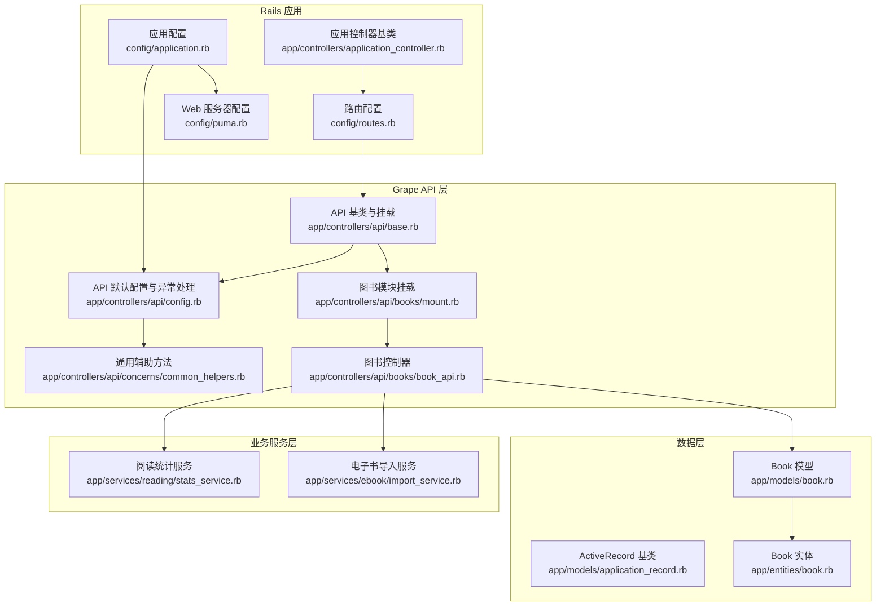
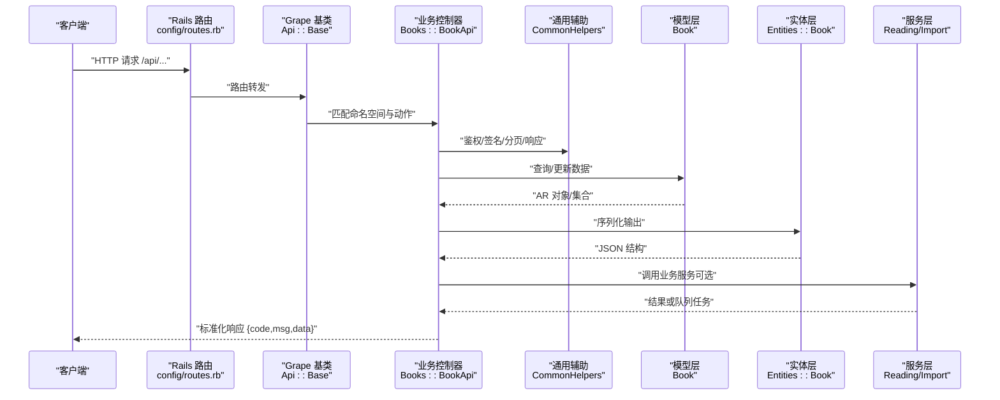
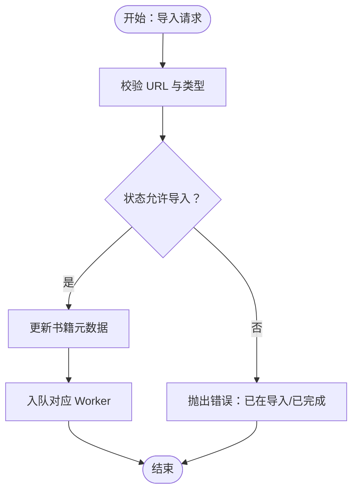
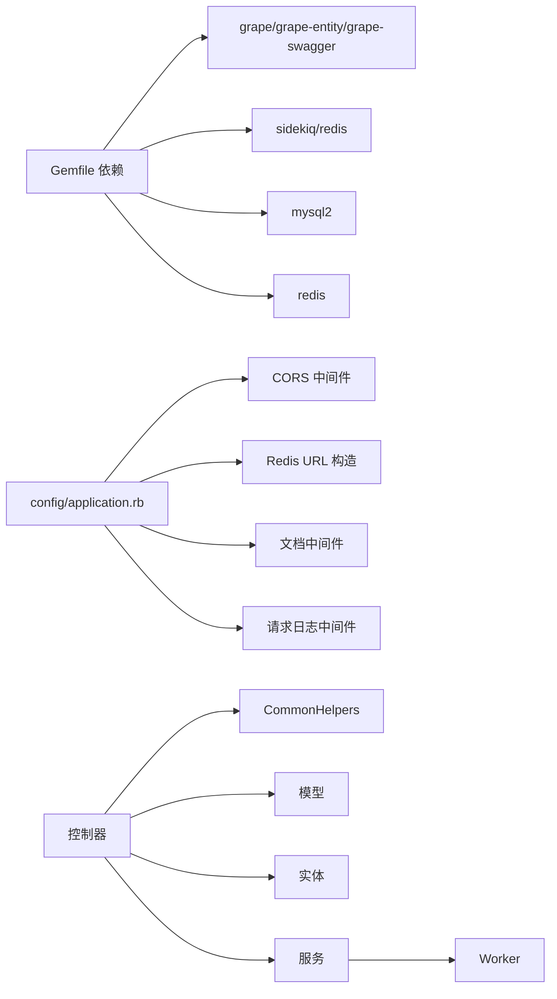

# 整体架构模式

<cite>
**本文档引用的文件**
- [app/controllers/api/base.rb](file://app/controllers/api/base.rb)
- [app/controllers/application_controller.rb](file://app/controllers/application_controller.rb)
- [config/routes.rb](file://config/routes.rb)
- [app/controllers/api/config.rb](file://app/controllers/api/config.rb)
- [app/controllers/api/concerns/common_helpers.rb](file://app/controllers/api/concerns/common_helpers.rb)
- [app/controllers/api/books/mount.rb](file://app/controllers/api/books/mount.rb)
- [app/controllers/api/books/book_api.rb](file://app/controllers/api/books/book_api.rb)
- [app/models/application_record.rb](file://app/models/application_record.rb)
- [app/models/book.rb](file://app/models/book.rb)
- [app/entities/book.rb](file://app/entities/book.rb)
- [app/services/reading/stats_service.rb](file://app/services/reading/stats_service.rb)
- [app/services/ebook/import_service.rb](file://app/services/ebook/import_service.rb)
- [config/application.rb](file://config/application.rb)
- [config/puma.rb](file://config/puma.rb)
- [Gemfile](file://Gemfile)
</cite>

## 目录
1. [引言](#引言)
2. [项目结构](#项目结构)
3. [核心组件](#核心组件)
4. [架构总览](#架构总览)
5. [详细组件分析](#详细组件分析)
6. [依赖关系分析](#依赖关系分析)
7. [性能考量](#性能考量)
8. [故障排查指南](#故障排查指南)
9. [结论](#结论)

## 引言
本文件系统性阐述语音图书平台的整体架构模式，围绕基于 Ruby on Rails 的 RESTful API 设计展开，重点说明 MVC 分层架构在本项目中的具体实现方式。文档覆盖控制器层（Controllers）如何处理 HTTP 请求、服务层（Services）如何封装业务逻辑、模型层（Models）如何管理数据访问；同时解释 API 路由设计原则、请求响应处理流程、错误处理机制，并给出架构决策的技术考量与设计权衡，包括可扩展性、性能优化与维护性方面的建议。

## 项目结构
本项目采用“Rails + Grape”混合架构：Rails 负责路由与基础配置，Grape 作为独立的 API 层挂载于 Rails 之上，形成清晰的分层与职责边界。核心目录与职责如下：
- 路由层：Rails 路由负责根路径与健康检查，以及将 Grape API 挂载到 /api。
- 控制器层：Grape 命名空间下的各模块控制器（如 Books、Home、Readings 等）处理具体业务接口。
- 实体层：Grape::Entity 定义对外输出的数据结构与序列化规则。
- 模型层：ActiveRecord 模型承载数据访问、关联关系与领域约束。
- 服务层：纯 Ruby 对象封装复杂业务逻辑（如阅读统计、电子书导入）。
- 配置层：Rails 应用配置、Puma 进程/线程模型、Sidekiq 队列、CORS、Redis 等。



**图示来源**
- [config/routes.rb:1-30](file://config/routes.rb#L1-L30)
- [app/controllers/api/base.rb:1-65](file://app/controllers/api/base.rb#L1-L65)
- [app/controllers/api/config.rb:1-54](file://app/controllers/api/config.rb#L1-L54)
- [app/controllers/api/concerns/common_helpers.rb:1-133](file://app/controllers/api/concerns/common_helpers.rb#L1-L133)
- [app/controllers/api/books/mount.rb:1-13](file://app/controllers/api/books/mount.rb#L1-L13)
- [app/controllers/api/books/book_api.rb:1-242](file://app/controllers/api/books/book_api.rb#L1-L242)
- [app/models/application_record.rb:1-4](file://app/models/application_record.rb#L1-L4)
- [app/models/book.rb:1-157](file://app/models/book.rb#L1-L157)
- [app/entities/book.rb:1-58](file://app/entities/book.rb#L1-L58)
- [app/services/reading/stats_service.rb:1-140](file://app/services/reading/stats_service.rb#L1-L140)
- [app/services/ebook/import_service.rb:1-70](file://app/services/ebook/import_service.rb#L1-L70)
- [config/application.rb:1-81](file://config/application.rb#L1-L81)
- [config/puma.rb:1-46](file://config/puma.rb#L1-L46)

**章节来源**
- [config/routes.rb:1-30](file://config/routes.rb#L1-L30)
- [app/controllers/api/base.rb:1-65](file://app/controllers/api/base.rb#L1-L65)
- [config/application.rb:1-81](file://config/application.rb#L1-L81)

## 核心组件
- 路由与入口
  - Rails 路由将 /api 挂载至 Grape::API 的基类，根路径提供简单欢迎页，便于快速验证部署。
- API 基类与配置
  - Api::Config 统一设置 JSON 输出、默认格式、全局异常处理策略（参数校验、记录未找到、记录无效、自定义业务异常、通用异常）。
  - Api::Base 在此基础上挂载各业务模块（用户、图书、阅读、榜单、分类等），并集成 Swagger 文档。
- 控制器层
  - 各业务控制器（如 Books::BookApi）通过 Grape::API 定义命名空间与路由，使用 helpers 引入通用能力（鉴权、签名、分页、响应格式化）。
- 实体层
  - Grape::Entity 将模型数据转换为对外一致的 JSON 结构，内置 OSS URL 签名工具方法，保证资源访问安全可控。
- 模型层
  - ApplicationRecord 作为抽象基类；Book 模型定义丰富的关联、作用域、枚举与业务方法（如 OSS URL 签名），并提供黑名单过滤等策略。
- 服务层
  - 阅读统计服务与电子书导入服务分别封装复杂业务逻辑，便于测试与复用。
- Web 与队列
  - Puma 线程/进程模型适配吞吐与延迟平衡；Sidekiq 作为后台任务队列，支撑异步导入等耗时操作。

**章节来源**
- [app/controllers/api/config.rb:1-54](file://app/controllers/api/config.rb#L1-L54)
- [app/controllers/api/base.rb:1-65](file://app/controllers/api/base.rb#L1-L65)
- [app/controllers/api/books/book_api.rb:1-242](file://app/controllers/api/books/book_api.rb#L1-L242)
- [app/entities/book.rb:1-58](file://app/entities/book.rb#L1-L58)
- [app/models/book.rb:1-157](file://app/models/book.rb#L1-L157)
- [app/services/reading/stats_service.rb:1-140](file://app/services/reading/stats_service.rb#L1-L140)
- [app/services/ebook/import_service.rb:1-70](file://app/services/ebook/import_service.rb#L1-L70)
- [config/puma.rb:1-46](file://config/puma.rb#L1-L46)
- [config/application.rb:1-81](file://config/application.rb#L1-L81)

## 架构总览
本项目采用“Rails + Grape”的混合架构，Rails 负责基础设施与路由，Grape 专注 API 定义与业务编排。整体交互流程如下：



**图示来源**
- [config/routes.rb:1-30](file://config/routes.rb#L1-L30)
- [app/controllers/api/base.rb:1-65](file://app/controllers/api/base.rb#L1-L65)
- [app/controllers/api/books/book_api.rb:1-242](file://app/controllers/api/books/book_api.rb#L1-L242)
- [app/controllers/api/concerns/common_helpers.rb:1-133](file://app/controllers/api/concerns/common_helpers.rb#L1-L133)
- [app/models/book.rb:1-157](file://app/models/book.rb#L1-L157)
- [app/entities/book.rb:1-58](file://app/entities/book.rb#L1-L58)
- [app/services/reading/stats_service.rb:1-140](file://app/services/reading/stats_service.rb#L1-L140)
- [app/services/ebook/import_service.rb:1-70](file://app/services/ebook/import_service.rb#L1-L70)

## 详细组件分析

### 控制器层（Controllers）
- 命名空间与挂载
  - Api::Base 作为顶层挂载点，集中注册各模块（用户、图书、阅读、榜单、分类等），并提供健康检查与 Swagger 文档。
  - 各模块通过各自的 Mount 文件进行子模块挂载，保持路由组织清晰。
- 动作定义与参数校验
  - Books::BookApi 使用 Grape 的 params 块定义输入参数与约束，结合 helpers 进行鉴权与签名验证。
- 响应与序列化
  - 统一使用 success_response/err_response 包装响应；集合使用 serialize_collection；分页使用 paginated_response/pagination_info。
- 业务编排
  - 控制器内直接调用模型与实体，必要时委派给服务对象（如电子书导入）。

```mermaid
classDiagram
class Api_Base {
"+mount(...)"
"+add_swagger_documentation(...)"
"+up()"
}
class Books_Mount {
"+mount(BookApi)"
"+mount(SearchApi)"
"+mount(CategoriesApi)"
}
class BookApi {
"+compilation()"
"+by_id()"
"+chapter_url()"
"+catalogue()"
"+import()"
"+pages()"
"+page()"
"+page_html()"
"+styles()"
"+covers()"
}
Api_Base <|-- Books_Mount
Books_Mount <|-- BookApi
```

**图示来源**
- [app/controllers/api/base.rb:1-65](file://app/controllers/api/base.rb#L1-L65)
- [app/controllers/api/books/mount.rb:1-13](file://app/controllers/api/books/mount.rb#L1-L13)
- [app/controllers/api/books/book_api.rb:1-242](file://app/controllers/api/books/book_api.rb#L1-L242)

**章节来源**
- [app/controllers/api/base.rb:1-65](file://app/controllers/api/base.rb#L1-L65)
- [app/controllers/api/books/mount.rb:1-13](file://app/controllers/api/books/mount.rb#L1-L13)
- [app/controllers/api/books/book_api.rb:1-242](file://app/controllers/api/books/book_api.rb#L1-L242)

### 服务层（Services）
- 阅读统计服务
  - 提供用户阅读摘要、图书统计、进度列表、图表数据等聚合计算，使用缓存降低查询压力。
- 电子书导入服务
  - 校验文件类型与状态，更新书籍元数据，并将导入任务入队到对应 Worker（PDF/EPUB）。



**图示来源**
- [app/services/ebook/import_service.rb:1-70](file://app/services/ebook/import_service.rb#L1-L70)

**章节来源**
- [app/services/reading/stats_service.rb:1-140](file://app/services/reading/stats_service.rb#L1-L140)
- [app/services/ebook/import_service.rb:1-70](file://app/services/ebook/import_service.rb#L1-L70)

### 模型层（Models）
- ApplicationRecord 抽象基类
- Book 模型
  - 关联丰富：作者、类别、供应商、章节、目录、阅读进度、会话、书架、收藏、黑名单等。
  - 作用域与枚举：状态、内容类型、导入状态、评分等。
  - 黑名单过滤：基于家长控制与用户维度过滤不可见图书。
  - OSS URL 签名：统一封装阿里云 OSS 签名逻辑，支持中文路径与多种错误兜底。

```mermaid
classDiagram
class ApplicationRecord
class Book {
"+belongs_to : author"
"+belongs_to : category"
"+belongs_to : supplier"
"+has_many : chapters"
"+has_many : catalogues"
"+has_many : reading_progresses"
"+has_many : reading_sessions"
"+has_many : bookmarks"
"+has_many : bookshelves"
"+has_and_belongs_to_many : grades"
"+has_and_belongs_to_many : compilations"
"+enum status/content_type/import_status"
"+scope not_in_blacklist"
"+sign_oss_url(url)"
}
ApplicationRecord <|-- Book
```

**图示来源**
- [app/models/application_record.rb:1-4](file://app/models/application_record.rb#L1-L4)
- [app/models/book.rb:1-157](file://app/models/book.rb#L1-L157)

**章节来源**
- [app/models/application_record.rb:1-4](file://app/models/application_record.rb#L1-L4)
- [app/models/book.rb:1-157](file://app/models/book.rb#L1-L157)

### 实体层（Entities）
- Entities::Book
  - 暴露字段映射与派生属性（作者名、供应商名、章节列表、创建/更新时间格式化）。
  - 内置签名工具方法，统一处理 OSS 资源访问。

**章节来源**
- [app/entities/book.rb:1-58](file://app/entities/book.rb#L1-L58)

### API 路由设计原则
- 路由挂载
  - Rails 路由将 Grape::API 挂载到 /api，根路径提供简单欢迎页，便于健康检查与快速验证。
- 命名空间与模块化
  - Api::Base 下按业务域划分模块（如 Books、Home、Readings），每个模块独立挂载，便于扩展与维护。
- 文档集成
  - Swagger 文档通过 Grape::Swagger 自动生成，标签与基础路径在 Api::Base 中集中配置。

**章节来源**
- [config/routes.rb:1-30](file://config/routes.rb#L1-L30)
- [app/controllers/api/base.rb:1-65](file://app/controllers/api/base.rb#L1-L65)

### 请求响应处理流程
- 输入校验
  - 控制器使用 Grape 的 params 块定义参数与类型约束，配合 Api::Config 的 rescue_from 统一处理验证错误。
- 鉴权与签名
  - 通过 CommonHelpers 提供的 auth_user 与 authenticate_api! 实现用户与客户端双层鉴权。
- 业务执行
  - 控制器调用模型与实体，必要时委派服务对象；对集合使用分页与序列化。
- 统一响应
  - 使用 success_response/err_response 包裹响应，确保接口一致性。

**章节来源**
- [app/controllers/api/config.rb:1-54](file://app/controllers/api/config.rb#L1-L54)
- [app/controllers/api/concerns/common_helpers.rb:1-133](file://app/controllers/api/concerns/common_helpers.rb#L1-L133)
- [app/controllers/api/books/book_api.rb:1-242](file://app/controllers/api/books/book_api.rb#L1-L242)

### 错误处理机制
- 参数校验异常：返回 code=1002 的标准化错误。
- 记录未找到/无效：返回 code=1003/1002。
- 自定义业务异常：捕获 Api::Errors::CommonError 并返回对应 code/msg。
- 未知异常：开发环境返回详细信息，生产环境返回通用错误并记录日志。

**章节来源**
- [app/controllers/api/config.rb:1-54](file://app/controllers/api/config.rb#L1-L54)

## 依赖关系分析
- 组件耦合
  - 控制器依赖通用辅助与实体；实体依赖模型；控制器可选择性依赖服务；服务与模型之间弱耦合。
- 外部依赖
  - Grape、Grape::Entity、Grape::Swagger、Sidekiq、Redis、MySQL、阿里云 OSS SDK。
- 配置与中间件
  - CORS、Redis URL 构造、文档中间件、请求日志中间件均在 config/application.rb 中集中配置。



**图示来源**
- [Gemfile:1-45](file://Gemfile#L1-L45)
- [config/application.rb:1-81](file://config/application.rb#L1-L81)

**章节来源**
- [Gemfile:1-45](file://Gemfile#L1-L45)
- [config/application.rb:1-81](file://config/application.rb#L1-L81)

## 性能考量
- 线程与并发
  - Puma 默认线程数适中，生产环境可通过 WEB_CONCURRENCY 调整 worker 数量；线程池大小通过 RAILS_MAX_THREADS 控制，需与数据库连接池匹配。
- 缓存策略
  - 用户信息与阅读统计使用 Redis 缓存，减少数据库压力；缓存键与过期时间需结合业务热点调整。
- 查询优化
  - 控制器中使用 includes/joins 预加载关联，避免 N+1；模型层提供常用作用域与索引字段，提升筛选效率。
- 异步处理
  - 电子书导入等耗时任务通过 Sidekiq 异步执行，避免阻塞请求；队列名前缀区分环境，便于监控与扩容。
- 资源签名
  - OSS 资源统一签名，缩短客户端访问链路，降低跨域与鉴权成本。

**章节来源**
- [config/puma.rb:1-46](file://config/puma.rb#L1-L46)
- [app/controllers/api/concerns/common_helpers.rb:1-133](file://app/controllers/api/concerns/common_helpers.rb#L1-L133)
- [app/services/reading/stats_service.rb:1-140](file://app/services/reading/stats_service.rb#L1-L140)
- [app/services/ebook/import_service.rb:1-70](file://app/services/ebook/import_service.rb#L1-L70)
- [app/models/book.rb:103-141](file://app/models/book.rb#L103-L141)

## 故障排查指南
- 健康检查
  - 使用 /up 与 /api/up 快速判断服务与 API 是否可用。
- 日志定位
  - 开启请求日志中间件，结合 Rails 日志与 Sidekiq 日志定位问题。
- 常见错误
  - 未授权访问：检查 uuid 与签名参数；确认 ApiAuth 凭证有效。
  - 参数错误：核对 params 块定义与传参类型；关注 rescue_from 的 1002 错误。
  - 记录不存在：确认 ID 与可见性（黑名单/状态）。
  - 服务器内部错误：生产环境返回通用错误，开发环境显示详细堆栈，便于定位。

**章节来源**
- [app/controllers/api/base.rb:10-22](file://app/controllers/api/base.rb#L10-L22)
- [app/controllers/api/config.rb:17-51](file://app/controllers/api/config.rb#L17-L51)
- [config/application.rb:76-78](file://config/application.rb#L76-L78)

## 结论
本项目通过“Rails + Grape”的混合架构实现了清晰的分层与职责分离：Rails 负责基础设施与路由，Grape 专注于 API 定义与业务编排。控制器层承担请求处理与编排职责，服务层封装复杂业务，模型层聚焦数据与领域逻辑，实体层统一输出格式。配合完善的异常处理、缓存与异步队列机制，系统在可扩展性、性能与可维护性方面具备良好基础。后续可在以下方向持续演进：进一步细化领域模型与服务边界、完善监控与可观测性、引入更细粒度的缓存策略与限流机制。