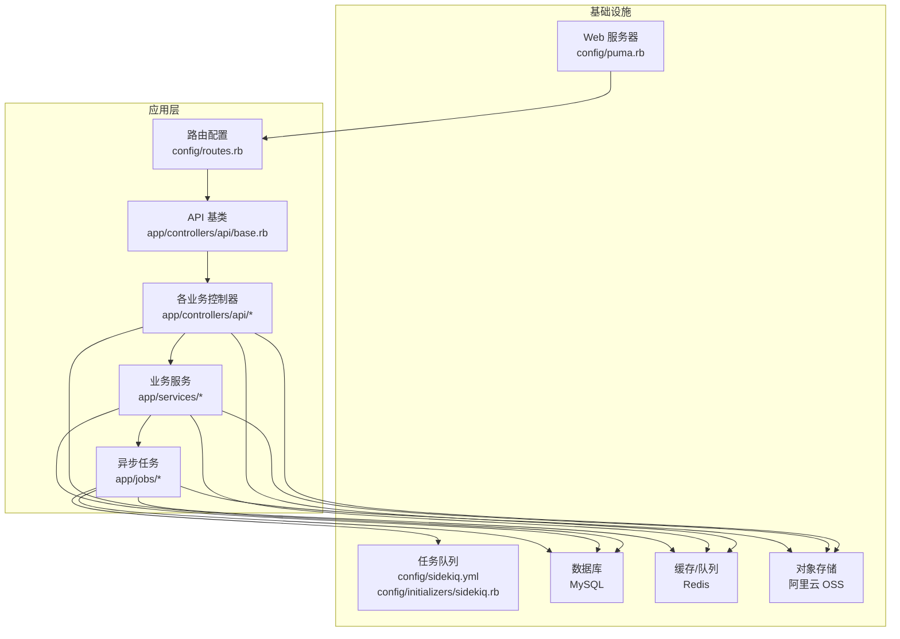
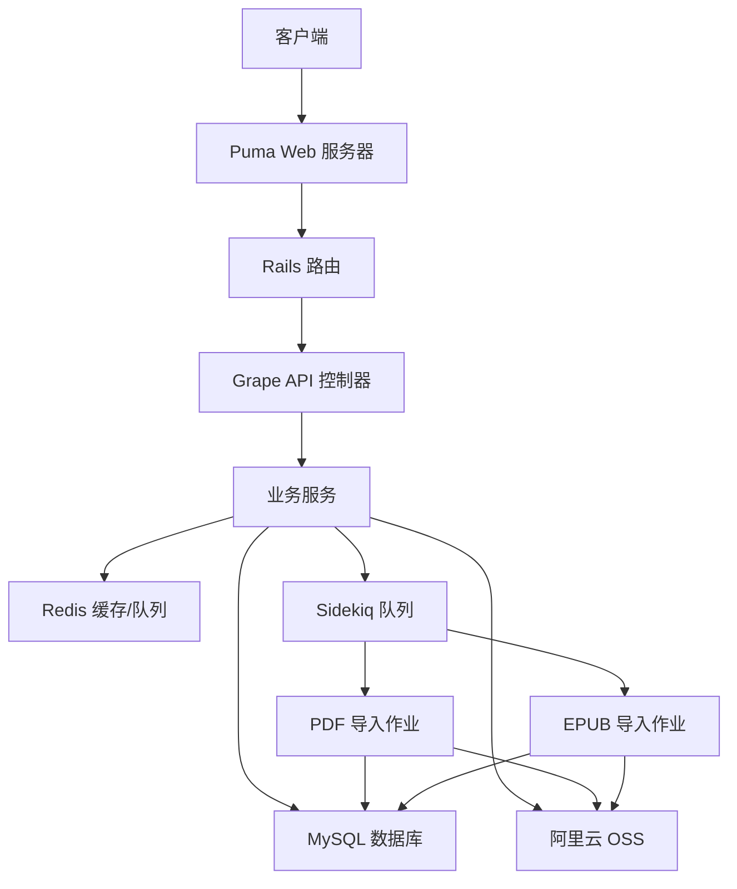
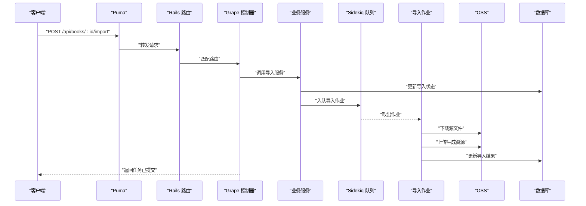
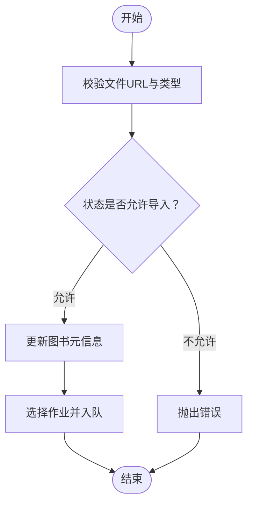
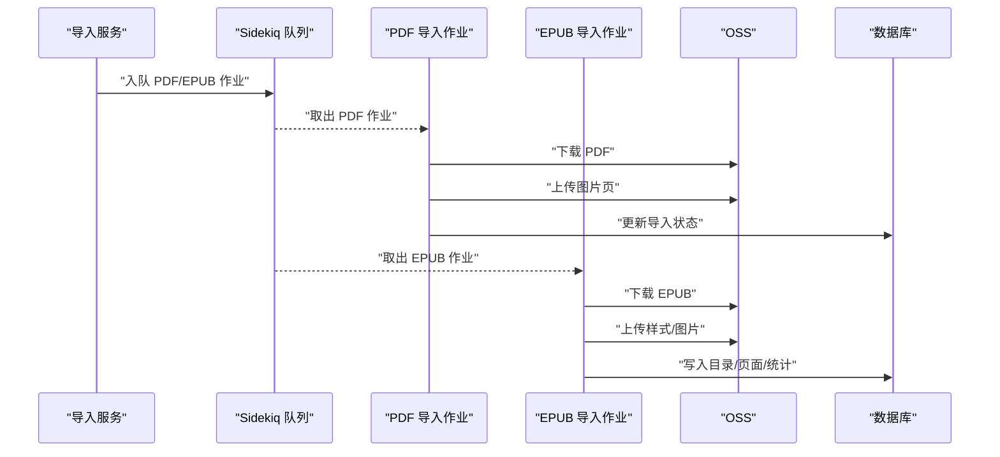
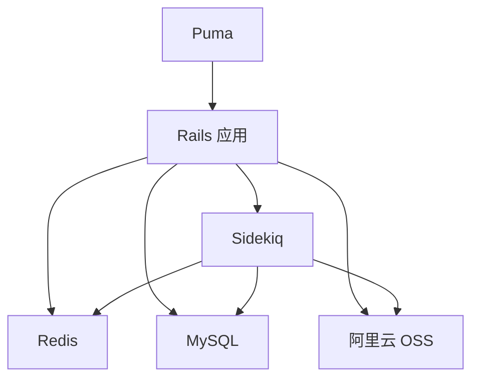
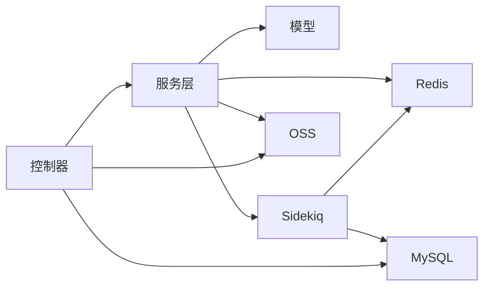

# 系统架构设计

<cite>
**本文档引用的文件**
- [config/routes.rb](file://config/routes.rb)
- [app/controllers/api/base.rb](file://app/controllers/api/base.rb)
- [app/controllers/api/books/book_api.rb](file://app/controllers/api/books/book_api.rb)
- [app/controllers/api/readings/reading_api.rb](file://app/controllers/api/readings/reading_api.rb)
- [config/application.rb](file://config/application.rb)
- [config/puma.rb](file://config/puma.rb)
- [config/sidekiq.yml](file://config/sidekiq.yml)
- [config/initializers/sidekiq.rb](file://config/initializers/sidekiq.rb)
- [config/initializers/aliyun_oss.rb](file://config/initializers/aliyun_oss.rb)
- [Gemfile](file://Gemfile)
- [app/services/ebook/import_service.rb](file://app/services/ebook/import_service.rb)
- [app/jobs/book_pdf_import_worker.rb](file://app/jobs/book_pdf_import_worker.rb)
- [app/jobs/book_epub_import_worker.rb](file://app/jobs/book_epub_import_worker.rb)
- [app/services/reading/stats_service.rb](file://app/services/reading/stats_service.rb)
</cite>

## 目录
1. [简介](#简介)
2. [项目结构](#项目结构)
3. [核心组件](#核心组件)
4. [架构总览](#架构总览)
5. [详细组件分析](#详细组件分析)
6. [依赖关系分析](#依赖关系分析)
7. [性能考虑](#性能考虑)
8. [故障排查指南](#故障排查指南)
9. [结论](#结论)

## 简介
本系统是一个面向儿童的语音图书平台，采用“RESTful API + 异步任务”的架构模式，围绕图书内容管理、阅读行为追踪与统计、家长管控、会员体系等核心业务展开。系统以 Rails 应用为核心，通过 Puma 作为 Web 服务器对外提供 API 服务；后台任务通过 Sidekiq 队列异步执行，包括电子书导入、导出、支付回调等；数据持久化使用 MySQL，缓存与队列共用 Redis；对象存储采用阿里云 OSS，用于存放电子书、图片与样式资源。

## 项目结构
系统采用 Rails 的分层组织方式，结合 Grape API 实现模块化的 RESTful 接口挂载。主要目录与职责如下：
- app/controllers/api：Grape API 控制器层，按业务域拆分子模块（如 books、readings、memberships 等），统一挂载至 /api 路由。
- app/services：业务服务层，封装领域逻辑（如电子书导入、阅读统计与进度跟踪）。
- app/jobs：异步任务层，基于 Sidekiq 执行耗时或外部依赖操作（如 PDF/EPUB 导入、导出、支付回调）。
- app/models：数据模型层，基于 ActiveRecord 定义实体关系与字段。
- config：应用配置，包括路由、Puma、Sidekiq、初始化器（如 OSS、CORS、Redis）。
- config/initializers：第三方服务初始化（如阿里云 OSS 客户端、DocsAuth 中间件、请求日志中间件）。
- lib：自定义中间件与工具（如文档鉴权、请求日志）。

**图表来源**
- [config/routes.rb:1-30](file://config/routes.rb#L1-L30)
- [app/controllers/api/base.rb:1-65](file://app/controllers/api/base.rb#L1-L65)
- [config/puma.rb:1-46](file://config/puma.rb#L1-L46)
- [config/sidekiq.yml:1-8](file://config/sidekiq.yml#L1-L8)
- [config/initializers/sidekiq.rb:1-22](file://config/initializers/sidekiq.rb#L1-L22)
- [config/initializers/aliyun_oss.rb:1-31](file://config/initializers/aliyun_oss.rb#L1-L31)

**章节来源**
- [config/routes.rb:1-30](file://config/routes.rb#L1-L30)
- [config/application.rb:1-81](file://config/application.rb#L1-L81)

## 核心组件
- API 层（Controllers）
  - 通过 Grape 在 /api 下挂载多个业务模块（如书籍、阅读、排行榜、分类、家长管控等），提供统一的 RESTful 接口。
  - 控制器负责参数校验、鉴权、调用服务层、返回标准化响应。
- 业务逻辑层（Services）
  - 封装复杂业务规则与跨模型操作，如电子书导入服务、阅读统计与进度服务。
  - 通过缓存提升查询性能，并在必要时进行事务性写入。
- 数据访问层（Models）
  - 基于 ActiveRecord 定义实体关系，提供查询、关联与基础 CRUD。
- 异步任务层（Jobs）
  - 基于 Sidekiq 的后台作业，处理耗时或外部依赖操作（如 PDF/EPUB 导入、导出、支付回调）。
- 基础设施
  - Web 服务器：Puma（多线程、可选多进程 worker）。
  - 队列与缓存：Redis（Sidekiq 与 Rails 缓存共享）。
  - 数据库：MySQL。
  - 对象存储：阿里云 OSS（用于电子书、图片、样式资源）。

**章节来源**
- [app/controllers/api/base.rb:1-65](file://app/controllers/api/base.rb#L1-L65)
- [app/controllers/api/books/book_api.rb:1-242](file://app/controllers/api/books/book_api.rb#L1-L242)
- [app/controllers/api/readings/reading_api.rb:1-93](file://app/controllers/api/readings/reading_api.rb#L1-L93)
- [app/services/ebook/import_service.rb:1-70](file://app/services/ebook/import_service.rb#L1-L70)
- [app/services/reading/stats_service.rb:1-140](file://app/services/reading/stats_service.rb#L1-L140)
- [config/puma.rb:1-46](file://config/puma.rb#L1-L46)
- [config/sidekiq.yml:1-8](file://config/sidekiq.yml#L1-L8)
- [config/initializers/sidekiq.rb:1-22](file://config/initializers/sidekiq.rb#L1-L22)
- [config/initializers/aliyun_oss.rb:1-31](file://config/initializers/aliyun_oss.rb#L1-L31)

## 架构总览
系统采用“API + 异步任务”双通道架构：
- 同步请求：客户端通过 Puma 接收 HTTP 请求，Grape 控制器解析参数并调用服务层，服务层与数据库交互，返回 JSON 响应。
- 异步任务：服务层触发 Sidekiq 作业，作业从 OSS 下载源文件，解析并生成目标资源（如图片页、XHTML、样式表），再上传至 OSS 并更新数据库状态。

**图表来源**
- [config/routes.rb:1-30](file://config/routes.rb#L1-L30)
- [app/controllers/api/base.rb:1-65](file://app/controllers/api/base.rb#L1-L65)
- [config/puma.rb:1-46](file://config/puma.rb#L1-L46)
- [config/sidekiq.yml:1-8](file://config/sidekiq.yml#L1-L8)
- [config/initializers/sidekiq.rb:1-22](file://config/initializers/sidekiq.rb#L1-L22)
- [config/initializers/aliyun_oss.rb:1-31](file://config/initializers/aliyun_oss.rb#L1-L31)

## 详细组件分析

### API 层（Controllers）
- 路由与入口
  - 根路由提供健康检查与欢迎页；Grape API 挂载在 /api，统一暴露各业务模块接口。
- 控制器职责
  - 参数校验与鉴权（如 uuid 鉴权），调用服务层，序列化响应，返回统一格式。
  - 示例：书籍模块提供合集资源、图书详情、章节 URL、目录、导入电子书、页面清单、单页内容、XHTML 内容、样式表、批量封面等接口。
  - 示例：阅读模块提供上报阅读记录、我的阅读统计、图表数据、阅读进度列表、某本书的阅读进度等接口。
- 关键流程
  - 电子书导入：控制器接收请求后，调用导入服务，服务更新图书状态并入队相应作业（PDF/EPUB）。
  - 阅读上报：控制器调用阅读跟踪服务，服务更新会话与统计。

**图表来源**
- [config/routes.rb:1-30](file://config/routes.rb#L1-L30)
- [app/controllers/api/books/book_api.rb:100-124](file://app/controllers/api/books/book_api.rb#L100-L124)
- [app/services/ebook/import_service.rb:14-25](file://app/services/ebook/import_service.rb#L14-L25)
- [app/jobs/book_pdf_import_worker.rb:16-68](file://app/jobs/book_pdf_import_worker.rb#L16-L68)
- [app/jobs/book_epub_import_worker.rb:17-173](file://app/jobs/book_epub_import_worker.rb#L17-L173)

**章节来源**
- [config/routes.rb:1-30](file://config/routes.rb#L1-L30)
- [app/controllers/api/base.rb:1-65](file://app/controllers/api/base.rb#L1-L65)
- [app/controllers/api/books/book_api.rb:1-242](file://app/controllers/api/books/book_api.rb#L1-L242)
- [app/controllers/api/readings/reading_api.rb:1-93](file://app/controllers/api/readings/reading_api.rb#L1-L93)

### 业务逻辑层（Services）
- 电子书导入服务
  - 校验文件 URL 与类型（PDF/EPUB），更新图书元信息，选择对应作业入队。
- 阅读统计与进度服务
  - 提供用户统计摘要、图书统计、进度列表、某书进度、图表数据（日/周/月）等。
  - 使用缓存降低查询开销，保证高频接口性能。

**图表来源**
- [app/services/ebook/import_service.rb:14-25](file://app/services/ebook/import_service.rb#L14-L25)

**章节来源**
- [app/services/ebook/import_service.rb:1-70](file://app/services/ebook/import_service.rb#L1-L70)
- [app/services/reading/stats_service.rb:1-140](file://app/services/reading/stats_service.rb#L1-L140)

### 数据访问层（Models）
- 采用 ActiveRecord 抽象，定义实体关系与字段，提供查询、关联与基础 CRUD。
- 与服务层协作完成复杂业务写入（如导入作业中的事务性写入）。

**章节来源**
- [app/jobs/book_epub_import_worker.rb:96-157](file://app/jobs/book_epub_import_worker.rb#L96-L157)

### 异步任务层（Jobs）
- PDF 导入作业
  - 从 OSS 下载 PDF，按强制图片模式导入，生成图片页并上传至 OSS，最后更新数据库状态。
- EPUB 导入作业
  - 解压 EPUB，解析目录与样式，提取图片并替换为 OSS URL，逐页生成目录与页面，计算字数，最后更新数据库状态。
- 作业配置
  - Sidekiq 并发度、队列与超时在配置文件中定义，生产环境通过环境变量控制并发与队列。

**图表来源**
- [app/jobs/book_pdf_import_worker.rb:16-68](file://app/jobs/book_pdf_import_worker.rb#L16-L68)
- [app/jobs/book_epub_import_worker.rb:17-173](file://app/jobs/book_epub_import_worker.rb#L17-L173)
- [config/sidekiq.yml:1-8](file://config/sidekiq.yml#L1-L8)

**章节来源**
- [app/jobs/book_pdf_import_worker.rb:1-84](file://app/jobs/book_pdf_import_worker.rb#L1-L84)
- [app/jobs/book_epub_import_worker.rb:1-328](file://app/jobs/book_epub_import_worker.rb#L1-L328)
- [config/sidekiq.yml:1-8](file://config/sidekiq.yml#L1-L8)

### 基础设施组件
- Web 服务器（Puma）
  - 支持多线程与可选多进程 worker，生产环境启用预加载与 worker 数量控制。
- 应用服务器
  - Rails 应用，集成 CORS、文档鉴权、请求日志中间件，设置 API-only 模式与 Sidekiq 队列适配。
- 数据库（MySQL）
  - 通过 ActiveRecord 访问，迁移脚本定义了图书、章节、阅读统计、会员、订单等核心表。
- 消息队列（Sidekiq）
  - 使用 Redis 作为队列与缓存，配置并发度、队列与超时，日志按天轮转。
- 对象存储（阿里云 OSS）
  - 初始化器加载环境变量，创建 OSS 客户端与桶实例，供导入/导出作业与控制器使用。

**图表来源**
- [config/puma.rb:1-46](file://config/puma.rb#L1-L46)
- [config/application.rb:1-81](file://config/application.rb#L1-L81)
- [config/initializers/sidekiq.rb:1-22](file://config/initializers/sidekiq.rb#L1-L22)
- [config/initializers/aliyun_oss.rb:1-31](file://config/initializers/aliyun_oss.rb#L1-L31)

**章节来源**
- [config/puma.rb:1-46](file://config/puma.rb#L1-L46)
- [config/application.rb:1-81](file://config/application.rb#L1-L81)
- [config/initializers/sidekiq.rb:1-22](file://config/initializers/sidekiq.rb#L1-L22)
- [config/initializers/aliyun_oss.rb:1-31](file://config/initializers/aliyun_oss.rb#L1-L31)
- [Gemfile:1-45](file://Gemfile#L1-L45)

## 依赖关系分析
- 组件耦合
  - 控制器依赖服务层，服务层依赖模型与外部组件（OSS、Redis、Sidekiq）。
  - 异步作业与服务层解耦，通过队列传递参数，实现高吞吐与容错。
- 外部依赖
  - Sidekiq 与 Redis：队列与缓存共享，通过统一 Redis URL 构建。
  - 阿里云 OSS：导入/导出作业与控制器均依赖 OSS 客户端。
  - MySQL：所有写入与查询通过 ActiveRecord 访问。

**图表来源**
- [app/controllers/api/books/book_api.rb:100-124](file://app/controllers/api/books/book_api.rb#L100-L124)
- [app/services/ebook/import_service.rb:61-67](file://app/services/ebook/import_service.rb#L61-L67)
- [config/initializers/sidekiq.rb:7](file://config/initializers/sidekiq.rb#L7)
- [config/initializers/aliyun_oss.rb:19-31](file://config/initializers/aliyun_oss.rb#L19-L31)

**章节来源**
- [app/services/ebook/import_service.rb:1-70](file://app/services/ebook/import_service.rb#L1-L70)
- [config/initializers/sidekiq.rb:1-22](file://config/initializers/sidekiq.rb#L1-L22)
- [config/initializers/aliyun_oss.rb:1-31](file://config/initializers/aliyun_oss.rb#L1-L31)

## 性能考虑
- 线程与并发
  - Puma 默认多线程，生产环境可通过环境变量调整 worker 数量与线程数，注意数据库连接池大小需与线程数匹配。
- 缓存策略
  - 阅读统计服务使用缓存降低查询压力，建议合理设置过期时间以平衡一致性与性能。
- 队列与重试
  - Sidekiq 配置了队列与超时，导入作业具备重试次数，建议对失败任务进行监控与告警。
- I/O 优化
  - 导入作业在本地临时目录处理，完成后清理，避免磁盘占用；OSS 上传采用分批处理与错误重试。

## 故障排查指南
- 健康检查
  - 根路由提供健康检查接口，可用于负载均衡探活与容器编排健康检查。
- 日志与中间件
  - 请求日志中间件输出到指定日志文件，便于定位请求链路与异常。
- 队列与作业
  - Sidekiq 日志按天轮转，关注导入作业的错误堆栈与重试次数，检查 Redis 连接与队列状态。
- OSS 问题
  - 确认 OSS 端点、密钥与桶配置正确，检查签名 URL 生成与权限策略。
- 数据库连接
  - 确保数据库连接池与 Puma 线程数匹配，避免连接不足导致超时。

**章节来源**
- [config/routes.rb:6-8](file://config/routes.rb#L6-L8)
- [config/application.rb:76-78](file://config/application.rb#L76-L78)
- [config/initializers/sidekiq.rb:12-16](file://config/initializers/sidekiq.rb#L12-L16)
- [config/initializers/aliyun_oss.rb:19-31](file://config/initializers/aliyun_oss.rb#L19-L31)

## 结论
本系统通过清晰的分层架构与异步任务机制，实现了高可用、可扩展的语音图书平台。API 层提供稳定的服务接口，业务服务层封装复杂逻辑，异步作业承担耗时任务，基础设施组件（Puma、Sidekiq、Redis、MySQL、OSS）协同支撑整体运行。建议在生产环境中持续监控队列积压、作业失败率与缓存命中率，确保系统稳定性与用户体验。