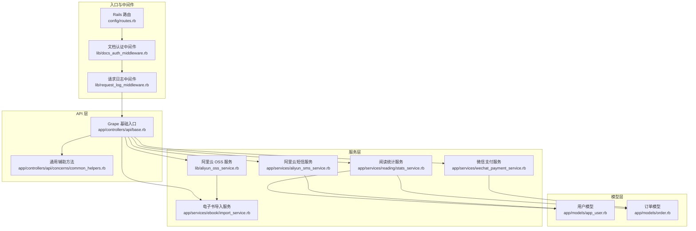
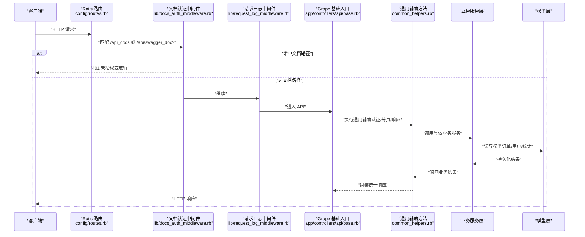
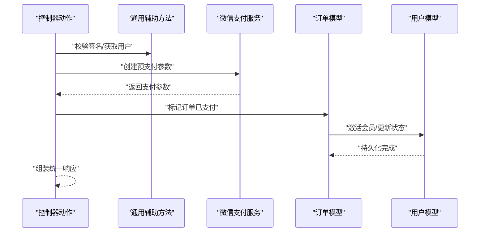
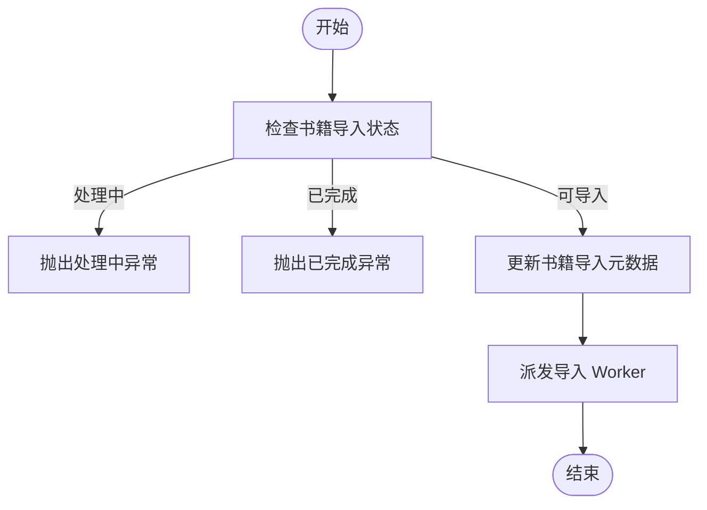
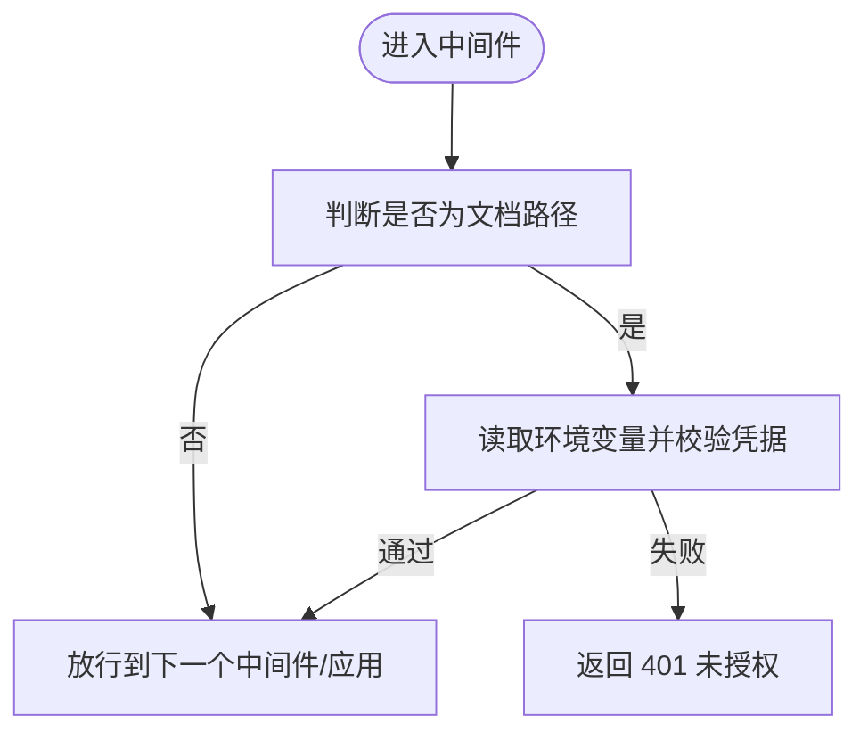
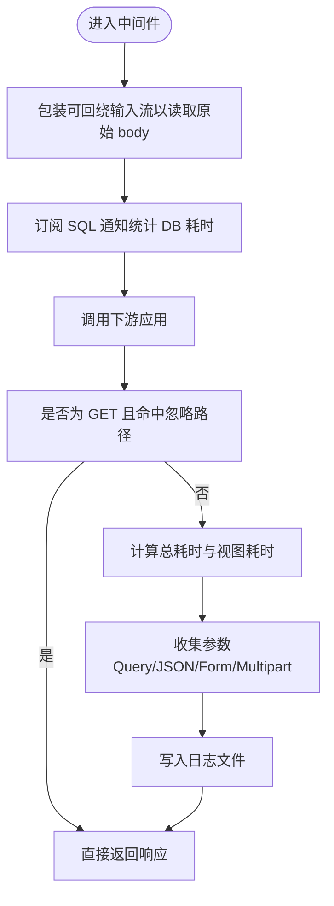
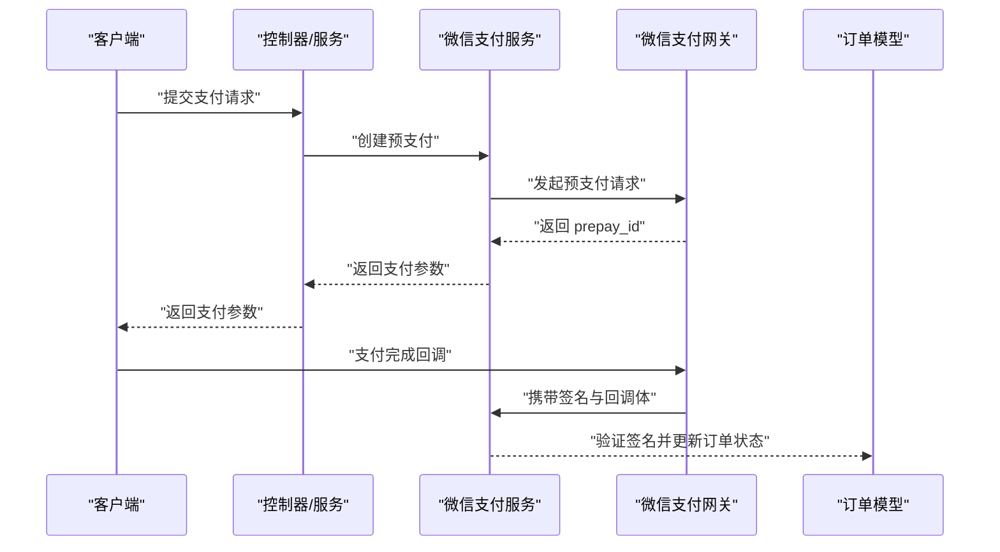
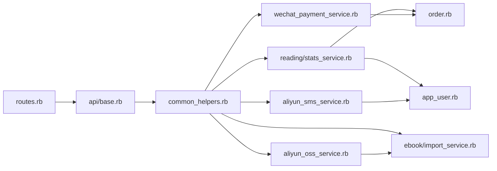

# 组件交互关系

<cite>
**本文引用的文件**
- [config/routes.rb](file://config/routes.rb)
- [app/controllers/api/base.rb](file://app/controllers/api/base.rb)
- [app/controllers/api/concerns/common_helpers.rb](file://app/controllers/api/concerns/common_helpers.rb)
- [lib/request_log_middleware.rb](file://lib/request_log_middleware.rb)
- [lib/docs_auth_middleware.rb](file://lib/docs_auth_middleware.rb)
- [app/services/wechat_payment_service.rb](file://app/services/wechat_payment_service.rb)
- [app/services/aliyun_sms_service.rb](file://app/services/aliyun_sms_service.rb)
- [lib/aliyun_oss_service.rb](file://lib/aliyun_oss_service.rb)
- [config/initializers/aliyun_oss.rb](file://config/initializers/aliyun_oss.rb)
- [app/models/app_user.rb](file://app/models/app_user.rb)
- [app/models/order.rb](file://app/models/order.rb)
- [app/services/ebook/import_service.rb](file://app/services/ebook/import_service.rb)
- [app/services/reading/stats_service.rb](file://app/services/reading/stats_service.rb)
</cite>

## 目录
1. [简介](#简介)
2. [项目结构](#项目结构)
3. [核心组件](#核心组件)
4. [架构总览](#架构总览)
5. [详细组件分析](#详细组件分析)
6. [依赖分析](#依赖分析)
7. [性能考虑](#性能考虑)
8. [故障排查指南](#故障排查指南)
9. [结论](#结论)
10. [附录](#附录)

## 简介
本文件聚焦语音图书平台的组件交互关系，系统采用“中间件 + Grape API 控制器 + 服务层 + 模型层”的分层架构。文档详细说明：
- 控制器与服务层的交互方式与职责边界
- 服务层与模型层的协作模式与事务处理
- 中间件（认证与日志）在请求生命周期中的作用
- 第三方服务集成点（微信支付、阿里云OSS、短信服务）的调用流程与安全要点
- 组件交互图与时序图，帮助理解模块化设计与解耦策略

## 项目结构
系统以 Rails 路由挂载 Grape API 作为统一入口，控制器负责路由与参数校验，服务层封装业务逻辑，模型层承载数据与约束，中间件贯穿请求生命周期进行日志与安全控制。

**图表来源**
- [config/routes.rb:1-30](file://config/routes.rb#L1-L30)
- [app/controllers/api/base.rb:1-65](file://app/controllers/api/base.rb#L1-L65)
- [app/controllers/api/concerns/common_helpers.rb:1-133](file://app/controllers/api/concerns/common_helpers.rb#L1-L133)
- [lib/request_log_middleware.rb:1-164](file://lib/request_log_middleware.rb#L1-L164)
- [lib/docs_auth_middleware.rb:1-51](file://lib/docs_auth_middleware.rb#L1-L51)
- [app/services/wechat_payment_service.rb:1-113](file://app/services/wechat_payment_service.rb#L1-L113)
- [app/services/aliyun_sms_service.rb:1-100](file://app/services/aliyun_sms_service.rb#L1-L100)
- [lib/aliyun_oss_service.rb:1-109](file://lib/aliyun_oss_service.rb#L1-L109)
- [app/services/ebook/import_service.rb:1-70](file://app/services/ebook/import_service.rb#L1-L70)
- [app/services/reading/stats_service.rb:1-140](file://app/services/reading/stats_service.rb#L1-L140)
- [app/models/app_user.rb:1-140](file://app/models/app_user.rb#L1-L140)
- [app/models/order.rb:1-104](file://app/models/order.rb#L1-L104)

**章节来源**
- [config/routes.rb:1-30](file://config/routes.rb#L1-L30)
- [app/controllers/api/base.rb:1-65](file://app/controllers/api/base.rb#L1-L65)
- [app/controllers/api/concerns/common_helpers.rb:1-133](file://app/controllers/api/concerns/common_helpers.rb#L1-L133)

## 核心组件
- 路由与入口
  - Rails 路由挂载 Grape API 至 /api，并提供健康检查与根页面。
- 中间件
  - 文档认证中间件：对特定文档路径启用 HTTP Basic 认证。
  - 请求日志中间件：记录请求耗时、数据库耗时、视图耗时与参数摘要。
- API 基础与辅助
  - 基础入口集中挂载各业务模块，内置 Swagger 文档。
  - 通用辅助方法提供统一响应格式、分页、签名认证与用户上下文。
- 服务层
  - 微信支付：生成预支付参数与回调签名验证。
  - 阿里云短信：基于 POP 签名发送短信验证码。
  - 阿里云 OSS：上传/下载/签名 URL 生成。
  - 电子书导入：校验文件类型与状态，派发导入 Worker。
  - 阅读统计：聚合用户与图书维度的阅读指标。
- 模型层
  - 用户模型：角色、设备绑定、阅读统计与缓存失效。
  - 订单模型：支付方式、状态、会员激活与订单号生成。

**章节来源**
- [lib/docs_auth_middleware.rb:1-51](file://lib/docs_auth_middleware.rb#L1-L51)
- [lib/request_log_middleware.rb:1-164](file://lib/request_log_middleware.rb#L1-L164)
- [app/controllers/api/base.rb:1-65](file://app/controllers/api/base.rb#L1-L65)
- [app/controllers/api/concerns/common_helpers.rb:1-133](file://app/controllers/api/concerns/common_helpers.rb#L1-L133)
- [app/services/wechat_payment_service.rb:1-113](file://app/services/wechat_payment_service.rb#L1-L113)
- [app/services/aliyun_sms_service.rb:1-100](file://app/services/aliyun_sms_service.rb#L1-L100)
- [lib/aliyun_oss_service.rb:1-109](file://lib/aliyun_oss_service.rb#L1-L109)
- [app/services/ebook/import_service.rb:1-70](file://app/services/ebook/import_service.rb#L1-L70)
- [app/services/reading/stats_service.rb:1-140](file://app/services/reading/stats_service.rb#L1-L140)
- [app/models/app_user.rb:1-140](file://app/models/app_user.rb#L1-L140)
- [app/models/order.rb:1-104](file://app/models/order.rb#L1-L104)

## 架构总览
下图展示请求从进入系统到返回的总体交互路径，以及中间件与核心组件的职责分工。

**图表来源**
- [config/routes.rb:1-30](file://config/routes.rb#L1-L30)
- [lib/docs_auth_middleware.rb:1-51](file://lib/docs_auth_middleware.rb#L1-L51)
- [lib/request_log_middleware.rb:1-164](file://lib/request_log_middleware.rb#L1-L164)
- [app/controllers/api/base.rb:1-65](file://app/controllers/api/base.rb#L1-L65)
- [app/controllers/api/concerns/common_helpers.rb:1-133](file://app/controllers/api/concerns/common_helpers.rb#L1-L133)

## 详细组件分析

### 控制器与服务层交互
- 控制器职责
  - 路由挂载与健康检查
  - 参数校验与统一响应包装
- 服务层职责
  - 封装业务流程（支付、导入、统计）
  - 与模型层交互完成数据持久化
- 交互示例
  - 订单支付成功后，服务层调用模型层激活会员并更新用户状态；控制器通过通用辅助方法返回统一响应。

**图表来源**
- [app/controllers/api/concerns/common_helpers.rb:1-133](file://app/controllers/api/concerns/common_helpers.rb#L1-L133)
- [app/services/wechat_payment_service.rb:1-113](file://app/services/wechat_payment_service.rb#L1-L113)
- [app/models/order.rb:1-104](file://app/models/order.rb#L1-L104)
- [app/models/app_user.rb:1-140](file://app/models/app_user.rb#L1-L140)

**章节来源**
- [app/controllers/api/concerns/common_helpers.rb:1-133](file://app/controllers/api/concerns/common_helpers.rb#L1-L133)
- [app/services/wechat_payment_service.rb:1-113](file://app/services/wechat_payment_service.rb#L1-L113)
- [app/models/order.rb:1-104](file://app/models/order.rb#L1-L104)
- [app/models/app_user.rb:1-140](file://app/models/app_user.rb#L1-L140)

### 服务层与模型层协作
- 阅读统计服务
  - 聚合计数与聚合计算，利用缓存降低查询压力
- 订单与用户
  - 订单状态流转与会员激活，用户状态同步更新
- 电子书导入
  - 校验文件类型与导入状态，派发 Worker 异步处理

**图表来源**
- [app/services/ebook/import_service.rb:1-70](file://app/services/ebook/import_service.rb#L1-L70)

**章节来源**
- [app/services/reading/stats_service.rb:1-140](file://app/services/reading/stats_service.rb#L1-L140)
- [app/models/order.rb:1-104](file://app/models/order.rb#L1-L104)
- [app/models/app_user.rb:1-140](file://app/models/app_user.rb#L1-L140)
- [app/services/ebook/import_service.rb:1-70](file://app/services/ebook/import_service.rb#L1-L70)

### 中间件工作机制与生命周期
- 文档认证中间件
  - 仅对文档路径启用 Basic 认证，读取环境变量进行校验
- 请求日志中间件
  - 订阅 SQL 事件统计数据库耗时，解析请求体与多参数格式，输出统一日志格式至独立文件

**图表来源**
- [lib/docs_auth_middleware.rb:1-51](file://lib/docs_auth_middleware.rb#L1-L51)

**图表来源**
- [lib/request_log_middleware.rb:1-164](file://lib/request_log_middleware.rb#L1-L164)

**章节来源**
- [lib/docs_auth_middleware.rb:1-51](file://lib/docs_auth_middleware.rb#L1-L51)
- [lib/request_log_middleware.rb:1-164](file://lib/request_log_middleware.rb#L1-L164)

### 第三方服务集成点
- 微信支付
  - 生成预支付参数（APP 调起所需字段）
  - 回调签名验证（生产建议使用平台证书）
- 阿里云短信
  - 基于 POP 签名发送验证码短信
- 阿里云 OSS
  - 上传/下载/签名 URL 生成，支持本地文件与二进制数据
  - 初始化加载 OSS 客户端与桶对象

**图表来源**
- [app/services/wechat_payment_service.rb:1-113](file://app/services/wechat_payment_service.rb#L1-L113)
- [app/models/order.rb:1-104](file://app/models/order.rb#L1-L104)

**章节来源**
- [app/services/wechat_payment_service.rb:1-113](file://app/services/wechat_payment_service.rb#L1-L113)
- [app/services/aliyun_sms_service.rb:1-100](file://app/services/aliyun_sms_service.rb#L1-L100)
- [lib/aliyun_oss_service.rb:1-109](file://lib/aliyun_oss_service.rb#L1-L109)
- [config/initializers/aliyun_oss.rb:1-31](file://config/initializers/aliyun_oss.rb#L1-L31)

## 依赖分析
- 控制器依赖
  - 基础入口集中挂载各模块，依赖通用辅助方法进行认证与响应包装
- 服务层依赖
  - 支付服务依赖订单模型；短信服务依赖用户模型；OSS 服务依赖初始化配置
- 中间件依赖
  - 文档认证中间件依赖环境变量；日志中间件依赖 Rails 日志与通知系统

**图表来源**
- [config/routes.rb:1-30](file://config/routes.rb#L1-L30)
- [app/controllers/api/base.rb:1-65](file://app/controllers/api/base.rb#L1-L65)
- [app/controllers/api/concerns/common_helpers.rb:1-133](file://app/controllers/api/concerns/common_helpers.rb#L1-L133)
- [app/services/wechat_payment_service.rb:1-113](file://app/services/wechat_payment_service.rb#L1-L113)
- [app/services/aliyun_sms_service.rb:1-100](file://app/services/aliyun_sms_service.rb#L1-L100)
- [lib/aliyun_oss_service.rb:1-109](file://lib/aliyun_oss_service.rb#L1-L109)
- [app/services/ebook/import_service.rb:1-70](file://app/services/ebook/import_service.rb#L1-L70)
- [app/services/reading/stats_service.rb:1-140](file://app/services/reading/stats_service.rb#L1-L140)
- [app/models/app_user.rb:1-140](file://app/models/app_user.rb#L1-L140)
- [app/models/order.rb:1-104](file://app/models/order.rb#L1-L104)

**章节来源**
- [config/routes.rb:1-30](file://config/routes.rb#L1-L30)
- [app/controllers/api/base.rb:1-65](file://app/controllers/api/base.rb#L1-L65)
- [app/controllers/api/concerns/common_helpers.rb:1-133](file://app/controllers/api/concerns/common_helpers.rb#L1-L133)

## 性能考虑
- 缓存与热点数据
  - 用户上下文与阅读统计服务使用缓存降低数据库压力
- 日志与监控
  - 日志中间件分离日志文件，便于性能分析与问题定位
- 异步处理
  - 电子书导入通过 Worker 异步执行，避免阻塞请求线程
- 参数解析与安全
  - 日志中间件对参数进行截断与格式识别，减少敏感信息泄露风险

[本节为通用指导，无需列出具体文件来源]

## 故障排查指南
- 文档访问 401
  - 检查文档认证中间件的环境变量配置与 Basic 凭据
- 请求日志缺失
  - 确认日志中间件是否被正确挂载，忽略路径设置是否导致过滤
- 支付回调失败
  - 核对微信支付回调签名验证逻辑与平台证书配置
- 短信发送失败
  - 检查阿里云短信签名与模板配置，确认 POP 签名计算
- OSS 上传/签名失败
  - 校验 OSS 客户端初始化与密钥配置，确认签名 URL 的过期时间与编码

**章节来源**
- [lib/docs_auth_middleware.rb:1-51](file://lib/docs_auth_middleware.rb#L1-L51)
- [lib/request_log_middleware.rb:1-164](file://lib/request_log_middleware.rb#L1-L164)
- [app/services/wechat_payment_service.rb:1-113](file://app/services/wechat_payment_service.rb#L1-L113)
- [app/services/aliyun_sms_service.rb:1-100](file://app/services/aliyun_sms_service.rb#L1-L100)
- [lib/aliyun_oss_service.rb:1-109](file://lib/aliyun_oss_service.rb#L1-L109)
- [config/initializers/aliyun_oss.rb:1-31](file://config/initializers/aliyun_oss.rb#L1-L31)

## 结论
本系统通过清晰的分层与中间件机制实现了高内聚低耦合的设计：控制器专注于路由与响应包装，服务层承担业务编排，模型层专注数据与约束，中间件贯穿请求生命周期提供安全与可观测性。第三方服务以服务类形式接入，保持与核心业务的解耦。建议在生产环境中完善平台证书校验与密钥轮换策略，持续优化缓存与日志策略以提升整体性能与稳定性。

[本节为总结性内容，无需列出具体文件来源]

## 附录
- 统一响应结构
  - 成功响应包含 code、msg、data；分页响应额外包含分页信息
- 认证与签名
  - API 客户端认证依赖 access_key_id 与签名，签名算法对参数排序后拼接密钥计算
- 健康检查
  - 提供 /up 接口用于负载均衡与容器健康探测

**章节来源**
- [app/controllers/api/concerns/common_helpers.rb:1-133](file://app/controllers/api/concerns/common_helpers.rb#L1-L133)
- [app/controllers/api/base.rb:1-65](file://app/controllers/api/base.rb#L1-L65)