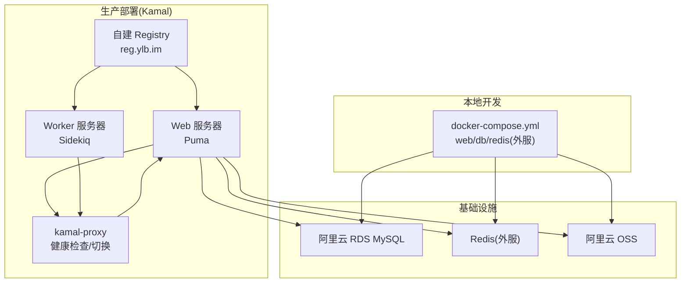
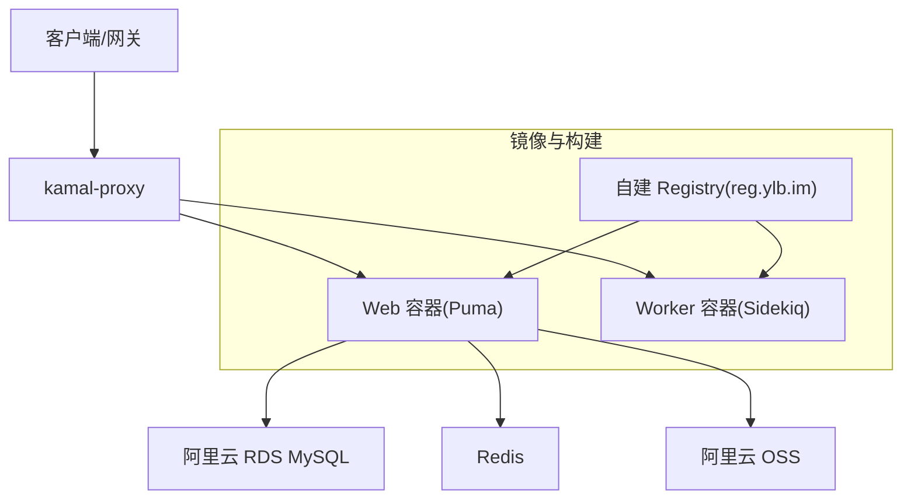
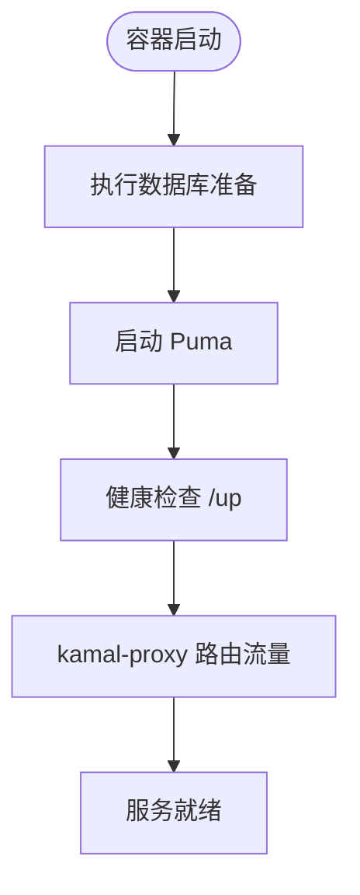
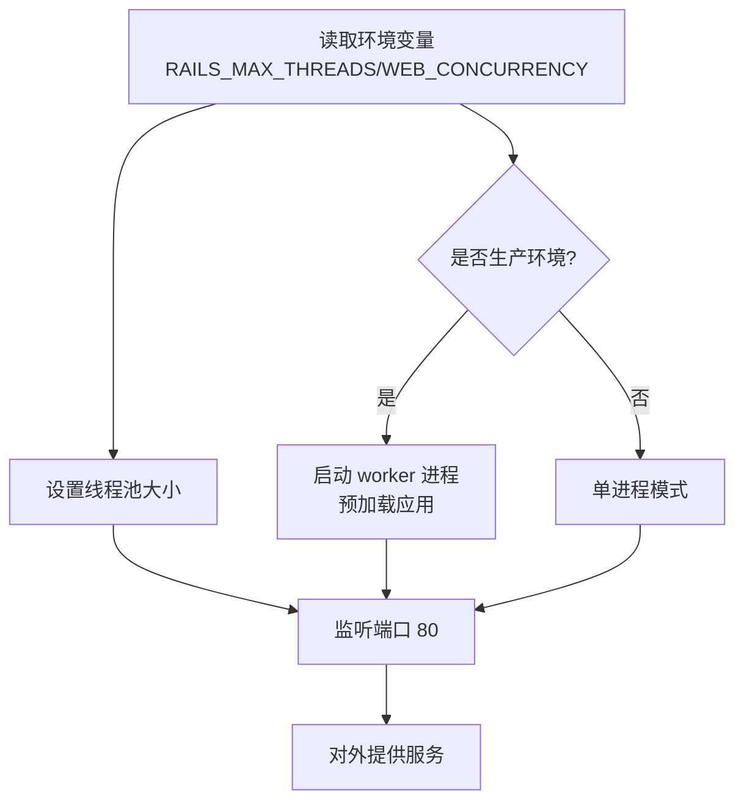
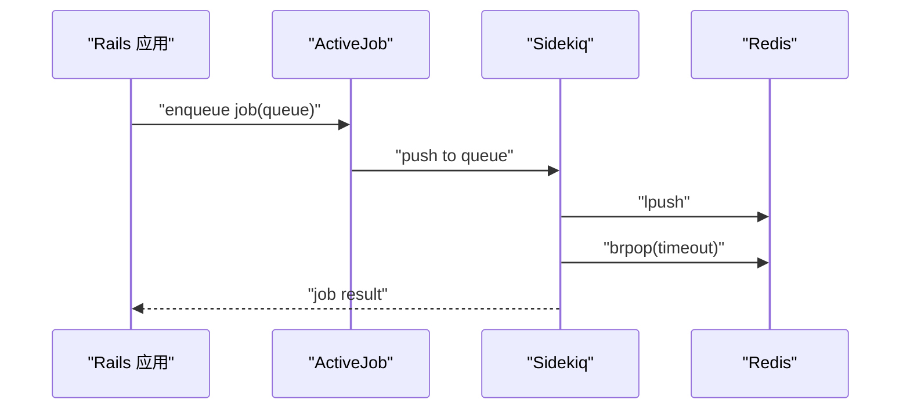
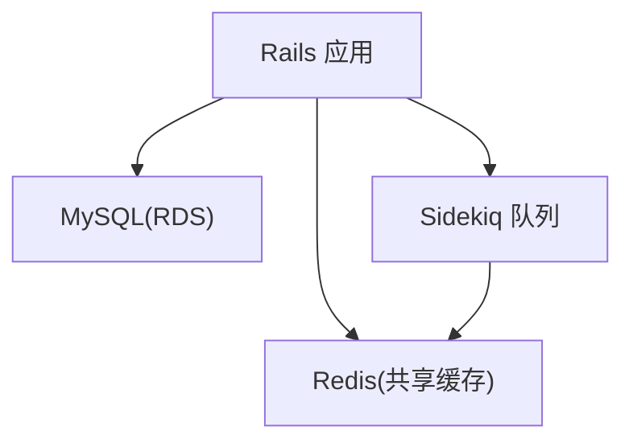
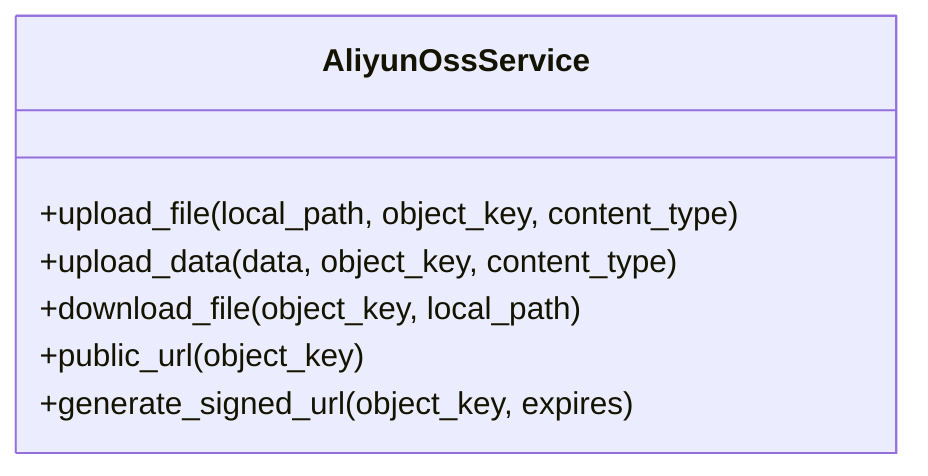
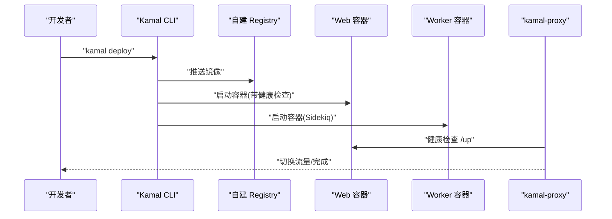
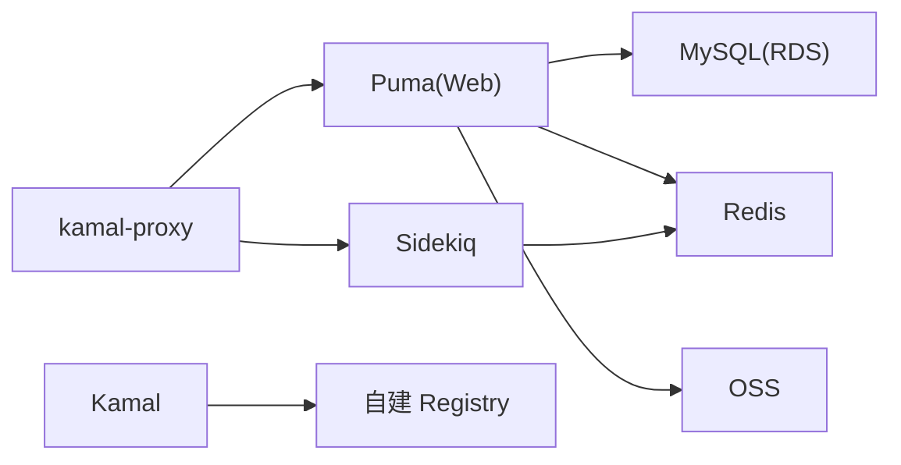

# 部署架构

<cite>
**本文引用的文件**
- [Dockerfile](file://Dockerfile)
- [docker-compose.yml](file://docker-compose.yml)
- [config/puma.rb](file://config/puma.rb)
- [config/sidekiq.yml](file://config/sidekiq.yml)
- [config/initializers/sidekiq.rb](file://config/initializers/sidekiq.rb)
- [config/deploy.yml](file://config/deploy.yml)
- [config/deploy.staging.yml](file://config/deploy.staging.yml)
- [config/environments/production.rb](file://config/environments/production.rb)
- [config/environments/development.rb](file://config/environments/development.rb)
- [config/database.yml](file://config/database.yml)
- [KAMAL_DEPLOYMENT.md](file://KAMAL_DEPLOYMENT.md)
- [DEPLOYMENT.md](file://DEPLOYMENT.md)
- [lib/aliyun_oss_service.rb](file://lib/aliyun_oss_service.rb)
- [config/initializers/aliyun_oss.rb](file://config/initializers/aliyun_oss.rb)
</cite>

## 目录
1. [简介](#简介)
2. [项目结构](#项目结构)
3. [核心组件](#核心组件)
4. [架构总览](#架构总览)
5. [详细组件分析](#详细组件分析)
6. [依赖关系分析](#依赖关系分析)
7. [性能考量](#性能考量)
8. [故障排查指南](#故障排查指南)
9. [结论](#结论)
10. [附录](#附录)

## 简介
本文件面向语音图书平台的部署与运维团队，系统性阐述容器化部署方案、多环境配置（开发、测试、生产）、Web 服务器（Puma）配置与进程管理、异步任务处理（Sidekiq）架构、数据库与缓存策略、对象存储（阿里云 OSS）集成，以及部署流程图与环境配置要点。目标是帮助读者快速理解并稳定交付系统。

## 项目结构
围绕部署的关键文件与目录如下：
- 容器与编排
  - Dockerfile：生产镜像构建脚本，含多阶段构建、国内镜像源优化、jemalloc 与 Bootsnap 预编译
  - docker-compose.yml：本地开发环境（Rails + MySQL），Sidekiq 通过 Kamal 独立部署
- Web 服务器与进程
  - config/puma.rb：Puma 线程数、worker 数、端口、预加载与 PID 文件配置
- 异步任务
  - config/sidekiq.yml：并发、队列、超时
  - config/initializers/sidekiq.rb：Sidekiq Redis 连接与日志配置
- 部署与环境
  - config/deploy.yml：生产环境 Kamal 配置（单 web + 单 worker，代理、超时、卷挂载）
  - config/deploy.staging.yml：测试环境 Kamal 配置
  - config/environments/production.rb：生产环境缓存、日志、强制 HTTPS
  - config/environments/development.rb：开发环境缓存与调试开关
  - config/database.yml：数据库连接池与多环境配置
- 对象存储
  - config/initializers/aliyun_oss.rb：OSS 客户端初始化
  - lib/aliyun_oss_service.rb：OSS 上传/下载/签名 URL 服务封装

图表来源
- [docker-compose.yml:1-53](file://docker-compose.yml#L1-L53)
- [config/deploy.yml:1-104](file://config/deploy.yml#L1-L104)
- [config/deploy.staging.yml:1-74](file://config/deploy.staging.yml#L1-L74)

章节来源
- [Dockerfile:1-63](file://Dockerfile#L1-L63)
- [docker-compose.yml:1-53](file://docker-compose.yml#L1-L53)
- [config/deploy.yml:1-104](file://config/deploy.yml#L1-L104)
- [config/deploy.staging.yml:1-74](file://config/deploy.staging.yml#L1-L74)

## 核心组件
- 容器镜像与构建
  - 多阶段构建，基础镜像使用国内镜像源，加速依赖安装；启用 jemalloc 与 Bootsnap 预编译以优化内存与启动速度
  - ENTRYPOINT 在容器启动时执行数据库准备；CMD 启动 Puma
- Web 服务器（Puma）
  - 线程数由环境变量控制；生产环境启用 worker 进程与预加载；端口默认 80，与 kamal-proxy app_port 保持一致
- 异步任务（Sidekiq）
  - 并发较低（2），队列包含支付、默认、导入、导出、邮件；通过统一 Redis URL 连接；日志按天轮转并输出到 stdout
- 数据库与缓存
  - 生产环境数据库连接池较大；缓存使用 Redis（共享于多容器）
- 对象存储（阿里云 OSS）
  - 初始化客户端与桶；提供上传、下载、签名 URL 生成能力

章节来源
- [Dockerfile:1-63](file://Dockerfile#L1-L63)
- [config/puma.rb:1-46](file://config/puma.rb#L1-L46)
- [config/sidekiq.yml:1-8](file://config/sidekiq.yml#L1-L8)
- [config/initializers/sidekiq.rb:1-22](file://config/initializers/sidekiq.rb#L1-L22)
- [config/environments/production.rb:1-75](file://config/environments/production.rb#L1-L75)
- [config/database.yml:1-39](file://config/database.yml#L1-L39)
- [config/initializers/aliyun_oss.rb:1-31](file://config/initializers/aliyun_oss.rb#L1-L31)
- [lib/aliyun_oss_service.rb:1-109](file://lib/aliyun_oss_service.rb#L1-L109)

## 架构总览
语音图书平台采用“容器 + 容器编排 + 反向代理”的生产部署架构。Web 与 Worker 分离部署，通过 kamal-proxy 实现零停机切换与健康检查。数据库、缓存与对象存储均为外部服务，确保高可用与弹性扩展。

图表来源
- [config/deploy.yml:1-104](file://config/deploy.yml#L1-L104)
- [config/deploy.staging.yml:1-74](file://config/deploy.staging.yml#L1-L74)

## 详细组件分析

### 容器化与镜像构建
- 多阶段构建与依赖优化
  - 基础镜像使用国内镜像源，加速 apt 与 gem 安装
  - jemalloc 与 Bootsnap 预编译减少内存占用与启动时间
- 运行时安全
  - 非 root 用户运行，仅授予运行时所需权限
- 启动流程
  - ENTRYPOINT 执行数据库准备；CMD 启动 Puma；容器暴露 80 端口

图表来源
- [Dockerfile:55-62](file://Dockerfile#L55-L62)
- [config/deploy.yml:78-95](file://config/deploy.yml#L78-L95)

章节来源
- [Dockerfile:1-63](file://Dockerfile#L1-L63)

### Web 服务器（Puma）配置与进程管理
- 线程与并发
  - 线程数由环境变量控制；生产环境启用 worker 进程与预加载，提升吞吐与稳定性
- 端口与健康检查
  - 端口默认 80，与 kamal-proxy app_port 一致；健康检查路径 /up
- PID 文件与重启
  - 支持 tmp_restart 插件，允许通过 Rails 命令重启

图表来源
- [config/puma.rb:28-45](file://config/puma.rb#L28-L45)

章节来源
- [config/puma.rb:1-46](file://config/puma.rb#L1-L46)

### 异步任务处理（Sidekiq）
- 队列与并发
  - 并发 2，队列包括支付、默认、导入、导出、邮件；适合后台任务与 IO 密集场景
- 连接与日志
  - 通过统一 Redis URL 连接；日志按天轮转并输出到 stdout，便于集中采集
- 启动方式
  - 通过 Kamal 在 worker 服务器上单独启动 Sidekiq

图表来源
- [config/sidekiq.yml:1-8](file://config/sidekiq.yml#L1-L8)
- [config/initializers/sidekiq.rb:9-21](file://config/initializers/sidekiq.rb#L9-L21)

章节来源
- [config/sidekiq.yml:1-8](file://config/sidekiq.yml#L1-L8)
- [config/initializers/sidekiq.rb:1-22](file://config/initializers/sidekiq.rb#L1-L22)

### 数据库与缓存策略
- 数据库
  - 开发/测试使用本地 MySQL；生产使用阿里云 RDS；连接池大小随环境调整
- 缓存
  - 生产环境使用 Redis 作为缓存存储，跨容器共享，提高响应速度

图表来源
- [config/database.yml:1-39](file://config/database.yml#L1-L39)
- [config/environments/production.rb:47-51](file://config/environments/production.rb#L47-L51)

章节来源
- [config/database.yml:1-39](file://config/database.yml#L1-L39)
- [config/environments/production.rb:1-75](file://config/environments/production.rb#L1-L75)

### 对象存储（阿里云 OSS）集成
- 初始化
  - 通过环境变量配置 OSS 端点、密钥与桶；初始化客户端与桶对象
- 服务封装
  - 提供上传文件/二进制数据、下载、生成签名 URL 等能力；异常统一抛出 UploadError

图表来源
- [lib/aliyun_oss_service.rb:9-109](file://lib/aliyun_oss_service.rb#L9-L109)

章节来源
- [config/initializers/aliyun_oss.rb:1-31](file://config/initializers/aliyun_oss.rb#L1-L31)
- [lib/aliyun_oss_service.rb:1-109](file://lib/aliyun_oss_service.rb#L1-L109)

### 多环境配置（开发、测试、生产）
- 开发环境
  - 使用本地 MySQL；缓存使用内存存储；开启详细日志与查询日志
- 测试环境
  - 使用独立数据库配置；与生产类似但资源较小
- 生产环境
  - 使用 Redis 共享缓存；强制 HTTPS；日志按文件轮转；数据库连接池较大

章节来源
- [config/environments/development.rb:1-59](file://config/environments/development.rb#L1-L59)
- [config/environments/production.rb:1-75](file://config/environments/production.rb#L1-L75)
- [config/database.yml:1-39](file://config/database.yml#L1-L39)

### 部署流程与零停机切换
- 生产部署（Kamal）
  - 单 web + 单 worker 服务器；镜像推送至自建 Registry；kamal-proxy 健康检查通过后切换流量；优雅下线与版本回滚
- 测试部署
  - 独立域名与环境变量；与生产类似但资源与配置更小
- 本地验证
  - 通过 docker-compose 快速验证；或本地 Docker 镜像构建与运行

图表来源
- [config/deploy.yml:1-104](file://config/deploy.yml#L1-L104)
- [config/deploy.staging.yml:1-74](file://config/deploy.staging.yml#L1-L74)
- [KAMAL_DEPLOYMENT.md:197-213](file://KAMAL_DEPLOYMENT.md#L197-L213)

章节来源
- [config/deploy.yml:1-104](file://config/deploy.yml#L1-L104)
- [config/deploy.staging.yml:1-74](file://config/deploy.staging.yml#L1-L74)
- [KAMAL_DEPLOYMENT.md:1-541](file://KAMAL_DEPLOYMENT.md#L1-L541)

## 依赖关系分析
- 组件耦合
  - Web 依赖数据库、Redis、OSS；Sidekiq 依赖 Redis；Kamal 依赖自建 Registry 与代理
- 外部依赖
  - 阿里云 RDS、Redis、OSS；国内网络优化（镜像源、Registry）
- 潜在风险
  - 端口不一致导致健康检查失败；db:prepare 未执行导致表缺失；时区配置不当导致日志时间不正确

图表来源
- [config/puma.rb:32](file://config/puma.rb#L32)
- [config/sidekiq.yml:1](file://config/sidekiq.yml#L1)
- [config/deploy.yml:17](file://config/deploy.yml#L17)
- [config/deploy.yml:80-87](file://config/deploy.yml#L80-L87)

章节来源
- [config/puma.rb:1-46](file://config/puma.rb#L1-L46)
- [config/sidekiq.yml:1-8](file://config/sidekiq.yml#L1-L8)
- [config/deploy.yml:1-104](file://config/deploy.yml#L1-L104)

## 性能考量
- Puma 并发
  - 线程数与 worker 数需结合 CPU 与 IO 特性调优；生产环境建议根据实例规格与负载压测结果调整
- 连接池
  - 数据库连接池与线程数需匹配，避免连接耗尽
- 缓存
  - Redis 共享缓存可显著降低数据库压力；注意过期策略与键空间设计
- 镜像与启动
  - jemalloc 与 Bootsnap 预编译有助于缩短启动时间与降低内存占用

## 故障排查指南
- 健康检查失败
  - 确认 Puma 端口与 kamal-proxy app_port 一致；检查 /up 路由可达
- 数据库连接失败
  - 检查 RDS 白名单与网络连通性；核对数据库凭据与数据库名
- db:prepare 未执行
  - 确保容器启动命令被入口脚本识别并执行数据库准备
- 时区与日志
  - 在部署配置中设置时区；确保日志轮转与采集正常
- 端口与安全组
  - 确保服务器安全组开放 80/443；容器端口映射与暴露一致

章节来源
- [KAMAL_DEPLOYMENT.md:251-270](file://KAMAL_DEPLOYMENT.md#L251-L270)
- [KAMAL_DEPLOYMENT.md:342-385](file://KAMAL_DEPLOYMENT.md#L342-L385)
- [KAMAL_DEPLOYMENT.md:429-442](file://KAMAL_DEPLOYMENT.md#L429-L442)

## 结论
本部署架构以容器化为核心，结合 Kamal 实现零停机部署与代理路由，Web 与 Worker 分离，配合外部数据库、缓存与对象存储，形成高可用、可扩展的生产环境。通过合理的 Puma 并发、Sidekiq 队列与缓存策略，以及严格的多环境配置与健康检查机制，能够稳定支撑语音图书平台的业务需求。

## 附录
- 环境变量清单（摘取）
  - 数据库：DATABASE_PRD_HOST/PORT/USERNAME/PASSWORD/DATABASE
  - 应用：RAILS_ENV/WEB_CONCURRENCY/RAILS_MAX_THREADS/TZ/SECRET_KEY_BASE
  - 对象存储：ALIYUN_ACCESS_KEY_ID/ALIYUN_ACCESS_KEY_SECRET/OSS_BUCKET_NAME/OSS_ENDPOINT/OSS_STS_ROLE_ARN
  - 缓存：REDIS_URL/REDIS_PASSWORD
- 常用部署命令
  - 本地验证：docker-compose up/down、docker build/run
  - 生产部署：kamal deploy、kamal rollback、kamal app exec

章节来源
- [config/deploy.yml:28-70](file://config/deploy.yml#L28-L70)
- [config/deploy.staging.yml:26-46](file://config/deploy.staging.yml#L26-L46)
- [DEPLOYMENT.md:146-228](file://DEPLOYMENT.md#L146-L228)