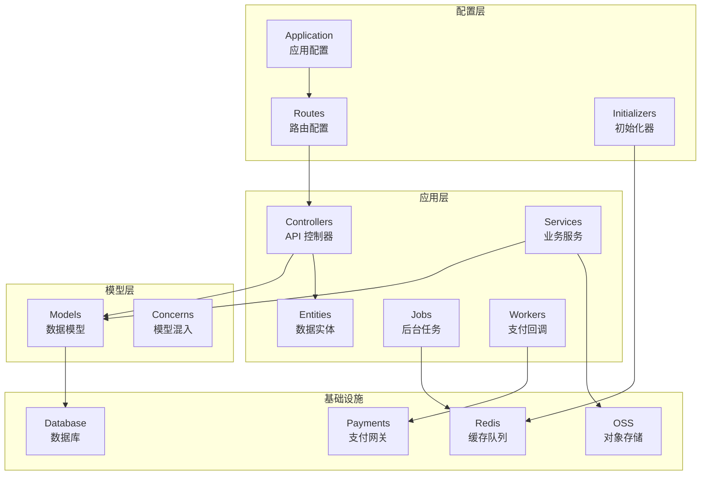
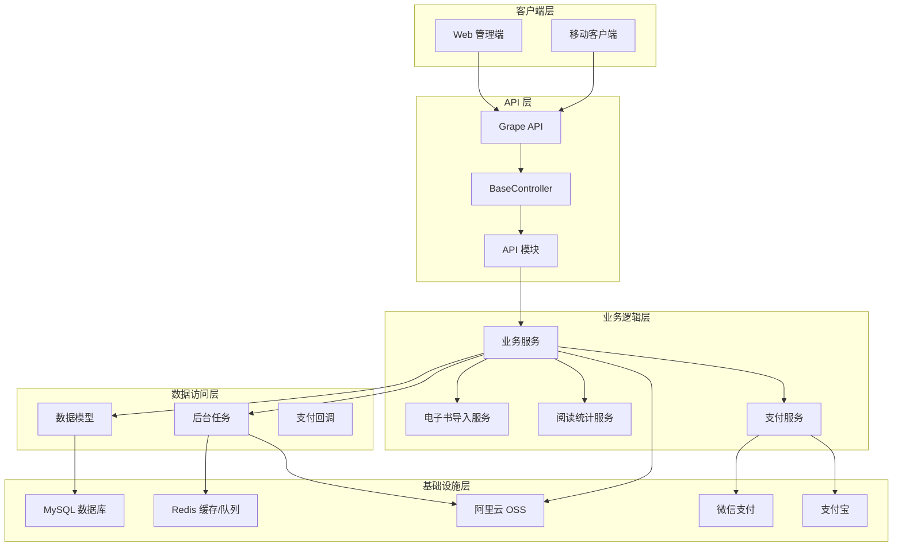
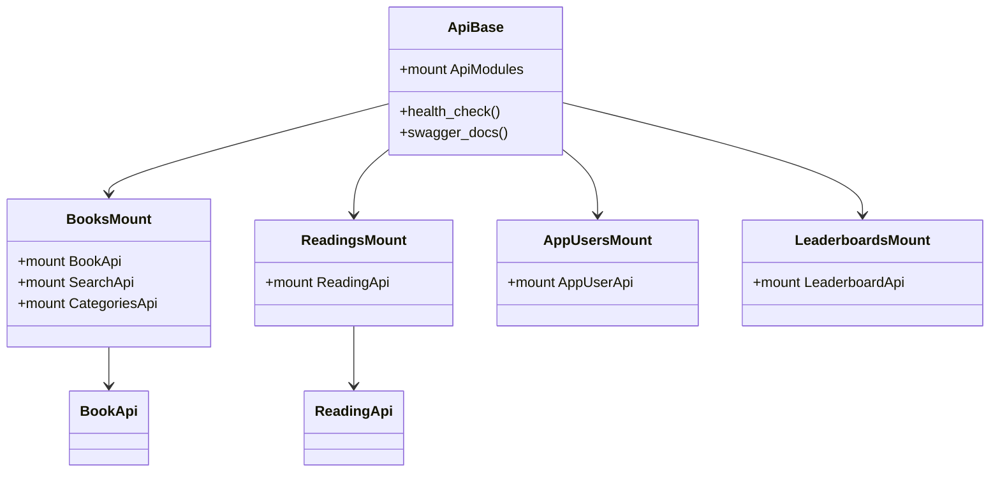
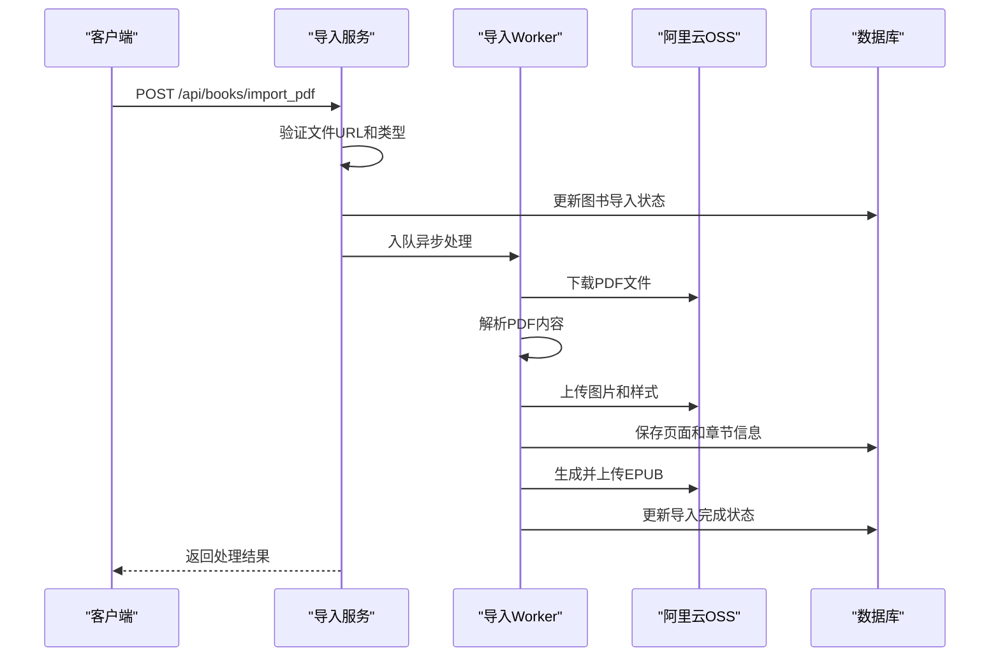
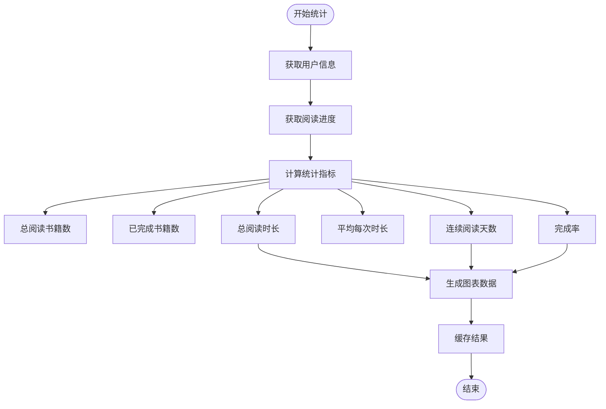
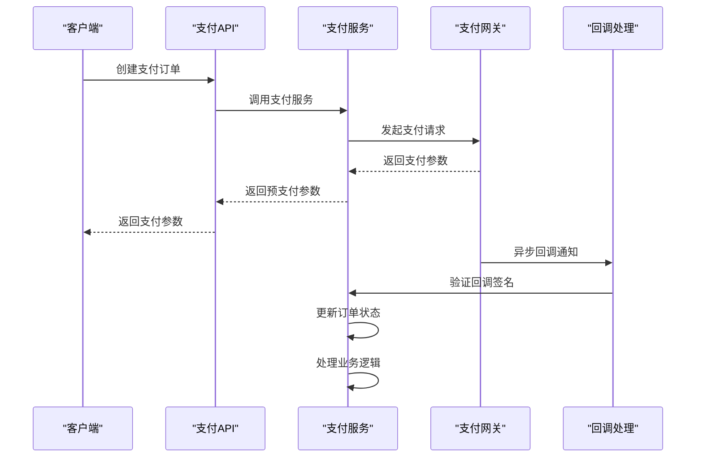
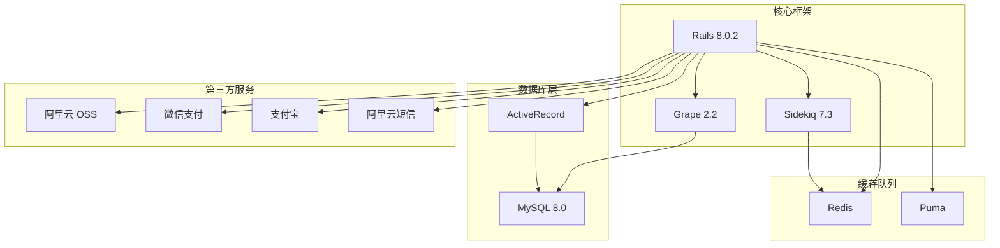

# 项目概览

<cite>
**本文档引用的文件**
- [README.md](file://README.md)
- [Gemfile](file://Gemfile)
- [config/application.rb](file://config/application.rb)
- [config/routes.rb](file://config/routes.rb)
- [app/controllers/application_controller.rb](file://app/controllers/application_controller.rb)
- [app/controllers/api/base.rb](file://app/controllers/api/base.rb)
- [app/controllers/api/books/mount.rb](file://app/controllers/api/books/mount.rb)
- [app/controllers/api/readings/mount.rb](file://app/controllers/api/readings/mount.rb)
- [app/models/book.rb](file://app/models/book.rb)
- [app/models/app_user.rb](file://app/models/app_user.rb)
- [app/services/ebook/import_service.rb](file://app/services/ebook/import_service.rb)
- [app/jobs/book_epub_import_worker.rb](file://app/jobs/book_epub_import_worker.rb)
- [app/services/reading/stats_service.rb](file://app/services/reading/stats_service.rb)
- [app/services/wechat_payment_service.rb](file://app/services/wechat_payment_service.rb)
- [config/deploy.yml](file://config/deploy.yml)
</cite>

## 目录
1. [项目简介](#项目简介)
2. [项目结构](#项目结构)
3. [核心组件](#核心组件)
4. [架构总览](#架构总览)
5. [详细组件分析](#详细组件分析)
6. [依赖关系分析](#依赖关系分析)
7. [性能考虑](#性能考虑)
8. [故障排除指南](#故障排除指南)
9. [结论](#结论)
10. [附录](#附录)

## 项目简介
VoiceBook 是一个面向儿童阅读的内容管理平台，支持电子书（PDF/EPUB）、有声书、视频和绘本等多种内容类型。后端采用 Rails 8.0.2 + Grape API + Sidekiq 架构，提供移动端调用的 API 接口，并通过 Kamal 部署到阿里云服务器。平台具备电子书导入导出、语音播放、用户管理、阅读统计、排行榜、家长管控、支付服务等核心功能。

**章节来源**
- [README.md:1-195](file://README.md#L1-L195)

## 项目结构
项目采用 Rails API-only 架构，采用模块化的 Grape API 设计，将不同业务域拆分为独立的 API 模块。核心目录结构如下：

**图表来源**
- [config/application.rb:16-81](file://config/application.rb#L16-L81)
- [config/routes.rb:4-30](file://config/routes.rb#L4-L30)

**章节来源**
- [config/application.rb:16-81](file://config/application.rb#L16-L81)
- [config/routes.rb:4-30](file://config/routes.rb#L4-L30)

## 核心组件
项目的核心组件包括用户系统、图书管理、阅读统计、支付服务、电子书处理等模块。各组件职责明确，通过清晰的接口进行交互。

### 用户系统
用户系统负责用户身份认证、设备绑定、阅读统计和家长管控等功能。支持多种登录方式（手机号+验证码、密码、微信、QQ）和角色管理（孩子、家长、管理员）。

### 图书管理系统
图书管理支持多种内容类型（电子书、有声书、视频、绘本），提供完整的图书生命周期管理，包括导入、导出、分类、标签等功能。

### 阅读统计系统
阅读统计系统跟踪用户的阅读行为，包括阅读时长、字数统计、进度跟踪、连续阅读天数等指标，并提供图表展示功能。

### 支付服务系统
支付服务系统集成微信支付和支付宝支付，提供预支付订单创建、回调验证、订单状态管理等功能。

**章节来源**
- [app/models/app_user.rb:36-140](file://app/models/app_user.rb#L36-L140)
- [app/models/book.rb:57-157](file://app/models/book.rb#L57-L157)
- [app/services/reading/stats_service.rb:4-140](file://app/services/reading/stats_service.rb#L4-L140)

## 架构总览
系统采用分层架构设计，前后端分离，API 服务通过 Grape 提供 RESTful 接口，后台任务通过 Sidekiq 异步处理。

**图表来源**
- [app/controllers/api/base.rb:5-65](file://app/controllers/api/base.rb#L5-L65)
- [config/application.rb:35-37](file://config/application.rb#L35-L37)
- [config/deploy.yml:10-17](file://config/deploy.yml#L10-L17)

**章节来源**
- [app/controllers/api/base.rb:5-65](file://app/controllers/api/base.rb#L5-L65)
- [config/application.rb:35-37](file://config/application.rb#L35-L37)
- [config/deploy.yml:10-17](file://config/deploy.yml#L10-L17)

## 详细组件分析

### API 架构设计
系统采用 Grape 框架构建 RESTful API，通过模块化设计将不同业务域分离到独立的 API 组件中。

**图表来源**
- [app/controllers/api/base.rb:24-38](file://app/controllers/api/base.rb#L24-L38)
- [app/controllers/api/books/mount.rb:4-12](file://app/controllers/api/books/mount.rb#L4-L12)
- [app/controllers/api/readings/mount.rb:3-9](file://app/controllers/api/readings/mount.rb#L3-L9)

**章节来源**
- [app/controllers/api/base.rb:24-38](file://app/controllers/api/base.rb#L24-L38)
- [app/controllers/api/books/mount.rb:4-12](file://app/controllers/api/books/mount.rb#L4-L12)
- [app/controllers/api/readings/mount.rb:3-9](file://app/controllers/api/readings/mount.rb#L3-L9)

### 电子书导入导出流程
系统支持 PDF 到 EPUB 的转换和 EPUB 文件的导入处理，采用异步任务队列处理耗时操作。

**图表来源**
- [app/services/ebook/import_service.rb:14-25](file://app/services/ebook/import_service.rb#L14-L25)
- [app/jobs/book_epub_import_worker.rb:17-25](file://app/jobs/book_epub_import_worker.rb#L17-L25)

**章节来源**
- [app/services/ebook/import_service.rb:14-25](file://app/services/ebook/import_service.rb#L14-L25)
- [app/jobs/book_epub_import_worker.rb:17-25](file://app/jobs/book_epub_import_worker.rb#L17-L25)

### 阅读统计服务
阅读统计服务提供用户阅读行为的数据分析和可视化展示。

**图表来源**
- [app/services/reading/stats_service.rb:6-28](file://app/services/reading/stats_service.rb#L6-L28)
- [app/services/reading/stats_service.rb:66-110](file://app/services/reading/stats_service.rb#L66-L110)

**章节来源**
- [app/services/reading/stats_service.rb:6-28](file://app/services/reading/stats_service.rb#L6-L28)
- [app/services/reading/stats_service.rb:66-110](file://app/services/reading/stats_service.rb#L66-L110)

### 支付服务架构
支付服务集成多种支付方式，提供安全可靠的支付处理能力。

**图表来源**
- [app/services/wechat_payment_service.rb:19-37](file://app/services/wechat_payment_service.rb#L19-L37)
- [app/services/wechat_payment_service.rb:43-64](file://app/services/wechat_payment_service.rb#L43-L64)

**章节来源**
- [app/services/wechat_payment_service.rb:19-37](file://app/services/wechat_payment_service.rb#L19-L37)
- [app/services/wechat_payment_service.rb:43-64](file://app/services/wechat_payment_service.rb#L43-L64)

## 依赖关系分析
项目采用现代化的 Ruby on Rails 技术栈，各组件间依赖关系清晰，耦合度适中。

**图表来源**
- [Gemfile:3-22](file://Gemfile#L3-L22)
- [config/application.rb:35-37](file://config/application.rb#L35-L37)

**章节来源**
- [Gemfile:3-22](file://Gemfile#L3-L22)
- [config/application.rb:35-37](file://config/application.rb#L35-L37)

## 性能考虑
系统在设计时充分考虑了性能优化，采用了多种策略来提升响应速度和吞吐量：

### 缓存策略
- Redis 缓存用户阅读统计数据，缓存有效期 30 秒
- 应用级缓存减少数据库查询压力
- OSS 对象存储提供 CDN 加速

### 异步处理
- Sidekiq 异步处理电子书导入导出任务
- 后台任务队列分离处理不同类型的工作
- 异步支付回调处理

### 数据库优化
- 合理的索引设计支持高频查询
- 分页查询限制默认每页 10 条记录
- 事务批量操作减少数据库往返

## 故障排除指南
常见问题及解决方案：

### 部署相关问题
- SSH 密钥权限错误：确保 `~/.ssh/id_rsa` 权限正确且已加载到 ssh-agent
- Docker 构建失败：检查 Docker Registry 凭证和网络连接
- Kamal 部署超时：根据数据库迁移时间调整部署超时配置

### API 接口问题
- CORS 跨域错误：检查前端域名配置和后端 CORS 设置
- Swagger 文档访问：确认文档接口认证配置
- 健康检查失败：检查容器日志和依赖服务状态

### 业务功能问题
- 电子书导入失败：检查 OSS 文件 URL 和文件格式
- 支付回调异常：验证支付网关回调签名和证书配置
- 阅读统计异常：检查 Redis 连接和缓存清理机制

**章节来源**
- [README.md:90-96](file://README.md#L90-L96)
- [config/deploy.yml:90-95](file://config/deploy.yml#L90-L95)

## 结论
VoiceBook 语音图书平台采用成熟的 Rails + Grape + Sidekiq 技术栈，构建了功能完整、架构清晰的儿童阅读内容管理平台。系统支持多种内容类型和支付方式，具备完善的用户管理和阅读统计功能。通过模块化设计和异步处理机制，系统具有良好的扩展性和维护性。建议在生产环境中重点关注缓存策略、异步任务监控和支付安全等方面，以确保系统的稳定运行。

## 附录

### 技术栈概览
- **后端框架**：Rails 8.0.2，Ruby 3.3.0
- **API 框架**：Grape 2.2 + Grape Entity
- **数据库**：MySQL 8.0 (utf8mb4)
- **缓存队列**：Redis + Sidekiq 7.3
- **部署**：Kamal + Docker + kamal-proxy
- **存储**：阿里云 OSS
- **渲染**：poppler-utils (pdftocairo)
- **测试**：RSpec + FactoryBot + Webmock

### 核心 API 端点
- `/api/books` - 图书列表
- `/api/books/:id` - 图书详情
- `/api/books/:id/pages` - 电子书页面清单
- `/api/books/:id/pages/:page_number` - 单页内容
- `/api/books/import_pdf` - 上传并导入 PDF
- `/api/books/export_epub` - 从 OSS 上的 PDF 导出 EPUB

### 部署架构
- **服务器**：阿里云 Ubuntu 114.215.208.190
- **域名**：api.zheliyuedu.cn
- **Docker Registry**：reg.ylb.im
- **Sidekiq 日志**：log/sidekiq.log (daily rotation)
- **Redis 策略**：建议改为 noeviction

**章节来源**
- [README.md:9-195](file://README.md#L9-L195)
- [config/deploy.yml:80-104](file://config/deploy.yml#L80-L104)