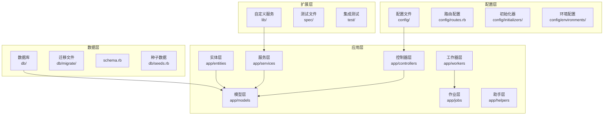
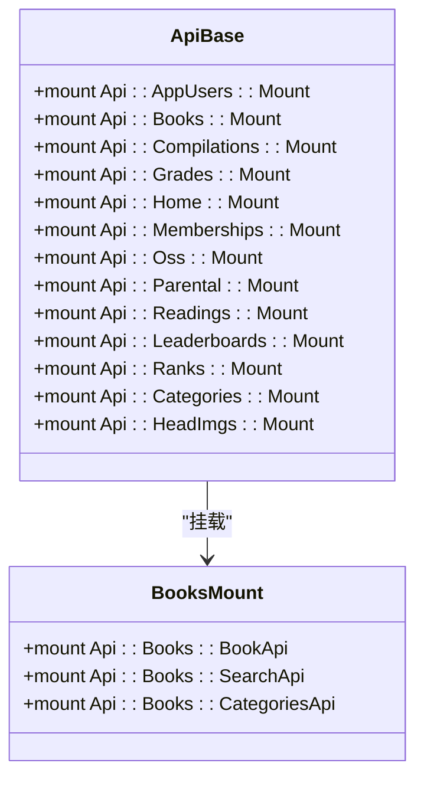
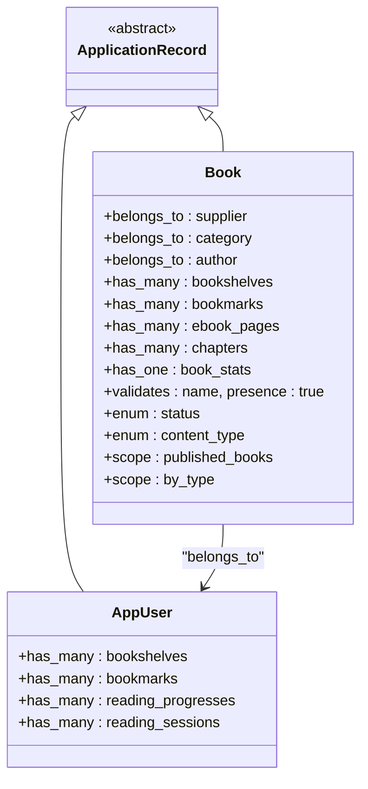
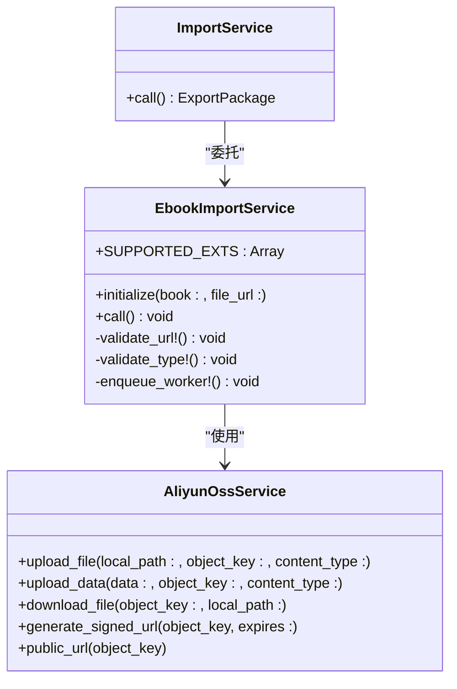
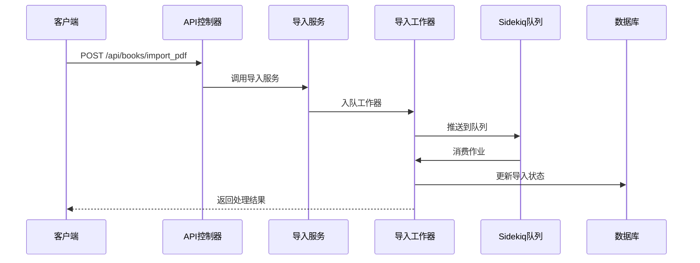
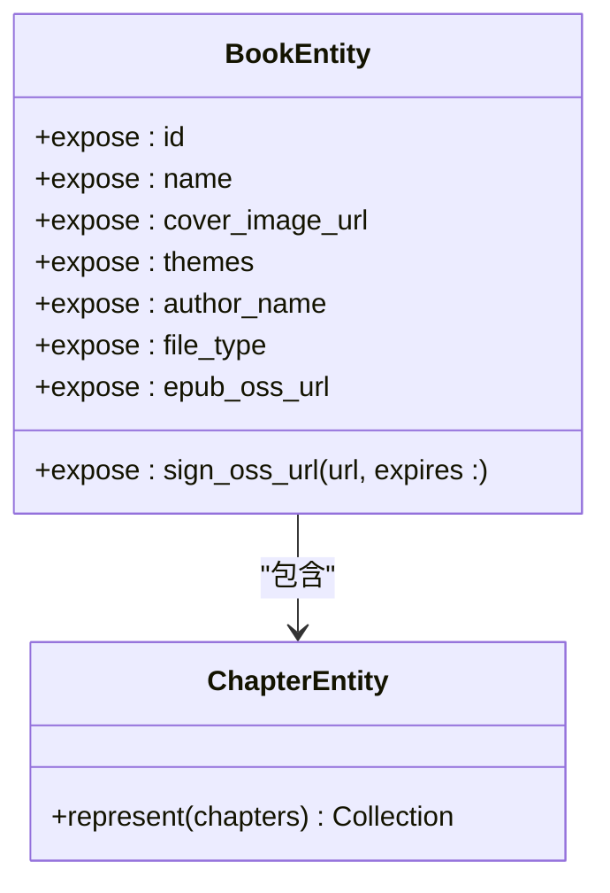
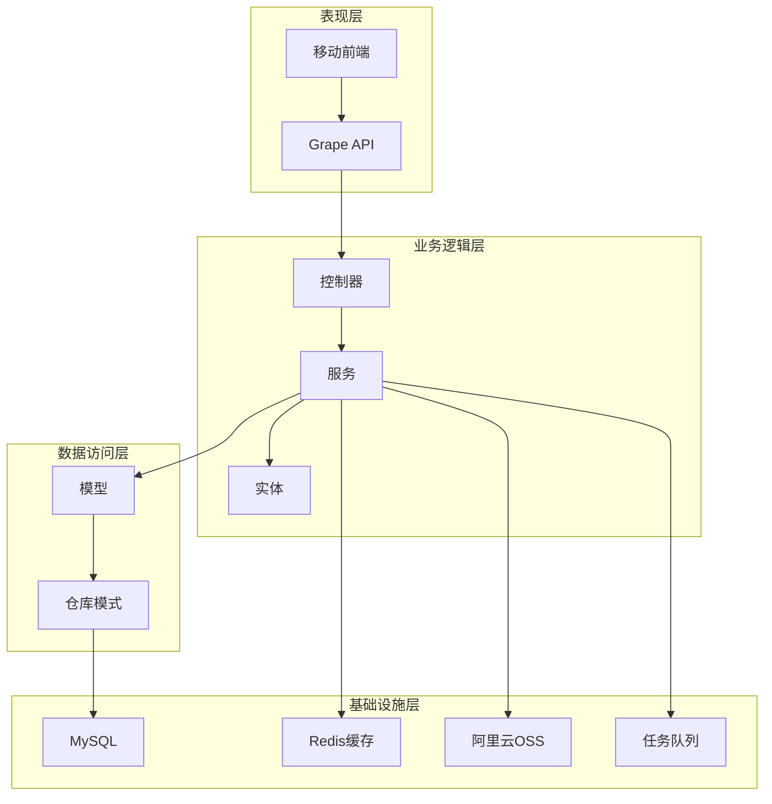
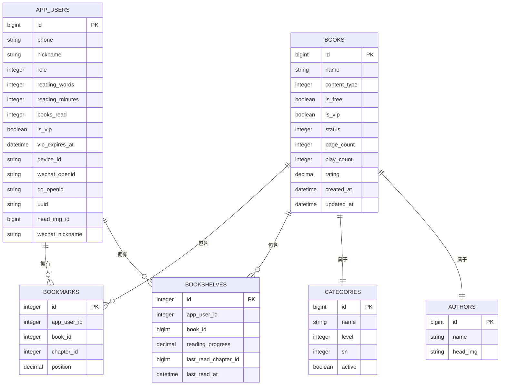
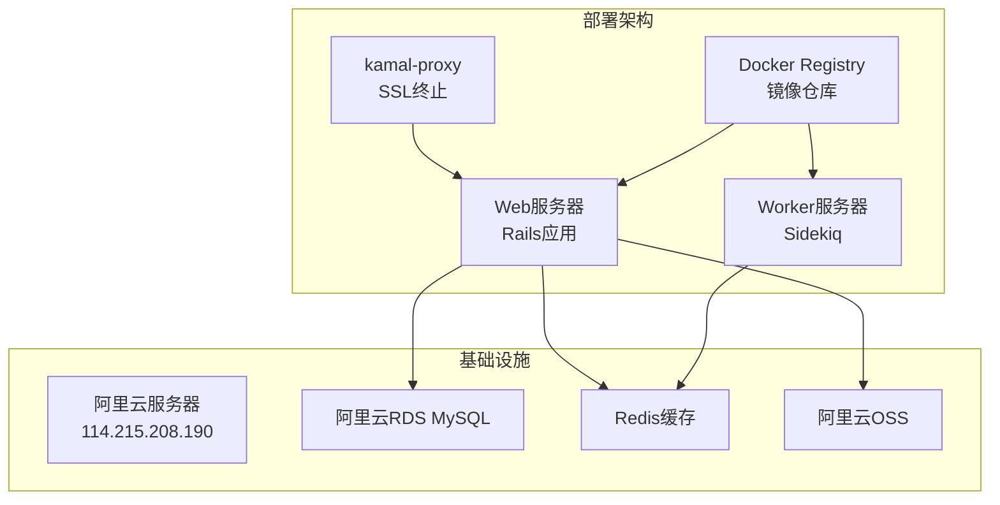

# 项目结构说明

<cite>
**本文档引用的文件**
- [README.md](file://README.md)
- [Gemfile](file://Gemfile)
- [config/application.rb](file://config/application.rb)
- [config/routes.rb](file://config/routes.rb)
- [app/controllers/application_controller.rb](file://app/controllers/application_controller.rb)
- [app/controllers/api/base.rb](file://app/controllers/api/base.rb)
- [app/controllers/api/books/mount.rb](file://app/controllers/api/books/mount.rb)
- [app/models/application_record.rb](file://app/models/application_record.rb)
- [app/models/book.rb](file://app/models/book.rb)
- [app/entities/book.rb](file://app/entities/book.rb)
- [app/services/ebook/import_service.rb](file://app/services/ebook/import_service.rb)
- [app/jobs/application_job.rb](file://app/jobs/application_job.rb)
- [lib/aliyun_oss_service.rb](file://lib/aliyun_oss_service.rb)
- [db/schema.rb](file://db/schema.rb)
- [config/deploy.yml](file://config/deploy.yml)
</cite>

## 目录
1. [项目简介](#项目简介)
2. [项目结构概览](#项目结构概览)
3. [核心组件详解](#核心组件详解)
4. [架构设计](#架构设计)
5. [配置文件说明](#配置文件说明)
6. [数据库设计](#数据库设计)
7. [部署配置](#部署配置)
8. [开发指南](#开发指南)

## 项目简介

VoiceBook 是一个基于 Rails 8.0.2 + Grape API + Sidekiq 异步处理的儿童阅读内容管理平台。该项目支持电子书（PDF/EPUB）、有声书、视频和绘本等多种内容类型的管理，并提供完整的 API 接口供移动端调用。

## 项目结构概览

**图表来源**
- [config/application.rb:16-81](file://config/application.rb#L16-L81)
- [config/routes.rb:1-30](file://config/routes.rb#L1-L30)

## 核心组件详解

### 控制器层 (Controllers)

VoiceBook 采用 Grape API 架构，所有 API 接口都通过 Grape 模块进行组织：

**图表来源**
- [app/controllers/api/base.rb:24-38](file://app/controllers/api/base.rb#L24-L38)
- [app/controllers/api/books/mount.rb:6-10](file://app/controllers/api/books/mount.rb#L6-L10)

**章节来源**
- [app/controllers/api/base.rb:1-65](file://app/controllers/api/base.rb#L1-L65)
- [app/controllers/api/books/mount.rb:1-13](file://app/controllers/api/books/mount.rb#L1-L13)

### 模型层 (Models)

模型层采用 ActiveRecord 设计，包含完整的业务实体关系：

**图表来源**
- [app/models/application_record.rb:1-4](file://app/models/application_record.rb#L1-L4)
- [app/models/book.rb:57-157](file://app/models/book.rb#L57-L157)

**章节来源**
- [app/models/application_record.rb:1-4](file://app/models/application_record.rb#L1-L4)
- [app/models/book.rb:1-157](file://app/models/book.rb#L1-L157)

### 服务层 (Services)

服务层负责复杂的业务逻辑处理：

**图表来源**
- [app/services/ebook/import_service.rb:4-70](file://app/services/ebook/import_service.rb#L4-L70)
- [lib/aliyun_oss_service.rb:9-109](file://lib/aliyun_oss_service.rb#L9-L109)

**章节来源**
- [app/services/ebook/import_service.rb:1-70](file://app/services/ebook/import_service.rb#L1-L70)
- [lib/aliyun_oss_service.rb:1-109](file://lib/aliyun_oss_service.rb#L1-L109)

### 作业层 (Jobs)

异步作业处理后台任务：

**图表来源**
- [app/services/ebook/import_service.rb:61-67](file://app/services/ebook/import_service.rb#L61-L67)
- [config/application.rb:35-37](file://config/application.rb#L35-L37)

**章节来源**
- [app/jobs/application_job.rb:1-8](file://app/jobs/application_job.rb#L1-L8)

### 实体层 (Entities)

Grape Entity 用于 API 响应数据格式化：

**图表来源**
- [app/entities/book.rb:4-58](file://app/entities/book.rb#L4-L58)

**章节来源**
- [app/entities/book.rb:1-58](file://app/entities/book.rb#L1-L58)

## 架构设计

VoiceBook 采用分层架构设计，各层职责明确：

**图表来源**
- [config/application.rb:35-37](file://config/application.rb#L35-L37)
- [Gemfile:19-22](file://Gemfile#L19-L22)

## 配置文件说明

### 应用配置 (config/application.rb)

应用配置文件定义了系统的核心行为：

- **自动加载配置**: 自动加载 lib 目录，但忽略 assets 和 tasks
- **实体类加载**: 通过 initializer 显式 require 加载，避免与模型名冲突
- **国际化配置**: 默认语言为中文，时区为北京时间
- **API配置**: API-only 模式，禁用视图渲染
- **队列配置**: 使用 Sidekiq 作为后台任务队列
- **CORS配置**: 允许跨域访问，暴露必要的分页头部信息
- **中间件**: 包含文档认证中间件和请求日志中间件

**章节来源**
- [config/application.rb:16-81](file://config/application.rb#L16-L81)

### 路由配置 (config/routes.rb)

路由配置采用 Grape API 架构：

- **健康检查**: `/up` 端点用于负载均衡和 Docker 健康检查
- **API挂载**: 将 Api::Base 挂载到 `/api` 路径
- **根路由**: 提供简单的欢迎页面

**章节来源**
- [config/routes.rb:1-30](file://config/routes.rb#L1-L30)

### 环境配置

项目包含三个主要环境配置：

- **development.rb**: 开发环境配置，启用详细日志和调试功能
- **production.rb**: 生产环境配置，优化性能和安全性
- **test.rb**: 测试环境配置，隔离测试数据

**章节来源**
- [config/application.rb:18-20](file://config/application.rb#L18-L20)

## 数据库设计

### 核心数据模型

**图表来源**
- [db/schema.rb:115-157](file://db/schema.rb#L115-L157)
- [db/schema.rb:23-49](file://db/schema.rb#L23-L49)
- [db/schema.rb:184-192](file://db/schema.rb#L184-L192)

### 数据迁移策略

项目采用渐进式数据迁移策略：

- **版本化迁移**: 所有数据库变更通过迁移文件记录
- **数据同步**: 支持从其他系统（如 zheliread）同步数据
- **字段演进**: 通过迁移文件逐步添加新字段和索引
- **数据完整性**: 通过验证和索引保证数据一致性

**章节来源**
- [db/schema.rb:1-200](file://db/schema.rb#L1-L200)

## 部署配置

### Kamal 部署架构

**图表来源**
- [config/deploy.yml:8-17](file://config/deploy.yml#L8-L17)
- [config/deploy.yml:78-87](file://config/deploy.yml#L78-L87)

### 部署配置细节

- **服务器配置**: 单台 Web 服务器 + 单台 Worker 服务器
- **Docker配置**: 使用 kamal 进行容器编排
- **环境变量**: 通过 Kamal secret 管理敏感配置
- **健康检查**: 通过 /up 端点进行健康检查
- **SSL配置**: 由阿里云 SLB 处理 SSL 终止

**章节来源**
- [config/deploy.yml:1-104](file://config/deploy.yml#L1-L104)

## 开发指南

### 开发环境搭建

1. **系统要求**: Ruby 3.3.0, MySQL 8.0, poppler-utils
2. **依赖安装**: `bundle install`
3. **数据库初始化**: `bundle exec rake db:create db:migrate db:seed`
4. **启动服务**: 
   - Web: `bundle exec puma -C config/puma.rb`
   - Worker: `bundle exec sidekiq -C config/sidekiq.yml`

### 测试策略

项目采用 RSpec 测试框架：

- **单元测试**: 针对模型、服务和作业的测试
- **集成测试**: 针对 API 接口的测试
- **工厂测试**: 使用 FactoryBot 创建测试数据
- **覆盖率**: 使用 SimpleCov 进行代码覆盖率分析

### 代码规范

- **编码风格**: 使用 RuboCop 进行代码风格检查
- **注释规范**: 使用 YARD 注释文档
- **提交规范**: 遵循约定式提交规范
- **分支管理**: 使用 Git Flow 进行版本控制

**章节来源**
- [README.md:106-126](file://README.md#L106-L126)
- [Gemfile:25-44](file://Gemfile#L25-L44)